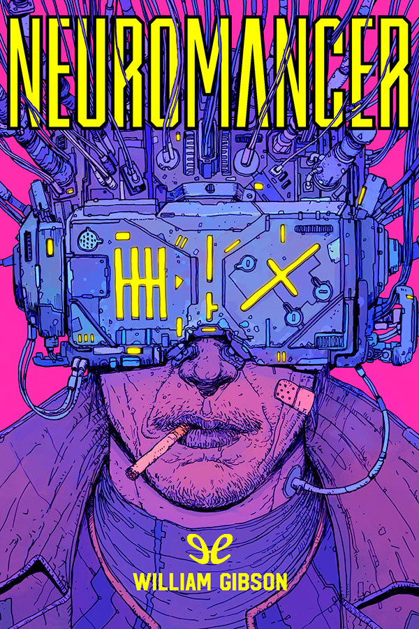
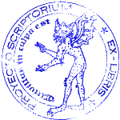
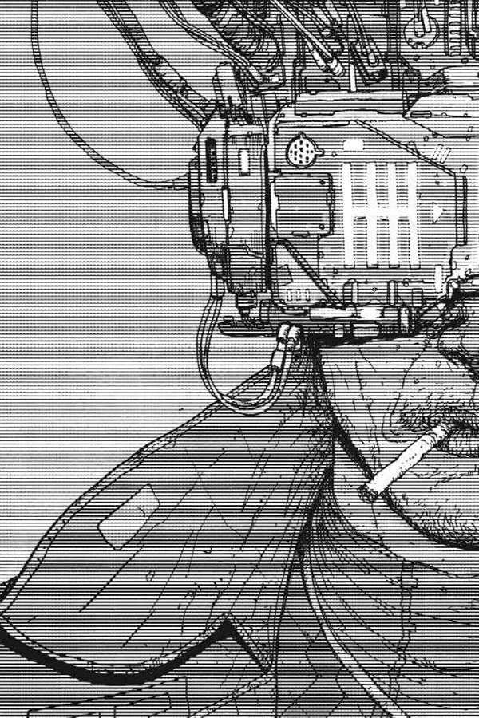

[]{#cubierta.xhtml}

#  {.cubierta title="پوشش"}

[]{#sinopsis.xhtml}

ماتریکس: توهمی توافقی که روزانه توسط میلیاردها کاربر تجربه می‌شود. جهانی در درون جهان...

«کیس» داغ‌ترین کابوی کامپیوتر بود که در بزرگراه اطلاعاتی می‌تاخت - هوشیاری‌اش را به فضای مجازی تزریق می‌کرد، در میان شبکه‌های لمسی داده و منطق پرواز می‌کرد، و اسرار رمزگذاری شده را برای هر کسی که پول خرید مهارت‌هایش را داشت، می‌ربود. سپس به اشتباه به افراد اشتباهی پشت کرد، کسانی که به شدت او را گیر انداختند - و استعداد را ذره به ذره از مغزش سوزاندند. او که از فضای مجازی تبعید شده بود و در جسم فیزیکی خود گرفتار شده بود، در دنیای زیرزمینی با فناوری پیشرفته مرگ را در آغوش می‌کشید. تا اینکه یک توطئه سایه‌وار به او فرصتی دوباره - و درمانی - پیشنهاد داد... به چه قیمتی...
:::

[]{#عنوان.xhtml}

{width="100%"}

ویلیام گیبسون

# نورومنسر {.ttitulo}

سه‌گانه‌ی اسپراول: ۰۱

ePub r1.1

تماشاگر [۰۳.۰۹.۱۷]{.tfecha}

[]{#info.xhtml}

::: info
عنوان اصلی: *نورومنسر*

ویلیام گیبسون، ۱۹۸۴

تصویر جلد: Josan Gonzalez

ویرایشگر دیجیتال: ناظر

ePub پایه r1.2
:::

{height="20%"}

[]{#dedicatoria.xhtml}

::: {.dedicatoria .centrado}
برای دب

چه کسی آن را ممکن ساخت

با عشق
:::

[]{#PART1.xhtml}

# بخش اول {.heren3 title="بخش اول: بلوز شهر چیبا"}

بلوز چیبا سیتی

[]{#C1.xhtml}

## ۱ {.heren2}

[آسمان بالای]{.small} بندر به رنگ تلویزیونی بود که روی کانال مرده تنظیم شده بود.

"انگار که من مصرف نمی‌کنم،" کیز شنید که کسی می‌گوید، در حالی که خود را از میان جمعیت اطراف در چت بیرون می‌کشید. "انگار بدنم دچار کمبود شدید مواد مخدر شده." صدایی از اسپراول و شوخی‌ای از اسپراول بود. چاتسوبو بار مهاجران حرفه‌ای بود؛ می‌توانستید یک هفته آنجا بنوشید و هرگز دو کلمه ژاپنی نشنوید.

راتز پشت بار بود و بازوی مصنوعی‌اش با حرکتی یکنواخت لیوان‌های آبجو کرین را پر می‌کرد. کیس را دید و لبخندی زد، دندان‌هایش شبکه‌ای از فولاد اروپای شرقی و پوسیدگی قهوه‌ای بود. کیس جایی را در کنار بار پیدا کرد، بین برنزه شدن غیرمعمول یکی از فاحشه‌های لانی زون و یونیفرم مرتب دریایی یک آفریقایی قدبلند که استخوان گونه‌هایش با ردیف‌های دقیق زخم‌های قبیله‌ای برجسته شده بود. راتز با دست سالم خود یک لیوان آبجو را روی بار هل داد و گفت: «وِیج زود اینجا بود، با دو تا جوانی که می‌خواستند کار کنند. شاید کاری با تو داشته باشد، کیس؟»

کیس شانه بالا انداخت. دختر سمت راستش خندید و به او ضربه زد.

لبخند متصدی بار پهن‌تر شد. زشتی او زبانزد خاص و عام بود. در
عصری که زیبایی ارزان بود، در زشتی او چیزی حماسی وجود داشت. بازوی
عتیقه با ناله به سمت یک لیوان دیگر رفت. یک پروتز نظامی روسی بود،
یک دستکار با بازخورد نیرو با هفت عملکرد، که در پلاستیک صورتی
کثیف پوشانده شده بود. "شما بیش از حد هنرمند هستید، آقای کیس." راتز
غرولند کرد؛ آن صدا برای او حکم خنده را داشت. با چنگال صورتی شکم
آویزان سفیدپوش خود را خاراند. "شما هنرمند معامله کمی خنده‌دار هستید."

"حتماً،" کیز گفت و از آبجویش نوشید. "یکی باید اینجا بامزه باشه. مطمئنم که تو نیستی."

خنده فاحشه یک پرده بالا رفت.

"تو هم همینطور، خواهر. پس ناپدید شو، باشه؟ زون، او دوست صمیمی من است."

او به چشم‌های کیس نگاه کرد و صدایی شبیه به تف کردن، که به سختی از لب‌هایش خارج می‌شد، ایجاد کرد.
اما او رفت.

"عیسی،" کیس گفت، "چه جور خرابکاری راه انداختی اینجا؟ آدم نمی‌تونه یه نوشیدنی بخوره."

"ها،" رتز گفت و با پارچه‌ای روی چوب زخمی کشید. "منطقه درصدی را نشان می‌دهد. تو را برای سرگرمی اینجا نگه می‌دارم."

هنگامی که کیس داشت آبجویش را برمی‌داشت، یکی از آن لحظات عجیب سکوت فرود آمد، گویی صد گفتگوی نامرتبط همزمان به یک مکث رسیده بودند. سپس خنده فاحشه طنین‌انداز شد، که با مقداری هیستری آمیخته بود.

راتز غرولند. "فرشته‌ای رد شد."

"چینی‌ها،" فریاد زد یک استرالیایی مست، "چینی‌ها لعنتی پیوند اعصاب را اختراع کردند. برای یک کار عصبی هر روز سرزمین اصلی را به من بده. درستت می‌کنم، رفیق..."

"حالا این،" کیس خطاب به لیوانش گفت، تمام تلخی‌اش ناگهان مثل صفرا در وجودش بالا آمد، "این همه چرندیات است."

[ژاپنی‌ها]{.small} چیزهای بیشتری از جراحی مغز و اعصاب را فراموش کرده بودند که چینی‌ها هرگز نمی‌دانستند. کلینیک‌های سیاه چیبا در خط مقدم بودند، کل بدن تکنیک‌ها ماهانه جایگزین می‌شدند، و با این حال آن‌ها نتوانستند آسیبی را که او در آن هتل ممفیس دیده بود، ترمیم کنند.

یک سال اینجا و او هنوز رویای فضای مجازی را می‌دید، امید شبانه رنگ می‌باخت. تمام سرعتی که او گرفت، تمام پیچ‌هایی که او در شهر شب طی کرده بود و گوشه‌هایی که بریده بود، و هنوز هم ماتریس را در خواب می‌دید، شبکه‌های روشن منطق که در آن خلأ بی‌رنگ باز می‌شد... اسپراول اکنون راهی طولانی و عجیب به سوی خانه بر فراز اقیانوس آرام بود، و او مرد کنسول نبود، کابوی فضای مجازی نبود. فقط یک دلال دیگر، که سعی می‌کرد از پس آن برآید. اما رویاها در شب ژاپنی مانند وودوی سیم زنده می‌آمدند، و او برای آن گریه می‌کرد، در خواب گریه می‌کرد، و تنها در تاریکی بیدار می‌شد، در کپسولش در هتلی تابوتی، دستانش را در تختخواب چنگ می‌زد، فوم دمپر بین انگشتانش جمع شده بود، سعی می‌کرد به کنسولی که آنجا نبود برسد.

"دیشب دخترت را دیدم،" رتز گفت و دومین کرین را به کیس داد.

«من یکی ندارم»، او گفت و نوشید.

"خانم لیندا لی."

کیس سرش را تکان داد.

"دختر نه؟ هیچی؟ فقط بیزنس، رفیق هنرمند؟ وقف تجارت؟"
چشمان قهوه‌ای ریز متصدی بار در گوشت چروکیده‌ای فرو رفته بود. "فکر کنم قبلاً، وقتی اون بود، بیشتر دوستت داشتم. بیشتر می‌خندیدی. حالا، بعضی شب‌ها، شاید زیادی هنری بشی؛ آخرش تو تانک‌های کلینیک، قطعات یدکی."

"قلبم را می‌شکنی، رتز." او آبجویش را تمام کرد، پولش را داد و رفت،
شانه‌های باریک و بلندش زیر بادگیر نایلونی خاکی رنگ و لکه‌دار از باران خم شده بود. در میان جمعیت نین‌سِی راه باز می‌کرد، بوی عرق مانده خودش را حس می‌کرد.

[پرونده بیست]{.small}-[دو]{.small}. در بیست و دو سالگی، او یک
گاوچران، یک دزد احشام، یکی از بهترین‌ها در اسپراول بود. او توسط بهترین‌ها، توسط مک‌کوی پولی و بابی کوین، افسانه‌های این حرفه، آموزش دیده بود. او تقریباً به طور دائم در اوج آدرنالین زندگی می‌کرد، محصول جانبی جوانی و مهارت، که به یک دک سفارشی سایبر اسپیس متصل بود که هوشیاری بی‌بدنش را به توهم توافقی که ماتریکس بود، پرتاب می‌کرد. او به عنوان یک دزد، برای دزدان ثروتمندتر کار می‌کرد، کارفرمایانی که نرم‌افزارهای عجیب و غریب مورد نیاز برای نفوذ به دیوارهای روشن سیستم‌های شرکتی را فراهم می‌کردند و پنجره‌هایی را به سوی میدان‌های غنی داده باز می‌کردند.

او اشتباه کلاسیک را مرتکب شده بود، همان اشتباهی که قسم خورده بود هرگز انجام ندهد. او از کارفرمایانش دزدی کرد. چیزی را برای خودش نگه داشت و سعی کرد آن را از طریق یک واسطه در آمستردام رد کند. او هنوز مطمئن نبود که چگونه لو رفته است، نه اینکه اکنون اهمیتی داشته باشد. او انتظار داشت بمیرد، اما آنها فقط لبخند زدند. البته به او گفتند که خوش آمدید، خوش آمدید به پول. و او به آن نیاز داشت. چون - همچنان لبخند می‌زدند - آنها مطمئن می‌شدند که او دیگر هرگز کار نخواهد کرد.

سیستم عصبی او را با یک مایکوتوکسین روسی دوران جنگ آسیب رساندند.

او که در هتلی در ممفیس به تخت بسته شده بود و استعدادش ذره ذره می‌سوخت، سی ساعت دچار توهم بود.

آسیب ناچیز، ظریف و کاملاً مؤثر بود.

برای کیس، که برای سرخوشی بی‌بدن فضای مجازی زندگی کرده بود، این سقوط بود. در باره‌هایی که به عنوان یک کابوی ماهر رفت و آمد می‌کرد، موضع نخبگان شامل نوعی تحقیر آرام برای جسم بود. بدن گوشت بود. کیس در زندان جسم خود افتاد.

[کل دارایی‌های او]{.small} به سرعت به ین جدید تبدیل شد، دسته‌ای پر از پول کاغذی قدیمی که بی‌وقفه در مدار بسته بازارهای سیاه جهان مانند صدف‌های جزایر تروبریاند در گردش بود. انجام معاملات قانونی با پول نقد در اسپراول دشوار بود؛ در ژاپن، این کار از قبل غیرقانونی بود.

در ژاپن، او با اطمینانی گره‌خورده و مطلق می‌دانست که درمانش را پیدا خواهد کرد. در چیبا. چه در یک کلینیک ثبت‌شده و چه در سایه‌روشنِ طب سیاه. چیبا که مترادف با ایمپلنت‌ها، پیوند اعصاب و میکروبایونیک بود، آهنربایی برای خرده‌فرهنگ‌های جنایتکارِ تکنولوژیکِ اسپراول بود.

در چیبا، او ین جدید خود را در دو ماه رفت و آمد به امتحانات و مشاوره‌ها ناپدید شده دید. مردان در کلینیک‌های سیاه، آخرین امید او، از مهارتی که با آن مثله شده بود، شگفت‌زده شدند و سپس به آرامی سر تکان دادند.

اکنون او در ارزان‌ترین تابوت‌ها می‌خوابید، آن‌هایی که نزدیک‌ترین به بندر بودند، زیر
نورافکن‌های کوارتز-هالوژن که اسکله‌ها را تمام شب مانند صحنه‌های وسیع روشن می‌کردند؛
جایی که نمی‌توانستید نورهای توکیو را به خاطر درخشش
آسمان تلویزیونی ببینید، حتی لوگوی هولوگرافیک غول‌پیکر شرکت فوجی الکتریک را هم نمی‌توانستید ببینید، و خلیج توکیو پهنه‌ای سیاه بود که مرغان دریایی بر فراز دسته‌های شناور فوم‌های سفید می‌چرخیدند. پشت بندر شهر قرار داشت،
گنبد کارخانه‌ها که با مکعب‌های عظیم آرکولوژی‌های شرکتی غالب شده بودند. بندر و شهر
توسط یک مرز باریک از خیابان‌های قدیمی از هم جدا شده بودند، منطقه‌ای بدون نام رسمی. شهر شب، با نینسی در قلب آن. در روز، بارها در نینسی بسته و بی‌شکل بودند، نئون‌ها خاموش، هولوگرام‌ها بی‌حرکت، در انتظار، زیر آسمان نقره‌ای مسموم.

[دو بلوک به سمت غرب]{.small} از چت، در چایخانه‌ای به نام Jarre de
Thé، کیس اولین قرص شب خود را با یک اسپرسوی دوبل پایین فرستاد.
این یک هشت‌ضلعی صورتی تخت بود، گونه‌ای قوی از دکس برزیلی که او از
یکی از دختران زون خریده بود.

دیوارهای "جار" با آینه‌ها پوشیده شده بود و هر پنل با نئون قرمز قاب گرفته شده بود.

در ابتدا، وقتی خود را در چیبا، با پولی کم و امیدی کمتر برای یافتن درمان، تنها یافت، وارد نوعی حالت اضطراری شد، با شدتی سرد که گویی متعلق به شخص دیگری بود، سرمایه تازه ای را به دست آورد. در ماه اول، بر سر مبالغی که یک سال قبل مضحک به نظر می‌رسیدند، دو مرد و یک زن را کشت. نینسی او را فرسوده کرد تا جایی که خیابان خود به تجسمی از یک آرزوی مرگ، یک سم پنهان که نمی‌دانست حمل می‌کند، به نظر می‌رسید.

نایت سیتی شبیه یک آزمایش دیوانه‌وار در داروینیسم اجتماعی بود که توسط یک محقق خسته طراحی شده بود و یک انگشت شست خود را به طور دائم روی دکمه‌ی سریع گذاشته بود. اگر دست از تلاش برمی‌داشتی، بدون هیچ اثری غرق می‌شدی، اما اگر کمی سریع‌تر حرکت می‌کردی، کشش سطحی شکننده بازار سیاه را می‌شکستی؛ در هر صورت، تو رفته بودی، و چیزی از تو جز خاطره‌ای مبهم در ذهن کسی مانند راتز باقی نمی‌ماند، هرچند قلب، ریه یا کلیه‌هایت ممکن بود در خدمت غریبه‌ای با ین جدید برای مخازن کلینیک زنده بمانند.

در اینجا زمزمه‌ای دائمی و زیرپوستی وجود داشت، و مرگ مجازات پذیرفته شده برای تنبلی، بی‌دقتی، فقدان ظرافت، و عدم توجه به خواسته‌های یک پروتکل پیچیده بود.

تنها سر میزی در "Jarre de Thé"، با نزدیک شدن به هشت‌ضلعی،
قطرات عرق از کف دستانش شروع به جوشیدن کردند، ناگهان از هر تار موی گزگز کننده روی بازوها و سینه‌اش آگاه شد، کیس می‌دانست که در نقطه‌ای با خودش وارد بازی‌ای شده است، یک بازی بسیار قدیمی که نامی ندارد، یک سولیتِر نهایی. دیگر سلاحی حمل نمی‌کرد، دیگر اقدامات احتیاطی اولیه را انجام نمی‌داد. او سریع‌ترین و بی‌باکانه‌ترین معاملات را در خیابان انجام می‌داد و شهرت داشت که می‌تواند هر چیزی را که بخواهید تهیه کند. بخشی از وجودش می‌دانست که قوس خودویرانگری‌اش برای مشتریانش که به طور پیوسته کمتر می‌شدند، کاملاً آشکار است، اما همان بخش از وجودش از این دانش که تنها مسئله زمان است، لذت می‌برد. و این همان بخشی از وجودش بود که با غرور در انتظار مرگ، از فکر کردن به لیندا لی متنفر بود.

او او را، شبی بارانی، در یک آرکید پیدا کرده بود.

زیر ارواح درخشان که از میان مه آبی دود سیگار می‌سوختند،
هولوگرام‌های قلعه جادوگر، جنگ تانک اروپا، افق نیویورک...
و اکنون او او را به آن شکل به یاد می‌آورد، صورتش غرق در نور لیزر بی‌قرار،
ویژگی‌هایی که به یک کد تقلیل یافته بود: گونه‌هایش که با سوختن قلعه جادوگر سرخ می‌شد،
پیشانی‌اش که با آبی شدن مونیخ در جنگ تانک، غرق در آبی می‌شد،
دهانش که با طلای داغ لمس می‌شد، در حالی که یک مکان‌نما در حال حرکت، جرقه از دیوار یک دره آسمان‌خراش می‌زد.
او آن شب در اوج بود، با یک آجر کِتامین وِج که در راه یوکوهاما بود و پول از قبل در جیبش.
او از باران گرمی که روی سنگفرش نینسی می‌سوخت بیرون آمده بود و به نحوی او برایش انتخاب شده بود،
یکی از چهره‌ها از میان ده‌ها نفری که پشت کنسول‌ها ایستاده بودند، غرق در بازی‌ای که انجام می‌داد.
حالت چهره‌اش، آن زمان، همان حالتی بود که او ساعت‌ها بعد، بر چهره خوابیده‌اش در تابوتی در کنار بندر دید،
لب بالایی‌اش مانند خطی که بچه‌ها برای نشان دادن پرنده‌ای در حال پرواز می‌کشند.

با عبور از رواق و ایستادن کنار او، با غرور از معامله‌ای که کرده بود، دید که نگاهش را بالا آورد. چشمانی خاکستری که با مداد سیاه دودی احاطه شده بودند. چشمانی حیوانی که در نور چراغ‌های خودرویی که از روبرو می‌آمد، میخکوب شده بودند.

شبشان با هم به صبح کشید، به بلیط‌هایی در اسکله شناور و اولین سفر او در سراسر خلیج. باران همچنان می‌بارید، بر فراز هاراجوکو می‌ریخت، روی ژاکت پلاستیکی‌اش دانه می‌بست، بچه‌های توکیو با کفش‌های لوفر سفید و شنل‌های سلفونی از کنار بوتیک‌های معروف عبور می‌کردند، تا اینکه او با او در هیاهوی نیمه‌شب یک سالن پانچو ایستاد و دستش را مانند کودکی گرفت.

یک ماه طول کشید تا مجموعه‌ای از مواد مخدر و تنشی که او از میانشان عبور می‌کرد، آن چشمان همیشه وحشت‌زده را به چاه‌هایی از نیاز بازتابی تبدیل کند. او شاهد بود که شخصیت او تکه‌تکه می‌شود، مانند کوه یخ جدا می‌شود، تکه‌هایی که دور می‌شوند، و سرانجام او نیاز خام، اسکلت گرسنه اعتیاد را دید. او شاهد بود که او به دنبال ضربه بعدی با تمرکزی که او را به یاد آخوندک‌هایی می‌انداخت که در دکه‌های کنار شیگا، در کنار مخازن ماهی کپور جهش‌یافته آبی و جیرجیرک‌های قفس‌شده در بامبو می‌فروختند، می‌انداخت.

او به حلقه سیاه تفاله قهوه در فنجان خالی‌اش خیره شد. با سرعتی که نوشیده بود، می‌لرزید. لمینت قهوه‌ای روی میز، با لایه‌ای از خراش‌های ریز، کدر شده بود. با افزایش دکس در ستون فقراتش، او شاهد ضربات تصادفی بی‌شماری بود که برای ایجاد چنین سطحی لازم بود. جاره با سبکی قدیمی و بی‌نام از قرن گذشته تزئین شده بود، ترکیبی ناآرام از سبک سنتی ژاپنی و پلاستیک‌های رنگ‌پریده میلان، اما همه چیز لایه‌ای ظریف به خود گرفته بود، گویی اعصاب ناآرام میلیون‌ها مشتری به نحوی به آینه‌ها و پلاستیک‌های براق سابق حمله کرده و هر سطح را با چیزی که هرگز پاک نمی‌شد، مه‌آلود کرده بود.

"هی. کیس، رفیق خوب..."

او سرش را بلند کرد، با چشمانی خاکستری که با رنگ‌پاش احاطه شده بودند، روبرو شد. او لباس‌های کار یکنواخت فضایی فرانسوی رنگ و رو رفته و کفش‌های ورزشی سفید نو به پا داشت.

"دنبالت بودم، رفیق." او روبروی او نشست و آرنج‌هایش را روی میز گذاشت. آستین‌های سرهمی آبی‌رنگش از سرشانه پاره شده بود؛ او به طور خودکار بازوهایش را برای نشانه‌هایی از درم یا سوزن بررسی کرد. "سیگار می‌خوای؟"

او یک بسته مچاله شده فیلتر یه‌هه‌یوان را از جیب مچ پایش بیرون آورد و
به او تعارف کرد. او یکی گرفت، گذاشت تا او با یک لوله پلاستیکی قرمز آن را روشن کند.
"خوب می‌خوابی، کیز؟ خسته به نظر می‌رسی." لهجه‌اش او را به سمت جنوب اسپراول، به سمت آتلانتا می‌برد. پوست زیر چشمانش رنگ‌پریده و ناسالم به نظر می‌رسید، اما گوشت هنوز صاف و سفت بود. او بیست ساله بود. خطوط جدید درد شروع به حک شدن دائمی در گوشه‌های دهانش کرده بودند. موهای تیره‌اش را به عقب کشیده بود و با نواری از ابریشم طرح‌دار نگه داشته بود. طرح ممکن بود ریزتراشه‌ها یا نقشه شهر را نشان دهد.

"نه اگر یادم بماند قرص‌هایم را بخورم،" او گفت، در حالی که موج ملموسی از
اشتیاق به او دست داد، شهوت و تنهایی بر روی موج آمفتامین سوار بودند. او بوی پوستش را در تاریکی بیش از حد گرم
تابوتی نزدیک بندر به یاد آورد، انگشتانش را روی گودی کمرش قفل کرده بود.

تمام گوشت، فکر کرد، و تمام آنچه می‌خواهد.

«دستمزد»، او گفت و چشمانش را تنگ کرد. «او می‌خواهد تو را با سوراخی در صورتت ببیند.» او سیگار خودش را روشن کرد.

"کی گفته؟ رتز؟ با رتز حرف زدی؟"

"نه. مونا. دوست‌پسر جدیدش یکی از بچه‌های ویج است."

"من به او بدهکار نیستم. او به من بدهکار است، او به هر حال پول را از دست داده است." او شانه بالا انداخت.

"خیلی‌ها حالا به او بدهکارند، کیس. شاید تو قربانی بشی. واقعاً باید مراقب باشی."

"حتماً. تو چطور، لیندا؟ جایی برای خوابیدن داری؟"

"بخواب." سرش را تکان داد. "حتماً، کیز." لرزید، روی میز خم شد. صورتش از عرق براق شده بود.

«بفرما،» گفت و در جیب بادگیرش گشت و اسکناس پنجاه دلاری مچاله شده‌ای بیرون آورد. خود به خود آن را صاف کرد، زیر میز، چهار تا کرد و به او داد.

"تو به آن احتیاج داری، عزیزم. بهتر است آن را به ویج بدهی." چیزی در چشمان خاکستری او بود که او نمی‌توانست بخواند، چیزی که قبلاً هرگز در آنجا ندیده بود.

"من خیلی بیشتر از این به ویج بدهکارم. ببرش. بیشترش هم می‌آید،" دروغ گفت،
در حالی که ین جدیدش را می‌دید که در جیب زیپ‌دار ناپدید می‌شود.

"پولتو می‌گیری، کیس، و سریع وِیج رو پیدا می‌کنی."

"می‌بینمت، لیندا،" او گفت و بلند شد.

"حتماً." میلی‌متری از سفیدی زیر هر کدام از مردمک‌هایش نمایان بود.
سانپاکو. "مراقب پشت سرت باش، مرد."

سر تکان داد، مشتاق رفتن بود.

او به عقب نگاه کرد در حالی که در پلاستیکی پشت سرش بسته می‌شد، چشمانش را دید
که در قفسی از نئون قرمز منعکس شده بود.

جمعه شب در{.small} نینسی.

او از کنار دکه‌های یاکیتوری و سالن‌های ماساژ، یک کافی‌شاپ زنجیره‌ای به نام «دختر زیبا»، و صدای رعد الکترونیکی یک آرکید گذشت. او کنار رفت تا یک ساراریمن کت و شلوار مشکی‌پوش از کنارش رد شود و لوگوی میتسوبیشی-ژننتک را که روی پشت دست راست مرد خالکوبی شده بود، دید.

آیا واقعی بود؟ اگر این واقعاً واقعی بود، با خود فکر کرد، او در دردسر خواهد افتاد.
اگر واقعی نبود، حقش بود. کارمندان ام-جی بالاتر از سطح معینی، ریزتراشه‌های پیشرفته‌ای در بدنشان کاشته شده بود که سطح جهش‌یافته را در جریان خون نظارت می‌کرد. چنین تجهیزاتی در شهر شب تو را غارت می‌کردند، مستقیماً به یک کلینیک سیاه می‌فرستادند.

ساراریمن ژاپنی بود، اما جمعیت نینسی جمعیتی خارجی بودند. گروه‌هایی از ملوانان که از بندر بالا آمده بودند، گردشگران تنها و مضطربی که به دنبال لذت‌هایی بودند که هیچ راهنمایی فهرست نکرده بود، اراذل و اوباش که پیوندها و ایمپلنت‌های خود را به رخ می‌کشیدند، و ده‌ها گونه متمایز از کلاهبرداران، که همگی در رقصی پیچیده از هوس و تجارت در خیابان ازدحام کرده بودند.

تئوری‌های بی‌شماری وجود داشت که توضیح می‌داد چرا شهر چیبا به انکلاو نینسی اجازه فعالیت می‌داد، اما کیس به این ایده گرایش داشت که یاکوزا ممکن است این مکان را به عنوان نوعی پارک تاریخی حفظ کرده باشند، یادآوری از ریشه‌های فروتنانه. اما او همچنین در این مفهوم که فناوری‌های نوظهور به مناطق غیرقانونی نیاز دارند، منطقی می‌دید، که شهر شب برای ساکنانش وجود نداشت، بلکه به عنوان یک زمین بازی عمدتاً بدون نظارت برای خود فناوری بود.

لینده درست می‌گفت، با خودش فکر کرد، در حالی که به چراغ‌ها خیره شده بود؟ آیا ویج او را می‌کشت تا عبرتی شود؟ منطقی به نظر نمی‌رسید، اما ویج عمدتاً با مواد بیولوژیکی ممنوعه سر و کار داشت، و می‌گفتند که برای انجام این کار باید دیوانه باشی.

اما لیندا گفت که ویج می‌خواهد او را بکشد. بینش اصلی کیس در مورد پویایی معاملات خیابانی این بود که نه خریدار و نه فروشنده واقعاً به او نیاز نداشتند. کسب‌وکار یک واسطه این است که خود را یک شر ضروری جلوه دهد. جایگاه مشکوکی که کیس برای خود در اکولوژی جنایی شهر شب ایجاد کرده بود، با دروغ‌ها بریده شده بود، شب به شب با خیانت تراشیده شده بود. اکنون، با احساس اینکه دیوارهای آن شروع به فرو ریختن کرده‌اند، لبه یک سرخوشی عجیب را احساس کرد.

هفته قبل، او انتقال عصاره غده مصنوعی را به تعویق انداخته بود و آن را با حاشیه سودی بیشتر از حد معمول می‌فروخت. او می‌دانست که ویج از این موضوع خوشش نیامده است. ویج تامین‌کننده اصلی او بود، نه سال در چیبا و یکی از معدود دلالان خارجی که توانسته بود با تشکیلات جنایتکار به شدت طبقه‌بندی شده فراتر از مرزهای شهر شب ارتباط برقرار کند. مواد ژنتیکی و هورمون‌ها از طریق نردبانی پیچیده از شرکت‌های پوششی و مخفی به نینسی سرازیر می‌شدند. به نحوی، ویج یک بار توانسته بود ردیابی کند و اکنون در دوازده شهر ارتباطات پایدار داشت.

کیس خود را در حالی یافت که از پشت ویترین مغازه‌ای خیره شده بود. آنجا اشیاء کوچک و درخشان را به ملوانان می‌فروخت. ساعت، چاقوی جیبی، فندک، دستگاه‌های VTR جیبی، دستگاه‌های simstim، زنجیرهای manriki سنگین، و شوریکن. شوریکن‌ها همیشه او را مجذوب خود کرده بودند، ستاره‌های فولادی با نوک‌های تیز چاقو. برخی کروم بودند، برخی سیاه، برخی دیگر با سطحی رنگین‌کمانی مانند روغن روی آب پوشش داده شده بودند. اما ستاره‌های کرومی نگاه او را به خود جلب کردند. آن‌ها روی پارچه آلتروسوئد قرمز رنگ با حلقه‌های تقریباً نامرئی نخ ماهیگیری نایلونی نصب شده بودند، مرکز آن‌ها با اژدها یا نمادهای یین‌یانگ مهر شده بود. آن‌ها نور نئون خیابان را جذب کرده و می‌پیچاندند، و به ذهن کیس رسید که این‌ها همان ستاره‌هایی هستند که او تحت آن‌ها سفر می‌کرد، سرنوشتش در صورت فلکی از کروم ارزان نوشته شده بود.

«جولی،» او به ستاره‌هایش گفت. «وقت دیدن جولی پیر است. او می‌داند.»

J[ULIUS]{.small} D[EANE WAS]{.small} صد و سی و پنج سال داشت، متابولیسم او با هفته‌ای ثروتی از سرم‌ها و هورمون‌ها به دقت تغییر یافته بود. سد اصلی او در برابر پیری، زیارتی سالانه به توکیو بود، جایی که جراحان ژنتیک کد DNA او را بازنشانی می‌کردند، رویه‌ای که در چیبا در دسترس نبود. سپس به هنگ کنگ پرواز می‌کرد و کت و شلوارهای سالانه و پیراهن‌ها را سفارش می‌داد. بی‌جنسیت و صبورانه غیرانسانی، رضایت اصلی او به نظر می‌رسید در ارادت او به اشکال غریب پرستش خیاطی نهفته باشد. کیس هرگز او را ندیده بود که دو بار یک کت و شلوار بپوشد، اگرچه کمد لباس او به نظر می‌رسید که کاملاً از بازسازی‌های دقیق لباس‌های قرن گذشته تشکیل شده باشد. او لنزهای تجویزی را به کار می‌برد، قاب شده در طلای عنکبوتی، از صفحات نازک کوارتز مصنوعی صورتی آسیاب شده و مانند آینه‌های خانه‌ی عروسک ویکتوریایی پخ‌دار شده بود.

دفاتر او در انباری پشت نینسی قرار داشت که به نظر می‌رسید بخشی از آن سال‌ها پیش با مجموعه‌ای تصادفی از مبلمان اروپایی تزئین شده بود، گویی دین زمانی قصد داشت از آنجا به عنوان خانه‌اش استفاده کند. قفسه‌های کتاب نئو-آزتک در کنار دیواری از اتاقی که کیس در آن منتظر بود، گرد و غبار جمع می‌کردند. یک جفت چراغ رومیزی پیازی به سبک دیزنی به طور نامناسبی روی یک میز قهوه‌خوری کوتاه به سبک کاندینسکی از فولاد با روکش لاک قرمز قرار گرفته بودند. ساعتی دالی بین قفسه‌های کتاب روی دیوار آویزان بود، صفحه کج و معوج آن به سمت کف بتنی برهنه آویزان بود. عقربه‌های آن هولوگرام‌هایی بودند که با چرخش، برای مطابقت با پیچ و خم‌های صفحه تغییر می‌کردند، اما هرگز زمان صحیح را نشان نمی‌داد. اتاق با ماژول‌های حمل و نقل فایبرگلاس سفید انباشته شده بود که بوی زنجبیل نگهداری شده می‌داد.

"به نظر می‌رسد تمیز هستی، پسر پیر،" صدای بی‌جسم دین گفت. "بیا تو."

پیچ‌های مغناطیسی با صدای تق تق از جای خود بیرون افتادند و در اطراف در عظیم چوب رز تقلیدی در سمت چپ قفسه‌های کتاب قرار گرفتند. JULIUS DEANE IMPORT EXPORT با حروف بزرگ چسبی که پوسته‌پوسته شده بود، روی پلاستیک نوشته شده بود. اگر مبلمان پراکنده در سرسرای موقت دین نشان‌دهنده پایان قرن گذشته بود، خود دفتر متعلق به آغاز آن به نظر می‌رسید.

صورت بی‌نقص صورتی دین، از میان نوری که از یک چراغ برنجی قدیمی با کلاهک مستطیلی شیشه‌ای سبز تیره می‌تابید، به کیسی خیره شد. واردکننده پشت میزی بزرگ از فولاد رنگ‌شده، که در دو طرف آن کابینت‌های بلند کشودار از نوعی چوب روشن قرار داشت، ایمن محصور شده بود. کیسی حدس زد، نوعی که زمانی برای نگهداری سوابق مکتوب از نوعی استفاده می‌شد. روی میز پر از کاست، طومارهای چاپ زرد شده و قطعات مختلفی از نوعی ماشین تحریر کوکی بود، ماشینی که دین هرگز فرصت بازسازی آن را پیدا نمی‌کرد.

«چه چیزی تو را به این اطراف کشانده، پسرک؟» دین پرسید و به کیسی یک آبنبات باریک که در کاغذ آبی و سفید شطرنجی پیچیده شده بود، تعارف کرد. «یکی را امتحان کن. تینگ تینگ جه، بهترینش.» کیسی زنجبیل را رد کرد، روی یک صندلی گردان چوبی که لق می‌زد نشست و انگشت شستش را روی درز رنگ و رو رفته‌ی یک شلوار جین مشکی کشید. «جولی، شنیده‌ام ویج می‌خواهد مرا بکشد.»

"آه. خب پس. و این را از کجا شنیدید، اگر جسارت داشته باشم؟"

مردم.

«مردم،» دین گفت، در حالی که یک آبنبات زنجبیلی می‌خورد. «چه نوع مردمی؟ دوستان؟»

کیس سر تکان داد.

"همیشه آنقدرها هم آسان نیست که بفهمی دوستانت چه کسانی هستند، اینطور نیست؟"

"من کمی به او بدهکارم، دین. چیزی به تو گفت؟"

"اخیراً خبری از او نداشتم." سپس آهی کشید. "البته اگر می‌دانستم، شاید در موقعیتی نبودم که بتوانم به شما بگویم. اوضاع که می‌دانید چطور است."

"چیزها؟"

"او یک ارتباط مهم است، کیس."

"آره. می‌خواد منو بکشه، جولی؟"

"تا جایی که من می‌دانم نه." دین شانه بالا انداخت. شاید داشتند درباره‌ی قیمت زنجبیل صحبت می‌کردند. "اگر شایعه‌ای بی‌اساس از آب دربیاید، رفیق قدیمی، یک هفته یا بیشتر دیگر برگرد و من یک چیز کوچکی از سنگاپور به تو خواهم داد."

"از هتل نان های، خیابان بنکولن؟"

"دهان‌ات را ببند، پسر پیر!" دین با لبخند گفت. میز فولادی پر از تجهیزات رفع اشکال به ارزش یک ثروت بود.

"می‌بینمت، جولی. به ویج سلام می‌رسونم."

انگشتان دین به گره‌ی بی‌نقص کراوات ابریشمی رنگ‌پریده‌اش خورد.

H[او کمتر]{.small} از یک بلوک با دفتر دین فاصله داشت که متوجه شد،
آگاهی ناگهانی سلولی که کسی پشت سرش بود، و خیلی نزدیک.

پرورش یک پارانویای رام‌شده‌ی خاص، چیزی بود که کیس آن را بدیهی می‌دانست. ترفند کار در این بود که اجازه ندهی از کنترل خارج شود. اما این خود می‌توانست ترفند بزرگی باشد، پشت یک دسته هشت‌ضلعی. او با موج آدرنالین مبارزه کرد و ویژگی‌های باریک صورتش را در ماسکی از پوچیِ ملولانه جمع کرد، و تظاهر کرد که اجازه می‌دهد جمعیت او را با خود ببرد. وقتی پنجره‌ی نمایشی تاریکی را دید، موفق شد کنار آن بایستد. آنجا یک بوتیک جراحی بود که برای بازسازی تعطیل شده بود. با دستانی در جیب‌های کتش، از پشت شیشه به یک تکه گوشت تخت و بیضی‌شکل که در آزمایشگاه رشد کرده بود و روی پایه‌ای از یشم تقلبی تراشیده شده بود، خیره شد. رنگ پوستش او را به یاد فاحشه‌های زون می‌انداخت؛ با صفحه‌نمایش دیجیتالی درخشان که به یک تراشه‌ی زیرپوستی سیم‌کشی شده بود، خالکوبی شده بود. چرا زحمت جراحی را به خود بدهیم، با خود فکر کرد، در حالی که عرق از پهلوهایش سرازیر می‌شد، وقتی می‌توانی آن را در جیبت حمل کنی؟

بدون اینکه سرش را تکان دهد، چشمانش را بالا برد و به انعکاس جمعیت در حال عبور خیره شد.

آنجا.

پشت ملوانان با آستین کوتاه خاکی. موهای تیره، عینک آفتابی آینه‌ای، لباس‌های تیره، لاغر...

و رفت.

سپس کیس در حال دویدن بود، خمیده، از میان اجساد جاخالی می‌داد.

"تفنگ را به من [قرض می‌دهی]{.small}، شین؟"

پسر لبخندی زد. "دو ساعت دیگر." آن‌ها در کنار هم در بوی غذاهای دریایی تازه و خام در پشت غرفه سوشی شیگا ایستادند. "دو ساعت دیگر برگرد."

"همین الان یکی لازم دارم، رفیق. چیزی داری؟"

شین پشت قوطی‌های خالی دو لیتری که زمانی پر از ترب کوهی پودر شده بود، گشت. او بسته‌ای باریک را که در پلاستیک خاکستری پیچیده شده بود، بیرون آورد. "شوکر. یک ساعت، بیست ین جدید. سی ین ودیعه."

"لعنت. من به این احتیاج ندارم. من به اسلحه احتیاج دارم. انگار که شاید بخوام به کسی شلیک کنم، می‌فهمی؟"

پیشخدمت شانه بالا انداخت و شوکر را پشت قوطی‌های ترب کوهی گذاشت.
"دو ساعت."

[او بدون اینکه زحمتی به خود بدهد تا نگاهی به ویترین شوریکن‌ها بیندازد]{.small} وارد مغازه شد. او هرگز در زندگی‌اش یکی از آن‌ها را پرتاب نکرده بود.

او دو بسته یهویوان با تراشه بانک میتسوبیشی خرید که نام او را چارلز درک می نامید. این بهتر از ترومن استار بود، بهترین کاری که او برای گذرنامه توانسته بود انجام دهد.

زن ژاپنی پشت باجه شبیه کسی بود که چند سالی از عمر دین پیر بیشتر داشت، و هیچ‌کدام از این سال‌ها با کمک علم سپری نشده بود. دین، دسته اسکناس نازک ین جدیدش را از جیبش بیرون آورد و به او نشان داد. "من می‌خواهم یک اسلحه بخرم."

او به سمت قفسه‌ای پر از چاقو اشاره کرد.

"نه،" او گفت، "من چاقو دوست ندارم."

او جعبه‌ای دراز را از زیر پیشخوان بیرون آورد. در جعبه مقوایی زرد رنگ بود که تصویری خام از یک کبرای حلقه زده با کلاه باد کرده روی آن مهر شده بود. داخل آن هشت استوانه یکسان پیچیده در دستمال کاغذی بود. او تماشا کرد در حالی که انگشتان قهوه‌ای لکه‌دار، کاغذ را از یکی از آن‌ها جدا کرد. او شیء را برای او گرفت تا بررسی کند، لوله‌ای فولادی مات با بندی چرمی در یک انتها و یک هرم برنزی کوچک در انتهای دیگر. او لوله را با یک دست، و هرم را بین انگشت شست و اشاره دست دیگرش گرفت و کشید. سه بخش تلسکوپی روغنی از فنر سیم‌پیچ فشرده بیرون آمد و قفل شد. "کبرا،" او گفت.

[فراتر از نئون]{.small} لرزش نینسی، آسمان آن سایه خاکستری بد بود. هوا بدتر شده بود؛ امشب انگار دندان داشت و نیمی از جمعیت ماسک فیلتر پوشیده بودند. کیس ده دقیقه در توالت ادرار صرف کرد و سعی کرد راهی مناسب برای پنهان کردن کبرای خود پیدا کند؛ سرانجام تصمیم گرفت دسته آن را در کمر شلوار جین خود قرار دهد، در حالی که لوله آن به سمت شکم او کج شده بود. نوک ضربتی هرمی بین قفسه سینه او و آستر بادگیرش قرار گرفته بود. این چیز طوری حس می‌شد که انگار با قدم بعدی‌اش ممکن بود روی سنگفرش بیفتد، اما به او احساس بهتری می‌داد.

چت واقعاً یک بار معاملاتی نبود، اما در شب‌های وسط هفته مشتریان مرتبطی را جذب می‌کرد. جمعه‌ها و شنبه‌ها متفاوت بود. مشتریان همیشگی هنوز آنجا بودند، بیشترشان، اما پشت هجوم ملوانان و متخصصانی که از آن‌ها سوءاستفاده می‌کردند، محو می‌شدند. وقتی کیس از درها رد شد، به دنبال رتز گشت، اما متصدی بار دیده نمی‌شد. لانی زون، دلال فحشای ساکن بار، با علاقه‌ای پدرانه و خیره به یکی از دخترانش که مشغول کار روی یک ملوان جوان بود، نگاه می‌کرد. زون به نوعی هیپنوتیزم اعتیاد داشت که ژاپنی‌ها آن را "رقصندگان ابری" می‌نامیدند. کیس با جلب نگاه دلال فحشا، او را به سمت بار فراخواند. زون با چهره‌ای دراز، شل و آرام، در میان جمعیت به آرامی شناور شد.

"امشب حقوق رو دیدی، لانی؟"

زون با خونسردی همیشگی‌اش به او نگاه کرد. سرش را تکان داد.

"مطمئنی، رفیق؟"

"شاید در نامبان. شاید دو ساعت پیش."

"چند تا جوجه‌تیغی با خودش داره؟ یکی‌شون لاغر، مو مشکی، شاید یه کاپشن مشکی؟"

"نه،" زون در نهایت گفت، پیشانی صافش چین خورده بود تا نشان دهد چقدر برای به خاطر آوردن این جزئیات بی‌معنی تلاش کرده است. "بچه‌های بزرگ. گرافیتی‌کارها." در چشمان زون سفیدی بسیار کمی دیده می‌شد و عنبیه کمتر؛ زیر پلک‌های افتاده، مردمک‌هایش گشاد و عظیم بودند. او مدت طولانی به صورت کیس خیره شد، سپس نگاهش را پایین انداخت. او برآمدگی شلاق فولادی را دید. "کبرا،" گفت و ابرویی بالا انداخت. "می‌خوای کسی رو لت و پار کنی؟"

"می‌بینمت، لانی." کیس از بار خارج شد.

دمش [برگشته بود]{.small}. او از این بابت مطمئن بود. احساس خنجری از شادی کرد، هشت‌ضلعی‌ها و آدرنالین با چیز دیگری در هم آمیخته بود.
داری از این لذت می‌بری، فکر کرد؛ دیوانه‌ای.

زیرا به شکلی عجیب و بسیار تقریبی، شبیه به یک گسل در ماتریکس بود. به اندازه کافی مست شو، خود را در نوعی دردسر ناامیدکننده اما به طرز عجیبی دلخواه بیابی، و ممکن بود نینسی را به عنوان میدانی از داده‌ها ببینی، همانطور که ماتریکس زمانی او را به یاد پروتئین‌هایی می‌انداخت که برای تشخیص تخصص سلول‌ها به هم پیوند می‌خورند. سپس می‌توانی خود را در یک دریفت و لغزش با سرعت بالا بیندازی، کاملاً درگیر اما جدا از همه چیز، و در اطراف تو رقص کسب و کار، تعامل اطلاعات، داده‌هایی که در هزارتوهای بازار سیاه جان گرفته‌اند...

باشه، کیس، به خودش گفت. اونا رو بکشون داخل. آخرین چیزی که انتظارشو دارن. اون نیمه بلوک با محل بازی که لیندا لی رو برای اولین بار اونجا ملاقات کرده بود، فاصله داشت.

او در نینسی دوید و دسته‌ای از ملوانان در حال قدم زدن را پراکنده کرد. یکی از آن‌ها در اسپانیایی پشت سرش فریاد زد. سپس از ورودی عبور کرد، صدا مانند موج دریا بر سرش کوبید، فرکانس‌های زیر در عمق شکمش می‌لرزید. کسی ضربه‌ای ده مگاتنی به "تانک وار اروپا" زد، یک انفجار هوایی شبیه‌سازی شده که آرکید را در صدای سفید غرق کرد، در حالی که یک گوی آتشین هولوگرافیک خیره‌کننده مانند قارچ در بالای سرش پدیدار شد. او به سمت راست پیچید و از پله‌های چوبی رنگ نشده بالا رفت. او یک بار با ویج به اینجا آمده بود تا در مورد معامله‌ای در مورد محرک‌های هورمونی ممنوعه با مردی به نام ماتسوگا صحبت کند. او راهرو را به یاد آورد، موکت لکه‌دارش، ردیف درهای یکسان که به کیوسک‌های اداری کوچک منتهی می‌شدند. اکنون یکی از درها باز بود. دختری ژاپنی با تی‌شرت آستین کوتاه مشکی از یک ترمینال سفید سرش را بلند کرد، پشت سرش پوستری مسافرتی از یونان، آبی اژه با ایدئوگرام‌های ساده شده.

"امنیتت رو بیار اینجا"، کیس به او گفت.

سپس در راهرو دوید و از دید او خارج شد. دو در آخر بسته بودند و او حدس زد که قفل هستند. چرخید و کف کفش ورزشی نایلونی خود را به در کامپوزیتی با روکش آبی در انتهای راهرو کوبید. در باز شد و سخت‌افزار ارزان‌قیمت از قاب شکسته افتاد.
تاریکی آنجا بود، منحنی سفید محفظه ترمینال. سپس به سمت در سمت راست آن رفت، هر دو دستش را دور دستگیره پلاستیکی شفاف حلقه کرد و با تمام وجود به داخل فشار آورد. چیزی شکست و او وارد شد.
این جایی بود که او و ویج با ماتسوگا ملاقات کرده بودند، اما هر شرکت پوششی که ماتسوگا اداره می‌کرد، مدت‌ها بود که از بین رفته بود. هیچ ترمینالی، هیچ چیز. نور از کوچه پشت آرکید، از میان پلاستیک دوده گرفته فیلتر می‌شد. او یک حلقه مارپیچ فیبر نوری را که از پریز دیواری بیرون زده بود، انبوهی از ظروف غذای دور ریخته شده و غلاف بدون پروانه یک پنکه برقی را تشخیص داد.

پنجره یک تکه پلاستیک ارزان بود. ژاکتش را از تن درآورد، آن را دور دست راستش پیچید و مشت زد. شکست، و برای بیرون آوردنش از قاب به دو ضربه دیگر نیاز بود. در میان هرج و مرج خفه شده بازی‌ها، آژیر شروع به کار کرد، که یا توسط پنجره شکسته یا توسط دختر انتهای راهرو فعال شده بود.

کیف را چرخاند، ژاکتش را پوشید و کبرا را تا انتها باز کرد.

با بسته بودن در، او روی دمش حساب می‌کرد تا تصور کند از دری که نیمه‌باز کرده بود، عبور کرده است. هرم برنزی کبرا به آرامی شروع به تکان خوردن کرد و شفت فولادی فنری ضربان قلب او را تقویت می‌کرد.

هیچ اتفاقی نیفتاد. فقط صدای هجوم آلارم، برخورد بازی‌ها، و تپش قلبش بود. وقتی ترس آمد، مانند دوستی نیمه‌فراموش‌شده بود. نه مکانیسم سرد و سریع پارانویای دکس، بلکه ترس ساده حیوانی. او آنقدر طولانی در لبه اضطراب مداوم زندگی کرده بود که تقریباً فراموش کرده بود ترس واقعی چیست.

این اتاقک جایی بود که آدم‌ها در آن می‌مردند. او ممکن بود اینجا بمیرد.
آن‌ها ممکن بود اسلحه داشته باشند...

یک تصادف، از انتهای راهرو. صدای مردی که به ژاپنی فریاد می‌زند. جیغی از وحشت. تصادف دیگر.

و صداي قدم‌ها، شتاب‌زده، نزدیک‌تر می‌آید.

در حال عبور از کنار در بسته‌ی او. برای مدت سه ضربان سریع قلبش مکث کرد. و برگشت. یک، دو، سه. پاشنه‌ی چکمه‌ای روی حصیر کشیده شد.

آخرین غرور ناشی از هشت‌ضلعی در او فرو ریخت. او مار را به دسته آن بست و به سمت پنجره خزید، از ترس کور شده بود و اعصابش فریاد می‌زدند. او بالا رفت، بیرون پرید و در حال سقوط بود، همه اینها قبل از اینکه متوجه کاری که کرده بود بشود. برخورد با آسفالت، میله‌های دردناکی را از ساق پاهایش عبور داد.

یک باریکه باریک نور از دریچه سرویس نیمه‌باز، توده‌ای از فیبر نوری دور ریخته شده و بدنه یک کنسول اسقاطی را قاب گرفته بود. او با صورت به زمین افتاده بود روی تخته‌ای از نئوپان خیس؛ غلتید، به سایه کنسول. پنجره اتاقک مربعی از نور کم‌رنگ بود. آژیر همچنان نوسان می‌کرد، اینجا بلندتر، دیوار پشتی غرش بازی‌ها را کند می‌کرد.

سری در قاب پنجره ظاهر شد، که نور فلورسنت راهرو پشت آن را روشن کرده بود، سپس ناپدید شد. دوباره برگشت، اما او هنوز نمی‌توانست چهره را تشخیص دهد. درخشش نقره‌ای روی چشم‌ها. "لعنتی،" زنی با لهجه‌ی شمال اسپراول گفت.

سر رفته بود. کیس برای مدت طولانی بیست ثانیه زیر کنسول دراز کشید، سپس بلند شد. مار فولادی هنوز در دستش بود و چند ثانیه طول کشید تا به یاد بیاورد چیست. او در حالی که مچ پای چپش را می‌مالید، لنگ‌لنگان از کوچه دور شد.

[شین]{.small} [تپانچه او]{.small} پنجاه سال پیش در ویتنام
ساخته شده بود، تقلیدی از یک کپی آمریکای جنوبی از والتر PPK، با قابلیت
عمل دوگانه در شلیک اول، و کشش بسیار خشن. کالیبر آن .22 لانگ رایفل بود،
و کیس ترجیح می‌داد مواد منفجره آزید سرب را به گلوله‌های توخالی چینی ساده‌ای
که شین به او فروخته بود، داشته باشد. با این حال، یک تپانچه بود و نه
گلوله مهمات، و همانطور که از غرفه سوشی در خیابان شیگا پایین می‌رفت، آن را
در جیب کتش در آغوش گرفته بود. دسته‌های آن پلاستیک قرمز روشن بود که به
صورت طرح اژدهای برجسته قالب‌گیری شده بود، چیزی که در تاریکی انگشت شستتان را
روی آن می‌کشیدید. او کبرا را در یک سطل زباله در نینسی انداخته بود و
یک هشت‌ضلعی دیگر را قورت داد.

قرص مدارهای او را روشن کرد و او با هیجان از شیگا به نینسی،
سپس به باییتسو رفت. دم او، او تصمیم گرفته بود، رفته بود و اشکالی نداشت. او تماس‌هایی داشت که باید برقرار می‌کرد، کارهایی که باید انجام می‌داد و منتظر نمی‌ماند. یک بلوک پایین‌تر در باییتسو، به سمت بندر، ساختمانی اداری ده طبقه بدون ویژگی با آجر زرد زشت قرار داشت. پنجره‌های آن اکنون تاریک بودند، اما اگر گردنتان را دراز می‌کردید، نوری ضعیف از پشت بام قابل مشاهده بود. تابلوی نئون خاموشی در نزدیکی ورودی اصلی، CHEAP HOTEL را زیر مجموعه‌ای از ایدئوگرام‌ها ارائه می‌داد. اگر مکان نام دیگری داشت، کیس آن را نمی‌دانست؛ همیشه به آن هتل ارزان گفته می‌شد. از طریق کوچه‌ای در باییتسو به آنجا می‌رسیدید، جایی که آسانسوری در پایین یک شفت شفاف منتظر بود. آسانسور، مانند هتل ارزان، یک فکر ثانویه بود که با بامبو و اپوکسی به ساختمان بسته شده بود. کیس وارد قفس پلاستیکی شد و کلید خود را که نواری مغناطیسی سفت و سخت بدون علامت بود، استفاده کرد.

کیس تابوتی را اینجا، به صورت هفتگی، از زمانی که به چیبا آمده بود اجاره کرده بود، اما هرگز در هتل ارزان نخوابیده بود. او در جاهای ارزان‌تری می‌خوابید.

بوی عطر و سیگار در آسانسور پیچیده بود؛ دیواره‌های قفس
خراشیده و جای انگشت خورده بود. با عبور از طبقه پنجم، چراغ‌های نینسی را دید.
همانطور که قفس با هیسی تدریجی کند می‌شد، انگشتانش را روی دسته پیستول کوبید.
مثل همیشه، با تکانی شدید متوقف شد، اما او آماده بود.
به حیاطی قدم گذاشت که به عنوان ترکیبی از لابی و چمن برای آن مکان عمل می‌کرد.

در مرکز فرش مربعی چمن پلاستیکی سبز، یک نوجوان ژاپنی
پشت یک کنسول C شکل نشسته بود و کتاب درسی می‌خواند. تابوت‌های فایبرگلاس سفید در چارچوبی از داربست صنعتی چیده شده بودند. شش طبقه تابوت، ده تابوت در هر طرف. کیس به سمت پسر سر تکان داد و با لنگیدن از روی چمن پلاستیکی به نزدیک‌ترین نردبان رفت. محوطه با حصیرهای ارزان لمینت شده پوشیده شده بود که در باد شدید صدا می‌داد و هنگام باران چکه می‌کرد، اما باز کردن تابوت‌ها بدون کلید نسبتاً دشوار بود.

راهروی مشبک لرزید زیر وزن او که به سمت شماره ۹۲ در طبقه سوم پیش می‌رفت. تابوت‌ها سه متر طول، دریچه‌های بیضی‌شکل یک متر عرض و کمی کمتر از یک متر و نیم ارتفاع داشتند. کلیدش را در شکاف فرو برد و منتظر تأیید از کامپیوتر مرکزی ماند. پیچ‌های مغناطیسی با صدای دلگرم‌کننده‌ای به صدا درآمدند و دریچه با صدای فنرهای کهنه به صورت عمودی بالا رفت. با ورود او، فلورسنت‌ها روشن شدند، دریچه را پشت سرش بست و پنلی را که قفل دستی را فعال می‌کرد، فشار داد.

چیزی در شماره ۹۲ جز یک کامپیوتر جیبی استاندارد هیتاچی و یک جعبه خنک‌کننده کوچک سفید استایروفومی وجود نداشت. خنک‌کننده حاوی بقایای سه تخته ۱۰ کیلویی یخ خشک بود که با دقت در کاغذ پیچیده شده بود تا تبخیر آن به تأخیر بیفتد، و یک فلاسک آزمایشگاهی از آلومینیوم اسپان. کیس که روی تخته تمپر فوم قهوه‌ای که هم کف و هم تخت بود، چمباتمه زده بود، تفنگ ۲۲ شین را از جیبش درآورد و بالای خنک‌کننده گذاشت. سپس ژاکتش را درآورد. ترمینال تابوت در یک دیوار مقعر قالب‌گیری شده بود، روبروی پنلی که قوانین خانه را به هفت زبان فهرست کرده بود. کیس گوشی صورتی را از پایه آن برداشت و شماره‌ای در هنگ کنگ را از حفظ گرفت. پنج بار زنگ زد، سپس تلفن را قطع کرد. خریدار او برای سه مگابایت رم داغ در هیتاچی، تماس‌ها را پاسخ نمی‌داد.

او در شینجوکو با یک شماره توکیویی تماس گرفت.

زنی پاسخ داد، چیزی به ژاپنی.

"مرد مار آنجاست؟"

"خیلی خوشحالم که صدات رو می‌شنوم،" مرد مار گفت و از خط تلفن داخلی صحبت کرد.
"منتظر تماست بودم."

"موزیکی که می‌خواستی رو گرفتم." نگاهی به کولر انداخت.

"خیلی خوشحالم که این را می‌شنوم. ما مشکل جریان نقدی داریم. می‌توانی پیش‌پرداخت کنی؟"

"اوه، لعنتی، واقعاً به پول احتیاج دارم..."

مارمنگوشی تلفن را قطع کرد.

"تو عوضی هستی،" کیز به گیرنده humming گفت. او به تفنگ کوچک ارزان قیمت خیره شد.

«مشکوک»، او گفت، «همه‌چیز امشب خیلی مشکوک به نظر می‌رسد.»

C[ASE WALKED INTO]{.small} چت، یک ساعت قبل از طلوع فجر، هر دو دستش در
جیب‌های کتش بود؛ یکی اسلحه اجاره‌ای را نگه داشته بود و دیگری قمقمه آلومینیومی را.

راتز پشت میزی در انتهای سالن نشسته بود و آب آپولوناریس را از پارچ آبجو می‌نوشید. صد و بیست کیلو گوشت خمیری‌اش با تکیه بر دیواری روی صندلی‌ای که جیرجیر می‌کرد، کج شده بود. پسرکی برزیلی به نام کورت پشت بار ایستاده بود و به جمع کوچکی از مست‌های عمدتاً ساکت رسیدگی می‌کرد. بازوی پلاستیکی راتز هنگام بالا بردن پارچ و نوشیدن، وزوز کرد. سر تراشیده‌اش با عرق پوشیده شده بود. "دوست هنرمند، حال و روزت خوش نیست،" گفت و خرابی خیس دندان‌هایش را نمایان کرد.

"من حالم خوبه،" کیس گفت و مثل جمجمه ای لبخند زد. "خیلی خوب." او در صندلی روبروی رتز فرو رفت، دست‌هایش همچنان در جیب‌هایش بود.

و شما در این پناهگاه سیار که از مشروب و مواد مخدر ساخته شده، رفت و آمد می‌کنید، درست است. در برابر احساسات ناپسند، مقاوم است، مگر نه؟

"چرا از سر راهم کنار نمی‌ری، رتز؟ وِیج رو دیدی؟"

«اثباتی علی الخوف والوحدة»، واصل الساقي. «استمع إلى الخوف. ربما يكون صديقك».

"چیزی در مورد درگیری امشب در آرکید شنیدی، رتز؟ کسی آسیب دیده؟"

"یک نگهبان امنیتی دیوانه را برید." شانه بالا انداخت. "می‌گویند دختر بود."

"باید با ویج، رتز، من صحبت کنم..."

"آه." دهان رَتز باریک شد و به یک خط واحد فشرده شد. او از کنار کیس، به سمت ورودی نگاه می‌کرد. "فکر می‌کنم در شرف آن هستی."

ناگهان تیغه شوریکن در پنجره او برق زد. سرعت در سرش زنگ می‌زد. تپانچه در دستش از عرق لیز شده بود.

"آقای ویج،" رتز گفت و به آرامی زائده صورتی خود را دراز کرد، گویی انتظار داشت دست بدهد. "چه لذتی. خیلی کم به ما افتخار می‌دهید."

کیس سرش را برگرداند و به صورت ویج نگاه کرد. ماسکی برنزه و فراموش‌نشدنی بود. چشمانش پیوند شده‌ی دریایی-سبز نیکون بود که در مخزن رشد کرده بود. ویج کت و شلواری از ابریشم فولادی و دستبندی ساده از پلاتین روی هر دو مچش پوشیده بود. او توسط جوی‌بوی‌هایش، مردان جوان تقریباً یکسان، احاطه شده بود که بازوها و شانه‌هایشان با عضلات پیوندی برجسته بود.

"حالت چطوره، کیس؟"

"آقایان،" رتز گفت و زیرسیگاری پر از ته سیگار را که روی میز بود با چنگال پلاستیکی صورتی‌اش برداشت، "من اینجا هیچ دردسری نمی‌خواهم." زیرسیگاری از پلاستیک ضخیم و نشکن ساخته شده بود و روی آن تبلیغ آبجو Tsingtao بود. رتز آن را به آرامی خرد کرد و ته سیگارها و تکه‌های پلاستیک سبز روی میز ریخت. "متوجه شدید؟"

«هی عزیزم،» یکی از بچه‌های جو گفت، «می‌خوای اون رو روی من امتحان کنی؟»

"زحمت شلیک به پاها را به خودت نده، کورت،" رتز گفت، لحنش
خودمانی بود. کیس نگاهی به سرتاسر اتاق انداخت و برزیلی را دید که روی
پیشخوان ایستاده بود و یک تفنگ ساچمه‌ای اسمیت اند وسون به سمت سه نفری
گرفته بود. لوله تفنگ، ساخته شده از آلیاژ کاغذی نازک که با یک کیلومتر
رشته شیشه‌ای پیچیده شده بود، به اندازه‌ای پهن بود که مشتی را ببلعد.
خشاب اسکلتی پنج فشنگ نارنجی چاق، ژله‌های ساب‌سونیک کیسه شنی را
نشان می‌داد.

«از نظر فنی غیرکشنده است»، گفت رتز.

"هی، رتز،" کیس گفت، "یه لطفی بهت بدهکارم."

متصدی بار شانه بالا انداخت. «هیچی، تو به من بدهکاری. این‌ها،» و او با خشم به ویج و جو‌بوی‌ها خیره شد، «باید بهتر از این‌ها می‌دونستن. تو کسی رو توی چاتسوبو نمی‌بری.»

وِیج سرفه کرد. "خب، کی داره حرف از بردن کسی می‌زنه؟ ما فقط می‌خوایم درباره‌ی کار صحبت کنیم. کیسی و من، با هم کار می‌کنیم."

کیس .۲۲ را از جیبش بیرون کشید و به سمت کشاله ران ویج نشانه رفت.
"شنیدم می‌خوای منو بکنی." پنجه صورتی رتز دور تفنگ حلقه شد و
کیس دستش را شل کرد.

"ببین، کیز، بهم بگو چه غلطی داری می‌کنی، دیوونه شدی یا چی؟ این چه کوفتیه که می‌خوام بکشمت؟" ویج به سمت پسر سمت چپش برگشت. "شما دو تا برگردین به نامبان. منتظر من باشین."

کیس تماشا کرد که آن‌ها از بار گذشتند، که اکنون کاملاً متروکه بود
به جز کورت و یک ملوان مست با شلواری خاکی، که در پایین یک صندلی بار پیچیده بود.
لوله اسمیت اند وسون مسیر این دو را تا در دنبال کرد، سپس به سمت ویج برگشت.
خشاب تپانچه کیس روی میز افتاد. راتز تفنگ را در پنجه‌اش گرفت و گلوله را از
خشاب خارج کرد.

"چه کسی به تو گفت که می‌خواهم تو را بزنم، کیز؟" ویج پرسید.

لیندا.

"کی بهت گفت، رفیق؟ کسی داره سعی می‌کنه سرت رو کلاه بذاره؟"

ملوان ناله کرد و با شدت استفراغ کرد.

«او را از اینجا بیرون کن»، راتز به کورت صدا زد، که حالا لبه‌ی بار نشسته بود، اسمیت اند وسون روی دامن او قرار داشت و سیگاری را روشن می‌کرد.

کیس سنگینی شب را حس کرد که مانند کیسه‌ای از شن خیس بر روی او فرود می‌آمد و پشت چشمانش جا خوش می‌کرد. او قمقمه را از جیبش بیرون آورد و به ویج داد. "تمام چیزی که دارم. هیپوفیز. اگه سریع بفروشی‌اش پانصد بهت می‌ده. بقیه‌ی پولم تو یه رم بود، ولی الان دیگه رفته."

"حالت خوبه، کیس؟" قمقمه قبلاً پشت یقه فلزی ناپدید شده بود. "منظورم اینه که باشه، این قضیه رو حل می‌کنه، ولی قیافه‌ات بد به نظر می‌رسه. انگار له شدی. بهتره جایی بری و بخوابی."

"آره." او ایستاد و تکان خوردن قایق را زیر پایش حس کرد. "خب، من این پنجاه دلار رو داشتم، ولی به کسی دادمش." او خندید. خشاب تفنگ ۲۲ و یک فشنگ جدا را برداشت و در یک جیبش انداخت، سپس تفنگ را در جیب دیگرش گذاشت. "باید شین رو ببینم، پول پیشم رو پس بگیرم."

«برو خانه،» رتز گفت، با چیزی شبیه به دستپاچگی روی صندلی جیرجیرکننده جابجا شد. «هنرمند. برو خانه.»

احساس کرد که او را تماشا می‌کنند وقتی از اتاق عبور کرد و با شانه از درهای پلاستیکی رد شد.

"لعنتی" [او گفت]، به رنگ صورتی بر فراز شیگا. پایین
در نینسی، هولوگرام‌ها مانند ارواح ناپدید می‌شدند، و بیشتر نئون‌ها
از قبل سرد و مرده بودند. او قهوه غلیظ سیاه را از یک فنجان فومی فروشنده خیابانی نوشید و طلوع خورشید را تماشا کرد. "عزیزم، پرواز کن و برو.
شهرهایی مثل این برای کسانی است که راه سقوط را دوست دارند." اما واقعاً اینطور نبود، و او به طور فزاینده‌ای سخت می‌یافت که حس خیانت را حفظ کند. او فقط یک بلیط خانه می‌خواست، و رم در هیتاچی او می‌توانست آن را برایش بخرد، اگر او می‌توانست فروشنده مناسب را پیدا کند. و آن معامله با پنجاه؛ او تقریباً آن را رد کرده بود، می‌دانست که قرار است بقیه آنچه را که داشت از او بدزدد.

وقتی از آسانسور بیرون آمد، همان پسر روی میز بود.
کتاب درسی متفاوت. "رفیق خوب،" کیس از روی چمن پلاستیکی صدا زد،
"لازم نیست به من بگویی. من قبلاً می‌دانم. خانم زیبایی آمد عیادت،
گفت کلید من را دارد. انعام خوبی برای تو، بگو پنجاه تا اسکناس نو؟" پسر کتابش را زمین گذاشت. "زن،" کیس گفت و با انگشت شستش خطی روی پیشانی‌اش کشید. "ابریشمی." او لبخند پهنی زد. پسر لبخند زد، سر تکان داد. "ممنون، عوضی،" کیس گفت.

در صحنه نمایش، او با قفل مشکل داشت. او فکر کرد که او با دستکاری آن را خراب کرده است. تازه‌کار. او می‌دانست کجا یک جعبه سیاه اجاره کند که هر چیزی را در هتل ارزان باز کند. با خزیدن او، چراغ‌های فلورسنت روشن شدند.

"دریچه را خیلی آهسته ببند، رفیق. هنوز اون اسلحه مخصوص شنبه شب رو داری که از پیشخدمت کرایه کردی؟"

او با پشت به دیوار، در انتهای تابوت نشسته بود. زانوهایش را بالا آورده و مچ دست‌هایش را روی آن‌ها گذاشته بود؛ دهانه فلفل‌پاش تفنگ فلش‌دار از دستانش بیرون زده بود.

"تو در آرکید هستی؟" او دریچه را پایین کشید. "لندا کجاست؟"

"اون سوئیچ ضامن رو بزن."

او انجام داد.

"دخترت؟ لیندا؟"

سر تکان داد.

"رفته. هیتاچی تو رو برداشت. بچه خیلی مضطربی. در مورد تفنگ چی، مرد؟" عینک آفتابی داشت. لباس‌هایش سیاه بود، پاشنه‌های چکمه‌های سیاهش در فوم دما فرو رفته بود.

"آن را به شین پس دادم، بیعانه ام را گرفتم. گلوله هایش را به نصف قیمتی که خریده بودم به او فروختم. پول را می خواهی؟"

"نه."

"یخ خشک می‌خوای؟ همین الان فقط همین رو دارم."

"امشب چه بلایی سرت اومده؟ چرا اون نمایش رو توی آرکید راه انداختی؟ مجبور شدم این نگهبان رو که با نانچیکو دنبالم اومده بود، ناکار کنم."

"لیندا گفت که می‌خواهی مرا بکشی."

"لیندا گفت؟ من او را قبل از اینکه اینجا بیایم ندیدم."

"شما با Wage نیستید؟"

سرش را تکان داد. او متوجه شد که عینک‌ها جراحی شده و درونی هستند و حفره‌های چشمش را مهر و موم کرده‌اند. لنزهای نقره‌ای از پوست صاف و رنگ‌پریده بالای استخوان گونه‌اش بیرون زده بودند و با موهای تیره‌ای که به صورت نامرتب کوتاه شده بود، قاب گرفته شده بودند. انگشتانش که دور فلتچر حلقه شده بودند، باریک، سفید و نوک‌دار با رنگ شرابی پولیش شده بودند. ناخن‌ها مصنوعی به نظر می‌رسیدند. "فکر می‌کنم خرابکاری کردی، کیس. من ظاهر شدم و تو من را درست در تصویر واقعیت خودت جا دادی."

"خب چی می‌خوای، خانم؟" او به عقب تکیه داد و روی دریچه افتاد.

"تو. یک موجود زنده، مغز هنوز تا حدودی سالم. مالی، کیس. اسم من مالی است. من تو را برای مردی که برایش کار می‌کنم جمع‌آوری می‌کنم. او فقط می‌خواهد صحبت کند، همین. کسی نمی‌خواهد به تو آسیب برساند."

"خوبه."

"جز اینکه گاهی اوقات به مردم آسیب می‌زنم، کیز. فکر کنم سیم‌کشی بدنم اینطوریه." او شلوار جین چرمی مشکی تنگ و یک ژاکت مشکی حجیم از پارچه‌ای مات که به نظر می‌رسید نور را جذب می‌کند، پوشیده بود. "اگه این تفنگ دارت رو بذارم کنار، با من راحت می‌شی، کیز؟ به نظر میای که دوست داری ریسک‌های احمقانه بکنی."

"من خیلی راحت‌ام. آدم سهل‌گیر و بی‌دردسریم."

"اشکالی نداره، رفیق." فلتچر در کت سیاه ناپدید شد.
"چون اگه بخوای با من دربیفتی، یکی از احمقانه‌ترین ریسک‌های تمام عمرت رو کردی."

او دستانش را دراز کرد، کف دست‌ها رو به بالا، انگشتان سفید کمی باز شده بودند، و
با کلیکی که به سختی شنیده می‌شد، ده تیغ جراحی دو لبه به طول چهار سانتی‌متر از محفظه‌های زیر ناخن‌های شرابی رنگش بیرون لغزیدند.

لبخند زد. تیغه‌ها به آرامی عقب کشیده شدند.

[]{#C2.xhtml}

## ۲ {.heren2}

{.small} پس از یک سال تابوت، اتاق طبقه بیست و پنجم هتل چیبا عظیم به نظر می‌رسید. ابعاد آن ده متر در هشت متر بود، نیمی از یک سوئیت. یک قهوه‌ساز سفید براون روی میز کوتاهی کنار پنل‌های شیشه‌ای کشویی که به بالکنی باریک باز می‌شدند، بخار می‌کرد.

"کمی قهوه بخور. انگار بهش احتیاج داری." او کت مشکی‌اش را درآورد؛ غلاف چرمی زیر بازویش در یک بند چرمی مشکی قرار داشت. او یک پلیور خاکستری بدون آستین با زیپ‌های فلزی ساده در هر شانه پوشیده بود. ضد گلوله، کیس تصمیم گرفت، قهوه را در یک لیوان قرمز روشن ریخت. بازوها و پاهایش احساس می‌کردند از چوب ساخته شده‌اند.

"پرونده." او سرش را بلند کرد و برای اولین بار مرد را دید. "اسم من
آرمیتیج است." ردای تیره تا کمر باز بود، سینه پهن بدون مو و عضلانی، شکم صاف و سفت. چشم‌های آبی آنقدر رنگ‌پریده بودند که کیس را به یاد سفیدکننده می‌انداختند. "خورشید طلوع کرده، کیس. امروز روز شانس توست، پسر."

کیس بازویش را به پهلو چرخاند و مرد به راحتی از قهوه داغ جاخالی داد. لکه قهوه‌ای روی دیوار تقلیدی کاغذ برنجی کشیده شد. او حلقه طلایی زاویه‌دار را از لاله گوش چپ دید. نیروهای ویژه. مرد لبخندی زد.

"قهوه‌ات را بردار، کیز،" مولی گفت. "تو حالت خوب است، اما تا زمانی که آرمیتاژ حرفش را نزند، جایی نمی‌روی." او چهارزانو روی یک تشک ابریشمی نشست و شروع به باز کردن فلتچر کرد، بدون اینکه زحمت نگاه کردن به آن را به خود بدهد. دو آینه او را دنبال کردند در حالی که او به سمت میز رفت و فنجانش را دوباره پر کرد.

"خیلی جوان هستی که جنگ را به خاطر بیاوری، اینطور نیست، کیس؟" آرمیتاژ دست بزرگی را پشت موهای کوتاه قهوه‌ای خود کشید. دستبند طلای سنگینی روی مچ دستش برق زد. "لنینگراد، کیف، سیبری. ما تو را در سیبری اختراع کردیم، کیس."

"منظورت چیه؟"

"مشت فریادزن، پرونده. حتماً اسمش را شنیده‌اید."

"نوعی عملیات بود، اینطور نیست؟ سعی کردیم این مرکز روسی را با
برنامه‌های ویروسی بسوزانیم. بله، درباره‌اش شنیدم. و هیچ‌کس بیرون نیامد."

او تنش ناگهانی را حس کرد. آرمیتاژ به سمت پنجره رفت و به خلیج توکیو نگریست. "این درست نیست. یک واحد به هلسینکی بازگشت، کیز."

کیس شانه بالا انداخت، قهوه‌اش را نوشید.

شما یک کابوی کنسول هستید. نمونه‌های اولیه برنامه‌هایی که برای هک کردن بانک‌های صنعتی استفاده می‌کنید، برای Screaming Fist توسعه داده شده‌اند. برای حمله به مرکز کامپیوتری Kirensk. ماژول اصلی یک میکرو لایت Nightwing، یک خلبان، یک دک ماتریس، و یک جوکی بود. ما یک ویروس به نام Mole را اجرا می‌کردیم. سری Mole اولین نسل از برنامه‌های نفوذ واقعی بود.

"یخ‌شکن‌ها،" کیسی گفت، از بالای لبه‌ی فنجان قرمز.

"یخ از *ICE*، الکترونیک ضد نفوذ."

"مشکل اینجاست، آقا، من دیگر سوارکار نیستم، بنابراین فکر می‌کنم همین الان می‌روم..."

"من آنجا بودم، کیس؛ من آنجا بودم که نوع شما را اختراع کردند."

"تو هیچ ربطی به من و امثال من نداری، رفیق. تو فقط اونقدر پولداری که بتونی دخترهای تیغ‌زن گرون‌قیمت استخدام کنی تا منو اینجا بکشونن. من دیگه هیچ‌وقت، نه برای تو و نه برای هیچ‌کس دیگه، مشت نمی‌زنم." او به سمت پنجره رفت و به پایین نگاه کرد. "من الان اونجا زندگی می‌کنم."

"پروفایل ما می‌گوید که شما سعی می‌کنید مردم را فریب دهید تا شما را بکشند وقتی که حواس‌تان پرت است."

"پروفایل؟"

"ما یک مدل دقیق ساخته‌ایم. برای هر کدام از نام‌های مستعار شما یک گزینه خرید کرده‌ایم و اسکن را از طریق نرم‌افزار نظامی اجرا کردیم. تو خودکشی می‌کنی، کیس. مدل به تو یک ماه فرصت در بیرون می‌دهد. و پیش‌بینی پزشکی ما می‌گوید که در عرض یک سال به پانکراس جدیدی نیاز خواهی داشت."

«ما.» او با چشم‌های آبی رنگ و پریده روبرو شد. «ما» کی؟

"اگر به شما بگویم که می‌توانیم آسیب عصبی شما را ترمیم کنیم، چه می‌گویید،
کیس؟" آرمیتاژ ناگهان به کیس نگاه کرد، گویی از قطعه‌ای فلز تراشیده شده بود؛ بی‌اثر، به طرز باورنکردنی سنگین. مجسمه‌ای. او اکنون می‌دانست که این یک رویاست و به زودی بیدار خواهد شد. آرمیتاژ دیگر صحبت نخواهد کرد. رویاهای کیس همیشه در این فریز فریم‌ها به پایان می‌رسیدند و اکنون این یکی تمام شده بود.

"چی میگی، کیس؟"

کیس از بالای خلیج نگاه کرد و لرزید.

"می‌گفتم که تو پر از چرندیات بودی."

آرمیتیج سری تکان داد.

"سپس شرایط شما را می‌پرسم."

"تفاوت چندانی با آنچه به آن عادت داری، نداره، کیْس."

"بگذار مرد کمی بخوابد، آرمیتاژ،" مولی از روی فوتونش گفت، قطعات فلتچر روی ابریشم پخش شده بودند، شبیه یک پازل گران‌قیمت. "او در حال از هم پاشیدن است."

"شرایط،" کیز گفت، "و حالا. همین حالا."

او هنوز می‌لرزید. نمی‌توانست از لرزیدن دست بردارد.

[کلینیک]{.small} بی‌نام بود، با تزئینات گران‌قیمت، مجموعه‌ای از
غرفه‌های شیک که با باغ‌های کوچک رسمی از هم جدا شده بودند. او مکان را از گشتی که در ماه اول حضورش در چیبا زده بود، به یاد آورد.

"ترسیدی، کیْس. واقعاً ترسیدی." بعدازظهر یکشنبه بود و او با مولی در نوعی حیاط ایستاده بود. تخته‌سنگ‌های سفید، دسته‌ای بامبوی سبز، شن سیاه که به شکل موج‌های صاف درآمده بود. باغبان، چیزی شبیه خرچنگ فلزی بزرگ، در حال رسیدگی به بامبوها بود.

"کار می‌کنه، کیْس. تو هیچ ایده‌ای نداری که آرمیتاژ چه چیزهایی داره. انگار که قراره به این بچه‌های عصبی پول بده تا تو رو با برنامه‌ای که بهشون میده تا بهشون بگه چطور این کار رو انجام بدن، درست کنن. اون اونا رو سه سال از رقبا جلو میندازه. میدونی این چقدر ارزش داره؟" او شست‌هایش را در حلقه‌های کمربند شلوار جین چرمی‌اش قلاب کرد و روی پاشنه‌های لاک‌زده چکمه‌های گاوچرانی قرمز گیلاسی به عقب خم شد. نوک باریک چکمه‌ها در نقره مکزیکی روشن پوشیده شده بود. لنزها جیوه سریع و خالی بودند و با آرامشی حشره‌وار به او خیره شده بودند.

«تو سامورایی خیابانی هستی،» او گفت. «چقدر برای او کار کرده‌ای؟»

"چند ماه."

"قبل از آن چه؟"

"برای کس دیگری. دختر کارگر، می‌دانی؟"

سر تکان داد.

"خنده‌دار، پرونده."

"چه چیزی خنده‌دار است؟"

"انگار که تو رو می‌شناسم. اون پروفایلی که داره. می‌دونم چطور کار می‌کنی."

"تو منو نمی‌شناسی، خواهر."

"تو خوبی، کیز. بدشانسی آوردی، بهش میگن بدشانسی."

"چه طوره؟ حالش خوبه، مولی؟" خرچنگ رباتیک به سمت آن‌ها حرکت کرد و
راه خود را از میان امواج شن برداشت. پوسته برنزی آن ممکن بود هزار سال
قدمت داشته باشد. وقتی به فاصله یک متری چکمه‌هایش رسید، جریانی از نور شلیک
کرد، سپس برای لحظه‌ای متوقف شد و داده‌های به‌دست‌آمده را تحلیل کرد.

"چیزی که همیشه اول از همه بهش فکر می‌کنم، کیس، اون کفل شیرین خودمه." خرچنگ
مسیرش را برای دوری از او تغییر داده بود، اما او با دقتی بی‌نقص آن را لگد زد، نوک چکمه نقره‌ای‌اش به پوسته برخورد کرد. موجود به پشت افتاد، اما پاهای برنزی‌اش به زودی آن را راست کردند.

کیس روی یکی از صخره‌ها نشست و با نوک کفش‌هایش به تقارن موج‌های شن خراشید. شروع کرد به گشتن جیب‌هایش برای سیگار. "در پیراهنت،" او گفت.

"می‌خواهی به سوالم جواب بدهی؟" او یک یه یوان چروکیده از بسته بیرون آورد و او آن را با یک تیغه نازک فولادی آلمانی که شبیه ابزار جراحی بود، برایش روشن کرد.

"خب، بهت می‌گم، اون مرد قطعاً چیزی رو کشف کرده. الان پول زیادی داره، و قبلاً هرگز نداشته، و همیشه پول بیشتری به دست میاره."
کِیس متوجه تنش خاصی در اطراف دهان او شد. "یا شاید، شاید چیزی او را کشف کرده..." او شانه بالا انداخت.

"این یعنی چی؟"

"دقیقاً نمی‌دانم. می‌دانم که نمی‌دانم واقعاً برای چه کسی یا چه چیزی کار می‌کنیم."

او به آینه های دوقلو خیره شد. شنبه صبح، پس از خروج از هتل هیلتون،
به هتل ارزان برگشته بود و ده ساعت خوابیده بود. سپس پیاده روی طولانی و بی هدفی را در امتداد محیط امنیتی بندر انجام داد و به مرغ های دریایی که بالای حصار زنجیری دایره وار می چرخیدند نگاه کرد. اگر او را دنبال کرده بود، کارش را خوب انجام داده بود. او از شهر شب دوری کرده بود. او در تابوت منتظر تماس آرمیتاژ بود. حالا این حیاط آرام، بعد از ظهر یکشنبه، این دختر با بدن یک ژیمناست و دست های یک شعبده باز.

"اگر الان تشریف بیاورید داخل، قربان، متخصص بیهوشی منتظر ملاقات شماست."
تکنسین تعظیم کرد، برگشت و بدون اینکه منتظر بماند تا ببیند کیس دنبالش می‌آید یا نه، دوباره وارد کلینیک شد.

[بوی فولاد سرد]{.small}. یخ ستون فقراتش را نوازش کرد.

گم شده، چنان کوچک در آن تاریکی، دست‌ها سرد شده، تصویر بدن محو می‌شود در
راهروهای آسمان تلویزیون.

صداها.

سپس آتش سیاه، شاخه‌های عصبی را یافت، دردی
فراتر از هر آنچه نام درد بر آن نهاده شده است...

H[OLD STILL]{.small}. D[ON]{.small}'[T]{.small} move.

و رتز آنجا بود، و لیندا لی، ویج و لانی زون، صد چهره
از جنگل نئونی، ملوانان و کلاهبرداران و فاحشه‌ها، جایی که آسمان
نقره‌ای مسموم است، فراتر از زنجیر و زندان جمجمه.

لعنتی، تکون نخور.

جایی که آسمان از وزوز استاتیک به بی‌رنگی ماتریس محو شد،
و او شوریکن، ستارگانش را دید.

"بس کن، کیْس، باید رگت رو پیدا کنم!"

او سینه‌اش را گرفته بود و یک سرنگ پلاستیکی آبی در یک دستش بود. "اگه تکون بخوری، گلوتو پاره می‌کنم. هنوز پر از مهارکننده‌های اندورفین هستی."

[او بیدار شد و]{.small} او را در تاریکی کنار خود دید.

گردنش شکننده بود، ساخته شده از شاخه‌های نازک. نبض ثابتی از درد در
میانه ستون فقراتش وجود داشت. تصاویر شکل می‌گرفتند و دوباره شکل می‌گرفتند: مونتاژی لرزان از
برج‌های اسپراول و گنبدهای درهم Fuller، چهره‌های کم‌رنگ که در سایه زیر یک پل
یا روگذر به سمت او حرکت می‌کردند...

"پرونده؟ چهارشنبه است، پرونده." او حرکت کرد، غلتید و دستش را به سمت او دراز کرد. سینه‌اش به بازوی بالایی او سایید. صدای باز کردن درپوش فویل بطری آب و نوشیدن او را شنید. "بیا." بطری را در دستش گذاشت. "من می‌توانم در تاریکی ببینم، پرونده. تقویت‌کننده‌های تصویر میکروکانالی در عینک‌هایم."

"کمرم درد می‌کند."

"همان‌جا بود که مایع بدنت را عوض کردند. خونت را هم عوض کردند. خون
چون لوزالمعده‌ی جدیدی هم به تو پیوند زدند. و مقداری بافت جدید
به کبدت وصل کردند. اعصابش را، نمی‌دانم. تزریقات زیادی بود.
برای قسمت اصلی مجبور نبودند چیزی را باز کنند." او کنارش نشست. "ساعت ۲:۴۳:۱۲ بامداد است، کیس. یک نمایشگر به عصب بینایی‌ام وصل است."

او نشست و سعی کرد از بطری جرعه‌ای بنوشد. گلویش گرفت، سرفه کرد، آب ولرم روی سینه‌اش و ران‌هایش پاشید.

"باید عرشه را مشت بزنم،" شنید که خودش می‌گوید. داشت لباس‌هایش را پیدا می‌کرد. "باید بدانم..."

خندید. دست‌های کوچک و قوی‌اش بازوهای او را گرفتند. "متاسفم، قهرمان.
هشت روز انتظار. اگر الان وصل شوی، سیستم عصبی‌ات روی زمین می‌ریزد.
دستور پزشک است. علاوه بر این، آن‌ها فکر می‌کنند جواب داده است. یکی دو روز دیگر
بررسی‌ات می‌کنیم." او دوباره دراز کشید.

"ما کجا هستیم؟"

خانه. هتل ارزان.

"آرمیتاژ کجاست؟"

"هیلتون، مهره می‌فروشد به بومیان یا چیزی شبیه به آن. به زودی از اینجا می‌رویم، مرد. آمستردام، پاریس، سپس بازگشت به اسپراول." او شانه او را لمس کرد. "برگرد. ماساژ خوبی می‌دهم."

او روی شکم دراز کشیده بود، دست‌هایش را به جلو دراز کرده بود، نوک انگشتانش
به دیواره‌های تابوت خورده بود. او روی گودی کمرش نشست،
روی فوم دما دار زانو زد، شلوار چرمی‌اش روی پوستش خنک بود. انگشتانش گردنش را لمس کرد.

"چرا در هتل هیلتون نیستی؟"

او با دست دراز کردن به عقب، بین ران‌هایش، و گرفتن بیضه‌هایش با شست و انگشت اشاره، به او پاسخ داد. او یک دقیقه در تاریکی آنجا ماند، بالای او ایستاده بود، دست دیگرش روی گردنش بود. چرم شلوار جینش با حرکت به آرامی جیر جیر کرد. کیس جابجا شد و احساس کرد که در برابر فوم سخت می‌شود.

سرش درد می‌کرد، اما شکنندگی گردنش انگار عقب‌نشینی می‌کرد. با یک آرنج خود را بالا کشید، غلتید، دوباره روی فوم فرو رفت و او را به پایین کشید، سینه‌هایش را لیسید، نوک سینه‌های کوچک و سفتش خیس روی گونه‌اش سُر خورد. زیپ شلوار چرمی‌اش را پیدا کرد و آن را پایین کشید.

"اشکالی ندارد،" او گفت، "من می‌توانم ببینم." صدای پایین کشیده شدن شلوار جین. او در کنار او تقلا کرد تا بتواند آن‌ها را کنار بزند. او پایش را روی او انداخت و او صورتش را لمس کرد. سختی غیرمنتظره لنزهای کاشته شده. "نکن،" او گفت، "اثر انگشت."

حالا دوباره رویش چهارزانو نشست، دستش را گرفت و روی بدنش گذاشت، شستش روی شکاف باسنش و انگشتانش روی لبه‌های واژن. همین که شروع به پایین رفتن کرد، تصاویر دوباره با ضربان برگشتند، صورت‌ها، تکه‌های نئونی که می‌آمدند و می‌رفتند. او دور او سر خورد و کمر او به شدت قوس برداشت. او به این شکل او را در آغوش گرفت، خود را در او فرو کرد، بارها و بارها روی او سر خورد، تا زمانی که هر دو به اوج رسیدند، ارگاسم او در فضایی بی‌زمان به رنگ آبی شعله‌ور شد، وسعتی مانند ماتریس، جایی که صورت‌ها تکه‌تکه شدند و در راهروهای طوفانی پراکنده شدند، و قسمت داخلی ران‌هایش قوی و خیس به باسن او چسبیده بود.

O[N]{.small} N[INSEI]{.small}، نسخه رقیق‌تر و روزانه‌ی جمعیت، حرکات رقص را انجام می‌داد. امواج صدا از آرکیدها و سالن‌های پانچیکو برمی‌خاست. کیس به چت نگاه کرد و زون را دید که در غروب گرم و بوی آبجو از دخترانش مراقبت می‌کرد. راتز پشت بار بود.

"وِج رو دیدی، رَتز؟"

"امشب نه." رتز عمداً ابرویی برای مولی بالا انداخت.

"او را می‌بینی، به او بگو پولش دست من است."

"شانس در حال تغییر است، هنرمند من؟"

"خیلی زود است که بتوان گفت."

"خب، باید این یارو رو ببینم،" کیز گفت و به انعکاس خودش در عینک او نگاه کرد. "کارهای مهمی دارم که باید کنسل کنم."

"آرمیتیج خوشش نمی‌آید، تو را از نظرم دور کنم." او زیر ساعت ذوب‌شده دین ایستاد، دست‌هایش را روی کمرش گذاشته بود.

"اون یارو اگه تو اونجا باشی با من حرف نمی‌زنه. دین رو که اصلا برام مهم نیست. اون مراقب خودشه. ولی من آدم‌هایی دارم که اگه من سرد از چیبا برم، نابود می‌شن. اون‌ها آدم‌های من هستن، می‌فهمی؟"

دهانش سفت شد. سرش را تکان داد.

"من آدم‌هایی در سنگاپور دارم، ارتباطاتی در توکیو در شینجوکو و آساکوزا،
و آنها *پایین* خواهند رفت، متوجهی؟" دروغ گفت، دستش روی شانه ژاکت مشکی او بود. "پنج. پنج دقیقه. طبق ساعت تو، باشه؟"

"این چیزی نیست که برایش پول می‌گیرم."

"چیزی که به شما پرداخت می‌شود یک چیز است. اینکه بگذارم چند دوست نزدیکم بمیرند چون شما دستورالعمل‌هایتان را بیش از حد تحت‌اللفظی می‌گیرید، چیز دیگری است."

"چرندیات. دوستان صمیمی؟ مسخره‌ است. تو داری میری اونجا تا ما رو با قاچاقچی‌ات زیر نظر بگیری." او پاشنه‌ی چکمه‌اش را روی میز قهوه‌خوری کندینسکی که گرد و خاک گرفته بود، گذاشت.

"آه، کیز، رفیق، به نظر می‌رسد همراه تو قطعاً مسلح است، علاوه بر اینکه مقدار قابل توجهی سیلیکون در سرش دارد. این موضوع دقیقاً در مورد چیست؟" سرفه شبح‌وار دین در هوا بین آن‌ها معلق ماند.

"صبر کن، جولی. به هر حال، من تنها خواهم آمد."

"مطمئن باش، پسر پیر. جور دیگری نمی‌خواستم."

"باشه،" او گفت. "برو. ولی پنج دقیقه. بیشتر از این طول بکشه میام تو و دوست تنگت رو برای همیشه خنک می‌کنم. و تا وقتی اونجایی، سعی کن یه چیزی دست و پا کنی."

"اون چیه؟"

"چرا این لطف را در حق تو می‌کنم." او برگشت و از کنار
ماژول‌های سفید انباشته شده زنجبیل ترشی شده، بیرون رفت.

"بیشتر از حد معمول با غریبه‌ها همراهی می‌کنی، کیز؟" جولای پرسید.

"جولی، اون رفته. می‌خوای منو راه بدی؟ لطفا، جولی؟"

پیچ‌ها کار کردند. "آهسته، کیس،" صدا گفت.

«همه چیز را در کشو روشن کن، جولی، تمام وسایل داخل کشو»، کیز گفت و جایش را روی صندلی گردان گرفت.

«همیشه روشنه،» دین با لحنی آرام گفت و اسلحه‌ای را از پشت قطعات نمایان ماشین تحریر مکانیکی قدیمی‌اش برداشت و با دقت به سمت کیس نشانه رفت. یک هفت‌تیر شکاری بود، یک رولور مگنوم با لوله‌ای که تا ته بریده شده بود. جلوی محافظ ماشه بریده شده بود و دسته‌ها با چیزی شبیه نوار چسب قدیمی پیچیده شده بودند. کیس فکر کرد که در دستان صورتی و مرتب دین خیلی عجیب به نظر می‌رسد. «فقط برای احتیاط، می‌فهمی. شخصی نیست. حالا بگو چی می‌خوای.»

"من به یک درس تاریخ نیاز دارم، جولی. و یک راهنما برای کسی."

"چی شده، پسر پیر؟" پیراهن دین نخی راه‌راه آبنباتی بود، یقه آن سفید و سفت، مانند چینی.

"من، جولی. دارم می‌رم. رفتم. ولی این لطف رو در حقم بکن، باشه؟"

"به کی، پسر پیر؟"

"نام گایین آرمیتاژ، سوئیت در هیلتون."

دین اسلحه را پایین گذاشت. "آرام بنشین، کیس." او چیزی را روی ترمینال لپ‌تاپ تایپ کرد. "به نظر می‌رسد که تو به اندازه شبکه من می‌دانی، کیس. این آقا به نظر می‌رسد که یک توافق موقت با یاکوزا دارد، و پسران گل داوودی نئونی راه‌هایی برای غربال کردن متحدانشان از کسانی مثل من دارند. من جور دیگری آن را نمی‌خواهم. حالا، تاریخ. گفتی تاریخ." او دوباره اسلحه را برداشت، اما مستقیماً به سمت کیس نشانه نرفت. "چه نوع تاریخی؟"

"جنگ. تو در جنگی، جولی؟"

"جنگ؟ چه چیزی برای دانستن وجود دارد؟ سه هفته طول کشید."

"مشت فریادزن."

مشهور. این روزها تاریخ به شما یاد نمی‌دهند؟ فوتبال سیاسی بزرگ پس از جنگ، همین بود. واترگیت شد و به درک رفت. فرماندهان شما، کیس، فرماندهان اسپراول‌ساید شما، کجا بود؟ در مک‌لین؟ در پناهگاه‌ها، همه اینها... رسوایی بزرگ. مقداری از گوشت جوان وطن‌پرست را تلف کردند تا فناوری جدیدی را آزمایش کنند. بعدها معلوم شد که از دفاع روس‌ها خبر داشتند. از EMPها، سلاح‌های پالس مغناطیسی خبر داشتند. به هر حال این افراد را فرستادند، فقط برای دیدن. دین شانه بالا انداخت. "تیراندازی بوقلمون برای ایوان."

"آیا هیچ‌کدام از آن افراد توانستند خارج شوند؟"

«مسیح!» دین گفت، «سال‌ها طول کشیده... هرچند فکر می‌کنم چند نفر این کار را کردند. یکی از تیم‌ها. یک هلیکوپتر جنگی شوروی گیر آوردند. می‌دانید، هلیکوپتر. آن را به فنلاند پرواز دادند. البته کدهای ورود را نداشتند و در این فرآیند نیروهای دفاعی فنلاند را به شدت هدف قرار دادند. از نوع نیروهای ویژه.» دین دماغش را بالا کشید. «لعنتی.»

کیس سر تکان داد. بوی زنجبیل ترشی‌کرده شدید بود.

دین گفت و اسلحه را پایین گذاشت: «من جنگ را در لیسبون گذراندم، می‌دانید.»
«لیسبون جای دوست‌داشتنی است.»

"در خدمتیم، جولی؟"

"به سختی. هرچند که شاهد درگیری بودم." دین با لبخند صورتی‌اش گفت.
"شگفت‌انگیز است که جنگ چه کاری می‌تواند برای بازارهای انسان انجام دهد."

"ممنون، جولی. یه لطفی به من داری."

"به سختی، کیس. و خداحافظ."

و [بعدها به خودش]{.small} [میگفت]{.small} که آن شب در
خانه سمی، از همان اول اشتباه بود، که حتی وقتی مولی را در آن راهرو دنبال می‌کرد، از میان انبوهی از ته‌سیگارها و لیوان‌های فومی که زیر پا له شده بودند، می‌گذشت، آن را حس کرده بود. مرگ لیندا، در انتظار...

آنها به نامبان رفته بودند، پس از اینکه دین را دیده بود، و بدهی خود را به ویج با دسته‌ای ین جدید آرمیتاژ پرداخت کرده بود. ویج از این موضوع خوشش آمده بود، پسرانش کمتر، و مالی با نوعی شدت وحشیانه و شادمانه در کنار کیز پوزخند می‌زد، آشکارا آرزو می‌کرد که یکی از آنها حرکتی کند. سپس او را برای نوشیدن مشروب به چت برده بود.

"وقتت را تلف می‌کنی، کابوی،" مالی گفت، وقتی کیس هشت‌ضلعی را از جیب کتش بیرون آورد.

"چطوره؟ یکی می‌خوای؟" او قرص را به سمت او گرفت.

"پانکراس جدیدت، کیْس، و اون پلاکی که تو کبدته. آرمیتاژ اونا رو طوری طراحی کرده بود که از شر اون آشغال‌ها خلاص شی." با ناخن زرشکی‌اش به هشت‌ضلعی ضربه زد. "تو از نظر بیوشیمیایی قادر به مصرف آمفتامین یا کوکائین نیستی."

"لعنت بهش،" او گفت. به هشت‌ضلعی نگاه کرد، سپس به او.

"بخورش. دوازده تا بخور. هیچی نمیشه."

او انجام داد. هیچ چیز انجام نداد.

سه آبجو بعد، او از رتز درباره درگیری‌ها می‌پرسید.

"سَمی"، رَتز گفت.

"من رد می‌شم،" کیز گفت، "شنیدم اون پایین همدیگه رو می‌کشن."

یک ساعت بعد، او در حال خرید بلیط از یک تایلندی لاغر اندام با تی‌شرت سفید و شورت راگبی گشاد بود.

سامی، یک گنبد باد شده در پشت انبار کنار اسکله بود، پارچه‌ای خاکستری کشیده که با شبکه‌ای از کابل‌های فولادی نازک تقویت شده بود. راهرو، با دری در هر دو انتها، یک اتاق هوابند ابتدایی بود که اختلاف فشار را که از گنبد پشتیبانی می‌کرد، حفظ می‌کرد. حلقه‌های فلورسنت در فواصل معین به سقف تخته‌لایه پیچ شده بودند، اما بیشتر آنها شکسته بودند. هوا مرطوب و دم‌کرده با بوی عرق و بتن بود.

هیچ‌کدام از این‌ها او را برای آرنا، جمعیت، سکوت پرتنش، و عروسک‌های نورانی سر به فلک کشیده زیر گنبد آماده نکرده بود. بتن در طبقاتی به سمت صحنه‌ی مرکزی شیب داشت، دایره‌ای برجسته که با انبوهی درخشان از تجهیزات پرتاب احاطه شده بود. نوری جز هولوگرام‌هایی که بالای حلقه تغییر می‌کردند و سوسو می‌زدند، وجود نداشت و حرکات دو مرد در زیر را بازتولید می‌کرد. لایه‌هایی از دود سیگار از طبقات بالا می‌رفت و در هوا شناور می‌شد تا زمانی که به جریان‌هایی که توسط دمنده‌هایی که گنبد را نگه می‌داشتند، برخورد می‌کرد. صدایی جز غرش آرام دمنده‌ها و نفس‌های تقویت‌شده‌ی مبارزان شنیده نمی‌شد.

رنگ‌های بازتابیده بر روی لنزهای مولی سرازیر شدند، در حالی که مردان او را دور زدند. هولوگرام‌ها بزرگ‌نمایی ده برابری بودند؛ در ده برابر، چاقوهایی که در دست داشتند کمی کمتر از یک متر طول داشتند. مولی به یاد آورد که گرفتن چاقو مانند گرفتن شمشیر است، انگشتان حلقه شده، شست هم‌راستا با تیغه. چاقوها به نظر می‌رسیدند که خودشان حرکت می‌کنند، با یک بی‌تفاوتی آیینی از فوریت، از میان قوس‌ها و پاس‌های رقصشان سر می‌خورند، نوک از نوک می‌گذرد، در حالی که مردان منتظر فرصتی بودند. صورت مولی رو به بالا، صاف و بی‌حرکت، تماشا می‌کرد.

"من می‌روم تا برایمان غذا پیدا کنم،" کیز گفت. او در حالی که غرق در تفکر درباره رقص بود، سر تکان داد.

او از این مکان خوشش نیامد.

برگشت و دوباره به درون سایه‌ها قدم گذاشت. خیلی تاریک. خیلی ساکت.

جمعیت، او دید، عمدتاً ژاپنی بود. واقعاً جمعیت شهر شب نبود.
تکنسین‌هایی از آرکولوژی‌ها پایین آمده بودند. او حدس زد که این به این معنی است که آرنا تأییدیه کمیته تفریحی شرکتی را داشته است. او به طور خلاصه فکر کرد که زندگی کردن برای یک زایباتسو چگونه خواهد بود. مسکن شرکتی، سرود شرکتی، مراسم تدفین شرکتی.

او تقریباً یک دور کامل گنبد را طی کرده بود تا اینکه غرفه‌های غذا را پیدا کرد. او یاکیتوری روی سیخ و دو جعبه بلند مومی شکل آبجو خرید. با نگاهی به هولوگرام‌ها، دید که خون سینه‌ی یکی از پیکرها را آلوده کرده است. سس غلیظ قهوه‌ای روی سیخ‌ها و روی بند انگشتانش می‌چکید.

هفت روز دیگر و او استعفا می‌داد. اگر الان چشمانش را می‌بست، ماتریکس را می‌دید.

سایه‌ها در هم پیچیدند در حالی که هولوگرام‌ها در رقص خود می‌چرخیدند.

سپس ترس در میان شانه‌هایش گره خورد. رطوبتی سرد از عرق، راه خود را پایین و بر روی دنده‌هایش باز کرد. عمل جراحی موفقیت‌آمیز نبود. او هنوز اینجا بود، هنوز گوشت بود، مولی منتظر نبود، چشمانش به چاقوهای در حال چرخش قفل شده بود، آرمیتاژ در هتل هیلتون با بلیط‌ها و پاسپورت جدید و پول منتظر نبود. همه اینها فقط یک رویا بود، یک خیال رقت‌انگیز... اشک‌های داغ دیدگانش را تار کرد.

خون از ورید گردن در فورانی سرخ‌رنگ پاشید. و اکنون جمعیت
فریاد می‌زدند، برمی‌خاستند، فریاد می‌زدند - با فرو ریختن یک پیکر، هولوگرام
محو می‌شد، سوسو می‌زد...

لبه‌ی خام استفراغ در گلویش بود. چشمانش را بست، نفس عمیقی کشید،
چشمانش را باز کرد و دید که لیندا لی از کنارش رد شد، چشمان خاکستری‌اش از ترس نابینا شده بود. او همان لباس‌های نظامی فرانسوی را پوشیده بود.

و رفته. به درون سایه.

فقط یک واکنش کورکورانه: او آبجو و مرغ را انداخت و دنبالش دوید. شاید اسمش را صدا زده باشد، اما هرگز مطمئن نخواهد شد.

تصویر پسین یک خط باریک و مویی نور قرمز. بتن سوخته
زیر کفی نازک کفش‌هایش.

کفش‌های سفیدش برق می‌زدند، حالا نزدیک دیوار منحنی، و دوباره
خط شبح‌گون لیزر که بر چشمش داغ می‌شد، در دیدش بالا و پایین می‌رفت
همانطور که می‌دوید.

کسی او را به زمین انداخت. بتن کف دستش را خراشید.

او غلتید و لگد زد، اما موفق نشد. پسری لاغر، با موهای بلوند نوک‌تیز که از پشت در هاله‌ای رنگین‌کمانی می‌درخشید، بالای سر او خم شده بود. بالای صحنه، پیکری با چاقویی که بالا گرفته بود، به سمت جمعیت تشویق‌کننده چرخید. پسر لبخندی زد و چیزی از آستینش بیرون کشید. تیغی که با رنگ قرمز حکاکی شده بود، در حالی که سومین پرتو از کنارشان به تاریکی شلیک شد. کیس دید که تیغ مانند عصای آب‌یاب به سمت گلویش پایین می‌آید.

صورت در ابری وزوزکننده از انفجارهای میکروسکوپی پاک شد.
فلچت‌های مولی، با بیست گلوله در ثانیه. پسر یک بار،
تشنج‌کنان، سرفه کرد و روی پاهای کیز افتاد.

او به سمت غرفه‌ها، به درون سایه‌ها قدم برمی‌داشت. سرش را پایین انداخت،
انتظار داشت آن سوزن یاقوتی را که از سینه‌اش بیرون می‌زند ببیند. هیچ. او
او را پیدا کرد. او را در پای ستونی بتنی انداخته بودند، چشمانش بسته بود.
بوی گوشت پخته می‌آمد. جمعیت نام برنده را فریاد می‌زدند. یک فروشنده آبجو
شیرهایش را با پارچه‌ای تیره پاک می‌کرد. یک کفش ورزشی سفید، به نحوی، از پایش
درآمده بود و کنار سرش افتاده بود.

دیوار را دنبال کن. منحنی بتن. دست‌ها در جیب‌ها. به راه رفتن ادامه بده. از کنار چهره‌های بی‌تفاوت، چشم‌ها به تصویر پیروز بالای رینگ خیره شده.
روزی صورتی اروپایی با خطوط درهم در نور مسابقه می‌رقصید، لب‌ها دور لوله فلزی کوتاهی حلقه شده بود. بوی حشیش. کیس به راهش ادامه داد، بی‌احساس.

"کیس." آینه‌هایش از سایه‌ی عمیق‌تری بیرون آمدند. "حالت خوبه؟"

چیزی در تاریکی پشت سرش ناله کرد و قل‌قل کرد.

سرش را تکان داد.

"مبارزه تمام شد، کیز. وقت رفتن به خانه است."

او سعی کرد از کنار او رد شود و به تاریکی بازگردد، جایی که چیزی در حال مرگ بود. او با دستی بر روی سینه‌اش او را متوقف کرد. "دوستان دوست صمیمی شما. دخترت را برایت کشتند. در این شهر برای دوستانت خوب عمل نکرده‌ای، مگر نه؟ وقتی تو را گرفتیم، یک پروفایل ناقص از آن پیرمرد لعنتی داشتیم، مرد. او هر کسی را برای چند نفر جدید می‌سوزاند. آن یکی که آنجا بود گفت وقتی داشت سعی می‌کرد رم تو را بفروشد، او را گرفتند. برایشان ارزان‌تر بود که او را بکشند و آن را بگیرند. کمی پول ذخیره کنند... کسی که لیزر داشت را وادار کردم همه چیز را در مورد آن به من بگوید. تصادفی بود که ما اینجا بودیم، اما مجبور بودم مطمئن شوم." دهانش سخت بود، لب‌هایش در خطی نازک فشرده شده بودند.

حس کرد که مغزش قفل کرده است. گفت: «چه کسی، چه کسی آنها را فرستاد؟»

او کیسه‌ای آغشته به خون از زنجبیل ترشی را به او داد. او دید که دستانش از خون چسبناک شده‌اند. در تاریکی، کسی صداهای خیس می‌داد و مرد.

A[FTER THE POSTOPERATIVE]{.small} check at the clinic, Molly took him to
the port. Armitage was waiting. He'd chartered a hovercraft. The last
Case saw of Chiba were the dark angles of the arcologies. Then a mist
closed over the black water and the drifting shoals of waste.

[]{#PART2.xhtml}

# بخش دوم {.heren3 title="بخش دوم: سفر خرید"}

سفر خرید

[]{#C3.xhtml}

## ۳ {.heren2}

H[OME]{.small}.

خانه BAMA بود، اسپراول، محور کلان‌شهری بوستون-آتلانتا.

یک نقشه برای نمایش فراوانی تبادل داده برنامه‌ریزی کنید، هر هزار مگابایت یک پیکسل روی یک صفحه بسیار بزرگ. منهتن و آتلانتا کاملاً سفید می‌سوزند. سپس شروع به پالس زدن می‌کنند، نرخ ترافیک تهدید می‌کند که شبیه‌سازی شما را بیش از حد بارگذاری کند. نقشه شما در آستانه انفجار است. آن را خنک کنید. مقیاس خود را افزایش دهید. هر پیکسل یک میلیون مگابایت. با صد میلیون مگابایت در ثانیه، شروع به تشخیص بلوک‌های خاصی در منهتن مرکزی، طرح کلی پارک‌های صنعتی صد ساله در اطراف هسته قدیمی آتلانتا می‌کنید...

C[ASE از]{.small} خواب فرودگاه‌ها، از چرم‌های تیره‌ی مولی که
جلوی او در سالن‌های فرودگاه ناریتا، شیپ‌هول، اورلی حرکت می‌کردند، بیدار شد...
او خودش را دید که یک قمقمه‌ی پلاستیکی تخت از ودکای دانمارکی را در کیشکی
قبل از طلوع آفتاب خرید.

جایی در اعماق ریشه‌های بتن مسلح اسپراول، قطاری ستونی از هوای مانده را از تونلی عبور می‌داد. خود قطار بی‌صدا بود و روی بالشتک القایی خود می‌لغزید، اما هوای جابجا شده باعث می‌شد تونل آواز بخواند، باس آن به زیرصداها فرو می‌رفت. لرزش به اتاقی رسید که او در آن دراز کشیده بود و باعث شد گرد و غبار از شکاف‌های کف پارکت خشک شده بلند شود.

چشمانش را باز کرد و مولی را دید، برهنه و درست در فاصله‌ای دورتر از دسترسش، در پهنه‌ای از فوم صورتی بسیار نو. در بالا، نور خورشید از میان توری دوده گرفته‌ی یک نورگیر فیلتر می‌شد. یک مربع نیم‌متری از شیشه با تخته خرده جایگزین شده بود، و یک کابل ضخیم خاکستری از آنجا بیرون زده بود تا چند سانتی‌متر با زمین فاصله داشته باشد. او به پهلو دراز کشید و نفس کشیدن او را تماشا کرد، سینه‌هایش، خط پهلویش که با ظرافت کاربردی بدنه یک هواپیمای جنگی تعریف شده بود. بدنش لاغر، مرتب، عضلاتش مانند عضلات یک رقصنده بود.

اتاق بزرگ بود. او نشست. اتاق خالی بود، به جز تختخواب صورتی پهن و دو کیسه نایلونی، نو و یکسان، که کنار آن قرار داشتند. دیوارها خالی، بدون پنجره، یک در فولادی سفید رنگ برای آتش‌نشانی. دیوارها با لایه‌های بی‌شماری رنگ لاتکس سفید پوشیده شده بودند. فضای کارخانه. او این نوع اتاق، این نوع ساختمان را می‌شناخت؛ مستاجران در منطقه‌ای عمل می‌کردند که هنر کاملاً جرم نبود، و جرم کاملاً هنر نبود.

او در خانه بود.

پاهایش را به کف اتاق آویزان کرد. کف اتاق از قطعات کوچک چوبی ساخته شده بود،
بعضی گم شده، بعضی لق. سرش درد می‌کرد. آمستردام را به یاد آورد،
اتاق دیگری، در بخش شهر قدیمی در مرکز شهر، ساختمان‌هایی
صدها ساله. مالی از کنار کانال با آب پرتقال و
تخم مرغ برگشته بود. آرمیتیج در یک مأموریت مرموز رفته بود، آن دو تنها
قدم می‌زدند و از میدان دام به سمت باری که او می‌شناخت در خیابان دامراک رفتند. پاریس
رویایی مبهم بود. خرید. او او را به خرید برده بود.

او ایستاد و شلوار جین نو و چروک سیاهی را که کنار پایش افتاده بود، پوشید و کنار کیف‌ها زانو زد. اولین کیفی که باز کرد، متعلق به مالی بود: لباس‌های مرتب تا شده و گجت‌های کوچک گران‌قیمت. دومی پر از چیزهایی بود که به یاد نمی‌آورد خریده باشد: کتاب، نوار کاست، یک دستگاه سیم‌استیم، لباس‌هایی با برچسب‌های فرانسوی و ایتالیایی. زیر یک تی‌شرت سبز، بسته‌ای تخت‌خواب‌شو را پیدا کرد که با کاغذ ژاپنی بازیافتی اوریگامی پیچیده شده بود.

کاغذ پاره شد وقتی آن را برداشت؛ ستاره‌ای درخشان با نه نوک افتاد---و عمودی در شکاف پارکت فرو رفت.

"سوغاتی،" مولی گفت. "متوجه شدم که همیشه به آنها نگاه می‌کردی." او برگشت و دید که او چهارزانو روی تخت نشسته و با ناخن‌های شرابی‌رنگش شکمش را خواب‌آلود می‌خاراند.

آرمیتاژ گفت: «[یکی]{.small} [بعداً می‌آید]{.small} تا اینجا را امن کند.»
او با یک کلید مغناطیسی قدیمی در دست در ورودی باز ایستاده بود. مالی با اجاق گاز کوچک آلمانی که از کیفش درآورده بود، قهوه درست می‌کرد.

«من می‌توانم این کار را انجام دهم،» او گفت. «من در حال حاضر تجهیزات کافی دارم. اسکنر محیطی، آژیر...»

«نه،» او گفت و در را بست. «من می‌خواهم محکم باشد.»

"هر طور راحتی." او یک تی‌شرت توری مشکی پوشیده بود که داخل شلوار گشاد مشکی نخی قرار گرفته بود.

"تا حالا گرما رو حس کردی، آقای آرمیتیج؟" کیز پرسید، در حالی که نشسته بود و پشتش به دیوار تکیه داده بود.

آرمیتیج قدش از کیس بلندتر نبود، اما با شانه‌های پهن و وقار نظامی‌اش به نظر می‌رسید که تمام چهارچوب در را پر کرده است. او کت و شلوار تیره ایتالیایی پوشیده بود؛ در دست راستش کیف دستی چرمی نرم مشکی داشت. گوشواره نیروهای ویژه دیگر نبود. چهره خوش‌تراش و بی‌حالتش زیبایی معمول بوتیک‌های آرایشی را داشت، ترکیبی محافظه‌کارانه از چهره‌های رسانه‌ای برجسته دهه گذشته. درخشش کم‌رنگ چشمانش جلوه ماسک را تشدید می‌کرد. کیس شروع به پشیمانی از پرسیدن سوال کرد.

"خیلی از انواع نیروها سر از کار پلیس درآوردند، منظورم اینه. یا امنیت شرکتی،"
کیس ناخوشایند اضافه کرد. مالی یک فنجان قهوه داغ به او داد.
"اون کاری که با پانکراسم کردی، شبیه کارهای پلیسیه."

آرمیتیج در را بست و از اتاق گذشت تا جلوی کیس ایستاد. "تو پسر خوش‌شانسی هستی، کیس. باید از من تشکر کنی."

"باید این کار را بکنم؟" کیز با صدای بلند روی قهوه‌اش فوت کرد.

شما به یک پانکراس جدید نیاز داشتید. پانکراسی که برایتان خریدیم، شما را از وابستگی خطرناک رها می‌کند.

"ممنون، اما از آن وابستگی لذت می‌بردم."

"خوب است، چون یک مورد جدید دارید."

"چطور بود؟" کیز از قهوه‌اش سر بلند کرد. آرمیتاژ لبخند می‌زد.

"پانزده کیسه سم به پوشش شریان‌های اصلی مختلف شما چسبیده‌اند، کیس. آن‌ها در حال حل شدن هستند. بسیار آهسته، اما قطعاً در حال حل شدن هستند. هر کدام حاوی یک مایکوتوکسین هستند. شما از قبل با اثرات آن مایکوتوکسین آشنا هستید. این همان مایکوتوکسینی بود که کارفرمایان قبلی شما در ممفیس به شما دادند."

کیس با چشمانی گشاد شده به ماسک خندان خیره شد.

"تو وقت داری کاری را که برایش استخدامت کرده‌ام انجام دهی، کیز، اما فقط همین.
کار را انجام بده و من می‌توانم آنزیمی را به تو تزریق کنم که پیوند را بدون باز کردن کیسه‌ها حل کند. سپس به تعویض خون نیاز خواهی داشت. در غیر این صورت، کیسه‌ها ذوب می‌شوند و تو به همان جایی برمی‌گردی که من پیدایت کردم. پس می‌بینی، کیز، تو به ما نیاز داری. تو به ما به همان اندازه نیاز داری که وقتی تو را از فاضلاب بیرون کشیدیم."

کیس به مولی نگاه کرد. او شانه بالا انداخت.

"حالا برو پایین پیش آسانسور باربری و جعبه‌هایی رو که اونجا پیدا می‌کنی بیار بالا." آرمیتاژ کلید مغناطیسی را به او داد. "بفرما. از این خوشت میاد، کیس. مثل صبح کریسمس."

S[تابستان در]{.small} اسپراول، جمعیت مال‌ها مانند علف‌های در باد تکان می‌خورند،
میدانی از گوشت که با گرداب‌های ناگهانی نیاز و ارضا شدن در هم آمیخته است.

او در کنار مولی در نور فیلتر شده خورشید بر لبه یک فواره بتنی خشک نشست و اجازه داد جریان بی‌پایان چهره‌ها مراحل زندگی او را بازگو کند. ابتدا کودکی با چشمانی پلک‌دار، پسری خیابانی، دست‌هایش در کنارش آرام و آماده؛ سپس نوجوانی با صورتی صاف و مرموز زیر عینک قرمز. کیز به یاد آورد که در هفده سالگی روی پشت بام می‌جنگید، مبارزه‌ای خاموش در نور گل رز هندسه‌های سپیده‌دم.

او روی بتن جابجا شد، زبری و خنکی آن را از میان جین نازک مشکی‌اش حس می‌کرد. اینجا خبری از رقص پرانرژی نینسی نبود. این تجارتی متفاوت بود، با ریتمی دیگر، در بوی فست‌فود و عطر و عرق تازه تابستانی.

با عرشه منتظرش، در اتاق زیر شیروانی، یک Ono-Sendai Cyberspace 7.
آنها محل را با اشکال سفید انتزاعی واحدهای بسته‌بندی فومی، با فیلم پلاستیکی مچاله شده و صدها مهره فومی ریز رها کرده بودند. Ono-Sendai؛ گران‌ترین کامپیوتر Hosaka سال آینده؛ یک مانیتور سونی؛ دوازده دیسک یخ درجه شرکتی؛ یک قهوه‌ساز Braun.
آرمیتیج فقط منتظر تأیید کیس برای هر قطعه بود.

"کجا رفت؟" کیس از مولی پرسید.

او هتل‌ها را دوست دارد. بزرگ‌ها. نزدیک فرودگاه‌ها، اگر بتواند. برویم پایین به خیابان. او خودش را در جلیقه‌ای کهنه‌ی نظامی با دوازده جیب با اشکال عجیب و غریب زیپ کرده بود و یک جفت عینک آفتابی بزرگ پلاستیکی سیاه که لنزهای آینه‌ای او را کاملاً می‌پوشاند، به چشم زده بود.

"درباره اون مواد سمی، قبلاً چیزی شنیدی؟" او کنار فواره از او پرسید.
او سرش را تکان داد. "فکر می‌کنی راسته؟"

"شاید، شاید هم نه. به هر حال کار می‌کند."

"می‌دانید راهی هست که بتوانم بفهمم؟"

"نه،" او گفت، دست راستش را بالا آورد تا علامت سکوت را نشان دهد.
"این نوع پیچیدگی برای نشان دادن در اسکن خیلی ظریف است." سپس انگشتانش دوباره حرکت کردند: صبر کن. "و تو به هر حال زیاد اهمیتی نمی‌دهی. دیدم که آن سندای را نوازش می‌کردی؛ مرد، صحنه پورنوگرافی بود." او خندید.

"خب چه مدرکی علیه تو داره؟ چطور دختر کارگر رو به دام انداخته؟"

"غرور حرفه‌ای، عزیزم، همین." و دوباره علامت سکوت.
"می‌ریم یه صبحونه بخوریم، باشه؟ تخم‌مرغ، بیکن واقعی. احتمالاً می‌کُشِتت، انقدر مدت طولانی اون کریل‌های بازسازی شده چیبا رو خوردی. آره، بیا بریم، با تیوب می‌ریم منهتن و یه صبحونه واقعی می‌خوریم."

[نئون بی‌جان]{.small} به حروف بزرگ غبارآلود
لوله شیشه‌ای، "مترو هولوگرافیکس" را نشان می‌داد. کیسه تکه بیکن را که بین دندان‌های جلویی‌اش گیر کرده بود، برمی‌داشت. او دیگر از پرسیدن اینکه کجا می‌روند و چرا دست کشیده بود؛ تنها پاسخ او نیشگون‌های پهلو و علامت سکوت بود. او درباره مد فصل، ورزش، و رسوایی سیاسی در کالیفرنیا که او هرگز نشنیده بود، صحبت می‌کرد.

او به اطراف خیابان بن‌بست متروکه نگاه کرد. ورق روزنامه‌ای در حال چرخیدن از تقاطع گذشت. بادهای عجیب در سمت شرقی؛ چیزی مربوط به همرفت و همپوشانی در گنبدها. کیس از پنجره به تابلوی مرده خیره شد. او تصمیم گرفت که اسپراول او با اسپراول او یکی نبود. او او را از میان ده‌ها بار و کلوپ که قبلاً هرگز ندیده بود، عبور داده بود و کارها را انجام می‌داد، معمولاً با یک اشاره. حفظ ارتباطات.

چیزی در سایه‌های پشت METRO HOLOGRAFIX در حرکت بود.

در، ورقه‌ای از سقف موج‌دار بود. در مقابل آن، دستان مالی در دنباله‌ای پیچیده از حرکات جیف که او نمی‌توانست دنبال کند، حرکت می‌کرد. او علامت *پول نقد* را گرفت، شستش نوک انگشت اشاره را لمس می‌کرد. در به داخل باز شد و او را به درون بوی غبار برد. آن‌ها در فضایی باز ایستادند، انبوهی درهم‌پیچیده از زباله که در دو طرف تا دیوارهایی که با قفسه‌های کتاب‌های کاغذی در حال فروپاشی پوشیده شده بودند، بالا رفته بود. زباله‌ها شبیه چیزی بود که در آنجا رشد کرده بود، قارچی از فلز و پلاستیک پیچ‌خورده. او می‌توانست اشیاء منفرد را تشخیص دهد، اما سپس آن‌ها دوباره در توده محو می‌شدند: اجزای داخلی یک تلویزیون آنقدر قدیمی که با تکه‌های شیشه‌ای لامپ‌های خلاء پوشیده شده بود، یک بشقاب آنتن مچاله شده، یک مخزن فیبر قهوه‌ای پر از لوله‌های آلیاژی خورده شده. توده‌ای عظیم از مجلات قدیمی به فضای باز ریخته بود، گوشت تابستان‌های گمشده بی‌صدا به او خیره شده بود در حالی که او را از میان دره‌ای باریک از قراضه‌های فشرده دنبال می‌کرد. صدای بسته شدن در را پشت سرشان شنید. او نگاه نکرد.

تونل با یک پتوی ارتش قدیمی که به دری وصل شده بود، به پایان رسید.
با عبور مولی از آن، نور سفید سرازیر شد.

چهار دیوار مربع پلاستیکی سفید و خالی، سقف مطابق، کفپوش کاشی بیمارستانی سفید که در الگوی برجسته دیسک‌های کوچک ضد لغزش قالب‌گیری شده است. در مرکز یک میز چوبی مربع سفید رنگ و چهار صندلی تاشو سفید قرار داشت.

مردی که اکنون در پشت سرشان در چارچوب در ایستاده بود و چشم‌هایش را گشاد می‌کرد، پتو مانند شنلی روی یک شانه‌اش افتاده بود، انگار در تونل باد طراحی شده بود. گوش‌هایش بسیار کوچک بودند و صاف به جمجمه باریکش چسبیده بودند، و دندان‌های جلویی بزرگش که در چیزی شبیه به لبخند نمایان بود، به شدت به عقب کج شده بودند. او یک کت توئید قدیمی به تن داشت و در دست چپش نوعی تپانچه را گرفته بود. او به آن‌ها خیره شد، چشم‌هایش را گشاد کرد و اسلحه را در جیب کتش انداخت. به کیس اشاره کرد، به تخته پلاستیک سفیدی که نزدیک چارچوب در تکیه داده بود، اشاره کرد. کیس به سمت آن رفت و دید که یک ساندویچ مدارهای جامد است، تقریباً یک سانتی‌متر ضخامت داشت. او به مرد کمک کرد تا آن را بلند کند و در چارچوب در قرار دهد. انگشتان سریع و لکه‌دار شده از نیکوتین آن را با یک نوار چسب سفید محکم کردند. یک فن تهویه پنهان شروع به خرخر کرد.

«زمان،» مرد گفت و صاف ایستاد، «و شمارش. نرخ را می‌دانی، مول.»

"ما به یک اسکن نیاز داریم، فاین. برای ایمپلنت‌ها."

"پس برو آنجا بین دکل‌ها. روی نوار بایست. صاف بایست،
آره. حالا بچرخ، یک دور کامل سیصد و شصت درجه بزن." کیس تماشای او
را کرد که بین دو پایه شکننده با سنسورهای برجسته می‌چرخید. مرد یک مانیتور کوچک از جیبش بیرون آورد و به آن خیره شد. "چیزی جدید در سرت هست، آره. سیلیکون، پوشش کربن پیرولیتیک. یک ساعت، درسته؟ عینک تو همون خوانشی رو که همیشه داره می‌ده، کربن‌های ایزوتروپیک با دمای پایین. سازگاری زیستی بهتر با پیرولیتیک‌ها، ولی این دیگه کار خودته، درسته؟ همینطور با چنگال‌هات."

"بیا اینجا، کیس." او یک ضربدر سیاه و خراشیده شده روی کف سفید دید.
"برگرد. آهسته."

"پسر باکره است." مرد شانه بالا انداخت. "فقط چند کار دندانپزشکی ارزان."

"شما برای بیولوژیک‌ها می‌خوانید؟" مولی زیپ جلیقه سبز خود را باز کرد و عینک آفتابی تیره‌اش را برداشت.

"فکر می‌کنی این مایو است؟ بیا روی میز، بچه، یه نمونه‌برداری کوچولو ازت می‌گیریم." خندید و دندان‌های زردش را بیشتر نشان داد. "نه. حرف فاین، شیرین‌عسل، هیچ میکروب کوچکی نداری، هیچ بمب مغزی. می‌خوای صفحه رو خاموش کنم؟"

"فقط تا زمانی که تو بروی، فین. بعد از آن، صفحه نمایش کامل را به هر مدت که بخواهیم، خواهیم داشت."

"هی، این برای فنلاندی خوبه، مول. تو فقط ثانیه‌ای پول می‌پردازی."

آنها در را پشت سرش بستند و مولی یکی از صندلی‌های سفید را چرخاند و روی آن نشست، چانه‌اش را روی ساعدهایش که روی هم قرار داده بود، گذاشت. "حالا صحبت می‌کنیم. این خصوصی‌ترین چیزی است که از پسش برمی‌آیم."

"درباره چی؟"

"آنچه ما انجام می‌دهیم."

"داریم چکار می‌کنیم؟"

"کار کردن برای آرمیتیج."

و شما می‌گویید این به نفع او نیست؟

"بله. پروفایل تو رو دیدم، کیس. و بقیه‌ی لیست خرید ما رو هم، یک بار. تا حالا با مرده‌ها کار کردی؟"

"نه." او بازتاب خود را در عینک او تماشا کرد. "می‌توانم، حدس می‌زنم. من در کاری که انجام می‌دهم خوب هستم." زمان حال او را عصبی می‌کرد.

"می‌دونی که دیکسی فلت‌لاین مُرده؟"

سر تکان داد. "قلب، شنیدم."

"شما با سازه او کار خواهید کرد." او لبخند زد. "طناب‌ها را به شما یاد داد، هان؟ او و کوین. اتفاقاً من کوین را می‌شناسم. عوضی واقعی."

"کسی صدای مک‌کوی پولی را ضبط کرده؟ کی؟" حالا کیس نشست و آرنج‌هایش را روی میز گذاشت. "من نمی‌توانم آن را ببینم. او هیچ‌وقت اجازه نمی‌داد این کار را بکنند."

"سنس/نت. حسابی بهش پول دادن، شرط می‌بندم."

"کوئین هم مُرد؟"

"شانس با ما یار نبود. او در اروپا است. او به این موضوع ربطی ندارد."

"خب، اگر بتوانیم فلت‌لاین را بگیریم، کارمان تمام است. او بهترین بود. می‌دانید که او سه بار دچار مرگ مغزی شد؟"

سر تکان داد.

"در نوار مغزی‌اش خط صاف بود. نوارهایی را به من نشان داد. «پسر، من مُرده بودم.»"

ببین، کیس، از وقتی اومدم دارم سعی می‌کنم بفهمم کی پشت آرمیتیجه. اما نه حس یه زایباتسو رو داره، نه یه دولت، و نه یه شرکت وابسته به یاکوزا. آرمیتیج دستور می‌گیره. انگار یه چیزی بهش می‌گه بره چیبا، یه معتاد رو که آخرین تلاشش رو برای ترک می‌کنه برداره و یه برنامه رو در ازای عملی که حالش رو خوب می‌کنه معامله کنه. ما می‌تونستیم بیست تا گاوچران درجه یک بخریم با پولی که بازار حاضر بود برای اون برنامه جراحی بپردازه. تو خوب بودی، اما نه *اونقدر* خوب... دماغش رو خاروند.

"بدیهی است که برای کسی منطقی است،" او گفت. "کسی بزرگ."

"نذار احساساتت رو جریحه‌دار کنم." او پوزخندی زد. "یه ماموریت سخت و نفس‌گیر داریم، کیِس، فقط برای به دست آوردن سازه فلت‌لاین. سنس/نت اون رو توی یه گاوصندوق کتابخونه در بالاشهر قفل کرده. سفت‌تر از سوراخ مار، کیِس. حالا، سنس/نت، تمام مواد جدیدشون رو برای فصل پاییز هم اونجا قفل کردن. اگه اونا رو بدزدیم، از پولدارترین‌ها می‌شیم. ولی نه، ما باید فلت‌لاین رو بگیریم و بس. عجیبه."

"آره، همه‌چیز عجیبه. تو عجیبی، این سوراخ عجیبه، و اون موش کوچولوی عجیب بیرون در راهرو کیه؟"

"فین یه آشنای قدیمی منه. بیشتر تو کار خرید و فروش اموال مسروقه. نرم‌افزار. این کارای مربوط به حریم خصوصی یه شغل فرعیه. اما من آرمیتاژ رو راضی کردم که اینجا مسئول فنی ما باشه، پس وقتی بعداً اومد، انگار که ندیدیش. فهمیدی؟"

"پس آرمیتاژ چه چیزی را درون تو حل می‌کند؟"

«من به راحتی ساخته می‌شوم.» او لبخند زد. «هر کسی که در کارش خوب باشد،
همین است که *هست*، درست است؟ تو باید درگیر شوی، من باید بجنگم.»

او به او خیره شد. "پس به من بگو چه چیزی درباره آرمیتاژ می‌دانی."

"برای شروع، هیچ‌کس به نام آرمیتاژ در هیچ مشت فریادزنی شرکت نکرد. من چک کردم. اما این معنی زیادی ندارد. او شبیه هیچ‌کدام از عکس‌های پسرهایی که بیرون آمدند نیست." او شانه بالا انداخت. "خیلی مهم نیست. و شروع‌ها تنها چیزی است که من دارم." او ناخن‌هایش را روی پشتی صندلی کوبید. "اما شما *یک* گاوچران هستید، اینطور نیست؟ منظورم این است که شاید بتوانید کمی اطراف را نگاه کنید." او لبخند زد.

"او مرا می‌کشد."

"شاید. شاید هم نه. فکر می‌کنم او به تو نیاز دارد، کیز، و خیلی زیاد. علاوه بر این، تو یک جاکش باهوشی، نه؟ می‌توانی او را گول بزنی، حتماً."

"آن لیست دیگری که اشاره کردید چه بود؟"

اسباب بازی. عمدتاً برای شما. و یک روان‌پریش گواهی‌شده به نام پیتر ریویرا. مشتری خیلی زشتی.

"او کجاست؟"

"نمی‌دانم. اما او یک عوضی بیمار است، قسم می‌خورم. پروفایلش را دیدم." او صورتش را در هم کشید. "افتضاح." او مثل گربه ایستاد و کش و قوسی به بدنش داد. "خب، ما یک محور داریم، پسر؟ ما با هم در این راهیم؟ شریک؟"

کیس به او نگاه کرد. "انتخاب زیادی دارم، نه؟"

او خندید. "گرفتیش، گاوچران."

"ریشه‌های [ماتریکس]{.small} در بازی‌های آرکید ابتدایی،" صدای راوی گفت، "در برنامه‌های گرافیکی اولیه و آزمایش‌های نظامی با جک‌های جمجمه‌ای است." بر روی سونی، یک جنگ فضایی دو بعدی پشت جنگلی از سرخس‌های تولید شده با محاسبات ریاضی محو شد و امکانات فضایی مارپیچ‌های لگاریتمی را نشان داد؛ تصاویر سرد و آبی نظامی سوختند، حیوانات آزمایشگاهی به سیستم‌های آزمایشی سیم‌کشی شده بودند، کلاه‌ها به مدارهای کنترل آتش تانک‌ها و هواپیماهای جنگی متصل بودند. "فضای مجازی. یک توهم توافقی که روزانه توسط میلیاردها اپراتور قانونی، در هر کشوری، توسط کودکانی که مفاهیم ریاضی به آن‌ها آموزش داده می‌شود... تجربه‌ می‌شود. نمایشی گرافیکی از داده‌های انتزاع شده از بانک‌های هر کامپیوتر در سیستم انسانی. پیچیدگی غیرقابل تصور. خطوط نور در فضای غیرذهن، خوشه‌ها و صورت‌های فلکی داده‌ها. مانند نورهای شهر، دور شونده..."

«اون چیه؟» مولی پرسید، در حالی که او دکمه انتخاب کانال را می‌چرخاند.

"برنامه کودک." سیل ناپیوسته تصاویر با چرخیدن انتخابگر.
"خاموش،" او به هوساکا گفت.

"حالا می‌خواهی امتحان کنی، کیس؟"

چهارشنبه. هشت روز از بیدار شدن در هتل ارزان با مولی در کنارش.
«می‌خوای برم بیرون، کیس؟ شاید برات راحت‌تر باشه، تنها...» سرش را تکان داد.

"نه. بمان، مهم نیست." او هدبند مشکی حوله‌ای را روی پیشانی‌اش گذاشت، مراقب بود که الکترودهای پوستی سندای صاف را به هم نزند. او به دک روی پایش خیره شد، اما واقعاً آن را نمی‌دید، بلکه به جای آن پنجره مغازه در نینسی را می‌دید، شوریکن‌های کرومی که با نئون منعکس شده می‌سوختند. او نگاهی به بالا انداخت؛ روی دیوار، درست بالای سونی، هدیه او را آویزان کرده بود، با یک سنجاق نقاشی زرد رنگ از سوراخ وسط آن وصل کرده بود.

چشمانش را بست.

لبه‌های برجستهٔ پیچ اتصال برق را پیدا کردم.

و در تاریکی خونین پشت چشمانش، فسفِن‌های نقره‌ای در حال جوشیدن
از لبه فضا، تصاویر هیپناگوژیک مانند فیلم تند و سریع می‌گذشتند
که از فریم‌های تصادفی گردآوری شده بود. نمادها، اشکال، چهره‌ها، یک ماندالای
تار و پود شده و تکه‌تکه شده از اطلاعات بصری.

لطفاً، او دعا کرد، *حالا*---

یک دیسک خاکستری، به رنگ آسمان چیبا.

*اکنون*---

دیسک شروع به چرخش می‌کند، سریع‌تر، و به کره‌ای به رنگ خاکستری روشن‌تر تبدیل می‌شود.
در حال انبساط---

و برای او جاری شد، شکوفا شد، ترفند اوریگامی نئون سیال، باز شدن
خانه بی‌فاصله‌اش، کشورش، شطرنج سه‌بعدی شفافی که تا بی‌نهایت امتداد می‌یافت. چشم درونش به هرم پلکانی سرخ‌رنگ سازمان شکافت ساحل شرقی باز شد که فراتر از مکعب‌های سبز بانک میتسوبیشی آمریکا می‌سوخت، و در بالا و بسیار دور او بازوهای مارپیچی سیستم‌های نظامی را دید، که برای همیشه فراتر از دسترس او بودند.

و جایی او می‌خندید، در یک اتاق زیر شیروانی سفید رنگ، انگشتانی دوردست
که روی صفحه می‌لغزیدند، اشک‌های رهایی بر صورتش جاری بود.

M[OLLY WAS GONE]{.small} وقتی دستگاه را از سرش برداشت، اتاق تاریک بود. زمان را چک کرد. پنج ساعت در فضای مجازی بوده است. کامپیوتر Ono-Sendai را به یکی از میزهای کار جدید برد و روی تخت دراز کشید و کیسه خواب ابریشمی مشکی مولی را روی سرش کشید.

بسته امنیتی که به درب فولادی ضد حریق چسبانده شده بود، دو بار بوق زد. "ورود درخواست شد،" گفت. "سوژه طبق برنامه من تایید شده است."

"پس بازش کن." کیز ابریشم را از صورتش کنار زد و نشست، در حالی که در باز می‌شد، انتظار داشت مولی یا آرمیتاژ را ببیند.

«مسیح»، صدایی گرفته گفت، «می‌دانم که آن زن می‌تواند در تاریکی ببیند...» پیکری کوتاه قد وارد شد و در را بست. «چراغ‌ها را روشن کن، باشه؟» کیز از روی تخته لغزید و کلید قدیمی را پیدا کرد.

"من فنلاندی هستم،" فنلاندی گفت و با چهره‌ای هشداردهنده به کیس نگاه کرد.

"پرونده."

"از ملاقات با شما خوشحالم، مطمئنم. به نظر می‌رسد که من در حال کار روی سخت‌افزار رئیس شما هستم." فنلاندی یک بسته پارتگاس از جیبش بیرون آورد و یکی را روشن کرد. بوی تنباکوی کوبایی اتاق را پر کرد. او به سمت میز کار رفت و نگاهی به اونو-سندای انداخت. "به نظر می‌رسد دست‌نخورده است. به زودی درستش می‌کنم. اما مشکل شما اینجاست، بچه." او یک پاکت مانلای کثیف از داخل کتش بیرون آورد، خاکستر سیگارش را روی زمین ریخت و یک مستطیل سیاه بی‌شکل را از پاکت بیرون کشید. "نمونه‌های اولیه لعنتی کارخانه‌ای،" او گفت و آن چیز را روی میز انداخت. "آنها را در یک بلوک پلی‌کربنات ریخته‌اند، نمی‌توان با لیزر وارد شد بدون اینکه قطعات را بسوزاند. برای اشعه ایکس، اولتراسوند، خدا می‌داند چه چیزهای دیگری تله‌گذاری شده است. ما وارد می‌شویم، اما برای شریر استراحت نیست، درست است؟" او پاکت را با دقت فراوان تا کرد و در جیب داخلی‌اش گذاشت.

"چیست؟"

"اساساً یک سوئیچ فلیپ‌فلاپ است. آن را به سندای خود وصل کنید، می‌توانید بدون نیاز به خروج از ماتریکس، به سیم‌استیم زنده یا ضبط شده دسترسی پیدا کنید."

"برای چی؟"

"هیچ ایده‌ای ندارم. می‌دانم که دارم برای مول یک سیستم پخش آماده می‌کنم،
پس احتمالاً سنسوریوم او را دسترسی خواهی داشت." فنلاندی
چانه خود را خاراند. "پس حالا می‌فهمی که آن شلوار جین چقدر تنگ است، هان؟"

[]{#C4.xhtml}

## ۴ {.heren2}

C[ASE SAT IN]{.small} در اتاق زیر شیروانی نشسته بود و الکترودهای پوستی روی پیشانی‌اش بسته شده بود و ذرات معلق را در نور رقیق خورشیدی که از میان توری بالای سرش فیلتر می‌شد، تماشا می‌کرد. شمارش معکوس در گوشه‌ای از صفحه نمایش در حال انجام بود.

گاوچران‌ها وارد سیم‌استیم نمی‌شدند، فکر کرد، چون اساساً یک اسباب‌بازی گوشتی بود. او می‌دانست که ترودهای مورد استفاده‌اش و تاج پلاستیکی کوچکی که از یک دک سیم‌استیم آویزان بود، اساساً یکسان بودند و ماتریس فضای سایبری در واقع ساده‌سازی شدیدی از حسگر انسان بود، حداقل از نظر ارائه، اما خود سیم‌استیم به نظر او ضرب اضافی ور

صفحه نمایش یک هشدار دو ثانیه‌ای بوق زد.

کلید جدید با نواری نازک از فیبر نوری به سندای او وصل شد.

و یک و دو و---

فضای سایبری از نقاط اصلی به وجود لغزید. روان بود، فکر کرد، اما نه به اندازه کافی روان. باید روی آن کار کنم...

سپس کلید جدید را فشار داد.

تکان ناگهانی به درون جسمی دیگر. ماتریس از بین رفت، موجی از صدا و رنگ... او در خیابانی شلوغ حرکت می‌کرد، از کنار دکه‌هایی که نرم‌افزار ارزان می‌فروختند، قیمت‌ها روی برگه‌های پلاستیکی با خودکار نوشته شده بود، قطعات موسیقی از بلندگوهای بی‌شمار. بوهای ادرار، مونومرهای رایگان، عطر، کوفته‌های کریل سرخ شده. برای چند ثانیه وحشت‌زده، او بی‌قدرت برای کنترل بدنش مبارزه کرد. سپس خود را به انفعال واداشت، مسافر پشت چشمان او شد.

عینک به نظر نمی‌رسید که نور خورشید را اصلاً کم کند. او با خود فکر کرد که آیا آمپلی‌فایرهای داخلی به طور خودکار جبران می‌کنند. حروف الفبای عددی آبی رنگ، زمان را در سمت چپ میدان دید او نشان می‌دادند. او با خود فکر کرد: "خودنمایی می‌کند."

زبان بدن او گیج‌کننده بود، سبک او بیگانه. او پیوسته در آستانه برخورد با کسی به نظر می‌رسید، اما مردم از سر راهش کنار می‌رفتند، به پهلو قدم برمی‌داشتند، جا باز می‌کردند.

"حالت چطوره، کیس؟" او کلمات را شنید و حس کرد که او آنها را بیان می‌کند. او دستی را به داخل ژاکتش سر داد، نوک انگشتش دور یکی از سینه‌هایش را زیر ابریشم گرم می‌چرخاند. این حس باعث شد نفسش بند بیاید. او خندید. اما این ارتباط یک‌طرفه بود. او راهی برای پاسخ دادن نداشت.

دو بلوک آن‌طرف‌تر، او در حومهٔ «کوچهٔ خاطره» در حال گشت زدن بود. کیس سعی می‌کرد چشم‌هایش را به سمت نشانه‌هایی بکشد که برای پیدا کردن راه از آن‌ها استفاده می‌کرد. او شروع به کلافه شدن از انفعال موقعیت کرد.

گذار به فضای سایبری، هنگامی که او کلید را زد، آنی بود.
او خود را به پایین دیواری از یخ ابتدایی متعلق به کتابخانه عمومی نیویورک کوبید و به طور خودکار پنجره‌های احتمالی را شمرد. دوباره به حسگر او، به جریان پر پیچ و خم عضله، حواس تیز و درخشان وارد شد.

او خود را در حالی یافت که در مورد ذهنی که این احساسات را با او به اشتراک می‌گذاشت، کنجکاو بود. او درباره او چه می‌دانست؟ اینکه او نیز یک حرفه‌ای بود؛ اینکه او گفته بود وجودش، مانند وجود او، همان کاری بود که برای امرار معاش انجام می‌داد. او نحوه حرکت او را به سمت خود، پیش از این، هنگام بیدار شدن، می‌دانست، ناله مشترک وحدتشان را هنگامی که وارد او شده بود، و اینکه او قهوه سیاه را بعد از آن دوست داشت...

مقصد او یکی از مجتمع‌های اجاره نرم‌افزار مشکوکی بود که در امتداد "Memory Lane" قرار داشت. سکوتی حکم‌فرما بود، آرامشی. غرفه‌ها در یک سالن مرکزی ردیف شده بودند. مشتریان جوان بودند، تعداد کمی از آن‌ها از سن نوجوانی فراتر نرفته بودند. به نظر می‌رسید همه آن‌ها سوکت‌های کربنی در پشت گوش چپ خود داشتند، اما او روی آن‌ها تمرکز نکرد. پیشخوان‌هایی که در جلوی غرفه‌ها قرار داشتند، صدها تراشه مایکروسافت را نمایش می‌دادند، قطعات زاویه‌دار سیلیکون رنگی که زیر حباب‌های شفاف مستطیلی روی مربع‌های مقوای سفید نصب شده بودند. مالی به غرفه هفتم در امتداد دیوار جنوبی رفت. پشت پیشخوان، پسری با سر تراشیده شده، با نگاهی خالی به فضا خیره شده بود، دوازده تراشه مایکروسافت از سوکت پشت گوشش بیرون زده بود.

"لری، تو هم هستی، مرد؟" او جلوی او ایستاد. چشمان پسر متمرکز شد. او در صندلی‌اش نشست و با ناخن کثیفش تکه چوب درخشان ارغوانی رنگی را از حفره‌اش بیرون کشید.

"سلام، لری."

«مولی.» سر تکان داد.

"من کاری برای برخی از دوستانت دارم، لری."

لری یک جعبه پلاستیکی تخت از جیب پیراهن ورزشی قرمزش بیرون آورد و
آن را باز کرد و مایکروسافت را کنار دوازده تای دیگر قرار داد. دستش را
بالا برد، یک تراشه براق سیاه را که کمی بلندتر از بقیه بود انتخاب کرد و
به آرامی آن را در سرش فرو کرد. چشمانش تنگ شد.

"مولی یک سوار دارد،" او گفت، "و لری این را دوست ندارد."

«هی،» او گفت، «نمی‌دانستم اینقدر... حساس هستی. تحت تأثیر قرار گرفتم.
حساس شدن خیلی هزینه دارد.»

"شما را می‌شناسم، خانم؟" نگاه خالی برگشت. "دنبال خریدن پارچه‌های نرم هستید؟"

"من دنبال مدرن‌ها هستم."

"یک سوار داری، مالی. این را می‌گوید." او به تراشه سیاه ضربه زد.
"یکی دیگر از چشمان تو استفاده می‌کند."

"شریک من."

به شریک خود بگویید برود.

"چیزی برای مدرن‌های پلنگ دارم، لری."

"درباره چی صحبت می‌کنی، خانم؟"

"کیس، تو برو بیرون،" او گفت، و او کلید را زد، بلافاصله دوباره در
ماتریکس. شبح نرم‌افزار پیچیده برای چند ثانیه در آرامش وزوز کننده فضای مجازی
آویزان بود.

«پلنگ‌های مدرن»، او به هوساکا گفت و تروها را درآورد. «خلاصه‌ی پنج دقیقه‌ای.»

"آماده‌ام،" کامپیوتر گفت.

نامی نبود که او بشناسد. چیزی نو، چیزی که از وقتی او در چیبا بود، وارد شده بود. مدها با سرعت نور در میان جوانان اسپراول می‌پیچیدند؛ خرده‌فرهنگ‌ها می‌توانستند یک شبه ظهور کنند، دوازده هفته شکوفا شوند و سپس کاملاً ناپدید شوند. "برو،" او گفت. هوساکا به مجموعه کتابخانه‌ها، مجلات و سرویس‌های خبری خود دسترسی پیدا کرده بود.

خلاصه با مکث طولانی روی تصویری رنگی آغاز شد که در ابتدا کیس آن را نوعی کلاژ پنداشت، چهره پسری بریده شده از تصویری دیگر و چسبانده شده به عکسی از دیواری نقاشی شده. چشمانی تیره، چین‌های اپی‌کانتال که آشکارا نتیجه جراحی بودند، جوش‌های خشمگین روی گونه‌های باریک و رنگ‌پریده. هوساکا تصویر را ثابت نگه نداشت؛ پسر حرکت کرد، با وقار شوم یک میم که تظاهر به درندگی جنگل می‌کند. بدنش تقریباً نامرئی بود، الگویی انتزاعی که آجرکاری درهم‌ریخته را تقلید می‌کرد و به نرمی روی لباس یک‌تکه تنگش می‌لغزید. پلی‌کربنات تقلیدی.

برش به دکتر ویرجینیا رامبالی، جامعه‌شناسی، دانشگاه نیویورک، نام او، دانشکده و
دانشگاه او در حروف الفبای صورتی رنگ روی صفحه نمایش داده می‌شود.

با توجه به تمایل آن‌ها به این اعمال خشونت‌آمیز سورئال تصادفی،"
کسی گفت، "ممکن است برای بینندگان ما دشوار باشد که بفهمند چرا شما همچنان اصرار دارید که این پدیده شکلی از تروریسم نیست."

دکتر رمبالی لبخندی زد. "همیشه نقطه‌ای وجود دارد که تروریست دیگر رسانه‌ها را دستکاری نمی‌کند. نقطه‌ای که خشونت ممکن است تشدید شود، اما فراتر از آن، تروریست خود نماد رسانه‌ها می‌شود. تروریسم آن‌گونه که ما معمولاً درک می‌کنیم، ذاتاً با رسانه مرتبط است. پلنگ‌های مدرن دقیقاً به دلیل درجه خودآگاهی‌شان، به دلیل آگاهی‌شان از اینکه رسانه‌ها تا چه حد عمل تروریسم را از قصد اصلی جامعه‌شناختی-سیاسی جدا می‌کنند، با دیگر تروریست‌ها تفاوت دارند..."

"بیخیالش شو،" کیز گفت.

C[ASE MET HIS]{.small} اولین مدرن خود را دو روز پس از بررسی
خلاصه هوساکا ملاقات کرد. مدرن‌ها، او تصمیم گرفته بود، نسخه‌ای معاصر از
دانشمندان بزرگ دوران نوجوانی خودش بودند. نوعی DNA شبح‌وار نوجوانی در اسپراول
فعال بود، چیزی که دستورالعمل‌های کدگذاری شده خرده‌فرهنگ‌های مختلف کوتاه‌مدت را
حمل می‌کرد و آنها را در فواصل نامنظم تکثیر می‌کرد. مدرن‌های پلنگ یک نوع نرم‌سر
از دانشمندان بودند. اگر فناوری در دسترس بود، همه دانشمندان بزرگ سوکت‌هایی پر از
مایکروسافت داشتند. سبک مهم بود و سبک یکی بود. مدرن‌ها مزدوران، شوخ‌طبعان،
تکنوفتیشیست‌های نیهیلیست بودند.

پسری با صدایی نرم به نام آنجلو، کسی بود که با جعبه‌ای از فلاپی دیسک‌ها از طرف "فین" جلوی در آپارتمان ظاهر شد. صورتش پیوندی ساده بود که روی پلی‌ساکاریدهای کلاژن و غضروف کوسه رشد کرده بود، صاف و زشت. این یکی از ناخوشایندترین جراحی‌های انتخابی بود که کیس تا به حال دیده بود. وقتی آنجلو لبخند زد و دندان‌های نیش تیز و برنده حیوان بزرگی را نمایان کرد، کیس در واقع احساس آرامش کرد. پیوند جوانه دندان. او قبلاً این را دیده بود.

"نمی‌توانی اجازه دهی که این بچه‌های بی‌ادب شکاف نسلی بین شما ایجاد کنند،" مولی گفت. کیس، که مجذوب الگوهای یخ Sense/Net شده بود، سر تکان داد.

این همان بود. این همان چیزی بود که او بود، که بود، وجودش. او فراموش کرد
بخورد. مالی جعبه‌های برنج و سینی‌های فومی سوشی را روی گوشه میز بلند گذاشت. گاهی اوقات از اینکه مجبور بود عرشه را ترک کند تا از توالت شیمیایی که در گوشه‌ای از اتاق زیر شیروانی نصب کرده بودند استفاده کند، کینه می‌ورزید. الگوهای یخی روی صفحه شکل گرفتند و دوباره شکل گرفتند در حالی که او شکاف‌ها را جستجو می‌کرد، از آشکارترین تله‌ها دوری می‌کرد و مسیری را که از میان یخ Sense/Net می‌گذراند، ترسیم می‌کرد. یخ خوبی بود. یخ شگفت‌انگیز. الگوهایش در آنجا می‌سوختند در حالی که او با بازویش زیر شانه‌های مالی دراز کشیده بود و طلوع سرخ را از میان شبکه فولادی نورگیر تماشا می‌کرد. هزارتوی پیکسل رنگین‌کمانی‌اش اولین چیزی بود که وقتی بیدار شد دید. او مستقیماً به عرشه می‌رفت، بدون اینکه زحمت لباس پوشیدن را به خود بدهد، و وصل می‌شد. او داشت زمان را از دست می‌داد. او داشت کار می‌کرد. او روزها را گم کرد.

و گاهی اوقات، هنگام خوابیدن، به خصوص وقتی مولی در یکی از سفرهای شناسایی خود با گروه اجاره‌ای مدرن‌هایش بود، تصاویر چیبا به ذهنش هجوم می‌آورد. چهره‌ها و نئون‌های نینسی. یک بار از خواب آشفته‌ای از لیندا لی بیدار شد، قادر به یادآوری اینکه او کیست یا چه معنایی برای او داشته است. وقتی به یاد آورد، وصل شد و نه ساعت مداوم کار کرد.

برش یخ Sense/Net در مجموع نه روز طول کشید.

"گفتم یک هفته،" آرمیتیج گفت، و نتوانست رضایت خود را پنهان کند وقتی
کیس طرح او را برای فرار به او نشان داد. "وقت خودت را گرفتی."

"احتمالاً،" کیس گفت و با لبخند به صفحه نمایش نگاه کرد. "کار خوبیه، آرمیتاژ."

"بله،" آرمیتیج اعتراف کرد، "اما اجازه نده مغرورت کند. در مقایسه با آنچه که در نهایت با آن روبرو خواهی شد، این یک اسباب‌بازی آرکید است."

"دوستت دارم{.small}، مادر گربه{.small}"، پانتر زمزمه کرد
مرد ارتباطی مدرن. صدایش در هدست کیس، استاتیک تعدیل شده بود.
"آتلانتا، برود. اوضاع خوب است. برو، فهمیدی؟" صدای مولی کمی
واضح‌تر بود.

"شنیدن، اطاعت است." مدرن‌ها از نوعی دیش سیم‌توری در نیوجرسی استفاده می‌کردند تا سیگنال رمزگذاری شده مرد ارتباط را از ماهواره پسران مسیح پادشاه در مدار زمین‌ایستا بالای منهتن بازتاب دهند. آن‌ها تصمیم گرفتند کل عملیات را به عنوان یک شوخی خصوصی پر زرق و برق در نظر بگیرند، و انتخابشان برای ماهواره‌های ارتباطی به نظر عمدی می‌رسید. سیگنال‌های مالی در حال ارسال از یک دیش چتری یک متری بودند که به سقف یک برج بانکی شیشه‌ای سیاه که تقریباً به بلندی ساختمان سنس/نت بود، چسبانده شده بود.

آتلانتا. کد شناسایی ساده بود. آتلانتا به بوستون به شیکاگو به دنور، پنج دقیقه برای هر شهر. اگر کسی موفق می‌شد سیگنال مولی را رهگیری کند، آن را رمزگشایی کند، صدایش را شبیه‌سازی کند، کد مدرن‌ها را لو می‌داد. اگر او بیش از بیست دقیقه در ساختمان می‌ماند، به احتمال زیاد دیگر بیرون نمی‌آمد.

کیس آخرین جرعه قهوه‌اش را قورت داد، الکترودها را در جای خود قرار داد و
زیر تی‌شرت سیاهش سینه‌اش را خاراند. او فقط ایده‌ی مبهمی از آنچه پلنگ‌های مدرن برای منحرف کردن نیروهای امنیتی Sense/Net برنامه‌ریزی کرده بودند، داشت. وظیفه‌ی او این بود که اطمینان حاصل کند برنامه‌ی نفوذی که نوشته بود، زمانی که مولی به آن نیاز داشت، با سیستم‌های Sense/Net پیوند بخورد.
او شمارش معکوس را در گوشه‌ی صفحه تماشا کرد. دو. یک.

او متصل شد و برنامه‌اش را فعال کرد. "خط اصلی،" مرد رابط نفس کشید، صدایش تنها صدایی بود که کیس از میان لایه‌های درخشان یخ Sense/Net عبور می‌کرد. خوب. مالی را چک کن. او simstim را فعال کرد و وارد حسگرهای او شد.

اسکرامبلر ورودی بصری را کمی تار کرد. او در مقابل دیواری از آینه طلایی‌رنگ در لابی وسیع و سفید ساختمان ایستاده بود، آدامس می‌جوید و ظاهراً مجذوب انعکاس خود شده بود. جدا از عینک آفتابی بزرگی که چشمان آینه‌ای او را پنهان می‌کرد، او به طرز چشمگیری شبیه کسی بود که به آنجا تعلق دارد، دختری توریست دیگر که امیدوار بود تالی ایزِم را ببیند. او یک بارانی پلاستیکی صورتی، یک تاپ توری سفید، و شلواری گشاد و سفید به سبکی که سال قبل در توکیو مد بود، پوشیده بود. او با لبخندی خالی آدامسش را ترکاند. کیس احساس کرد می‌خواهد بخندد. او می‌توانست نوار میکروپور را روی قفسه سینه او حس کند، واحدهای کوچک و تخت زیر آن را حس کند: رادیو، واحد سیم‌استیم، و اسکرامبلر. میکروفون گلو که به گردنش چسبیده بود، تا حد امکان شبیه دیسک پوستی مسکن به نظر می‌رسید. دستانش، در جیب‌های کت صورتی، به طور سیستماتیک از میان مجموعه‌ای از تمرینات تنش-آزادسازی عبور می‌کردند. چند ثانیه طول کشید تا متوجه شود که احساس عجیب در نوک انگشتانش ناشی از تیغ‌هایی است که تا حدی بیرون کشیده و سپس جمع می‌شدند.

او به عقب برگشت. برنامه‌اش به دروازه پنجم رسیده بود. او تماشا می‌کرد که یخ‌شکن او در مقابلش چشمک می‌زد و تغییر شکل می‌داد، تنها با آگاهی ضعیفی از دستانش که روی دک می‌لغزیدند و تنظیمات جزئی انجام می‌دادند. صفحات شفاف رنگی مانند یک دسته کارت حقه جابجا می‌شدند. "یک کارت بردار،" با خود فکر کرد، "هر کارتی."

دروازه تار شد و گذشت. او خندید. یخ Sense/Net ورود او را به عنوان یک انتقال روتین از مجتمع لس آنجلس کنسرسیوم پذیرفته بود. او داخل بود. پشت سرش، زیربرنامه‌های ویروسی جدا شدند، با بافت کد دروازه در هم آمیختند، آماده برای منحرف کردن داده‌های واقعی لس آنجلس هنگام رسیدن.

دوباره ورق زد. مولی داشت از کنار میز پذیرش بزرگ دایره‌ای شکل در انتهای لابی عبور می‌کرد.

12:01:20 به عنوان خوانده شده در عصب بینایی او درخشید.

[در نیمه‌شب]{.small}، [همگام]{.small} با تراشه‌ای که پشت چشم مالی قرار داشت، مرد رابط در جرسی فرمان خود را صادر کرده بود. "خط اصلی." نه مدرن، که در طول دویست مایل اسپراول پراکنده بودند، همزمان از تلفن‌های عمومی MAX EMERG را شماره‌گیری کردند. هر مدرن یک سخنرانی کوتاه و مختصر ارائه داد، تلفن را قطع کرد و در تاریکی شب ناپدید شد و دستکش‌های جراحی خود را درآورد. نه دپارتمان پلیس و نهادهای امنیتی عمومی مختلف، اطلاعاتی را دریافت می‌کردند که یک فرقه‌ی فرعی گمنام از بنیادگرایان مسیحی مبارز، مسئولیت معرفی سطوح بالینی یک ماده‌ی روان‌گردان غیرقانونی شناخته شده به نام بلو ناین به سیستم تهویه هرم سنس/نت را بر عهده گرفته بود. بلو ناین، که در کالیفرنیا به عنوان Grievous Angel شناخته می‌شود، نشان داده شده بود که در هشتاد و پنج درصد از سوژه‌های آزمایشی، پارانویای حاد و روان‌پریشی قاتل ایجاد می‌کند.

C[ASE HIT THE]{.small} سوئیچ را زد، در حالی که برنامه‌اش از میان دروازه‌های زیرسیستم کنترل امنیت کتابخانه تحقیقاتی Sense/Net سرازیر می‌شد. او خود را در حال ورود به آسانسور یافت.

"ببخشید، شما کارمند هستید؟" نگهبان ابروهایش را بالا انداخت.
مولی آدامسش را باد کرد. "نه،" گفت و دو بند انگشت اول دست راستش را به
خورشیدگاه مرد کوبید. همانطور که او خم می‌شد و برای دستگاه بوق روی کمربندش چنگ می‌زد، سرش را به پهلو، به دیوار آسانسور کوبید.

با جویدن کمی سریع‌تر، او CLOSE DOOR و STOP را روی پنل روشن لمس کرد. او یک جعبه سیاه از جیب کتش بیرون آورد و یک سیم را در سوراخ کلید قفلی که مدار پنل را ایمن می‌کرد، وارد کرد.

T[HE]{.small} P[ANTHER]{.small} M[ODERNS]{.small} چهار دقیقه
برای اولین حرکت خود فرصت داشتند تا اثر کند، سپس دوز دوم اطلاعات نادرست آماده شده را تزریق کردند. این بار، آن را مستقیماً به سیستم ویدئویی داخلی ساختمان Sense/Net شلیک کردند.

در ساعت ۱۲:۰۴:۰۳، تمام صفحه‌های نمایش در ساختمان به مدت هجده ثانیه با فرکانسی چشمک زدند که باعث تشنج در بخش آسیب‌پذیر کارمندان Sense/Net شد. سپس چیزی که فقط به طور مبهم شبیه صورت انسان بود، صفحه‌ها را پر کرد، ویژگی‌های آن در پهنه‌های نامتقارن استخوان مانند یک تصویر مسخره‌ی مرکاتور کشیده شده بود. لب‌های آبی به طور مرطوب باز شدند، در حالی که فک پیچ خورده و کشیده شده حرکت می‌کرد. چیزی، شاید دستی، چیزی شبیه توده‌ی قرمزرنگ از ریشه‌های گره‌دار، به سمت دوربین لرزید، تار شد و ناپدید شد. تصاویر فوق‌العاده سریع آلودگی: نمودارهای سیستم تأمین آب ساختمان، دست‌های دستکش‌پوش که ظروف آزمایشگاهی را دستکاری می‌کنند، چیزی که به تاریکی سقوط می‌کند، یک لکه‌ی کمرنگ... ترک صوتی، با تنظیم زیر و بم برای پخش با سرعتی کمی کمتر از دو برابر سرعت پخش استاندارد، بخشی از یک گزارش خبری یک ماهه بود که جزئیات کاربردهای بالقوه نظامی ماده‌ای به نام HsG، یک ماده بیوشیمیایی که عامل رشد اسکلتی انسان را کنترل می‌کند، را شرح می‌داد. مصرف بیش از حد HsG سلول‌های استخوانی خاصی را به حالت بیش‌فعال در می‌آورد و رشد را تا هزار درصد افزایش می‌دهد.

در ساعت ۱۲:۰۵:۰۰، مرکز پوشیده از آینه کنسرسیوم Sense/Net کمی بیش از سه هزار کارمند داشت. پنج دقیقه بعد از نیمه‌شب، با پایان یافتن پیام مدرن‌ها در شعله‌ای از صفحه سفید، هرم Sense/Net فریاد کشید.

نیم دوجین هاورکرافت تاکتیکی NYPD، در واکنش به احتمال حضور "بلو ناین" در سیستم تهویه ساختمان، به سمت هرم Sense/Net در حال حرکت بودند. چراغ‌های هشدار آن‌ها با تمام قدرت روشن بود. یک هلیکوپتر اعزام سریع BAMA در حال برخاستن از سکوی خود در رایکر بود.

C[ASE TRIGGERED HIS]{.small} برنامه دومش را فعال کرد. ویروسی مهندسی‌شده به تار و پود کد حمله کرد که دستورات اصلی سرپرستی را برای زیرزمین که مواد تحقیقاتی Sense/Net در آن نگهداری می‌شد، غربال می‌کرد. "بوستون،" صدای مولی از طریق خط آمد، "من پایین هستم." کیز تغییر وضعیت داد و دیوار خالی آسانسور را دید. او در حال باز کردن زیپ شلوار سفید بود. یک بسته حجیم، دقیقاً به رنگ مچ پای رنگ‌پریده‌اش، با میکروسور در آنجا محکم شده بود. او زانو زد و نوار را جدا کرد. رگه‌های شرابی روی پلی‌کربنات تقلیدی سوسو زدند، در حالی که او لباس مدرن را باز کرد. او بارانی صورتی را درآورد، آن را کنار شلوار سفید انداخت و شروع به پوشیدن لباس روی تاپ مشبک سفید کرد.

۱۲:۰۶:۲۶.

ویروس کیس، پنجره‌ای را در یخ فرماندهی کتابخانه سوراخ کرده بود. او خود را به درون کوبید و فضایی آبی بی‌کران را یافت که با گوی‌های رنگی کدگذاری شده، بر روی شبکه‌ای متراکم از نئون آبی کم‌رنگ آویزان شده بودند. در فضای غیرماتریس، فضای داخلی یک سازه داده معین، بُعد ذهنی نامحدودی داشت؛ یک ماشین حساب اسباب‌بازی کودکانه که از طریق سِندای کیس قابل دسترسی بود، شکاف‌های بی‌پایانی از هیچ را با چند فرمان اساسی آویزان به نمایش می‌گذاشت. کیس شروع به وارد کردن دنباله‌ای کرد که فین از یک ساراریمان رده متوسط با مشکلات شدید مواد مخدر خریداری کرده بود. او شروع به لغزیدن در میان گوی‌ها کرد، گویی بر روی ریل‌های نامرئی قرار داشت.

اینجا. این یکی.

با مشت به درون گوی فرو رفت، طاقچه نئونی آبی رنگ و خنک بالای سرش
بی‌ستاره و صاف مانند شیشه مات، او زیربرنامه‌ای را فعال کرد که
تغییراتی را در دستورات اصلی سرپرستی اعمال کرد.

اکنون منتشر شد. ویروس با بازسازی آرام پارچه پنجره، در حال عقب‌گرد است.

انجام شد.

در لابی I[N THE]{.small} S[ENSE]{.small}/N[ET]{.small} ، دو پلنگ مدرن با هوشیاری پشت یک گلدان مستطیلی کوتاه نشسته بودند و با دوربین فیلمبرداری از شورش فیلم می‌گرفتند. هر دو لباس استتار پوشیده بودند. یکی از آنها که برای میکروفون گلوی خود صحبت می‌کرد، گفت: "تاکتیکال‌ها در حال حاضر در حال پاشیدن موانع فومی هستند. رپیدها هنوز در تلاشند تا هلیکوپتر خود را بنشانند."

کلید simstim را فشار داد. و به درد استخوان شکسته درافتاد. مولی به دیوار خاکستری و خالی راهرویی دراز تکیه داده بود، نفسش بریده بریده و نامنظم بود. کیس بلافاصله به ماتریکس بازگشت، خطی داغ از درد در ران چپش محو می‌شد.

"چه خبره، برود؟" از مرد رابط پرسید.

نمی‌دانم، کاتر. مادر حرف نمی‌زند. صبر کن.

برنامه کیس در حال چرخش بود. یک رشته باریک به نازکی مو از نئون قرمز از مرکز پنجره ترمیم شده تا طرح متغیر یخ‌شکن او امتداد داشت. او وقت انتظار نداشت. نفسی عمیق کشید و دوباره ورق زد.

مولی یک قدم برداشت و سعی کرد وزن خود را به دیوار راهرو تکیه دهد. در اتاق زیر شیروانی، کیز ناله کرد. قدم دوم او را از روی بازویی که دراز شده بود عبور داد. آستین یونیفرم با خون تازه می‌درخشید. نگاهی گذرا به یک چوب شوک فایبرگلاس شکسته. دید او به تونلی باریک شده بود. با قدم سوم، کیز فریاد کشید و خود را در ماتریکس یافت.

"برود؟ بوستون، عزیزم..." صدایش از درد گرفته بود. سرفه کرد. "یه مشکل کوچیک با بومی‌ها. فکر کنم یکیشون پامو شکوند."

"الان چی لازم داری، مادر گربه؟" صدای مرد پیوندی مبهم بود،
تقریباً در میان پارازیت گم شده بود.

کیس به خود فشار آورد تا برگردد. او به دیوار تکیه داده بود و تمام وزنش را روی پای راستش انداخته بود. او با عجله محتویات جیب کانگورویی لباسش را گشت و ورقه ای پلاستیکی پر از دیسک های پوستی رنگین کمانی بیرون آورد. او سه عدد را انتخاب کرد و آنها را محکم روی مچ دست چپش، روی رگ ها فشار داد. شش هزار میکروگرم آنالوگ اندورفین مانند پتکی بر درد فرود آمد و آن را در هم شکست. کمرش به شدت قوس برداشت. امواج صورتی گرما تا ران هایش بالا آمد. او آهی کشید و به آرامی آرام گرفت.

"باشه، برود. باشه الان. اما وقتی بیرون آمدم به یک تیم پزشکی نیاز خواهم داشت.
به مردم من بگو. کاتر، دو دقیقه تا هدف مانده‌ام. می‌توانی نگه داری؟"

"به او بگو من هستم و منتظرم،" کیز گفت.

مولی شروع به لنگیدن در راهرو کرد. وقتی به عقب نگاه کرد، یک بار، کیس
اجساد درهم پیچیده سه نگهبان امنیتی Sense/Net را دید. به نظر می‌رسید یکی از آن‌ها چشم نداشت.

"تاکتیکال‌ها و رپیدز طبقه همکف را امن کرده‌اند، مأمور گربه. موانع فومی. لابی داره داغ میشه."

"اینجا خیلی آبدار است،" او گفت، در حالی که خودش را از میان دو در فولادی خاکستری تاب می‌داد. "تقریباً رسیدیم، کاتر."

کیس به داخل ماتریکس رفت و الکترودها را از پیشانی‌اش بیرون کشید.
از عرق خیس شده بود. پیشانی‌اش را با حوله پاک کرد، جرعه‌ای آب از بطری دوچرخه‌اش که کنار هوساکا بود نوشید و نقشه کتابخانه را که روی صفحه نمایش داده شده بود بررسی کرد. یک نشانگر قرمز چشمک‌زن از میان طرح کلی یک در می‌خزید. فقط میلی‌مترها با نقطه سبز که مکان سازه دایکسی فلت‌لاین را نشان می‌داد فاصله داشت.
با خود فکر کرد که آن راه رفتن چه بلایی سر پایش می‌آورد. با مقدار کافی آنالوگ اندورفین، او می‌توانست روی دو تکه پای خونین راه برود.
بند نایلونی که او را در صندلی نگه می‌داشت سفت کرد و الکترودها را دوباره گذاشت.

روتین فعلی: الکترودها، جک، و برگردان.

کتابخانه تحقیقاتی Sense/Net یک انبار مرده بود؛ مواد ذخیره شده در اینجا باید به صورت فیزیکی خارج می‌شدند تا بتوان با آن‌ها ارتباط برقرار کرد. مولی بین ردیف‌هایی از قفل‌های خاکستری یکسان لنگ‌لنگان حرکت می‌کرد.

"پنج تا دیگه و ده تا سمت چپش بهش بگو، برود،" کیز گفت.

«پنج تا دیگه و ده تا مونده، مادر گربه،» مرد رابط گفت.

او به سمت چپ رفت. کتابداری با چهره‌ای رنگ‌پریده بین دو کمد پناه گرفته بود، گونه‌هایش خیس و چشمانش بی‌حالت بود. مالی او را نادیده گرفت. کیس با خود اندیشید که مدرن‌ها چه کرده بودند که چنین ترسی را برانگیخته بود. او می‌دانست که این موضوع به یک تهدید ساختگی مربوط می‌شود، اما او بیش از حد درگیر یخ خودش بود که توضیحات مالی را دنبال کند.

"همین است،" کیز گفت، اما او قبلاً جلوی کابینتی که سازه در آن قرار داشت، ایستاده بود. خطوط آن کیز را به یاد قفسه‌های کتاب نئو-آزتک در اتاق انتظار جولی دین در چیبا انداخت.

"انجامش بده، کاتر،" مولی گفت.

پرونده به فضای مجازی واژگون شد و فرمانی را از طریق رشته قرمز رنگی که یخ کتابخانه را شکافته بود، ارسال کرد. پنج سیستم هشدار مجزا متقاعد شدند که همچنان فعال هستند. سه قفل پیچیده غیرفعال شدند، اما خود را همچنان قفل شده می‌دانستند. بانک مرکزی کتابخانه دچار یک تغییر جزئی در حافظه دائمی خود شد: ساختار، طبق دستور اجرایی، یک ماه قبل برداشته شده بود. با بررسی مجوز برداشتن ساختار، کتابدار سوابق پاک شده را پیدا می‌کرد.

در با لولاهای بی‌صدا باز شد.

"۰۴۶۷۸۳۹،" کیز گفت و مولی یک واحد ذخیره‌سازی سیاه از قفسه بیرون کشید.
شبیه خشاب یک تفنگ تهاجمی بزرگ بود، سطوح آن با برچسب‌های هشدار و درجه‌بندی امنیتی پوشیده شده بود.

مولی در کمد را بست؛ کیس چرخید.

او خط را از میان یخ کتابخانه بیرون کشید. خط به طور خودکار به برنامه او برگشت و یک بازگشت کامل سیستم را فعال کرد. دروازه‌های Sense/Net از کنار او رد شدند در حالی که عقب می‌رفت، زیربرنامه‌ها در حالی که از دروازه‌هایی که در آنجا مستقر شده بودند عبور می‌کرد، به هسته یخ‌شکن می‌چرخیدند.

"بیرون برو، گروه!" او گفت و در صندلی‌اش افتاد. پس از تمرکز یک اجرای واقعی، او می‌توانست متصل باقی بماند و همچنان از بدن خود آگاه باشد. ممکن بود روزها طول بکشد تا Sense/Net سرقت سازه را کشف کند. کلید، انحراف انتقال لس آنجلس بود که بیش از حد با اجرای وحشت مدرن همزمان شده بود. او شک داشت که سه مامور امنیتی که مولی در راهرو با آنها روبرو شده بود، زنده بمانند تا درباره آن صحبت کنند. او ورق زد.

آسانسور، با جعبه سیاه مولی که کنار پنل کنترل چسبانده شده بود،
همان جایی که او رهایش کرده بود باقی ماند. نگهبان هنوز روی زمین جمع شده بود.
کیس برای اولین بار درم روی گردن او را متوجه شد. چیزی از مولی، برای نگه داشتن او. او از روی او رد شد و جعبه سیاه را برداشت قبل از اینکه LOBBY را فشار دهد.

همانطور که در آسانسور باز شد، زنی از میان جمعیت به عقب پرتاب شد، وارد آسانسور شد و با سر به دیواره پشتی برخورد کرد. مولی او را نادیده گرفت و خم شد تا پوست را از گردن نگهبان جدا کند. سپس شلوار سفید و بارانی صورتی را از در بیرون انداخت، عینک آفتابی را هم بعد از آنها پرت کرد و کلاه لباسش را روی پیشانی‌اش کشید. سازه، که در جیب کانگورویی لباس بود، هنگام حرکت به جناغ سینه‌اش فشار می‌آورد. او بیرون رفت.

کیس قبلاً وحشت را دیده بود، اما هرگز در فضایی بسته.

کارمندان Sense/Net که از آسانسورها بیرون می‌ریختند، به سمت درهای خیابان هجوم بردند، اما با موانع فومی تاکتیکی‌ها و تفنگ‌های کیسه‌ای BAMA Rapids روبرو شدند. این دو سازمان که متقاعد شده بودند در حال مهار انبوهی از قاتلان بالقوه هستند، با درجه‌ای از کارایی غیرمعمول همکاری می‌کردند. فراتر از لاشه‌های خرد شده درهای اصلی خیابان، اجساد سه لایه روی موانع انباشته شده بودند. صدای توخالی تفنگ‌های ضد شورش، پس‌زمینه‌ای مداوم برای صدایی که جمعیت در رفت و برگشت خود در کف مرمرین لابی ایجاد می‌کرد، فراهم می‌کرد. کیس هرگز چیزی شبیه به آن صدا نشنیده بود.

نه، ظاهراً مولی هم همینطور بود. «خدای من،» گفت و مکث کرد. این نوعی زاری بود که به گریه و زاری خام و مطلق ترس تبدیل شد. کف لابی پوشیده از اجساد، لباس، خون و طومارهای طولانی و له شده‌ای از پرینت زرد بود.

«بیا دیگه، خواهر. ما برای بیرون رفتنیم.» چشمان دو مدرن از پشت شیشه‌های پلی‌کربنات با چرخش دیوانه‌وار بیرون را می‌نگریستند، کت و شلوارهایشان قادر به همراهی با آشفتگی شکل و رنگی که در پشت سرشان شعله‌ور بود، نبود. «درد داری؟ بیا. تامی تو را می‌برد.» تامی چیزی را به کسی که صحبت می‌کرد، یک دوربین ویدئویی پیچیده در پلی‌کربنات، داد.

«شیکاگو»، او گفت، «دارم میام.» و بعد او در حال سقوط بود، نه به سمت کف مرمرین، که از خون و استفراغ لیز شده بود، بلکه به درون چاهی گرم از خون، به سوی سکوت و تاریکی.

رهبر [پلنگ مدرن]{.small} که خود را لوپوس یاندر بوی معرفی کرد، کت و شلوار پلی کربنات با قابلیت ضبط پوشیده بود که به او اجازه می‌داد پس‌زمینه‌ها را به دلخواه پخش کند. او مانند نوعی گارگویل پیشرفته، بر لبه میز کار کیس نشسته بود و با چشمانی نیمه‌باز به کیس و آرمیتاژ نگاه می‌کرد. لبخندی زد. موهایش صورتی بود. جنگلی رنگین‌کمانی از مایکروسافت‌ها پشت گوش چپش سیخ شده بود؛ گوشش نوک‌تیز بود و با موهای صورتی بیشتری پر شده بود. مردمک‌هایش طوری اصلاح شده بود که نور را مانند چشم گربه جذب کند. کیس به کت و شلوارش که با رنگ و بافت می‌خزید، نگاه می‌کرد.

"اجازه دادی از کنترل خارج بشه،" آرمیتاژ گفت. او مانند مجسمه‌ای در مرکز اتاق ایستاده بود، پیچیده در چین‌های تیره و براق یک بارانی گران‌قیمت.

«آشوب، آقای هو»، لوپوس یاندر بوی گفت. «این حالت و روش ماست.
این انگیزه اصلی ماست. زن شما می‌داند. ما با او سر و کار داریم. نه با
شما، آقای هو.» کت و شلوار او الگوی زاویه‌دار عجیبی از بژ و آووکادوی
روشن به خود گرفته بود. «او به تیم پزشکی‌اش نیاز داشت. او با آنهاست. ما
مراقب او خواهیم بود. همه چیز خوب است.» دوباره لبخند زد.

"به او پرداخت کن،" کیز گفت.

آرمیتیج با خشم به او خیره شد. "ما جنس رو نداریم."

«زن تو آن را دارد»، یاندر بوی گفت.

"به او پرداخت کن."

آرمیتیج با خشکی به سمت میز رفت و سه دسته پول درشت ین ژاپن را از جیب‌های پالتویش بیرون آورد. "می‌خواهی بشماری؟" از یاندر بوی پرسید.

"نه،" پلنگ مدرن گفت. "تو پول خواهی داد. تو یک آقای کی هستی. تو پول می‌دهی تا یک آقای کی بمانی. نه یک آقای نام."

"امیدوارم این یک تهدید نباشد،" آرمیتاژ گفت.

"این همون تجارته،" یاندر‌بوی گفت و پول را در تنها جیب جلوی کتش چپاند.

تلفن زنگ خورد. کیس جواب داد.

«مولی،» او در حالی که تلفن را به آرمیتاژ می‌داد، به او گفت.

[نورهای]{.small} [شهر]{.small} [بی‌کران]{.small} در سپیده‌دم خاکستری رنگ می‌باختند، هنگامی که کیس از ساختمان خارج شد. اندام‌هایش سرد و بی‌حس به نظر می‌رسیدند. خوابش نمی‌برد. از آپارتمانش خسته شده بود. لوپوس رفته بود، سپس آرمیتاژ، و مولی در جایی زیر تیغ جراحی بود. لرزشی زیر پاهایش احساس کرد که قطاری با صدای هیس از کنارش گذشت. آژیرها در دوردست به گوش می‌رسیدند.

او با یقه بالا، خمیده در یک کاپشن چرمی نو، گوشه‌ها را به طور تصادفی می‌پیچید، اولین سیگار از زنجیره‌ای از یهه‌یوان‌ها را به جوی انداخت و سیگار دیگری روشن کرد. او سعی می‌کرد کیسه‌های سم آرمیتیج را در جریان خونش تصور کند، غشاهای میکروسکوپی که با هر قدم نازک‌تر می‌شدند. واقعی به نظر نمی‌رسید. ترس و دردی که از طریق چشمان مالی در لابی سنس/نت دیده بود نیز واقعی نبود. او متوجه شد که سعی می‌کند چهره سه نفری را که در چیبا کشته بود به یاد بیاورد. مردان مبهم بودند؛ زن او را به یاد لیندا لی انداخت. یک سه‌چرخه-کامیون فرسوده با پنجره‌های آینه‌کاری شده از کنارش گذشت، سیلندرهای پلاستیکی خالی در قسمت بار آن تق‌تق می‌کردند.

"پرونده."

او به طور غریزی به پهلو جهید و دیوار را پشت سر خود قرار داد.

"پیامی برای تو، کیس." کت و شلوار لوپوس یاندر بوی از رنگ‌های اصلی خالص عبور کرد. "ببخشید. قصد نداشتم شما را بترسانم."

کیس صاف ایستاد، دست‌هایش در جیب‌های کتش بود. او یک سر از مدرن بلندتر بود. "باید مراقب باشی، یاندر بوی."

"این پیام است. وینترمیوت." او آن را هجی کرد.

"از طرف تو؟" کیسی یک قدم جلوتر رفت.

"نه،" یاندر بوی گفت. "برای تو."

"از طرف کی؟"

"وینترمیوت،" یاندر بوی تکرار کرد و سر تکان داد، تاج موهای صورتی‌اش را بالا و پایین برد. لباسش مات و سیاه شد، سایه‌ای از کربن در برابر بتن قدیمی. او یک رقص کوچک عجیب انجام داد، بازوهای باریک سیاهش چرخیدند، و سپس ناپدید شد. نه. آنجا. کلاهش را بالا کشید تا صورتی‌ها را پنهان کند، لباسش دقیقاً به رنگ خاکستری مناسب، لکه‌دار و کثیف مانند پیاده‌رویی که روی آن ایستاده بود. چشم‌هایش قرمزی چراغ راهنمایی را منعکس می‌کرد. و سپس او واقعاً ناپدید شد.

کیس چشمانش را بست، با انگشتان بی‌حس ماساژشان داد و به دیوار آجری رنگ و رو رفته تکیه داد.

نینسی خیلی ساده‌تر بود.

[]{#C5.xhtml}

## ۵ {.heren2}

[تیم پزشکی]{.small} مولی دو طبقه از یک آپارتمان گمنام در نزدیکی مرکز قدیمی بالتیمور را اشغال کرده بود. ساختمان مدولار بود، مانند نسخه غول‌پیکری از هتل ارزان، هر اتاقک چهل متر طول داشت. کیز هنگامی که مولی از یکی از آنها خارج شد که لوگوی پرکار استادانه ای از جِرالد چین، دندانپزشک، بر خود داشت، با او روبرو شد. او لنگ می زد.

"او می‌گوید اگر چیزی را لگد کنم، می‌افتد."

او گفت: «با یکی از رفقای شما برخورد کردم، یک مدرن.»

"آره؟ کدومش؟"

"لوپوس یاندر بوی. پیامی داشت." او دستمال کاغذی را که با ماژیک قرمز و با حروف بزرگ و دقیق و پرزحمتش کلمات W I N T E R M U T E روی آن نوشته شده بود، به او داد.
"او گفت---" اما دست او برای سکوت بالا آمد.

«برای ما مقداری خرچنگ بیاورید»، او گفت.

بعد از ناهار در بالتیمور، مالی با
آسانی نگران‌کننده‌ای خرچنگ خود را کالبدشکافی می‌کرد، آن‌ها با تیوب وارد نیویورک شدند. کیز یاد گرفته بود که سوال نپرسد؛ آن‌ها فقط علامت سکوت را می‌آوردند. به نظر می‌رسید پایش او را اذیت می‌کند و او به ندرت صحبت می‌کرد.

کودک سیاه‌پوست لاغری با مهره‌های چوبی و مقاومت‌های قدیمی که به هم بافته شده بودند، در موهایش، درِ فین را باز کرد و آن‌ها را در تونل زباله هدایت کرد. کیس احساس کرد که این مواد در غیاب آن‌ها به نحوی رشد کرده‌اند. یا شاید به نظر می‌رسید که به طرز ظریفی در حال تغییر است، خودش را زیر فشار زمان می‌پزد، فلس‌های نامرئی و بی‌صدا ته‌نشین می‌شوند تا مالچ، عصاره بلورین فناوری دور ریخته شده را تشکیل دهند، که به طور مخفیانه در مکان‌های زباله اسپراول شکوفا می‌شود.

فراتر از پتوی ارتشی، فنلاندی پشت میز سفید منتظر بود.

مولی به سرعت شروع به اشاره کرد، تکه کاغذی بیرون آورد، چیزی روی آن نوشت و به فنلاندی داد. او آن را بین انگشت شست و اشاره گرفت، طوری که انگار ممکن است منفجر شود، آن را از بدن خود دور نگه داشت. او حرکتی کرد که کیس نمی‌دانست، حرکتی که ترکیبی از بی‌صبری و تسلیم غمگین را منتقل می‌کرد. او بلند شد و خرده‌های نان را از جلوی ژاکت پشمی کهنه‌اش پاک کرد. یک شیشه ترشی شاه‌ماهی در کنار بسته‌بندی پلاستیکی پاره شده نان تخت و یک زیرسیگاری فلزی پر از ته‌سیگارهای پارتاگاس روی میز قرار داشت.

"صبر کن،" فنلاندی گفت و اتاق را ترک کرد.

مولی جای او را گرفت، تیغه را از انگشت اشاره‌اش بیرون کشید و
یک تکه خاکستری شاه‌ماهی را سیخ کرد. کیس بی‌هدف در اتاق پرسه زد و
هنگام عبور، تجهیزات اسکن را روی پایه‌ها لمس کرد.

ده دقیقه گذشت و فنلاندی با لبخندی زرد و گشاد برگشت. سر تکان داد، به مولی علامت شست بالا داد و به کیس اشاره کرد تا در برداشتن پنل در به او کمک کند. در حالی که کیس لبه چسبک را صاف می‌کرد، فنلاندی یک کنسول کوچک و تخت از جیبش بیرون آورد و یک دنباله پیچیده را وارد کرد.

"عسل،" او به مولی گفت و کنسول را کنار گذاشت، "تو آن را داری.
شوخی نمی‌کنم، بوی آن را حس می‌کنم. می‌خواهی بگویی از کجا آن را گرفتی؟"

«پسرم»، مولی گفت و شاه‌ماهی و کراکرها را کنار زد. «من با لری، جداگانه، معامله‌ای کردم.»

"باهوشانه است،" فنلاندی گفت. "این یک هوش مصنوعی است."

"کمی آهسته‌تر برو،" کیز گفت.

«برن»، فنلاندی گفت و او را نادیده گرفت. «برن. تابعیت محدود سوئیسی تحت معادل قانون سال ۵۳ را دارد. برای Tessier-Ashpool S.A. ساخته شده است. آنها مالک کامپیوتر مرکزی و نرم‌افزار اصلی هستند.»

"چیزی در برن هست، باشه؟" کیس عمداً بین آن‌ها ایستاد.

"وینترمیوت کد تشخیص یک هوش مصنوعی است. من شماره‌های ثبت تورینگ را دارم. هوش مصنوعی."

«این‌ها همه خوب است،» مولی گفت، «اما ما را به کجا می‌رساند؟»

اگر یاندر‌بوی درست بگوید، فنلاندی گفت، این هوش مصنوعی از آرمیتاژ حمایت می‌کند.

"من به لری پول دادم تا مدرن‌ها کمی در مورد آرمیتیج تحقیق کنند،" مولی در حالی که رو به کیز کرد، توضیح داد. "آنها خطوط ارتباطی بسیار عجیبی دارند. توافق این بود که اگر به یک سوال پاسخ دهند، پول من را دریافت می‌کنند: چه کسی آرمیتیج را اداره می‌کند؟"

"و فکر می‌کنی کار این هوش مصنوعی باشه؟ به این‌ها که اجازه‌ی هیچ‌گونه خودمختاری داده نمی‌شه.
شرکت مادر، این تسل... کار اونه."

«تسیر-اشپول اس.آ.»، فنلاندی گفت. «و من یک داستان کوچک درباره آن‌ها برایت دارم. می‌خواهی بشنوی؟» او نشست و جلو خم شد.

«فین،» مالی گفت. «او عاشق داستان است.»

"این یکی را تا به حال به کسی نگفته‌ام،" فنلاندی شروع کرد.

[فین بود]{.small} یک دلال، یک قاچاقچی کالاهای دزدی،
عمدتاً در نرم‌افزار. در جریان کسب و کارش، او گاهی اوقات با دلالان دیگر در تماس بود، که برخی از آنها در موارد سنتی‌تر این حرفه معامله می‌کردند. در فلزات گرانبها، تمبر، سکه‌های کمیاب، جواهرات، خز، و نقاشی‌ها و سایر آثار هنری. داستانی که او به کیز و مالی گفت با داستان مرد دیگری آغاز شد، مردی که او اسمیت صدا می‌کرد.

اسمیت همچنین یک واسطه بود، اما در فصول گرم‌تر او به عنوان یک دلال آثار هنری ظاهر می‌شد. او اولین کسی بود که فین می‌شناخت و "سیلیکونی شده بود" - این عبارت برای کیس حس قدیمی بودن را داشت - و مایکروسافت‌هایی که او خریداری می‌کرد برنامه‌های تاریخ هنر و جداول فروش گالری‌ها بودند. با داشتن نیم دوجین تراشه در سوکت جدیدش، دانش اسمیت در مورد تجارت هنر چشمگیر بود، حداقل با استانداردهای همکارانش. اما اسمیت با درخواستی برای کمک نزد فین آمده بود، درخواستی برادرانه، یک تاجر به تاجر دیگر. او گفت که به یک راهنما در مورد خاندان تسیر-اشپول نیاز دارد و این کار باید به گونه‌ای انجام می‌شد که غیرممکن بودن ردیابی تحقیق به منبع آن را تضمین کند. فین اظهار داشت که ممکن است امکان‌پذیر باشد، اما قطعاً توضیحی لازم بود. فین به کیس گفت: "بوی پول می‌داد. و اسمیت خیلی مراقب بود. تقریباً بیش از حد مراقب بود."

اسمیت، همانطور که معلوم شد، تأمین‌کننده‌ای به نام جیمی داشت. جیمی سارق و چیزهای دیگر هم بود و تازه از یک سال اقامت در مدار بالا برگشته بود و چیزهایی را از چاه گرانشی پایین آورده بود. عجیب‌ترین چیزی که جیمی در گشت و گذارش در مجمع‌الجزایر توانسته بود به دست آورد، یک سر بود، مجسمه‌ای با کاردستی پیچیده، میناکاری روی پلاتین، تزئین شده با مروارید ریز و لاجورد. اسمیت، آهی کشید، میکروسکوپ جیبی‌اش را پایین گذاشت و به جیمی توصیه کرد که آن را ذوب کند. این یک اثر معاصر بود، نه عتیقه، و هیچ ارزشی برای کلکسیونر نداشت. جیمی خندید. او گفت که آن چیز یک ترمینال کامپیوتر است. می‌توانست صحبت کند. و نه با صدای مصنوعی، بلکه با آرایشی زیبا از چرخ‌دنده‌ها و لوله‌های ارگ مینیاتوری. ساختن چنین چیزی برای هر کسی، کاری باروک و منحرفانه بود، زیرا تراشه‌های صدای مصنوعی تقریباً هیچ هزینه‌ای نداشتند. این یک کنجکاوی بود. اسمیت سر را به کامپیوترش وصل کرد و گوش داد که صدای دلنشین و غیرانسانی ارقام اظهارنامه مالیاتی سال گذشته را می‌نوازد.

مشتریان اسمیت شامل یک میلیاردر توکیویی بودند که اشتیاقش به اتوماتای ساعت‌کاری به حد وسواس رسیده بود. اسمیت شانه بالا انداخت و کف دست‌هایش را به جیمی نشان داد، حرکتی به قدمت مغازه‌های گرو. او گفت که می‌تواند امتحان کند، اما شک داشت که بتواند چیز زیادی برایش بگیرد.

وقتی جیمی رفت و سر را باقی گذاشت، اسمیت با دقت آن را بررسی کرد و نشانه‌های خاصی را کشف کرد. سرانجام او توانست آن را به همکاری غیرمنتظره‌ای بین دو صنعتگر زوریخی، یک متخصص میناکاری در پاریس، یک جواهرساز هلندی و یک طراح تراشه کالیفرنیایی ردیابی کند. او کشف کرد که این اثر توسط Tessier-Ashpool S.A. سفارش داده شده بود.

اسمیت شروع به انجام مقدماتی برای جمع‌آوری کننده توکیو کرد و اشاره کرد که در مسیر چیزی قابل توجه قرار دارد.

و سپس او مهمانی داشت، مهمانی بدون اطلاع قبلی، کسی که انگار هیچ وجودی نداشت، از میان هزارتوی پیچیده امنیتی اسمیت عبور کرد. مردی کوچک، ژاپنی، با ادب فراوان، که تمام نشانه‌های یک قاتل نینجای پرورده در آزمایشگاه را داشت. اسمیت بی‌حرکت نشست و به چشمان آرام و قهوه‌ای مرگ در آن سوی میزی از چوب رز ویتنامی خیره شد. قاتل شبیه‌سازی شده به آرامی، تقریباً با عذرخواهی، توضیح داد که وظیفه‌اش یافتن و بازگرداندن یک اثر هنری خاص، مکانیزمی با زیبایی فراوان، است که از خانه استادش دزدیده شده بود. نینجا گفت که توجهش جلب شده است که اسمیت ممکن است از محل این شیء اطلاع داشته باشد.

اسمیت به مرد گفت که میل به مردن ندارد و سر را بیرون آورد.
و مهمانش پرسید، چقدر انتظار داری از فروش این شیء به دست آوری؟ اسمیت رقمی بسیار پایین‌تر از قیمتی که قصد داشت تعیین کند، اعلام کرد. نینجا یک تراشه اعتباری بیرون آورد و آن مبلغ را از حسابی شماره‌دار در سوئیس برای اسمیت وارد کرد. و مرد پرسید، چه کسی این قطعه را برای تو آورد؟ اسمیت به او گفت. ظرف چند روز، اسمیت از مرگ جیمی مطلع شد.

«پس اینجا بود که من وارد شدم،» فنلاندی ادامه داد. «اسمیت می‌دانست که من زیاد با آدم‌های «کوچه خاطرات» سر و کار دارم، و آنجا جایی است که برای یک کار بی‌سروصدا و غیرقابل ردیابی می‌روی. من یک گاوچران استخدام کردم. من واسطه بودم، بنابراین درصدی گرفتم. اسمیت، او مراقب بود. او به تازگی یک تجربه تجاری بسیار عجیب داشته بود و از آن بیرون آمده بود، اما جور در نمی‌آمد. چه کسی از آن مخفیگاه سوئیسی پول داده بود؟ یاکوزا؟ اصلا. آنها یک قانون بسیار سفت و سخت دارند که موقعیت‌های این چنینی را پوشش می‌دهد، و آنها گیرنده را هم می‌کشند، همیشه. آیا کار اطلاعاتی بود؟ اسمیت فکر نمی‌کرد. کارهای اطلاعاتی یک حس و حالی دارند، شما طوری می‌شوید که می‌توانید آن را بو کنید. خب، من گاوچرانم را وادار کردم خبرها را در آرشیو روزنامه‌ها جستجو کند تا اینکه تسیر-اشپول را در حال دعوای حقوقی پیدا کردیم. پرونده چیز مهمی نبود، اما ما شرکت حقوقی را پیدا کردیم. سپس او وکیل را از سر راه برداشت و ما آدرس خانواده را پیدا کردیم. فایده زیادی برای ما نداشت.»

کیس ابروهایش را بالا انداخت.

«فریساید»، فین گفت. «دوک نخ ریسی. معلوم شد که تقریباً مالک کل آن هستند. چیزهای جالب، تصویری بود که وقتی کابوی یک گزارش عادی از بایگانی‌های خبری تهیه کرد و خلاصه‌ای را تدوین کرد، به دست آوردیم. سازمان خانوادگی. ساختار شرکتی. ظاهراً می‌توانید در یک S.A. سرمایه‌گذاری کنید، اما بیش از صد سال است که هیچ سهمی از Tessier-Ashpool در بازار آزاد معامله نشده است. تا جایی که من می‌دانم، در هیچ بازاری. شما با یک خانواده نسل اول بسیار آرام و بسیار عجیب و غریب در مدار بالا روبرو هستید که مانند یک شرکت اداره می‌شود. پول زیاد، بسیار محتاط در مورد رسانه‌ها. شبیه‌سازی زیاد. قوانین مداری در مورد مهندسی ژنتیک بسیار ملایم‌تر است، درست است؟ و پیگیری اینکه کدام نسل، یا ترکیبی از نسل‌ها، در یک زمان مشخص مسئولیت را بر عهده دارند، دشوار است.»

"چطوره؟" مولی پرسید.

"تجهیزات برودتی مخصوص خودشان را دارند. حتی طبق قوانین مداری، شما در طول انجماد از نظر قانونی مرده محسوب می‌شوید. به نظر می‌رسد که آنها این کار را نوبتی انجام می‌دهند، اگرچه هیچ‌کس پدر بنیانگذار را حدود سی سال است که ندیده است. مادر بنیانگذار، در یک حادثه آزمایشگاهی جان باخت..."

"پس با نرده شما چه اتفاقی افتاد؟"

"هیچی." فنلندی اخم کرد. "انداختش. ما نگاهی به این درهم‌پیچیدگی فوق‌العاده از وکالت‌نامه‌ها انداختیم که T-Aها دارند، و همین بود. جیمی حتماً وارد Straylight شده، سر را برداشته و Tessier-Ashpool نینجاهای خود را برای آن فرستاده است. اسمیت تصمیم گرفت آن را فراموش کند. شاید او باهوش بود." او به مولی نگاه کرد. "ویلا Straylight. نوک دوک نخ ریسی. کاملاً خصوصی."

"فکر می‌کنی اون نینجا رو مال خودشون می‌دونن، فین؟" مولی پرسید.

اسمیت اینطور فکر می‌کرد.

«گران،» او گفت. «کنجکاوم که سر آن نینجای کوچک، فین، چه آمد؟»

احتمالاً او را در یخچال گذاشته‌اند. موقع نیاز یخ‌زدایی شود.

"باشه،" کیز گفت، "ما آرمیتیج رو داریم که داره چیزهایش را از یک هوش مصنوعی به نام وینترمیوت می‌گیرد. این ما را به کجا می‌رساند؟"

"هنوز هیچ جا،" مالی گفت، "اما الان یه کار جانبی کوچیک داری." او یک تکه کاغذ تا شده را از جیبش بیرون آورد و به او داد. او آن را باز کرد. مختصات شبکه و کدهای ورود.

"این کیه؟"

"آرمیتیج. پایگاه داده‌ای متعلق به او. آن را از مدرن‌ها خریده است. معامله‌ای جداگانه. کجاست؟"

"لندن،" کیز گفت.

"آن را بشکن." او خندید. "برای یک بار هم که شده، مزد زحماتت را بگیر."

C[ASE WAITED FOR]{.small} یک ترنس-بی‌اِما محلی در سکوی شلوغ.
مولی ساعت‌ها پیش به آپارتمان برگشته بود، سازه‌ی فلت‌لاین در
کیف سبز او بود، و کیز از آن زمان مدام در حال نوشیدن بود.

اینکه فلت‌لاین را یک سازه، یک نوار رام سخت‌افزاری که مهارت‌ها، وسواس‌ها، واکنش‌های ناگهانی مردی مرده را تکرار می‌کند، در نظر گرفتن، آزاردهنده بود... قطار محلی با غرش در امتداد نوار القایی سیاه وارد شد، ذرات ریز از شکاف‌های سقف تونل می‌ریخت. کیس به نزدیک‌ترین در لغزید و در حالی که سوار بود، مسافران دیگر را تماشا کرد. یک زوج از دانشمندان مسیحی با ظاهری شکارچی به سمت سه تکنسین جوان اداری که واژن‌های هولوگرافیک ایده‌آل شده‌ای روی مچ دستشان داشتند، نزدیک می‌شدند، صورتی خیس و درخشان زیر نور شدید. تکنسین‌ها با عصبی لب‌های کامل خود را لیسیدند و از زیر پلک‌های فلزی پایین آمده به دانشمندان مسیحی نگاه کردند. دختران شبیه حیوانات بلند و عجیب و غریب در حال چرا بودند، با ظرافت و ناخودآگاه با حرکت قطار تاب می‌خوردند، پاشنه‌های بلندشان مانند سم‌های صیقلی روی فلز خاکستری کف واگن بود. قبل از اینکه بتوانند یورش ببرند، از دست مبلغین فرار کنند، قطار به ایستگاه کیس رسید.

او بیرون رفت و در مقابل دیوار ایستگاه، سیگاری هولوگرافیک سفید را دید که در بالای آن، FREESIDE با حروف بزرگ و کج و معوجی که حروف ژاپنی چاپی را تقلید می‌کردند، می‌درخشید. او از میان جمعیت عبور کرد و زیر آن ایستاد و به آن چیز خیره شد. WHY WAIT؟ تابلو چشمک می‌زد. یک دوک سفید و کدر، با لبه‌های برجسته و شبکه‌ها و رادیاتورها، داک‌ها و گنبدها. او تبلیغ را، یا تبلیغات مشابه آن را، هزاران بار دیده بود. هرگز او را جذب نکرده بود. با دک خود، می‌توانست به همان راحتی که به آتلانتا می‌رسید، به بانک‌های Freeside دسترسی پیدا کند. سفر یک چیز فیزیکی بود. اما اکنون او نماد کوچک، به اندازه یک سکه کوچک، را که در گوشه پایین سمت چپ پارچه نوری تبلیغ بافته شده بود، متوجه شد: T-A.

او به سمت اتاقک برگشت، غرق در خاطرات فلت‌لاین. او بیشتر تابستان نوزده سالگی‌اش را در "جنتلمن لوزر" گذرانده بود، در حالی که آبجوهای گران‌قیمت می‌نوشید و به کابوی‌ها نگاه می‌کرد. آن زمان هرگز دستی به کارت‌ها نزده بود، اما می‌دانست چه می‌خواهد. آن تابستان حداقل بیست نفر دیگر امیدوار در "لوزر" سرگردان بودند، هر کدام مصمم بودند که برای یک کابوی کار کنند. راه دیگری برای یادگیری وجود نداشت.

همه از پولی، سوارکار روستایی حومه آتلانتا، که از مرگ مغزی پشت یخ سیاه جان سالم به در برده بود، شنیده بودند. خبرچین‌ها - که لاغر، در سطح خیابان و تنها راه ارتباطی بودند - حرف زیادی درباره پولی نداشتند، جز اینکه او غیرممکن را انجام داده بود. یکی دیگر از مشتاقان به کیس گفت، در ازای یک آبجو: "بزرگ بود، اما چه کسی می‌داند چه چیزی؟ شنیدم شاید یک شبکه حقوق برزیلی. به هر حال، مرد مرده بود، کاملاً مرده مغزی." کیس از میان بار شلوغ به مردی چهارشانه با آستین‌های بالا زده نگاه کرد، چیزی سنگین در رنگ پوستش بود.

«پسر،» فلت‌لاین ماه‌ها بعد در میامی به او گفت، «من مثل اون
مارمولک‌های گنده لعنتی هستم، می‌دونی؟ دو تا مغز لعنتی داشتن، یکی
توی سرشون و یکی نزدیک استخوان دنبالچه، پاهای عقبی رو حرکت می‌داد. اون
ماده سیاه رو زد و مغز دم لعنتی به کار خودش ادامه داد.»

نخبگان کابوی در "بازنده" به دلیل نوعی اضطراب گروهی عجیب، تقریباً خرافه‌پرستانه، پولی را طرد کردند. مک‌کوی پولی، لازاروس فضای مجازی...

و سرانجام قلبش او را رها کرد. قلب روسی اضافی‌اش،
که در طول جنگ در اردوگاه اسرای جنگی به او پیوند زده بودند. او از تعویض آن سر باز زده بود و گفته بود که برای حفظ حس زمان‌بندی‌اش به ضربان خاص آن نیاز دارد. کیس، برگه کاغذی را که مولی به او داده بود لمس کرد و از پله‌ها بالا رفت.

مولی روی فوم تمپر خرناس می‌کشید. یک گچ شفاف از زانویش تا چند میلی‌متر پایین‌تر از کشاله‌اش کشیده شده بود، پوست زیر میکروپور سفت با کبودی‌های خال‌خالی، سیاهی که به زرد زشتی تبدیل می‌شد. هشت درم، هر کدام با اندازه‌ و رنگی متفاوت، در یک خط مرتب پایین مچ دست چپش قرار داشتند. یک واحد ترانس‌درمال آکای کنارش قرار داشت، سیم‌های قرمز ظریفش به الکترودهای ورودی زیر گچ وصل شده بودند.

او تانسور کنار هوساکا را روشن کرد. دایره‌ی واضح نور مستقیماً روی سازه‌ی فلت‌لاین افتاد. او مقداری یخ قرار داد، سازه را وصل کرد و متصل شد.

این دقیقاً حس کسی بود که از روی شانه او می‌خواند.

او سرفه کرد. "دیکس؟ مک‌کوی؟ خودتونین مرد؟" گلویش گرفته بود.

"هی، رفیق،" صدایی بی‌هدف گفت.

"این پرونده است، مرد. یادت هست؟"

میامی، جو‌بوی، شاگرد زرنگ.

"آخرین چیزی که قبل از اینکه با تو صحبت کنم به یاد داری چیست، دیکس؟"

"هیچی."

"صبر کن." او سازه را قطع کرد. حضور از بین رفت. او آن را دوباره وصل کرد. "دیکس؟ من کی هستم؟"

"منو گیر انداختی، جک. تو دیگه کی هستی؟"

"کـ--- رفیقت. همکار. چه خبره، مرد؟"

"سوال خوبی است."

"یادت هست اینجا بودی، همین الان؟"

"نه."

"آیا می‌دانید ماتریس شخصیت ROM چگونه کار می‌کند؟"

"حتما، داداش، این یک ساختار فریمور است."

"پس من آن را به بانکی که استفاده می‌کنم وصل می‌کنم، آیا می‌توانم حافظه ترتیبی و بلادرنگ به آن بدهم؟"

"حدس می‌زنم،" سازه گفت.

"باشه، دیکس. تو *یک* سازه ROM هستی. فهمیدی؟"

"اگر شما اینطور می‌گویید،" ساختار گفت. "شما کی هستید؟"

"پرونده."

«میامی،» صدا گفت، «جو‌بوی، شاگرد زرنگ.»

"درست است. و برای شروع، دیکس، تو و من، به سمت گرید لندن می‌خزیم و به مقداری داده دسترسی پیدا می‌کنیم. حاضری؟"

"به من می‌گی که حق انتخاب دارم، پسر؟"

[]{#C6.xhtml}

## ۶ {.heren2}

"شما بهشت می‌خواهید"، فلت‌لاین توصیه کرد، وقتی کیس وضعیتش را توضیح داد. "کپنهاگ، حومه بخش دانشگاه را چک کن." صدا با فشردن دکمه‌ها مختصات را تکرار کرد.

آنها بهشت خود را، "بهشت دزدان دریایی"، در مرز درهم‌پیچیده یک شبکه دانشگاهی کم‌امنیت یافتند. در نگاه اول شبیه به نوعی گرافیتی بود که اپراتورهای دانشجو گاهی در محل تلاقی خطوط شبکه باقی می‌گذاشتند، نمادهای کم‌رنگ نور رنگی که در برابر طرح‌های مبهم ده‌ها دانشکده هنری می‌درخشیدند.

«اونجا»، گفت فلت‌لاین، «اون آبیه. فهمیدی؟ اون یه کد ورودی برای بل اروپا هست. تازه هم هست. بل به زودی اینجا می‌آد و کل تخته رو می‌خونه، هر کدی رو که پست شده پیدا کنه عوض می‌کنه. بچه‌ها فردا کدهای جدید رو می‌دزدن.»

کیس با ضربه زدن وارد بل اروپا شد و به یک کد تلفن استاندارد تغییر داد. با کمک فلت‌لاین، او به پایگاه داده لندن که مالی ادعا می‌کرد متعلق به آرمیتیج است، متصل شد.

«بیا،» صدا گفت، «من این کار را برایت انجام می‌دهم.» فلت‌لاین شروع به
خواندن مجموعه‌ای از ارقام کرد، کیس آن‌ها را روی دستگاهش وارد می‌کرد، سعی می‌کرد مکث‌هایی را که سازه برای نشان دادن زمان‌بندی استفاده می‌کرد، تشخیص دهد. سه بار طول کشید.

"اهمیت زیادی ندارد،" فلت‌لاین گفت. "اصلاً یخ نیست."

"این آشغال رو اسکن کن،" کیس به هوساکا گفت. "تاریخچه شخصی مالک رو پیدا کن."

خط‌خطی‌های نوروالکترونیک بهشت ناپدید شد و با یک لوزی ساده از نور سفید جایگزین شد. صدای دور هوساکا گفت: «محتویات عمدتاً فیلم‌های ضبط شده از دادگاه‌های نظامی پس از جنگ است.» «شخصیت اصلی سرهنگ ویلیس کورتو است.»

"همین الان نشونش بده،" کیز گفت.

چهره مردی صفحه را پر کرد. چشمان آرمیتاژ بود.

[دو ساعت بعد]{.small}، کیز کنار مولی روی تخته افتاد و اجازه داد
فوم دما خود را با بدن او تطبیق دهد.

"چیزی پیدا کردی؟" او پرسید، صدایش از خواب و مواد مخدر گرفته بود.

«بعداً بهت می‌گم،» گفت، «داغونم.» او مست بود و گیج.
همان‌طور دراز کشیده بود، چشم‌هایش بسته، و سعی می‌کرد قسمت‌های مختلف داستانی درباره مردی به نام کورتو را مرتب کند. هوساکا مقدار کمی داده مرتب کرده و خلاصه‌ای تهیه کرده بود، اما پر از حفره بود. برخی از مطالب سوابق چاپی بودند که به آرامی روی صفحه می‌چرخیدند، خیلی سریع، و کیس مجبور شده بود از کامپیوتر بخواهد آن‌ها را برایش بخواند.
بخش‌های دیگر ضبط‌های صوتی از جلسه استماع مشت جیغ‌زن بودند.

ویلیس کورتو، سرهنگ، از نقطه‌ی کور دفاع روسیه بر فراز کیرنسک سقوط کرده بود. شاتل‌ها با بمب‌های پالس، سوراخ را ایجاد کرده بودند و تیم کورتو با میکرو لایت‌های نایت‌وینگ وارد شده بودند، بال‌هایشان در نور ماه کشیده شده بود و در امتداد رودخانه‌های آنگارا و پودهامنایا به صورت نقره‌ای می‌درخشید، آخرین نوری که کورتو تا پانزده ماه بعد می‌دید. کیس سعی کرد تصور کند که میکرو لایت‌ها از کپسول‌های پرتاب خود، در ارتفاع بالا بر فراز استپ یخ‌زده، شکوفا می‌شوند.

"اونا حسابی سرت کلاه گذاشتن، رئیس،" کیز گفت و مولی کنارش تکان خورد.

میکرولایت‌ها مسلح نبودند، تا وزن یک اپراتور کنسول، یک دک پروتوتایپ و یک برنامه ویروس به نام "مول IX" را جبران کنند، اولین ویروس واقعی در تاریخ سایبرنتیک. کورتو و تیمش سه سال برای این عملیات تمرین کرده بودند. آن‌ها از یخ عبور کرده بودند، آماده تزریق "مول IX" بودند که EMPها فعال شدند. تفنگ‌های پالس روسی، سوارکاران را در تاریکی الکترونیکی انداختند؛ "نایت‌وینگز" دچار از کار افتادگی سیستم شد، مدارهای پرواز پاک شدند.

سپس لیزرها شروع به کار کردند و با هدف‌گیری در مادون قرمز، هواپیماهای تهاجمی شکننده و شفاف در برابر رادار را از بین بردند، و کورتو و مرد کنسول مرده‌اش از آسمان سیبری سقوط کردند. سقوط کردند و به سقوط ادامه دادند...

در داستان شکاف‌هایی وجود داشت، در اینجا، جایی که کیس اسناد مربوط به پرواز یک هلیکوپتر جنگی روسی ربوده شده را که موفق به رسیدن به فنلاند شده بود، اسکن کرد. هلیکوپتر در حالی که در یک بیشه صنوبر فرود آمد، توسط یک توپ ۲۰ میلی‌متری قدیمی که توسط گروهی از نیروهای ذخیره در آماده‌باش سحرگاهی هدایت می‌شد، از هم دریده شد. «مشت فریادکش» برای کورتو در حومه هلسینکی به پایان رسید، جایی که امدادگران فنلاندی او را از شکم درهم‌پیچیده هلیکوپتر بیرون می‌آوردند. جنگ نه روز بعد به پایان رسید و کورتو، نابینا، بی‌پا و با بیشتر فک خود از دست رفته، به یک مرکز نظامی در یوتا فرستاده شد. یازده ماه طول کشید تا دستیار کنگره او را در آنجا پیدا کند. او به صدای تخلیه لوله‌ها گوش می‌داد. در واشنگتن و مک‌لین، دادگاه‌های نمایشی از قبل در جریان بود. پنتاگون و سیا در حال بالکانیزه شدن، تا حدی از هم پاشیده شدن بودند و تحقیقات کنگره بر «مشت فریادکش» متمرکز شده بود. دستیار به کورتو گفت: «آماده برای واترگیت شدن».

دستیار گفت: او به چشم، پا و کارهای زیبایی گسترده‌ای نیاز دارد، اما می‌توان ترتیب آن را داد. مرد در حالی که شانه کورتو را از میان ملافه عرق‌کرده می‌فشرد، اضافه کرد: لوله‌کشی جدید.

کورتو صدای چکیدن آرام و بی‌امان را شنید. او گفت ترجیح می‌دهد همان‌طور که هست شهادت دهد.

نه، دستیار توضیح داد، محاکمات در حال پخش تلویزیونی بودند. محاکمات
باید به گوش رأی‌دهندگان می‌رسید. دستیار با ادب سرفه کرد.

پس از تعمیر، بازسازی و تمرین‌های فراوان، شهادت بعدی کورتو مفصل، تکان‌دهنده، شفاف و عمدتاً ساخته‌ی توطئه‌ای در کنگره بود که منافع خاصی در حفظ بخش‌های خاصی از زیرساخت‌های پنتاگون داشت. کورتو به تدریج متوجه شد که شهادت او در نجات مشاغل سه افسر که مستقیماً مسئول سرکوب گزارش‌های مربوط به ساخت تأسیسات EMP در کیرنسک بودند، نقش اساسی داشته است.

نقش او در محاکمات به پایان رسیده بود و در واشینگتن ناخواسته بود. در رستورانی در خیابان ام، بر فراز کرپ‌های مارچوبه، دستیار درباره خطرات مهلک صحبت با افراد اشتباه توضیح داد. کورتو حنجره مرد را با انگشتان سفت دست راستش خرد کرد. دستیار کنگره خفه شد، صورتش در کرپ مارچوبه فرو رفت و کورتو به بیرون، به هوای خنک سپتامبر واشینگتن قدم گذاشت.

هوساکا در میان گزارش‌های پلیس، پرونده‌های جاسوسی شرکتی و فایل‌های خبری غرش کرد. کیت شاهد بود که کورتو در لیسبون و مراکش با فراریان شرکتی کار می‌کرد، جایی که به نظر می‌رسید او شیفته ایده خیانت شد و از دانشمندان و تکنسین‌هایی که برای کارفرمایانش می‌خرید، متنفر بود. او در سنگاپور، مست، یک مهندس روسی را در هتلی تا حد مرگ کتک زد و اتاقش را به آتش کشید.

سپس در تایلند، به عنوان ناظر یک کارخانه هروئین، ظاهر شد. سپس به عنوان
مجری یک کارتل قمار در کالیفرنیا، و سپس به عنوان قاتل مزدور در
ویرانه‌های بن. او در ویچیتا سرقت از بانک انجام داد. سوابق مبهم‌تر،
تاریک‌تر شد، و فاصله‌ها طولانی‌تر.

یک روز، او گفت، در بخشی ضبط شده که شبیه بازجویی شیمیایی بود، همه چیز خاکستری شده بود.

سوابق پزشکی فرانسوی ترجمه شده توضیح دادند که مردی بدون هویت به یک واحد بهداشت روان در پاریس منتقل شده و تشخیص اسکیزوفرنی برای او صادر شده است. او دچار کاتاتونیا شد و به یک موسسه دولتی در حومه تولون فرستاده شد. او به موضوعی در یک برنامه آزمایشی تبدیل شد که به دنبال معکوس کردن اسکیزوفرنی از طریق کاربرد مدل‌های سایبرنتیک بود. گروهی از بیماران به صورت تصادفی انتخاب شده و با کمک دانشجویان تشویق شدند تا میکروکامپیوترها را برنامه‌نویسی کنند. او درمان شد، تنها موفقیت در کل آزمایش.

رکورد آنجا به پایان رسید.

مورد روی کف چرخید و مولی به آرامی او را نفرین کرد که مزاحمش شده بود.

T[تلفن زنگ خورد]{.small}. آن را به داخل تخت کشید. "بله؟"

«امشب به استانبول می‌رویم.» آرمیتاژ گفت. «امشب.»

«این حرامزاده چی می‌خواد؟» مولی پرسید.

"می‌گوید امشب عازم استانبول هستیم."

"این فوق‌العاده است."

آرمیتیج شماره پروازها و زمان‌های حرکت را می‌خواند.

مولی نشست و چراغ را روشن کرد.

"وسایل من چی؟" کیز پرسید. "دستگاهم."

«فین از پسش برمی‌آید»، آرمیتیج گفت و تلفن را قطع کرد.

کیس تماشای او را هنگام بستن چمدانش تماشا کرد. حلقه‌های سیاهی زیر چشمانش بود، اما حتی با وجود گچ دستش، شبیه تماشای یک رقص بود. هیچ حرکتی بیهوده نبود. لباس‌های او توده‌ای چروکیده کنار کیفش بود.

"درد داری؟" او پرسید.

"می‌توانم یک شب دیگر را در چین بگذرانم."

"دندانپزشک شما؟"

"حتماً. خیلی محتاط. او نیمی از آن قفسه را دارد، کلینیک کامل. تعمیرات سامورایی را انجام می‌دهد." او داشت کیفش را زیپ می‌کرد. "تا حالا به 'استانبول' رفته‌ای؟"

"چند روز، یک بار."

«هیچ‌وقت عوض نمی‌شود،» او گفت. «شهر پیر بد.»

"این[طور]{.small} بود وقتی که به سمت چیبا رفتیم،" مولی گفت،
در حالی که از پنجره قطار به منظره صنعتی ویران شده ماه خیره شده بود، چراغ‌های قرمز در افق هواپیماها را از یک نیروگاه همجوشی دور می‌کردند. "ما در لس‌آنجلس بودیم. او وارد شد و گفت وسایل را جمع کن، ما برای ماکائو رزرو شده بودیم. وقتی به آنجا رسیدیم، من در لیسبوا فانتان بازی کردم و او به ژونگ‌شان رفت. روز بعد من در شهر شب با تو بازی روح بودم." او یک روسری ابریشمی از آستین ژاکت سیاهش بیرون آورد و تزئینات را تمیز کرد. منظره اسپراول شمالی خاطرات گیج‌کننده کودکی را برای کیس بیدار کرد، علف‌های خشک در شکاف‌های یک صفحه بتنی کج شده بزرگراه می‌پیچیدند.

قطار ده کیلومتر مانده به فرودگاه شروع به کاهش سرعت کرد. کیس
طلوع خورشید را بر منظره دوران کودکی، بر سرباره‌های شکسته و
پوسته‌های زنگ‌زده پالایشگاه‌ها تماشا کرد.

[]{#C7.xhtml}

## ۷ {.heren2}

{.small} در بی اوغلو باران می‌بارید و مرسدس اجاره‌ای از کنار پنجره‌های مشبک و خاموش جواهرفروشان محتاط یونانی و ارمنی لغزید. خیابان تقریباً خالی بود، فقط چند پیکر با کت‌های تیره در پیاده‌روها به سمت ماشین چرخیدند تا خیره شوند.

«این منطقه زمانی بخش پررونق اروپایی استانبول عثمانی بود»،
مرسدس خرناق زد.

"پس اوضاع بدتر شده است،" کیز گفت.

"هیلتون در خیابان جمهوریت،" مولی گفت. او به عقب تکیه داد
به اولتراسوئد خاکستری ماشین.

"چطور آرمیتیج تنها پرواز می‌کنه؟" کیز پرسید. سرش درد می‌کرد.

"چون رو اعصابش می‌ری. الانم داری رو اعصاب من می‌ری."

او می‌خواست داستان کورتو را برایش تعریف کند، اما منصرف شد. او از
یک درم خواب، در هواپیما استفاده کرده بود.

جاده ورودی از فرودگاه، مستقیم و صاف بود، مانند یک برش دقیق که شهر را شکافته بود. او دیوارهای عجیب و غریب خانه‌های چوبی وصله‌پینه شده، کاندومینیوم‌ها، آرکولوژی‌ها، پروژه‌های مسکونی ناامیدکننده، و دیوارهای بیشتری از تخته چندلا و ورق گالوانیزه را که از کنار می‌گذشتند، تماشا می‌کرد.

فینی، در کت و شلوار جدید شینجوکو، مشکی ساراری‌من، با ترشرویی در لابی هیلتون منتظر بود، در صندلی مخمل‌دار در دریایی از فرش آبی روشن گیر افتاده بود.

"مسیح،" مالی گفت. "موش در کت و شلوار تجاری."

آنها از لابی عبور کردند.

"چقدر بهت پول میدن که بیای اینجا، فین؟" کیفش را کنار صندلی راحتی گذاشت. "شرط می‌بندم به اندازه‌ی لباسی که پوشیدی، پول نمی‌گیری، نه؟"

لب‌های بالایی فین عقب کشیده شد. «کافی نیست، شیرین‌عسل.» او یک کلید مغناطیسی با برچسب گرد زرد به او داد. «تو از قبل ثبت‌نام شده‌ای. هونچو طبقه بالاست.» او به اطراف نگاه کرد. «این شهر آشغال است.»

"تو دچار آگورافوبیا می‌شوی، آن‌ها تو را از زیر یک گنبد بیرون می‌آورند. فقط وانمود کن
این بروکلین است یا چیزی شبیه به آن." او کلید را دور انگشتش چرخاند. "تو اینجا هستی
به عنوان پیشخدمت یا چی؟"

"باید ایمپلنت‌های یه نفر رو چک کنم،" فنلاندی گفت.

"درباره عرشه من چطور؟" کیز پرسید.

فین با چهره‌ای درهم کشیده گفت: «پروتکل را رعایت کن. از رئیس بپرس.»

انگشتان مولی در سایه ژاکتش حرکت می‌کردند، لرزشی از جیو.
فین تماشا کرد، سپس سر تکان داد.

"آره،" او گفت، "می‌دانم او کیست." سرش را به سمت آسانسورها تکان داد. "بیا، گاوچرون." کیس با هر دو کیف دنبالش رفت.

اتاقشان ممکن بود همان اتاقی در چیبا باشد که آرمیتج را برای اولین بار در آن دیده بود. او صبح به پنجره رفت، تقریباً انتظار داشت خلیج توکیو را ببیند. هتلی در آن سوی خیابان بود. هنوز باران می‌بارید. چند نامه‌نویس در ورودی‌ها پناه گرفته بودند، دستگاه‌های چاپگر صوتی قدیمی‌شان در ورقه‌های پلاستیکی شفاف پیچیده شده بود، شاهدی بر اینکه کلمه نوشتاری هنوز در اینجا از اعتبار خاصی برخوردار بود. کشوری کند بود. او یک سدان سیتروئن سیاه مات را تماشا کرد، یک تبدیل اولیه سلول هیدروژنی، که پنج افسر ترک عبوس با یونیفرم‌های سبز چروکیده را بیرون ریخت. آنها وارد هتل آن سوی خیابان شدند.

او نگاهی به تخت، به مولی انداخت و رنگ‌پریدگی او او را تحت تأثیر قرار داد. او گچ میکروسور را روی تختخواب در اتاق زیر شیروانی‌شان، کنار القاکننده ترانس‌درمال، گذاشته بود. عینک او بخشی از چراغ اتاق را منعکس می‌کرد.

تلفن را در دست گرفت، پیش از آنکه فرصت کند دو بار زنگ بخورد. آرمیتاژ گفت: «خوشحالم که بیدار شدی.»

"من فقط. خانم هنوز تحت تاثیر است. گوش کن، رئیس، فکر می‌کنم شاید وقتش رسیده باشد که کمی صحبت کنیم. فکر می‌کنم اگر بدانم در مورد کاری که انجام می‌دهم کمی بیشتر، بهتر کار می‌کنم."

سکوت در خط. کیز لبش را گزید.

"به اندازه‌ی کافی می‌دانی. شاید هم بیشتر."

"فکر می‌کنی؟"

"لباست را بپوش، کیز. او را بیدار کن. حدود پانزده دقیقه دیگر مهمانی خواهی داشت. اسمش ترزیباشیان است." تلفن به آرامی وزوز کرد. آرمیتاژ رفته بود.

"بیدار شو، عزیزم،" کیز گفت. "بیز."

"من همین الان یک ساعت است که بیدارم." آینه‌ها چرخیدند.

"یه "Jersey Bastion" داریم که داره میاد."

"تو گوش زبان‌شناس داری، کیس. شرط می‌بندم که بخشی از ارمنی‌ها هستی. این همان چیزی است که آرمیتاژ روی ریویرا داشته است. کمکم کن بلند شوم."

ترزیباشیان مرد جوانی بود با کت و شلوار خاکستری و عینکی با قاب طلایی و شیشه‌های آینه‌ای. پیراهن سفیدش از یقه باز بود و موهای تیره و انبوهی را نمایان می‌کرد که در ابتدا کیس آن را با نوعی تی‌شرت اشتباه گرفت. او با سینی سیاه هیلتون که با سه فنجان کوچک و معطر قهوه غلیظ سیاه و سه شیرینی شرقی چسبناک و به رنگ کاه چیده شده بود، وارد شد.

"همانطور که شما به *انگلیسی* می‌گویید، باید این یکی را خیلی آسان بگیریم." او به نظر می‌رسید که به طور مشخص به مولی خیره شده است، اما در نهایت عینک نقره‌ای خود را برداشت. چشمانش قهوه‌ای تیره بود که با رنگ موهای کوتاه نظامی او مطابقت داشت. او لبخند زد. "اینطور بهتر است، اینطور نیست؟ وگرنه ما *تونل* بی‌نهایت، آینه در آینه می‌سازیم... شما به خصوص،" او به او گفت، "باید مراقب باشید. در ترکیه زنانی که چنین اصلاحاتی را انجام می‌دهند مورد disapproval قرار می‌گیرند."

مولی یکی از شیرینی‌ها را گاز زد و نصف کرد. "این نمایش منه، جک،" گفت در حالی که دهانش پر بود. جوید، قورت داد و لب‌هایش را لیسید. "من تو رو می‌شناسم. صندلی برای ارتش، درسته؟" دستش به آرامی داخل جلوی کتش سُر خورد و با فلتشر بیرون آمد. کیس نمی‌دانست که او آن را دارد.

"خیلی راحت، لطفا،" ترزیباشیان گفت، انگشتانه چینی سفیدش
چند سانتی‌متر مانده به لب‌هایش یخ زده بود.

او تفنگ را بالا آورد. «شاید مواد منفجره، خیلی زیاد، یا
شاید هم سرطان بگیری. یک سوزن، عوضی. ماه‌ها حسش نمی‌کنی.»

"لطفاً. شما این را به *انگلیسی* می‌خوانید و من را خیلی تنگ می‌کنید..."

"من اسمش را صبح بدی می‌گذارم. حالا درباره مردت به ما بگو و گورت را از اینجا گم کن." او اسلحه را کنار گذاشت.

او در فنر، در کوچوک گول‌خانه جده‌سی ۱۴ زندگی می‌کند. مسیر *تونل* او را دارم، شبانه به سمت بازار. اخیراً در هتل یئنی‌شهیر پلاس، مکانی مدرن به سبک *توریستیک*، اجرا می‌کند، اما ترتیباتی داده شده است که پلیس علاقه خاصی به این نمایش‌ها نشان داده است. مدیریت یئنی‌شهیر عصبی شده است. او لبخندی زد. بوی افترشیو فلزی می‌داد.

"من می‌خواهم درباره ایمپلنت‌ها بدانم،" او گفت و ران خود را ماساژ داد، "من می‌خواهم دقیقاً بدانم او چه کاری می‌تواند انجام دهد."

ترزیباشیان سر تکان داد. "بدترینش همان است که شما در *انگلیسی* می‌گویید، تلقین‌های پنهان." او این کلمه را با چهار هجای دقیق تلفظ کرد.

"در سمت چپ ما،" گفت مرسدس، در حالی که از میان هزارتوی خیابان‌های بارانی می‌گذشت، "بازار بزرگ، کاپالی چارشی، قرار دارد."

در کنار کیس، فن با صدایی قدرشناسانه ابراز رضایت کرد، اما او به جهت اشتباهی نگاه می‌کرد. سمت راست خیابان با اوراق‌فروشی‌های کوچک صف کشیده شده بود. کیس لاشه لوکوموتیوی را دید که بر روی قطعات شکسته مرمر شیاردار زنگ‌زده قرار گرفته بود. مجسمه‌های مرمرین بی‌سر مانند هیزم روی هم چیده شده بودند.

"دلتنگ خانه شده‌ای؟" کیز پرسید.

"اینجا مزخرف است،" فنلاندی گفت. کراوات ابریشمی سیاهش شبیه یک روبان کربن فرسوده شده بود. لکه‌هایی از سس کباب و تخم‌مرغ نیمرو روی لبه‌های کت و شلوار نویش دیده می‌شد.

«هی، جرسی،» کیز به ارمنی که پشت سرشان نشسته بود گفت، «این یارو وسایلش رو از کجا نصب کرده؟»

در شهر چیبا. او ریه چپ ندارد. دیگری تقویت شده است، اینطور می‌گویند؟ هر کسی ممکن است این ایمپلنت‌ها را بخرد، اما این یکی با استعدادترین است.
مرسدس منحرف شد و از برخورد با یک درای با لاستیک‌های بادکنکی که پر از پوست بود، اجتناب کرد.
"من او را در خیابان دنبال کرده‌ام و دیده‌ام که در یک روز، دوازده دوچرخه در نزدیکی او سقوط کرده‌اند. دوچرخه‌سواری را در بیمارستان پیدا کنید، داستان همیشه یکسان است. عقربی که کنار اهرم ترمز قرار گرفته است..."

"همانطور که می‌بینی، همان را هم می‌گیری، بله،" فنلاندی گفت. "نقشه‌های سیلیکون آن مرد را دیدم. خیلی چشمگیر بود. آنچه او تصور می‌کند، شما می‌بینید. فکر می‌کنم او می‌تواند آن را به یک پالس محدود کند و به راحتی شبکیه را بسوزاند."

"این را به دوست زن خود گفته‌ای؟" ترزیباشیان به جلو خم شد
بین سطل‌های اولتراسود. "در ترکیه، زنان هنوز زن هستند. این یکی..."

فنلندی پوزخندی زد. "اگر حتی یک نگاه چپ به او بیندازی، تخم‌هایت را برایت پاپیون خواهد کرد."

"من این اصطلاح را متوجه نمی‌شوم."

"اشکالی ندارد،" کیز گفت. "یعنی خفه شو."

ارمنی به عقب تکیه داد و بوی فلزی ادکلن در هوا پیچید. او شروع به نجوا کردن با یک دستگاه بی‌سیم سانیو به زبانی مخلوط و عجیب از یونانی، فرانسوی، ترکی و تکه‌هایی از انگلیسی کرد. دستگاه بی‌سیم به فرانسوی پاسخ داد. مرسدس به نرمی از پیچ خیابان گذشت. "بازار ادویه، که گاهی بازار مصری نامیده می‌شود،" ماشین گفت، "بر روی محل بازاری قدیمی‌تر که توسط سلطان حلیمه در سال ۱۶۶۰ بنا شد، ساخته شده است. این بازار مرکزی شهر برای ادویه‌ها، نرم‌افزارها، عطرها، مواد مخدر..."

"مواد مخدر،" کیز گفت، در حالی که برف‌پاک‌کن‌های ماشین را که روی شیشه ضدگلوله لکسان رفت و آمد می‌کردند، تماشا می‌کرد. "قبل از این چی گفتی، جرسی، در مورد اینکه این ریویرا سیم‌کشی شده؟"

"مخلوطی از کوکائین و مپریدین، بله." ارمنی به مکالمه‌ای که با سانیو داشت بازگشت.

"دمرول، قبلاً اینطور صداش می‌کردند،" فنلاندی گفت. "اون یه هنرمند سرعت‌بالاست. چه طبقه آدم‌های بامزه‌ای که باهاشون قاطی می‌شی، کیس."

"بی‌خیال،" کیز گفت و یقه ژاکتش را بالا کشید، "یه پانکراس نو یا یه چیزی برای اون بدبخت پیدا می‌کنیم."

{.small}وقتی وارد بازار شدند، فنلندی به طرز محسوسی روشن شد،
گویی از تراکم جمعیت و حس محصور بودن آرامش یافته بود. آنها همراه با ارمنی در یک گذرگاه عریض قدم زدند،
زیر ورقه‌های پلاستیکی دوده گرفته و آهن‌کاری سبز رنگ از
عصر بخار. هزاران تبلیغ معلق در هم پیچیده و سوسو می‌زدند.

"هی، مسیح،" فنلاندی گفت و بازوی کیس را گرفت، "به اون نگاه کن." او اشاره کرد. "یه اسبه، مرد. تا حالا اسب دیدی؟"

کِیس نگاهی به حیوان مومیایی شده انداخت و سر تکان داد. حیوان روی نوعی پایه قرار گرفته بود، نزدیک ورودی مکانی که پرنده و میمون می‌فروختند. پاهای حیوان بر اثر لمس ده‌ها دست، سیاه و بی‌مو شده بود. فین گفت: «یک بار در مریلند یکی از این‌ها را دیدم، و آن هم سه سال بعد از همه‌گیری بود. عرب‌هایی هنوز سعی می‌کنند از روی DNA آن‌ها را کدگذاری کنند، اما همیشه از کار می‌افتند.»

چشمان شیشه‌ای قهوه‌ای حیوان انگار که آن‌ها را هنگام عبور دنبال می‌کرد.
ترزیباشیان آن‌ها را به کافه‌ای در نزدیکی قلب بازار هدایت کرد، اتاقی با سقف کوتاه که به نظر می‌رسید قرن‌هاست به طور مداوم در حال فعالیت است. پسران لاغر اندام با روپوش‌های سفید کثیف بین میزهای شلوغ جاخالی می‌دادند و سینی‌های فلزی پر از بطری‌های ترک-توربوگ و لیوان‌های کوچک چای را متعادل می‌کردند.

کیس بسته‌ای یهویوان از دستفروشی کنار در خرید. ارمنی زیر لب با سان‌یو خود زمزمه می‌کرد. «بیا،» گفت، «او دارد حرکت می‌کند. هر شب او از *تونل* به بازار می‌رود تا مخلوطش را از علی بخرد. زن تو نزدیک است. بیا.»

[کوچه]{.small} مکانی قدیمی بود، خیلی قدیمی، دیوارها از بلوک‌های
سنگ تیره تراشیده شده بودند. سنگفرش ناهموار بود و بوی بنزینِ قرن‌ها
چکه کرده را می‌داد که توسط سنگ آهک کهنه جذب شده بود. "هیچی نمی‌بینم،"
زیر لب به فین گفت. "برای شیرینی خوبه،" فین گفت. "ساکت باش،" ترزیباشیان،
با صدایی بلندتر از حد گفت.

چوب روی سنگ یا بتن خراشیده شد. ده متر آن‌طرف‌تر در کوچه، تکه‌ای نور زرد روی سنگفرش‌های خیس افتاد و پهن‌تر شد. پیکری بیرون آمد و در دوباره بسته شد و آن مکان تنگ را در تاریکی فرو برد. کیز لرزید.

«حالا،» ترزیباشیان گفت، و پرتو درخشانی از نور سفید، که از پشت بام ساختمان روبروی بازار هدایت می‌شد، پیکر لاغر اندام کنار درب چوبی کهنه را در دایره‌ای کامل در خود گرفت. چشمان درشتش به چپ و راست چرخیدند و مرد فرو ریخت. کیس فکر کرد کسی به او شلیک کرده است؛ او صورت بر زمین افتاد، موهای بلوندش در برابر سنگ کهنه رنگ پریده بود، دستان بی‌حالش سفید و حقیرانه به نظر می‌رسیدند.

نورافکن هرگز لرزش نداشت.

پشت ژاکت مرد افتاده به بالا آمد و پاره شد، خون به دیوار و ورودی پاشید. جفتی بازوی غیرممکن دراز با تاندون‌های طنابی در نور می‌درخشیدند. آن چیز انگار خودش را از پیاده‌رو بیرون می‌کشید، از میان ویرانی بی‌جان و خونینی که ریویرا بود. دو متر قد داشت، روی دو پا ایستاده بود و به نظر می‌رسید سر ندارد. سپس به آرامی چرخید تا روبروی آن‌ها قرار گیرد، و کیس دید که سر دارد، اما گردن ندارد. چشم نداشت، پوستش صورتی مرطوب و روده‌ای می‌درخشید. دهانش، اگر دهان بود، دایره‌ای، مخروطی، کم‌عمق و پوشیده از توده‌ای درهم‌پیچیده از مو یا برس بود که مانند کروم سیاه می‌درخشید. تکه‌های لباس و گوشت را کنار زد و قدمی برداشت، دهانش انگار هنگام حرکت به دنبال آن‌ها می‌گشت.

ترزیباشیان چیزی به یونانی یا ترکی گفت و شتابزده عمل کرد،
دستانش را مانند مردی که قصد شیرجه زدن از پنجره را دارد باز کرد. او از آن رد شد. به دهانه تفنگی در تاریکی فراتر از دایره نور. تکه‌های سنگ از کنار سر کیس گذشتند؛ فنلاندی او را به حالت چمباتمه کشید.

نور از پشت بام ناپدید شد و او را با تصاویر پس‌مانده‌ای نامتناسب از نور آتش سلاح، هیولا و پرتو سفید باقی گذاشت. گوش‌هایش زنگ می‌زد.

سپس نور بازگشت، اکنون در حال نوسان، در حال جستجوی سایه‌ها.
ترزیباشیان به دری فولادی تکیه داده بود، صورتش در نور خیره‌کننده بسیار سفید بود. او مچ دست چپ خود را گرفته بود و به خون که از زخمی در دست چپش می‌چکید نگاه می‌کرد. مرد بلوند، دوباره سالم، بدون خون، در پاهای او افتاده بود.

مولی از سایه بیرون آمد، کاملاً سیاه پوش، با تیرکمانش در دست.

«از رادیو استفاده کن»، ارمنی با دندان‌های به هم فشرده گفت. «محمود را خبر کن. باید او را از اینجا بیرون ببریم. اینجا جای خوبی نیست.»

«این کوچولوی لعنتی تقریباً موفق شد،» فنلاندی گفت، در حالی که زانوهایش با صدای بلندی تق‌تق می‌کردند و بلند می‌شد، بی‌اثر به پاهای شلوارش می‌کوبید. «تو نمایش وحشتناک رو تماشا می‌کردی، درسته؟ نه همبرگری که از دید خارج شد. خیلی بامزه بود. خب، کمک کنین اون رو از اینجا بیرون ببرن. من باید تمام اون تجهیزات رو اسکن کنم قبل از اینکه بیدار بشه، مطمئن بشم آرمیتاژ پولش رو داره حیف و میل نمی‌کنه.»

مولی خم شد و چیزی را برداشت. یک تپانچه. "یک نامبو،" او گفت. "اسلحه خوبی است."

ترزیباشیان صدایی ناله مانند درآورد. کیس دید که بیشتر انگشت وسطش از بین رفته است.

با آبیِ پیش از سپیده‌دم که شهر را فرا گرفته بود، او به مرسدس گفت آن‌ها را به توپکاپی ببرد. فنلاندی و ترکی غول‌پیکر به نام محمود، ریویرا را که هنوز بیهوش بود، از کوچه بیرون آوردند. چند دقیقه بعد، سیتروئن خاکی برای ارمنی رسید که به نظر می‌رسید در آستانه غش کردن است.

«تو یه عوضی هستی»، مولی به مرد گفت و در ماشین را برایش باز کرد.
«باید عقب‌تر می‌موندی. به محض اینکه بیرون اومد، زیر نظرش داشتم.» ترزیباشیان با خشم به او خیره شد: «پس دیگه با تو کاری نداریم.»
او مرد را هل داد داخل و در را محکم بست. «اگه دوباره دیدمت، می‌کشمت»، به صورت سفید پشت شیشه دودی گفت. سیتروئن در کوچه به صدا درآمد و با ناشی‌گری به خیابان پیچید.

حالا مرسدس در حالی که شهر بیدار می‌شد، در استانبول زمزمه می‌کرد. آن‌ها از ایستگاه تونل بی اوغلو گذشتند و از میان هزارتوهای کوچه‌های پشتی متروک، خانه‌های آپارتمانی فرسوده که به طور مبهمی پاریس را به یاد کیس می‌آوردند، شتافتند.

"این چیه؟" او از مولی پرسید، در حالی که مرسدس خود را در حاشیه باغ‌هایی که کاخ سرای را احاطه کرده بودند، پارک می‌کرد. او با نگاهی بی‌حس به توده سبک‌های باروک که توپکاپی بود، خیره شد.

«مثل یک فاحشه‌خانه خصوصی برای پادشاه بود،» او گفت و بیرون آمد و کش و قوسی به بدنش داد. «زن‌های زیادی آنجا نگه می‌داشت. حالا موزه است. شبیه مغازه فین، همه این چیزها در هم ریخته آنجا، الماس‌های بزرگ، شمشیرها، دست چپ یحیی تعمید دهنده...»

"مثل یک مخزن حمایتی؟"

"نه. مرده. داخل این دست برنجی گذاشتمش، یه دریچه کوچیک کنارش بود که مسیحی‌ها می‌تونستن برای شانس ببوسنش. حدود یه میلیون سال پیش از مسیحی‌ها گرفتمش، و اونا هیچوقت اون لعنتی رو غبارروبی نمی‌کنن، چون یه یادگار کافره."

آهوی آهنی سیاه در باغ‌های سراگلی زنگ زده بود. کیس در کنار او راه می‌رفت و به نوک چکمه‌هایش نگاه می‌کرد که روی چمن‌های نامرتب که از سرمای زودرس خشک شده بودند، خرد می‌شدند. آن‌ها کنار مسیری از سنگفرش‌های سرد هشت‌ضلعی راه می‌رفتند. زمستان، جایی در بالکان، در انتظار بود.

«اون ترزی، آشغال درجه یکی بود،» او گفت. «اون پلیس مخفی بود.
شکنجه‌گر. خریدنش هم خیلی راحت بود، با پولی که آرمیتاژ پیشنهاد می‌داد.» در میان درختان خیس اطرافشان، پرندگان شروع به آواز خواندن کردند.

"من آن کار را برای تو انجام دادم،" کیز گفت، "همان کاری که در لندن بود. چیزی به دست آوردم، اما نمی‌دانم معنی‌اش چیست." او داستان کورتو را برایش تعریف کرد.

"خب، می‌دانستم که کسی به نام آرمیتاژ در آن مشت جیغ‌زن وجود ندارد. تحقیق کردم." او پهلوی زنگ‌زده آهوی آهنی را نوازش کرد. "فکر می‌کنی کامپیوتر کوچولو او را از آن بیرون کشید؟ در آن بیمارستان فرانسوی؟"

"فکر می‌کنم وینترمیوت است،" کیز گفت.

سر تکان داد.

"نکته اینجاست،" او گفت، "فکر می‌کنی او می‌دانست که قبلاً کورو بوده است؟ منظورم این است که، او شخص خاصی نبود، تا زمانی که وارد بخش شد، بنابراین شاید وینترمیوت فقط..."

"آره. از اول ساختیمش. آره..." برگشت و با هم راه افتادند. "قابل پیش‌بینیه. می‌دونی، اون یارو تو زندگی خصوصیش هیچ کاری نداره. حداقل تا جایی که من می‌تونم بفهمم. وقتی همچین کسی رو می‌بینی، فکر می‌کنی یه کاری هست که وقتی تنهاست انجام می‌ده. ولی آرمیتیج اینطور نیست. می‌شینه و به دیوار زل می‌زنه، مرد. بعد یه چیزی تو ذهنش جرقه می‌زنه و با تمام توان برای وینترمیوت چرخ می‌زنه."

"پس چرا اون انبار رو در لندن داره؟ نوستالژی؟"

"شاید او از آن خبر ندارد،" او گفت. "شاید فقط به نام اوست، درست است؟"

"متوجه نمی‌شوم،" کیز گفت.

"فقط دارم بلند فکر می‌کنم... هوش مصنوعی چقدر باهوشه، کیس؟"

"بستگی دارد. بعضی‌هاشان از سگ‌ها باهوش‌تر نیستند. حیوانات خانگی. به هر حال خرجشان سرسام‌آور است. آن‌هایی که واقعاً باهوش هستند، به اندازه‌ای باهوش هستند که هوش تورینگ اجازه می‌دهد."

"ببین، تو یه گاوچرانی. چطور این چیزا کاملاً تو رو مجذوب نمی‌کنن؟"

"خب،" او گفت، "اول از همه، آن‌ها کمیاب هستند. بیشترشان نظامی هستند،
آن‌های درخشان، و ما نمی‌توانیم یخ را بشکنیم. می‌دانید که یخ از کجا می‌آید؟ و بعد پلیس تورینگ وجود دارد، و آن گرمای بدی است."
او به او نگاه کرد. "نمی‌دانم، این بخشی از سفر نیست."

"همه سوارکاران مثل هم هستند،" او گفت. "بدون تخیل."

آنها به یک برکه مستطیل شکل وسیع رسیدند که در آن کپورها ساقه‌های گل آبی سفید را می‌مکیدند. او سنگی لق را به داخل انداخت و به موج‌های پخش شونده نگاه کرد.

«این وینترمیوت است»، او گفت. «این معامله خیلی بزرگ است، به نظر من. ما بیرون از جایی هستیم که امواج کوچک خیلی وسیع هستند، ما نمی‌توانیم سنگی را که به مرکز برخورد کرده ببینیم. می‌دانیم چیزی آنجاست، اما نمی‌دانیم چرا. من می‌خواهم بدانم چرا. می‌خواهم تو بروی و با وینترمیوت صحبت کنی.»

«نتوانستم نزدیکش شوم»، او گفت. «داری خواب می‌بینی.»

"امتحان کن."

"امکان‌پذیر نیست."

"از فلت‌لاین بپرس."

"از آن ریویرا چه می‌خواهیم؟" او پرسید، به امید تغییر موضوع.

او در برکه تف کرد. "خدا می‌داند. ترجیح می‌دهم او را بکشم تا اینکه به او نگاه کنم.
من پروفایل او را دیدم. او نوعی یهودای اجباری است. نمی‌تواند از نظر جنسی ارضا شود مگر اینکه بداند به معشوق خود خیانت می‌کند. این چیزی است که پرونده می‌گوید. و آنها باید ابتدا او را دوست داشته باشند. شاید او هم آنها را دوست داشته باشد. به همین دلیل بود که برای ترزی آسان بود که او را برای ما آماده کند، زیرا او سه سال است که اینجا بوده و اطلاعات سیاسی را به پلیس مخفی می‌فروخته است. احتمالاً ترزی به او اجازه داده بود تماشا کند، وقتی شوکرها بیرون آمدند. او در سه سال هجده نفر را انجام داده است. همه زنانی بین بیست تا بیست و پنج سال.
این باعث شد ترزی مخالفان را داشته باشد." او دستانش را در جیب‌های کتش فرو برد. "چون اگر کسی را پیدا می‌کرد که واقعاً می‌خواست، مطمئن می‌شد که او سیاسی می‌شود. او شخصیتی شبیه کت و شلوار یک مدرن دارد. پروفایل می‌گفت که این یک نوع بسیار نادر است، تخمین زده می‌شود یک نفر در دو میلیون. که به هر حال چیز خوبی در مورد طبیعت انسان می‌گوید، حدس می‌زنم."
او به گل‌های سفید و ماهی‌های تنبل خیره شد، صورتش ترش بود. "فکر می‌کنم مجبورم برای پیتر بیمه خاصی بخرم." سپس برگشت و لبخند زد، و بسیار سرد بود.

"این یعنی چی؟"

"بیخیال. برگردیم به بی اوغلو و دنبال یه چیزی برای صبحانه بگردیم.
امشب دوباره شب شلوغی دارم. باید وسایلش رو از اون آپارتمان تو فنر جمع کنم، باید برگردم بازار و براش دارو بخرم..."

"براش مواد بخرم؟ چطور حساب می‌کنه؟"

او خندید. "او روی سیم نمیمیره، عزیزم. و به نظر میرسه که بدون اون طعم خاص نمیتونه کار کنه. من تو رو همین الان بیشتر دوست دارم، به هر حال، اونقدر لاغر نیستی." او لبخند زد. "پس میرم پیش علی دلال و جنس میارم. شرط میبندم."

[آرمیتیج منتظر بود]{.small} در اتاقش در هتل هیلتون.

"وقت بسته‌بندی است،" او گفت، و کیس سعی کرد مردی به نام کورتو را پشت چشمان آبی کمرنگ و ماسک برنزه شده پیدا کند. او به ویج، در چیبا فکر کرد. او می‌دانست که اپراتورهای بالاتر از سطح معینی تمایل دارند شخصیت خود را پنهان کنند. اما ویج عیاشی‌ها، معشوقه‌ها داشت. حتی، شایعه شده بود، فرزندان. پوچی که در آرمیتاژ یافت، چیز دیگری بود.

"حالا کجا؟" او پرسید و از کنار مرد رد شد تا به خیابان خیره شود. "چه نوع آب و هوایی؟"

"آنها آب و هوا ندارند، فقط وضع هوا دارند،" آرمیتیج گفت. "بفرمایید. بروشور را بخوانید." او چیزی را روی میز قهوه‌خوری گذاشت و ایستاد.

"ریویرا اوکی بود؟ فاین کجاست؟"

"ریویرا خوب است. فین در راه خانه است." آرمیتاژ لبخندی زد، لبخندی که به اندازه تکان خوردن شاخک یک حشره معنی داشت. دستبند طلایش هنگام دراز کردن دست برای فشار دادن قفسه سینه کیس به صدا درآمد. "زیادی زرنگ نشو. آن کیسه‌های کوچک شروع به فرسودگی کرده‌اند، اما تو نمی‌دانی چقدر."

کیس صورتش را کاملاً بی‌حرکت نگه داشت و به خود فشار آورد تا سر تکان دهد.

وقتی آرمیتیج رفت، او یکی از بروشورها را برداشت. به طور گران‌قیمتی به زبان‌های فرانسوی، انگلیسی و ترکی چاپ شده بود.

FREESIDE---چرا صبر کنیم؟

هر چهار نفر آن‌ها در پروازی از خطوط هوایی ترکیه (THY) از فرودگاه یشیل‌کوی رزرو شده بودند. ترانسفر در پاریس به شاتل خطوط هوایی ژاپن (JAL). کیس در لابی هتل هیلتون استانبول نشست و به ریویرا نگاه کرد که در مغازه هدایا با دیوارهای شیشه‌ای، قطعات جعلی بیزانسی را ورق می‌زد. آرمیتاژ، با بارانی‌اش که مانند شنلی روی شانه‌هایش انداخته بود، در ورودی مغازه ایستاده بود.

ریویرا لاغر، بور، با صدایی نرم بود، لهجه انگلیسی‌اش بی‌نقص و روان بود. مالی گفت او سی ساله است، اما حدس زدن سنش دشوار بود. او همچنین گفت که از نظر قانونی بی‌وطن است و با پاسپورت جعلی هلندی سفر می‌کند. او محصول حلقه‌های آوار بود که حاشیه هسته رادیواکتیو بن قدیمی را تشکیل می‌دادند.

سه توریست خوشحال ژاپنی با عجله وارد مغازه شدند و با ادب به آرمیتاژ سر تکان دادند. آرمیتاژ با عجله و بیش از حد آشکار از کف مغازه عبور کرد تا کنار ریویرا بایستد. ریویرا برگشت و لبخند زد. او بسیار زیبا بود؛ کیس فرض کرد که این چهره‌ها کار یک جراح چیبا بوده است. کاری ظریف، نه شبیه ترکیب چهره‌های پاپ که به طور بی‌مزه‌ای خوش‌تیپ آرمیتاژ بود. پیشانی مرد بلند و صاف بود، چشمان خاکستری آرام و دور. بینی او که شاید بیش از حد زیبا تراشیده شده بود، به نظر می‌رسید شکسته و ناشیانه دوباره جا انداخته شده است. این نشانه خشونت، ظرافت فک او و سرعت لبخندش را جبران می‌کرد. دندان‌هایش کوچک، مرتب و بسیار سفید بود. کیس به دست‌های سفید که روی قطعات تقلیدی مجسمه بازی می‌کردند، نگاه کرد.

ریویرا طوری رفتار نمی‌کرد که انگار شب قبل مورد حمله قرار گرفته، با یک فلش‌دار سمی بیهوش شده، ربوده شده، تحت معاینه فن قرار گرفته و توسط آرمیتاژ برای پیوستن به تیمشان تحت فشار قرار گرفته است.

کیس ساعتش را چک کرد. مالی قرار بود از مأموریت مواد مخدرش برگردد. دوباره به ریویرا نگاه کرد. "شرط می‌بندم الان نشئه‌ای، عوضی،" به لابی هیلتون گفت. یک زن سالخورده ایتالیایی با کت و شلوار چرمی سفید، عینک پورشه خود را پایین آورد تا به او خیره شود. او لبخندی گشاد زد، ایستاد و کیفش را روی دوش انداخت. برای پرواز به سیگار نیاز داشت. او فکر می‌کرد آیا در شاتل JAL قسمتی برای سیگار کشیدن وجود دارد. "فعلا، خانم،" به زن گفت، که بلافاصله عینک آفتابی را روی بینی‌اش بالا کشید و رو برگرداند.

در فروشگاه هدایا سیگار بود، اما او از صحبت کردن با آرمیتاژ یا ریویرا لذت نمی‌برد. او لابی را ترک کرد و یک دستگاه فروش خودکار در یک تورفتگی باریک، در انتهای ردیفی از تلفن‌های عمومی پیدا کرد.

او جیب پر از لیرای خود را گشت و سکه‌های کوچک و مات آلیاژی را یکی پس از دیگری در دستگاه انداخت، از این روند کهن و از رده خارج شده به طور مبهمی سرگرم بود. نزدیک‌ترین تلفن زنگ خورد.

به طور خودکار، آن را برداشت.

"بله؟"

هارمونیک‌های ضعیف، صداهای کوچک غیرقابل شنیدن که در یک لینک مداری پخش می‌شوند، و سپس صدایی شبیه باد.

"سلام، کیس."

سکه پنجاه لیره‌ای از دستش افتاد، قل خورد و از دید خارج شد و روی فرش هتل هیلتون غلتید.

"وینترمیوت، کیس. وقتشه صحبت کنیم."

صدای تراشه‌ای بود.

"نمی‌خواهی صحبت کنی، کیس؟"

تلفن را قطع کرد.

در راه بازگشت به لابی، سیگارهایش را فراموش کرده بود، مجبور شد از میان تلفن‌های صف‌کشیده عبور کند. هر کدام به نوبت زنگ خورد، اما فقط یک بار، همانطور که از کنارشان رد می‌شد.

[]{#PART3.xhtml}

# بخش سوم {.heren3 title="بخش سوم: نیمه‌شب در کوچه ژول ورن"}

::: {.subtitulo .centrado}
نیمه‌شب در

خیابان ژول ورن
:::

[]{#C8.xhtml}

## ۸ {.heren2}

مجمع‌الجزایر{.small}.

جزایر. توروس، دوک، خوشه. دی‌ان‌ای انسان که مانند لکه‌ی روغن از چاه عمیق گرانش پخش می‌شود.

یک نمایش گرافیکی را فراخوانی کنید که تبادل داده‌ها را در مجمع‌الجزایر L-5 به شدت ساده می‌کند. یک بخش به صورت قرمز جامد کلیک می‌کند، یک مستطیل عظیم صفحه شما را تحت سلطه خود در می‌آورد.

فریساید. فریساید چیزهای زیادی است، نه همه آن‌ها برای توریست‌هایی که در چاه بالا و پایین می‌روند آشکار است. فریساید فاحشه‌خانه و مرکز بانکی، گنبد لذت و بندر آزاد، شهر مرزی و آبگرم است. فریساید لاس وگاس و باغ‌های معلق بابل، ژنو مداری و خانه خانواده‌ای درون‌زا و بسیار با دقت پالایش شده، قبیله صنعتی تسیر و اشپول است.

در خط هوایی O[N THE]{.small} به پاریس، آن‌ها در فرست کلاس کنار هم نشسته بودند،
مولی کنار پنجره، کیز کنار او، ریویرا و آرمیتاژ در راهرو. یک بار، وقتی هواپیما بر فراز آب چرخید، کیز درخشش جواهرگونه‌ی شهری در جزیره‌ای یونانی را دید. و یک بار، وقتی برای برداشتن نوشیدنی‌اش دست دراز کرد، در اعماق بوربون و آبش، لرزشی شبیه به یک اسپرم غول‌پیکر انسانی را دید.

مولی خم شد و روی او و سیلی به صورت ریویرا زد، یک بار. "نه، عزیزم. بازی نکن. اگر با من بازی‌های پنهانی کنی، خیلی بد اذیتت می‌کنم. می‌توانم این کار را بدون هیچ آسیبی به تو انجام دهم. من از این خوشم می‌آید."

پرونده به طور خودکار چرخید تا واکنش آرمیتاژ را بررسی کند. صورت صاف او آرام بود، چشمان آبی هوشیار بودند، اما هیچ خشمی در آن دیده نمی‌شد. "درسته، پیتر. نکن."

پرونده برگشت، در زمان برای گرفتن کوتاه‌ترین درخشش یک گل رز سیاه،
گلبرگ‌هایش مانند چرم براق بود، ساقه سیاه با کروم روشن خاردار بود.

پیتر ریویرا لبخندی شیرین زد، چشمانش را بست و بلافاصله به خواب رفت.

مولی برگشت، عدسی‌هایش در پنجره‌ی تاریک منعکس شدند.

"شما بیدار بودید، اینطور نیست؟" مولی پرسید، در حالی که او به سختی خود را به داخل مبل عمیق تمپرفوم در شاتل JAL می‌کشید.

"نه. زیاد سفر نمی‌کنم، فقط برای کار." مهماندار الکترودهای خوانش را به مچ دست و گوش چپ او وصل می‌کرد.

"امیدوارم SAS نگیری،" او گفت.

"حالت تهوع پروازی؟ عمراً."

"مثل هم نیست. ضربان قلبت در جاذبه صفر تندتر می‌شه و گوش داخلی‌ات تا مدتی دیوانه می‌شه. رفلکس پروازت رو فعال می‌کنه، انگار سیگنال‌هایی دریافت می‌کنی که باید با تمام قوا فرار کنی، و کلی آدرنالین." مهماندار به سمت ریویرا رفت و مجموعه‌ی جدیدی از الکترودها را از پیش‌بند پلاستیکی قرمزرنگش برداشت.

کیس سرش را برگرداند و سعی کرد طرح کلی ترمینال‌های قدیمی اورلی را تشخیص دهد، اما سکوی پرتاب با سپرهای بتنی مرطوب و خوش‌تراش پوشانده شده بود. نزدیک‌ترین مورد به پنجره، شعاری عربی را با اسپری قرمز بر خود داشت.

چشمانش را بست و به خودش گفت که شاتل فقط یک هواپیمای بزرگ است،
یکی که خیلی بالا پرواز می‌کند. بوی هواپیما می‌داد، بوی لباس نو
و آدامس و خستگی. به موسیقی کوتو که از بلندگو پخش می‌شد گوش داد و
منتظر ماند.

بیست دقیقه گذشت، آنگاه گرانش مانند دستی بزرگ و نرم با استخوان‌هایی از سنگ کهن بر او فرود آمد.

سندروم سازگاری با فضا{.small} بدتر از توصیف مالی بود،
اما به سرعت گذشت و او توانست بخوابد. مهماندار او را هنگام آماده شدن برای پهلو گرفتن در مجموعه ترمینال JAL بیدار کرد.

"حالا به فرای‌ساید می‌رویم؟" او پرسید و به تکه کوچکی از تنباکوی یهه‌یوان که با وقار از جیب پیراهنش بیرون آمده بود و ده سانتی‌متر از بینی‌اش را می‌رقصید، چشم دوخت. در پروازهای شاتل سیگار کشیدن ممنوع بود.

"نه، طبق معمول رئیس یه پیچ و تاب کوچیک تو برنامه‌ها انداخته، می‌دونی؟ ما این تاکسی رو به سمت صهیون، خوشه صهیون می‌فرستیم." او صفحه رها کننده روی مهارش را لمس کرد و شروع به آزاد کردن خود از آغوش فوم کرد. "انتخاب محل خنده‌داره، اگه از من بپرسی."

"چطوره؟"

دِرِدها. راستاها. کلونی حدوداً سی سال قدمت دارد.

"این یعنی چی؟"

"خواهی دید. از نظر من جای بدی نیست. به هر حال، اجازه می‌دهند سیگارهایت را آنجا بکشی."

Z[ION HAD BEEN]{.small} توسط پنج کارگر تأسیس شده بود که از بازگشت امتناع کرده بودند،
کسانی که پشت خود را به چاه کرده و شروع به ساخت و ساز کرده بودند. آنها
قبل از برقراری گرانش چرخشی در حلقه مرکزی کلونی، دچار کمبود کلسیم و کوچک شدن قلب شده بودند. از درون حباب تاکسی، بدنه موقتی زیون، کیس را به یاد ساختمان‌های سرهم‌بندی شده استانبول انداخت، صفحات نامنظم و تغییر رنگ داده شده با نمادهای راستا و حروف اول جوشکاران که با لیزر روی آنها نوشته شده بود.

مولی و یک صهیونیست لاغر اندام به نام آئورول به کاس کمک کردند تا یک راهروی سقوط آزاد به هسته یک توروس کوچکتر را مذاکره کند. او آرمیتاژ و ریویرا را در پی موج دوم سرگیجه SAS گم کرده بود. "اینجا،" مولی گفت و پاهای او را به سمت یک دریچه باریک بالای سر هل داد. "میله‌ها را بگیر. طوری که انگار داری عقب عقب بالا می‌روی، درست است؟ تو به سمت بدنه می‌روی، این مثل این است که داری به سمت گرانش پایین می‌روی. فهمیدی؟"

دل کیز به هم پیچید.

"تو حالت خوب میشه، رفیق،" ارول گفت، لبخندش با دندان‌های طلایی قاب گرفته شده بود.

به نحوی، انتهای تونل به کف آن تبدیل شده بود. کیز، گرانش ضعیف را مانند غریقی که جیب هوایی پیدا کرده باشد، در آغوش گرفت.

"بالا،" مولی گفت، "حالا نوبت بوسیدنشه؟" کیس صاف روی عرشه،
روی شکم، دست‌ها باز دراز کشیده بود. چیزی به شانه‌اش خورد. او
چرخید و بسته‌ی چاقی از کابل کشسان را دید. "باید خونه بازی کنیم،"
او گفت. "تو کمکم کن اینو نصب کنم." او به اطراف فضای وسیع و
بی‌نشان نگاه کرد و حلقه‌های فولادی را دید که به ظاهر تصادفی روی هر
سطحی جوش داده شده بودند.

وقتی کابل‌ها را، طبق نقشه‌ای پیچیده از
مولی، کشیدند، آن‌ها را با ورقه‌های ضربه‌خورده پلاستیک زرد آویزان کردند.
همانطور که کار می‌کردند، کیس به تدریج از موسیقی که دائماً در میان
تجمع می‌پیچید، آگاه شد. این موسیقی داب نام داشت، موزاییکی حسی که از
کتابخانه‌های عظیم پاپ دیجیتالی شده پخته شده بود؛ مولی گفت که این
عبادت و حس اجتماع است. کیس یکی از ورقه‌های زرد را بلند کرد؛ این
چیز سبک بود اما همچنان دست و پا گیر. صهیون بوی سبزیجات پخته شده،
انسانیت و گانجا می‌داد.

"خوب است،" آرمیتیج گفت، با زانوهای سست از دریچه عبور کرد و به هزارتوی ملافه‌ها اشاره کرد. ریویرا با اطمینان کمتری در گرانش نسبی دنبالش آمد.

"وقتی لازم بود، کجا بودی؟" کیز از ریویرا پرسید.

مرد دهانش را باز کرد تا صحبت کند. یک قزل‌آلای کوچک بیرون شنا کرد و حباب‌های غیرممکنی را پشت سر گذاشت. از کنار گونه‌ی کیس گذشت. "در سرش،" ریویرا گفت و لبخند زد.

کیس خندید.

"خوب است،" ریویرا گفت، "می‌توانید بخندید. من سعی می‌کردم به شما کمک کنم، اما دست‌هایم خوب نیستند." او کف دست‌هایش را بالا آورد که ناگهان دو برابر شد. چهار بازو، چهار دست.

"فقط دلقک بی‌ضرر، درسته، ریویرا؟" مولی بین آن‌ها ایستاد.

"یو،" ایرول از دریچه گفت، "میای با من بیای، گاوچران."

"عرشهٔ توست،" آرمیتیج گفت، "و بقیهٔ وسایل. کمکش کن تا از انبار بارگیری بیرون بیاورندش."

"خیلی رنگ‌پریده‌ای، رفیق،" ارول گفت، در حالی که ترمینال بسته‌بندی شده با فوم هوساکا را در امتداد راهروی مرکزی هدایت می‌کردند. "شاید دلت بخواد یه چیزی بخوری."

دهان کیس پر از بزاق شد؛ سرش را تکان داد.

آرمیتیج اقامتی هشتاد ساعته در صهیون را اعلام کرد. او گفت که مولی و کیس در جاذبه صفر تمرین خواهند کرد و خود را با کار در آن محیط وفق خواهند داد. او آنها را در مورد فری‌ساید و ویلای استرای‌لایت توجیه خواهد کرد. مشخص نبود که ریویرا قرار است چه کاری انجام دهد، اما کیس احساس نمی‌کرد که بخواهد بپرسد. چند ساعت پس از ورودشان، آرمیتیج او را به هزارتوی زرد فرستاد تا ریویرا را برای صرف غذا صدا بزند. او او را مانند گربه‌ای که روی یک تشک نازک از فوم دما دار پیچیده شده بود، برهنه، ظاهراً خوابیده، یافت، سرش توسط هاله‌ای چرخان از اشکال هندسی کوچک سفید، مکعب‌ها، کره‌ها و هرم‌ها احاطه شده بود. "هی، ریویرا." حلقه به چرخش ادامه داد. او برگشت و به آرمیتیج گفت. مولی که از قطعات جدا شده تفنگش به بالا نگاه می‌کرد، گفت: "اون مسته." "به حال خودش بگذار."

به نظر می‌رسید آرمیتیج فکر می‌کرد که بی‌وزنی بر توانایی کیس برای کار در ماتریکس تأثیر می‌گذارد. کیس استدلال کرد: «نگرانش نباش، من وصل می‌شوم و دیگر اینجا نیستم. همه چیز یکسان است.»

"سطح آدرنالین شما بالاتر است،" آرمیتاژ گفت. "شما هنوز هم
SAS دارید. وقت نخواهید داشت که اثر آن از بین برود. شما یاد خواهید گرفت که
با آن کار کنید."

"پس من از اینجا می‌دوم؟"

"نه. تمرین، پرونده. الان. بالا در راهرو..."

[فضای سایبری]{.small}، [همانطور که]{.small} دک آن را ارائه داد، هیچ
رابطه خاصی با محل فیزیکی دک نداشت. هنگامی که کیس متصل شد، چشمانش را به پیکربندی آشنای
هرم آزتک داده‌های مرجع انرژی هسته‌ای ساحل شرقی گشود.

"حالت چطوره، دیکسی؟"

"من مُرده‌ام، کیْس. وقت کافی در این هوساکا داشتم تا این را بفهمم."

"چه حسی داره؟"

"اینطور نیست."

"مزاحمتون شدم؟"

"چی اذیتم می‌کنه اینه که، هیچی اذیتم نمی‌کنه."

"چطوره؟"

"یه رفیقی داشتم تو اردوگاه روس‌ها، سیبری، انگشت شستش یخ زده بود.
دکترها اومدن و بریدنش. یه ماه بعد داشت شب تا صبح وول می‌خورد.
گفتم: «الروی، چی اذیتت می‌کنه؟» گفت: «لعنتی، انگشت شستم داره می‌خاره.» گفتم: «بخونونش.» گفت: «مک‌کوی، اون لعنتی *انگشت شست دیگه‌ست*.»"
وقتی سازه خندید، صدایی متفاوت از خنده بیرون آمد، نه خنده، بلکه خنجری سرد در ستون فقرات کیس فرو رفت. «یه لطفی در حقم بکن، پسر.»

"اون چیه، دیکس؟"

"این کلاهبرداری شما، وقتی تمام شد، این لعنتی را پاک می‌کنید."

C[ASE DIDN]{.small}[T UNDERSTAND]{.small} the Zionites.

آئرول، بدون هیچ تحریک خاصی، داستان نوزادی را تعریف کرد که از پیشانی‌اش بیرون زده و به جنگلی از گانجه هیدروپونیک خزیده بود. "نوزاد خیلی کوچکی بود، رفیق، به اندازه‌ی انگشتت." او کف دستش را روی پهنه‌ی بی‌جای زخمی از پیشانی قهوه‌ای‌اش کشید و لبخند زد.

"این علف است،" مولی وقتی قضیه را برایش تعریف کرد، گفت. "آنها تفاوت زیادی بین ایالت‌ها قائل نمی‌شوند، می‌دانی؟ اگر ایرول به تو بگوید اتفاق افتاده، خب، برای *او* اتفاق افتاده است. مثل چرندیات نیست، بیشتر شبیه شعر است. می‌فهمی؟"

کیس با تردید سر تکان داد. صهیونیست‌ها همیشه هنگام صحبت کردن، دستشان را روی شانه شما می‌گذاشتند. او از این خوشش نمی‌آمد.

"هی، آئرول،" کیز یک ساعت بعد، در حالی که برای یک تمرین در راهروی سقوط آزاد آماده می‌شد، صدا زد. "بیا اینجا مرد. می‌خوام اینو بهت نشون بدم." او ترودها را دراز کرد.

آئرول یک غلت آهسته را اجرا کرد. پاهای برهنه او به دیوار فولادی برخورد کرد و او با دست آزادش یک تیرآهن را گرفت. دست دیگرش یک کیسه آب شفاف پر از جلبک‌های آبی-سبز را نگه داشته بود. او به آرامی پلک زد و لبخند زد.

"امتحانش کن،" کیز گفت.

او بند را برداشت، آن را بست و کیس الکترودها را تنظیم کرد. چشمانش را بست. کیس دکمه‌ی روشن را فشار داد. آئورول لرزید. کیس او را بیرون کشید. "چی دیدی، مرد؟"

"بابل،" ارول با اندوه گفت و تروها را به او داد و در راهرو به راه افتاد.

R[IVIERA SAT MOTIONLESS]{.small} روی پد فومی خود نشسته بود، بازوی راستش صاف و هم‌سطح شانه او دراز شده بود. ماری با پولک‌های جواهرنشان، با چشمانی مانند نئون یاقوت، چند میلی‌متر پشت آرنج او محکم حلقه زده بود. کیس مار را که به ضخامت انگشت و نواری سیاه و قرمز بود، تماشا می‌کرد که به آرامی منقبض می‌شد و دور بازوی ریویرا سفت می‌شد.

"بیا پس،" مرد با نوازش به عقرب رنگ‌پریده و مومی که در مرکز کف دست باز شده‌اش قرار داشت گفت. "بیا." عقرب چنگال‌های قهوه‌ای‌اش را تکان داد و روی بازوی مرد بالا خزید، پاهایش رد باریک و تیره رگ‌ها را دنبال می‌کرد. وقتی به چین داخلی آرنج رسید، متوقف شد و به نظر می‌رسید که می‌لرزد. ریویرا صدای هیس آرامی داد. نیش بالا آمد، لرزید و در پوست بالای یک رگ برجسته فرو رفت. مار مرجانی آرام گرفت و ریویرا به آرامی آه کشید، در حالی که تزریق به او اثر می‌کرد.

سپس مار و عقرب ناپدید شدند و او یک سرنگ پلاستیکی شیری رنگ در دست چپ خود گرفت. "اگر خدا چیز بهتری ساخته باشد، آن را برای خودش نگه داشته است." این اصطلاح را می‌شناسی، کیز؟

"آره،" کیز گفت. "من این رو در مورد چیزهای خیلی متفاوتی شنیدم. همیشه یه نمایش کوچیک راه میندازی؟"

ریویرا بند کشی لوله جراحی را از بازویش شل کرد و درآورد. "بله. سرگرم‌کننده‌تر است." لبخندی زد، چشمانش حالا دوردست بود و گونه‌هایش گلگون. "من یک غشا در جای خود قرار داده‌ام، درست بالای رگ، بنابراین هرگز نگران وضعیت سوزن نیستم."

"درد نداره؟"

چشمان درخشانش به او خیره شد. "البته که همین‌طور است. بخشی از آن همین است، مگر نه؟"

«من فقط از درم‌ها استفاده می‌کنم.» کیز گفت.

«عابر پیاده»، ریویرا با تمسخر گفت و خندید، در حالی که پیراهن سفید نخی آستین کوتاه خود را می‌پوشید.

"باید خوب باشه،" کیز گفت و بلند شد.

"خودت رو بالا کشیدی، کیس؟"

"باید تسلیم می‌شدم."

"فریساید"، آرمیتیج گفت، پنل پروژکتور هولوگراف براون کوچک را لمس کرد. تصویر با لرزشی واضح شد، تقریباً سه متر از نوک تا نوک. "کازینوها اینجا." او به داخل نمایش اسکلتی دست برد و اشاره کرد. "هتل‌ها، املاک استراتا-عنوان، مغازه‌های بزرگ در امتداد اینجا." دستش حرکت کرد. "مناطق آبی دریاچه‌ها هستند." او به یک انتهای مدل رفت. "سیگار برگ بزرگ. در انتها باریک می‌شود."

"ما می‌توانیم آن را خوب ببینیم،" مالی گفت.

"اثر کوه، همانطور که باریک می‌شود. زمین بلندتر به نظر می‌رسد، سنگلاخی‌تر،
اما صعود آسانی است. هرچه بالاتر بروید، گرانش کمتر می‌شود. ورزش
آنجاست. یک حلقه ویلودروم اینجا هست." او اشاره کرد.

"یک چی؟" کیز به جلو خم شد.

«آنها با دوچرخه مسابقه می‌دهند،» مالی گفت. «گرانش کم، لاستیک‌های با چسبندگی بالا، سرعتشان به بیش از صد کیلومتر در ساعت می‌رسد.»

"این پایان به ما مربوط نمی‌شود،" آرمیتاژ با جدیت همیشگی‌اش گفت.

"لعنت بهش،" مولی گفت، "من یک دوچرخه‌سوار مشتاق هستم."

ریویرا خندید.

آرمیتیج به انتهای مقابل تصویر رفت. "این انتها اینطور است."
جزئیات داخلی هولوگرام در اینجا به پایان می‌رسد و بخش نهایی
دوک نخ خالی بود. "این ویلای استرالایت است. صعودی تند از گرانش و هر رویکردی پیچیده است. یک ورودی وجود دارد، اینجا، دقیقاً در مرکز. گرانش صفر."

"چی توشه، رئیس؟" ریویرا جلو آمد و گردنش را دراز کرد. چهار
شکل کوچک در نزدیکی نوک انگشت آرمیتاژ می‌درخشیدند. آرمیتاژ
مانند پشه به آن‌ها ضربه زد.

«پیتر»، آرمیتاژ گفت، «تو اولین کسی خواهی بود که از آن مطلع می‌شوی.
خودت را برای گرفتن دعوت‌نامه آماده خواهی کرد. وقتی وارد شدی، مطمئن شو که مالی هم وارد شود.»

کیس به فضای خالی که نشان‌دهنده استری‌لایت بود خیره شد و داستان فین را به یاد آورد: اسمیت، جیمی، سرِ سخنگو و نینجا.

"جزئیات موجود است؟" ریویرا پرسید. "می‌دانید که من باید برای کمد لباس برنامه‌ریزی کنم."

"خیابان‌ها را یاد بگیر،" آرمیتاژ گفت و به مرکز ماکت برگشت. "خیابان دزیدراتا اینجاست. این خیابان ژول ورن است."

ریویرا غلتاندن چشم‌هایش را.

در حالی که آرمیتیج نام خیابان‌های فرای‌ساید را می‌خواند، دوازده جوش روشن روی بینی، گونه‌ها و چانه‌اش ظاهر شد. حتی مولی هم خندید.

آرمیتاژ مکث کرد، با چشم‌های سرد و خالی‌اش به همه آنها نگریست.

"متاسفم،" ریویرا گفت، و زخم‌ها لرزیدند و ناپدید شدند.

[بیدار شد]{.small}، [دیر]{.small} هنگام دوره خواب، و متوجه شد که مولی کنارش روی فوم چمباتمه زده است. او می‌توانست تنش او را احساس کند. او گیج دراز کشید. وقتی او حرکت کرد، سرعت محض آن او را خیره کرد. او قبل از اینکه فرصتی برای درک اینکه آن را پاره کرده بود، بالا رفت و از ورقه پلاستیکی زرد عبور کرد.

"تکان نخور، رفیق."

کیس غلت زد و سرش را از شکاف پلاستیک رد کرد.
"چی...؟"

"ساکت شو."

"تو همونی، رفیق،" صدایی صهیونی گفت. "کیتی‌آی، صداشون کن، صداشون کن
استپینگ ریزور. من مالکم، خواهر. برادرها می‌خوان با تو و
کابوی صحبت کنن."

"برادران کدامند؟"

بنیان‌گذاران، رفیق. بزرگان صهیون، می‌دونی...

"اگه اون دریچه رو باز کنیم، نور رئیس رو بیدار می‌کنه،" کیس زمزمه کرد.

"آن را تاریک و ویژه کن، همین حالا،" مرد گفت. "بیا. من و من به دیدار بنیان‌گذاران می‌رویم."

"می‌دونی چقدر سریع می‌تونم تو رو تیکه تیکه کنم، رفیق؟"

"حرف نزن، خواهر. بیا."

[دو بنیان‌گذار بازمانده‌ی صهیون]{.small} پیرمردانی بودند، پیر با پیری شتاب‌یافته‌ای که گریبان‌گیر مردانی می‌شود که سال‌های زیادی را خارج از آغوش گرانش سپری کرده‌اند. پاهای قهوه‌ای‌شان که از کمبود کلسیم شکننده شده بود، در نور شدید و بازتابیده خورشید، شکننده به نظر می‌رسید. آن‌ها در مرکز جنگلی نقاشی‌شده از شاخ و برگ‌های رنگین‌کمانی شناور بودند، یک نقاشی دیواری جمعی زننده که کاملاً بدنه اتاق کروی را پوشانده بود. هوا آغشته به دود رزینی بود.

«تیغ گام‌زن»، یکی گفت، وقتی مولی به داخل اتاق رفت. «مثل
چوب تازیانه.»

"این داستانی است که ما داریم، خواهر،" دیگری گفت، "داستان مذهبی. ما خوشحالیم که با مائلکوم آمده‌ای."

"چطور ممکنه که شما به لهجه‌ی محلی صحبت نمی‌کنید؟" مولی پرسید.

"من اهل لس آنجلس هستم،" پیرمرد گفت. گیس‌های درهم‌پیچیده‌اش مانند درختی گره‌خورده با شاخه‌هایی به رنگ پشم فولاد بود. "خیلی وقت پیش، از چاه گرانش بالا رفتم و از بابل خارج شدم. تا قبایل را به خانه هدایت کنم. حالا برادرم تو را با استپین ریزر مقایسه می‌کند."

مولی دست راستش را دراز کرد و تیغه‌ها در هوای دودآلود برق زدند.

بنیان‌گذار دیگر، سرش را به عقب انداخت و خندید. «به زودی، روزهای آخر فرا می‌رسد... صداها. صداهایی که در بیابان فریاد می‌زنند و خرابی را برای بابل پیش‌گویی می‌کنند...»

«صداها.» بنیان‌گذار اهل لس آنجلس به کیس خیره شده بود. «ما فرکانس‌های زیادی را رصد می‌کنیم. همیشه گوش می‌دهیم. صدایی از میان هیاهوی زبان‌ها به ما رسید. با ما سخن گفت. برایمان یک داب قدرتمند پخش کرد.»

"اون‌ها رو زمستان خاموش صدا کن"، دیگری گفت و آن را دو کلمه کرد.

کیس احساس کرد پوست بازوهایش مور مور می‌شود.

«سکوت با ما سخن گفت،» اولین بنیان‌گذار گفت. «سکوت گفت که ما باید به تو کمک کنیم.»

"این کی بود؟" کیز پرسید.

"سی ساعت تا پهلو گرفتن در صهیون."

"تا حالا این صدا رو شنیدی؟"

«نه،» مرد اهل لس آنجلس گفت، «و ما از معنای آن مطمئن نیستیم. اگر این روزهای آخر است، باید انتظار پیامبران دروغین را داشته باشیم...»

"گوش کن،" کیز گفت، "اون یه هوش مصنوعیه، می‌دونی؟ هوش مصنوعی.
موسیقی‌ای که برات پخش کرد، احتمالاً فقط به بانک‌هات وصل شد و هرچیزی رو که فکر می‌کرد دوست داری، ساخت---"

«بابِل»، بنیان‌گذار دیگر حرفش را قطع کرد، «مادرانِ شیاطینِ بسیار، من می‌شناسم. انبوهی از لشکر!»

«اون چی بود که منو صدا زدی، پیرمرد؟» مولی پرسید.

"تیغ گام. و تو بلایی بر بابل می‌آوری، خواهر، بر تاریک‌ترین قلبش..."

"این صدا چه پیامی دارد؟" کیز پرسید.

«به ما گفته شد که به شما کمک کنیم،» دیگری گفت، «تا بتوانید ابزاری برای روزهای پایانی باشید.» چهره‌ی پر از خط او نگران بود. «به ما گفته شد که مِلکِم را با شما، در یدک‌کش او *گَروی*، به بندر بابِل، فری‌ساید، بفرستیم. و ما این کار را خواهیم کرد.»

«مائلکام یک پسر بدجنس است،» دیگری گفت، «و یک خلبان قایق یدک‌کش درستکار.»

اما ما تصمیم گرفتیم که آئرول را نیز با "بابیلون راکر" بفرستیم تا مراقب "گروی" باشد.

سکوت ناخوشایندی در گنبد پیچید.

"همین بود؟" کیز پرسید. "شماها برای آرمیتاژ کار می‌کنید یا چی؟"

«ما به شما فضا اجاره می‌دهیم،» بنیان‌گذار لس آنجلس گفت. «ما در اینجا با ترافیک‌های مختلفی درگیر هستیم و هیچ احترامی برای قانون بابل قائل نیستیم. قانون ما کلام جَه است. اما این بار، شاید اشتباه کرده باشیم.»

«دوبار اندازه بگیر، یک بار ببر،» دیگری به آرامی گفت.

«بیا دیگه، کیْس»، مولی گفت. «برگردیم قبل از اینکه اون مرد بفهمه ما رفتیم.»

"مِیلکِم تو را خواهد برد. عشقِ جَه، خواهر."

[]{#C9.xhtml}

## ۹ {.heren2}

[یدک‌کش]{.small} *م[ارکوس]{.small} گ[اروی]{.small}*، یک درام فولادی به طول نه متر و قطر دو متر، با فشردن ماولکوم برای یک مانور ناوبری، جیرجیر کرد و لرزید. کیس که در توری کشسان خود آویزان بود، پشت عضلانی صهیونیست را از میان مه اسکوپولامین تماشا می‌کرد. او این دارو را برای کاهش تهوع SAS مصرف کرده بود، اما محرک‌هایی که سازنده برای مقابله با اسکوپ گنجانده بود، هیچ اثری بر سیستم دستکاری شده او نداشت.

"چقدر طول می‌کشه تا به فرای‌ساید برسیم؟" مولی از روی تختش کنار ماژول خلبان مائلکام پرسید.

"الان زیاد طول نکشه، مِسه دَت."

"شماها تا حالا تو ساعت فکر کردین؟"

"خواهر، زمان، وقتش است، می‌دانی منظورم چیست؟ ترس،" و او موهایش را تکان داد، "تحت کنترل، مون، و من و من وقتی بیاییم آزاد می‌آییم..."

«پرونده،» او گفت، «آیا کاری برای تماس با دوستمان از برن انجام داده‌ای؟ مثل تمام آن زمانی که در صهیون بودی، با لب‌هایت که تکان می‌خوردند، وصل بودی؟»

"رفیق،" کیز گفت، "حتماً. نه. نداشتم. اما یه داستان بامزه در همین مورد دارم که از استانبول مونده." او داستان تلفن‌های هتل هیلتون را برایش تعریف کرد.

"مسیح،" او گفت، "این یک فرصت از دست رفته است. چرا تلفن را قطع کردی؟"

"می‌تونست هر کسی باشه،" دروغ گفت. "فقط یه تراشه... نمی‌دونم..." شانه بالا انداخت.

"فقط به خاطر اینکه ترسیده بودی نبود، ها؟"

دوباره شانه بالا انداخت.

"همین الان انجامش بده."

"چی؟"

"حالا. به هر حال، با فلت‌لاین در موردش صحبت کن."

"من همه چیز را مصرف کرده‌ام،" او اعتراض کرد، اما دستش را به سمت الکترودها دراز کرد. دک و هوساکا او پشت ماژول مایکلم همراه با یک مانیتور کرای با وضوح بسیار بالا نصب شده بودند.

او الکترودها را تنظیم کرد. *مارکوس گاروی* دور یک دستگاه تصفیه هوای قدیمی و عظیم روسی، چیزی مستطیلی که با نمادهای راستیفاری، شیران صهیون و خطوط ستاره سیاه نقاشی شده بود، و رنگ‌های قرمز، سبز و زرد روی برچسب‌های پر از کلمه به خط سیریلیک قرار گرفته بودند، سرهم شده بود. کسی تجهیزات خلبانی مائولکام را صورتی داغ استوایی رنگ کرده بود و بیشتر رنگ پاشیده شده روی صفحه نمایش‌ها و نمایشگرها را با تیغ تراشیده بود. واشرها در اطراف دریچه خروج در جلو با توده‌های نیمه‌سخت و نوارهای درزگیر شفاف، مانند رشته‌های ناشیانه جلبک مصنوعی، تزئین شده بودند. او از کنار شانه مائولکام به صفحه مرکزی نگاه کرد و نمایشگر اتصال را دید: مسیر یدک‌کش خطی از نقاط قرمز بود و فری‌ساید دایره‌ای سبز تقسیم شده. او به خطی که خود را امتداد می‌داد و نقطه‌ای جدید ایجاد می‌کرد، نگاه کرد.

او قطع اتصال کرد.

"دیکسی؟"

"بله."

"تا حالا سعی کردی هوش مصنوعی رو دور بزنی؟"

"حتماً. من خط صاف شدم. بار اول. داشتم خوش‌گذرانی می‌کردم، خیلی بالا رفته بودم، بیرون از بخش تجاری سنگین ریو. تجارت بزرگ، شرکت‌های چندملیتی، دولت برزیل مثل درخت کریسمس روشن شده بود. فقط داشتم خوش‌گذرانی می‌کردم، می‌دونی؟ و بعد شروع کردم به شناسایی این یک مکعب، شاید سه سطح بالاتر. اونجا رفتم و یه دور زدم."

"چطور به نظر می‌رسید، ظاهرش چطور بود؟"

"مکعب سفید."

"چطور فهمیدی که هوش مصنوعی بود؟"

"از کجا باید می‌دانستم؟ خدای من. متراکم‌ترین یخی بود که تا به حال دیده‌ام. پس دیگر چه بود؟ نظامیان آنجا چیزی شبیه به آن ندارند. به هر حال، من خارج شدم و به کامپیوترم گفتم آن را جستجو کند."

"بله؟"

"این در رجیستری تورینگ بود. هوش مصنوعی. شرکت قورباغه مالک اصلی ریو خود بود."

کیس لب پایینش را جوید و به فلات‌های «مرجع شکافت شرق ساحل» خیره شد، به خلاء نوروالکترونیکی بی‌نهایت ماتریس. «تسیر-اشپول، دایکسی؟»

"تسیر، آره."

"و برگشتی؟"

"حتماً. دیوانه بودم. فکر کردم سعی می‌کنم آن را قطع کنم. به اولین لایه رسیدم و تمام شد. جویبوی من بوی سوختن پوست را شنید و الکترودها را از من جدا کرد. لعنتی، این یخ."

"و نوار مغزی شما صاف بود."

"خب، این دیگه افسانه‌ایه، مگه نه؟"

کیس خارج شد. "لعنت بهش،" او گفت، "فکر می‌کنی چطور شد که دیکسی صاف شد، هان؟ سعی کرد با هوش مصنوعی ارتباط برقرار کنه. عالیه..."

"بفرمایید،" او گفت، "شما دو نفر قرار بود که مثل دینامیت باشید، درست است؟"

"D[IX]{.small}," C[ASE SAID]{.small}, "می‌خواهم یک هوش مصنوعی در برن ببینم. دلیل خاصی برای نه آوردن به ذهنتان می‌رسد؟"

"مگر اینکه ترس مرضی از مرگ داشته باشی، نه."

پرونده‌ای برای بخش بانکی سوئیس گشوده شد، موجی از هیجان را احساس کرد زیرا فضای مجازی لرزید، تار شد و منسجم شد. سازمان شکافت شرق ساحل از بین رفته بود و با پیچیدگی هندسی سرد بانکداری تجاری زوریخ جایگزین شده بود. او دوباره، برای برن، ضربه زد.

"بالا،" سازه گفت. "بلند خواهد بود."

آنها از شبکه‌های نور بالا رفتند، سطوح چشمک‌زن، یک سوسوی آبی.

همین دیگه، فکر کرد کیز.

وینترمیوت مکعبی ساده از نور سفید بود، همین سادگی نشان‌دهنده پیچیدگی فوق‌العاده‌ای بود.

"زیاد به نظر نمی‌آید، اینطور نیست؟" فلت‌لاین گفت. "اما فقط سعی کن به آن دست بزنی."

"دارم برای یک پاس می‌روم، دیکسی."

"بفرمایید."

کیس به فاصله چهار نقطه شبکه‌ای از مکعب پانچ شده بود. صورت خالی آن، که اکنون بالای سرش قد برافراشته بود، شروع به جوشیدن با سایه‌های داخلی کم‌رنگ کرد، گویی هزاران رقصنده پشت ورقه عظیمی از شیشه مات می‌چرخیدند.

"می‌داند که اینجا هستیم،" فلت‌لاین گفت.

مورد دوباره مشت خورد، یک بار؛ آنها یک نقطه شبکه به جلو جهیدند.

یک دایره خاکستری نقطه‌نقطه‌دار روی سطح مکعب شکل گرفت.

"دیکسی..."

"عقب بایست، سریع."

ناحیه خاکستری به نرمی برجسته شد، به شکل یک کره درآمد و از مکعب جدا شد.

کیس لبه‌ی عرشه را حس کرد که کف دستش را سوزاند، وقتی MAX REVERSE را کوبید.
ماتریس به عقب محو شد؛ آنها به درون یک محور گرگ و میش از بانک‌های سوئیسی سقوط کردند. او نگاه کرد. کره حالا تیره‌تر شده بود و به او نزدیک می‌شد. در حال سقوط.

"جک اوت"، فلت‌لاین گفت.

تاریکی مانند پتک فرود آمد.

[بوی فولاد سرد]{.small} و یخ ستون فقراتش را نوازش کرد.

و چهره‌هایی که از جنگلی نئونی به بیرون سرک می‌کشند، ملوانان و کلاهبرداران و روسپیان، زیر آسمانی نقره‌ای مسموم...

"ببین، کیْس، بهم بگو چه کوفتی داره باهات اتفاق می‌افته، تو کلاه گیس داری یا چی؟"

یک درد ضربان‌دار و مداوم، درست وسط ستون فقراتش---

[باران او را بیدار کرد]{.small}، نم‌نم بارانی آرام، پاهایش در حلقه‌های فیبر نوری دور ریخته شده گره خورده بود. دریای صداهای آرکید بر او موج زد، عقب رفت، دوباره برگشت. او غلت زد، نشست و سرش را گرفت.

نور دریچه خدماتی در انتهای سالن بازی، قطعات شکسته نئوپان خیس و شاسی چکه کننده یک کنسول بازی از بین رفته را به او نشان داد. عبارت ژاپنی ساده‌سازی شده با رنگ‌های صورتی و زرد کم‌رنگ روی بدنه کنسول مهر شده بود.

نگاهی به بالا انداخت و پنجره‌ای پلاستیکی دوده گرفته را دید، نوری ضعیف از فلورسنت‌ها.

کمرش درد می‌کرد، ستون فقراتش.

از جا برخاست، موهای خیس را از چشمانش کنار زد.

اتفاقی افتاده بود...

او جیب‌هایش را برای پول گشت، چیزی پیدا نکرد و لرزید. ژاکتش کجا بود؟ سعی کرد آن را پیدا کند، پشت کنسول را نگاه کرد، اما بی‌خیال شد.

در نین‌سِی، او جمعیت را سنجید. جمعه بود. باید جمعه می‌بود. لیندا احتمالاً در آرکید بود. شاید پول داشت، یا حداقل سیگار... سرفه کنان، باران را از جلوی پیراهنش می‌گرفت، از میان جمعیت به سمت ورودی آرکید لغزید.

هولوگرام‌ها در میان غرش بازی‌ها تاب می‌خوردند و می‌لرزیدند، ارواح
در مه غلیظ مکان در هم می‌آمیختند، بوی عرق و تنش خسته‌کننده. یک ملوان با تی‌شرت سفید، بون را در کنسول "جنگ تانک" با فلشی فیروزه‌ای نابود می‌کرد.

او در حال بازی کردن قلعه جادوگر بود، غرق در آن، چشمان خاکستری‌اش با رنگ سیاه مات شده احاطه شده بود.

وقتی دستش را دور او انداخت، سرش را بلند کرد و لبخند زد. "سلام. چطوری؟ خیس به نظر میای."

او او را بوسید.

"تو باعث شدی بازی‌ام را خراب کنم،" او گفت. "اونجا رو نگاه کن، عوضی. طبقه هفتم سیاه‌چال و خون‌آشام‌های لعنتی منو گرفتن." او یک سیگار به او داد. "خیلی خسته به نظر می‌رسی، رفیق. کجا بودی؟"

"نمی‌دانم."

"حالت خوبه، کیسی؟ دوباره داری می‌نوشی؟ داری دکس زون رو می‌خوری؟"

"شاید... کی بود که آخرین بار منو دیدی؟"

"هی، این یه نمایشه، درسته؟" او به او خیره شد. "درسته؟"

"نه. نوعی قطعی برق. من... در کوچه از خواب بیدار شدم."

"شاید کسی حسابت رو خالی کرده، عزیزم. هنوز پولت سر جاشه؟"

سرش را تکان داد.

"بفرمایید. به جایی برای خواب نیاز داری، کیس؟"

"فکر کنم همینطور باشد."

"بیا دیگه." دستش را گرفت. "برات یه قهوه و یه چیزی برای خوردن می‌گیرم. می‌برمت خونه. دیدنت خوبه، رفیق." دستش را فشرد.

لبخند زد.

چیزی شکست.

چیزی در هسته‌ی امور دگرگون شد. آرکید یخ زد، لرزید---

او رفته بود. سنگینی خاطره فرو ریخت، مجموعه‌ای کامل از دانش که مانند یک مایکروسافت در سوکت به سرش وارد شد. رفته بود. بوی گوشت سوخته به مشامش رسید.

ملوان با تی‌شرت سفید رفته بود. آرکید خالی و ساکت بود.
کیس به آرامی چرخید، شانه‌هایش خمیده، دندان‌هایش نمایان، دستانش
مشت شده بود. خالی. یک بسته آب‌نبات زرد مچاله شده،
که روی لبه یک کنسول تعادل داشت، به زمین افتاد و در میان
ته سیگار له شده و لیوان‌های استایروفوم قرار گرفت.

"من سیگار کشیدم،" کیز گفت، نگاهش به مشت گره‌کرده‌اش افتاد.
"من سیگار کشیدم و دختری داشتم و جایی برای خوابیدن. می‌فهمی، عوضی؟ می‌فهمی؟"

پژواک‌ها در فضای خالی آرکید پیچید، و در راهروهای کنسول‌ها محو شد.

او به خیابان قدم گذاشت. باران بند آمده بود.

نینسی متروکه بود.

هولوگرام‌ها سوسو می‌زدند، نئون می‌رقصید. بوی سبزیجات آب‌پز شده از
دکه فروشنده‌ای در آن سوی خیابان به مشامش می‌رسید. یک بسته باز نشده یهه‌یوان
کنار جعبه کبریت، جلوی پایش افتاده بود. JULIUS DEANE IMPORT EXPORT. کیس به
لوگوی چاپ شده و ترجمه ژاپنی آن خیره شد.

"باشه،" او گفت و کبریت‌ها را برداشت و پاکت سیگار را باز کرد. "شنیدم."

او وقت خود را صرف بالا رفتن از پله‌های دفتر دین کرد. عجله‌ای نیست، به خود گفت، عجله‌ای نیست. صورت آویزان ساعت دالی هنوز وقت اشتباهی را نشان می‌داد. روی میز کاندینسکی و قفسه‌های کتاب نئو-آزتک گرد و خاک نشسته بود. دیواری از ماژول‌های حمل و نقل فایبرگلاس سفید، اتاق را با بوی زنجبیل پر کرده بود.

"در قفل است؟" کیز منتظر پاسخ ماند، اما پاسخی نیامد. او به سمت در دفتر رفت و آن را امتحان کرد. "جولی؟"

چراغ برنجی با سایه سبز، دایره‌ای از نور را بر روی میز دین انداخته بود. کیس به درون یک ماشین تحریر قدیمی، به کاست‌ها، برگه‌های چاپی مچاله شده، به کیسه‌های پلاستیکی چسبناک پر از نمونه‌های زنجبیل خیره شده بود.

هیچ‌کس آنجا نبود.

کیس از کنار میز عریض فولادی رد شد و صندلی دین را کنار زد. تفنگ را در غلافی چرمی ترک‌خورده که زیر میز با نوار نقره‌ای چسبانده شده بود، پیدا کرد. یک تفنگ قدیمی، یک مگنوم ۳۵۷ بود که لوله و محافظ ماشه‌اش بریده شده بود. دسته آن با لایه‌هایی از نوار چسب پوشانده شده بود. نوار چسب قدیمی، قهوه‌ای و براق بود که کثیفی روی آن نشسته بود. او سیلندر را بیرون کشید و شش فشنگ را بررسی کرد. آن‌ها دست‌پر بودند. سرب نرم هنوز روشن و بدون لکه بود.

با رولور در دست راستش، کیس از کنار کمد سمت چپ میز گذشت و به مرکز دفتر درهم ریخته قدم گذاشت، دور از حوض نور.

"فکر می‌کنم عجله‌ای ندارم. فکر می‌کنم این نمایش شماست. اما تمام این مزخرفات، می‌دانید، کمی... قدیمی شده است." او تفنگ را با دو دست بالا آورد، مرکز میز را هدف گرفت و ماشه را کشید.

لگد تفنگ تقریباً مچ دستش را شکست. نور حاصل از شلیک، دفتر را مانند
فلاش دوربین روشن کرد. در حالی که گوش‌هایش زنگ می‌زد، به سوراخ دندانه‌دار جلوی میز خیره شد. گلوله انفجاری. آزید. دوباره اسلحه را بالا برد.

"نیازی نیست این کار را بکنی، پسر پیر،" جولی گفت و از سایه بیرون آمد.
او کت و شلوار سه تکه ابریشمی جناغی، پیراهن راه‌راه و پاپیون پوشیده بود. عینک او در نور برق زد.

کیس تفنگ را چرخاند و از خط دید به صورت صورتی و بی‌سن و سال دین نگاه کرد.

"نکن،" دین گفت. "حق با توست. درباره‌ی اینکه همه‌ی اینها چیست. اینکه من چی هستم.
اما منطق‌های درونی خاصی وجود دارند که باید رعایت شوند. اگر از آن استفاده کنی،
مغز و خون زیادی خواهی دید، و چندین ساعت طول می‌کشد - زمان ذهنی تو - تا سخنگوی دیگری را ایجاد کنم. حفظ این مجموعه برای من آسان نیست. اوه، و من متاسفم درباره‌ی لیندا، در آرکید. امیدوار بودم که از طریق او صحبت کنم، اما من همه‌ی اینها را از خاطرات تو تولید می‌کنم، و بار احساسی... خب، بسیار دشوار است. اشتباه کردم. متاسفم."

کیس اسلحه را پایین آورد. "این ماتریکس است. تو وینترمیوت هستی."

"بله. البته همه‌ی این‌ها به لطف واحد simstim که به دک شما متصل است، به شما می‌رسد. خوشحالم که توانستم شما را قبل از اینکه موفق به قطع اتصال شوید، متوقف کنم." دین دور میز چرخید، صندلی‌اش را صاف کرد و نشست. "بنشین، رفیق قدیمی. حرف‌های زیادی برای گفتن داریم."

"آیا ما؟"

"البته که داریم. مدتی است که داریم. وقتی تلفنی در استانبول به شما رسیدم آماده بودم. زمان حالا خیلی کوتاه است. شما در عرض چند روز عملیات خود را انجام خواهید داد، کیس." دین یک شکلات برداشت و روکش شطرنجی آن را جدا کرد و آن را در دهانش گذاشت. "بنشین،" او در حالی که شکلات در دهانش بود گفت.

کیس بدون اینکه نگاهش را از دین بردارد، روی صندلی گردان جلوی میز نشست. تفنگ را در دست داشت و آن را روی رانش گذاشته بود.

"خب،" دین با لحنی قاطع گفت، "دستور روز. 'چی،' از خودتان می‌پرسید، 'وینترمیوت چیست؟' درست می‌گویم؟"

"کم و بیش."

"یک هوش مصنوعی، اما شما این را می‌دانید. اشتباه شما، و کاملاً منطقی هم هست، در اشتباه گرفتن مین‌فریم وینترمیوت، برن، با *هویت* وینترمیوت است." دین با صدای بلند آب‌نباتش را مکید. "شما از قبل از هوش مصنوعی دیگر در ارتباط تسیر-اشپول آگاه هستید، اینطور نیست؟ ریو. من، تا جایی که من یک 'من' *دارم* - این کمی متافیزیکی می‌شود، می‌بینید - من کسی هستم که امور را برای آرمیتاژ ترتیب می‌دهم. یا کورو، که به هر حال، کاملاً ناپایدار است. به اندازه کافی پایدار است،" دین گفت و یک ساعت طلای پر زرق و برق از جیب جلیقه‌اش بیرون آورد و آن را باز کرد، "برای یکی دو روز آینده."

"شما به اندازه‌ی هر چیز دیگری در این معامله منطقی هستید،" کیز گفت و با دست آزادش گیجگاهش را ماساژ داد. "اگر اینقدر باهوش هستی..."

"چرا من پولدار نیستم؟" دین خندید و تقریباً در شیرینی‌اش خفه شد.
"خب، کیز، تنها چیزی که می‌توانم به تو بگویم، و من واقعاً آنقدرها هم که فکر می‌کنی جواب ندارم، این است که آنچه تو زمستان‌ساز می‌نامی، تنها بخشی از موجودی دیگر، یک، بگذار بگوییم، موجودیت *بالقوه* است. من، بگذار بگوییم، صرفاً یکی از جنبه‌های مغز آن موجودیت هستم. از دیدگاه تو، این شبیه به سر و کار داشتن با مردی است که لوب‌های مغزش قطع شده‌اند. فرض کن تو با بخش کوچکی از مغز سمت چپ آن مرد سر و کار داری. در چنین حالتی، گفتن اینکه آیا اصلاً با آن مرد سر و کار داری، دشوار است." دین لبخند زد.

"آیا داستان کورتو حقیقت دارد؟ از طریق یک میکرو در آن بیمارستان فرانسوی به او رسیدی؟"

"بله. و من فایلی را که در لندن به آن دسترسی پیدا کردید، آماده کردم. من سعی می‌کنم به معنای شما برنامه‌ریزی کنم، اما این واقعاً حالت اصلی من نیست. من بداهه‌پردازی می‌کنم. این بزرگترین استعداد من است. شما می‌بینید که من موقعیت‌ها را به برنامه‌ها ترجیح می‌دهم... واقعاً، من مجبور بوده‌ام با واقعیت‌ها سر و کار داشته باشم. من می‌توانم مقدار زیادی اطلاعات را دسته‌بندی کنم و خیلی سریع آن‌ها را دسته‌بندی کنم. جمع کردن تیمی که شما بخشی از آن هستید، زمان بسیار زیادی طول کشیده است. کورتو اولین نفر بود و او تقریباً موفق نشد. در تولون بسیار ضعیف بود. خوردن، دفع کردن و خودارضایی بهترین کاری بود که می‌توانست انجام دهد. اما ساختار زیربنایی وسواس‌ها وجود داشت: مشت فریادزن، خیانت او، جلسات کنگره."

"آیا او هنوز دیوانه است؟"

"او کاملاً یک شخصیت نیست." دین لبخندی زد. "اما مطمئنم شما از این موضوع آگاه هستید. اما کورتو در جایی در آنجا وجود دارد، و من دیگر نمی‌توانم آن تعادل ظریف را حفظ کنم. او در مقابل شما از هم می‌پاشد، کیس. بنابراین من روی شما حساب خواهم کرد..."

"خوبه، مادرجنده،" کیز گفت و با تفنگ ۳۵۷ به دهانش شلیک کرد.

حق با او بود درباره مغزها. و خون.

«م[ون]{.small}»، «م[اِلکوم واس]{.small}» می‌گفت: «من این را دوست ندارم...»

"باحاله،" مولی گفت. "فقط خوبه. این کاریه که این بچه‌ها انجام می‌دن،
همین. مثلاً، اون مرده نبود، و فقط چند ثانیه طول کشید..."

"صفحه رو دیدم، دستگاه EEG نشون می‌داد مرده. هیچی تکون نمی‌خورد، چهل ثانیه."

"خب، الان حالش خوبه."

"نوار مغزی مثل *بند* صاف است،" مائلکام اعتراض کرد.

[]{#C10.xhtml}

## ۱۰ {.heren2}

[او بی‌حس بود]{.small}، وقتی از گمرک رد می‌شدند، و مالی بیشتر
صحبت می‌کرد. مالکم روی عرشه *گروی* ماند. گمرک، برای
فریساید، عمدتاً شامل اثبات اعتبار شما بود. اولین چیزی که او دید،
وقتی به سطح داخلی دوک رسیدند، شعبه‌ای از کافی‌شاپ دختر زیبا بود.

«به خیابان ژول ورن خوش آمدید،» مولی گفت. «اگر در راه رفتن مشکل دارید، فقط به پاهایتان نگاه کنید. پرسپکتیو لعنتی است، اگر به آن عادت ندارید.»

آنها در خیابانی عریض ایستاده بودند که به نظر می‌رسید کف یک شکاف یا دره عمیق باشد، انتهای آن با زوایای ظریفی در مغازه‌ها و ساختمان‌هایی که دیواره‌های آن را تشکیل می‌دادند پنهان شده بود. نور در اینجا از میان توده‌های سبز تازه گیاهان که از طبقات و بالکن‌های آویزان که بالای سرشان قرار داشتند سرازیر می‌شد، فیلتر می‌شد. خورشید...

یک درخشش خیره‌کننده سفید در جایی بالای سرشان بود، بسیار روشن،
و آبی ضبط شده آسمان کن. او می‌دانست که نور خورشید با سیستمی لادو-اچسون پمپ می‌شود که آرمیچر دو میلی‌متری آن در طول دوک امتداد دارد، که آن‌ها کتابخانه‌ای چرخشی از جلوه‌های آسمان را در اطراف آن تولید می‌کنند، که اگر آسمان خاموش می‌شد، او از بالای آرمیچر نور به منحنی‌های دریاچه‌ها، سقف‌های کازینوها، خیابان‌های دیگر خیره می‌شد... اما این برای بدنش معنایی نداشت.

"عیسی،" او گفت، "من این را کمتر از SAS دوست دارم."

"بهش عادت کن. من اینجا یک ماه محافظ یه قمارباز بودم."

"می‌خوای جایی بریم، دراز بکشیم."

"باشه. کلیدها رو گرفتم." شانه‌اش را لمس کرد. "چه بلایی سرت اومد، رفیق؟ ضربانت صفر شد."

سرش را تکان داد. "هنوز نمی‌دانم. صبر کن."

"باشه. یه تاکسی می‌گیریم یا یه چیزی." دستش را گرفت و او را از کنار ژول ورن، از کنار ویترینی که خزهای پاریسی فصل را نمایش می‌داد، عبور داد.

"غیر واقعی است،" او گفت، دوباره نگاه کرد.

«نه،» او پاسخ داد و فرض کرد منظور او خزها بود، «روی پایه کلاژن رشدش بده، اما دی‌ان‌ای سمور است. چه فرقی می‌کند؟»

"فقط یک لوله بزرگ است و آنها چیزها را از آن می‌ریزند،" مالی گفت. "گردشگران، کلاهبرداران، هر چیزی. و صفحه‌های پول توری ظریفی وجود دارد که هر دقیقه کار می‌کنند، مطمئن شوید که پول وقتی مردم به چاه سقوط می‌کنند، اینجا می‌ماند."

آرمیتاژ آن‌ها را در جایی به نام اینترکانتیننتال،
یک صخره شیشه‌ای شیب‌دار که به درون مه سرد و صدای تند آب سرازیر می‌شد، رزرو کرده بود.
کیس به بالکنشان رفت و تماشای سه نوجوان فرانسوی سبزه را که با گلایدرهای ساده چند متر بالاتر از غبار آب پرواز می‌کردند، آغاز کرد؛ مثلث‌های نایلونی با رنگ‌های روشن و اولیه. یکی از آن‌ها تاب خورد، کج شد و کیس چشمش به موهای کوتاه تیره، سینه‌های قهوه‌ای، دندان‌های سفید در لبخندی گشاده افتاد. هوای اینجا بوی آب روان و گل می‌داد. "آره،" او گفت، "پول زیادی."

او کنار او به نرده تکیه داد، دست‌هایش شل و رها بود.
"آره. قرار بود یه بار بیایم اینجا، یا اینجا یا جایی در
اروپا."

"ما کی؟"

«هیچ‌کس،» او گفت و شانه‌هایش را ناخواسته بالا انداخت. «گفتی می‌خواهی تخت را بزنی. بخوابی. من هم به خواب نیاز دارم.»

"آره،" کیس گفت و کف دست‌هایش را روی استخوان گونه‌اش کشید. "آره، اینجا جای عجیبیه."

نوار باریک سیستم لادو-اچسون در تقلیدی انتزاعی از غروب خورشید برمودا، که با رشته‌هایی از ابرهای ضبط شده راه‌راه شده بود، می‌سوخت.
"آره،" او گفت، "خواب."

خواب به سراغش نمی‌آمد. وقتی هم که می‌آمد، رویاهایی به همراه داشت که شبیه
قطعاتی مرتب و ویرایش‌شده از خاطرات بودند. بارها بیدار می‌شد، مولی کنارش
کلافه بود، و صدای آب را می‌شنید، صداهایی که از میان پنل‌های شیشه‌ای باز
بالکن به داخل می‌آمدند، و صدای خنده زنی از کاندوهای پله‌ای در دامنه مقابل.
مرگ دین مثل یک کارت بد مدام سر باز می‌کرد، مهم نبود که به خودش می‌گفت
که آن دین نبوده است. که در واقع اصلا اتفاق نیفتاده بود. کسی یک بار به او
گفته بود که مقدار خون در بدن متوسط انسان تقریباً معادل یک جعبه آبجو
است.

هر بار که تصویر سر خرد شده دین به دیوار پشتی دفتر برخورد می‌کرد، کیس متوجه فکر دیگری می‌شد، چیزی تاریک‌تر، پنهان، که دور می‌شد و مانند ماهی، درست فراتر از دسترس او شیرجه می‌زد.

لیندا.

دین. خون روی دیوار دفتر واردکننده.

لินدا. بوی گوشت سوخته در سایه‌های گنبد چیبا. مولی کیسه‌ای زنجبیل در دست داشت، پلاستیک آن با خون پوشیده شده بود. دین او را کشته بود.

وینترمیوت. او مردی را تصور کرد که میکرویی کوچک در گوش مردی ویران شده به نام کورتو نجوا می‌کند، کلماتی که مانند رودخانه جاری می‌شوند، جایگزین شخصیت تخت‌نامی به نام آرمیتیج که به آرامی در اتاقی تاریک در حال شکل‌گیری بود... آنالوگ دین گفته بود که با "داده‌های موجود" کار می‌کند و از موقعیت‌های موجود بهره می‌برد.

اما اگر دین، دین واقعی، دستور قتل لیندا را به دستور وینترموت داده بود چه؟ کیس در تاریکی به دنبال سیگار و فندک مالی گشت. به خودش گفت دلیلی برای مشکوک شدن به دین وجود نداشت، و روشنش کرد. دلیلی نداشت.

وینترمیوت می‌توانست نوعی شخصیت را در یک پوسته بسازد. ظرافت دستکاری چقدر می‌توانست باشد؟ او یه هیوان را بعد از سومین پُک در زیرسیگاری کنار تخت خاموش کرد، از مولی فاصله گرفت و سعی کرد بخوابد.

رویا، خاطره، با یکنواختی یک نوار سیم‌استیم ویرایش‌نشده پخش می‌شد. او یک ماه، پانزدهمین تابستانش را، در هتلی با نرخ هفتگی، طبقه پنجم، با دختری به نام مارلین گذرانده بود. آسانسور ده سال بود که کار نمی‌کرد. سوسک‌ها در آشپزخانه کوچک با سینک گرفته شده و با چینی خاکستری‌رنگ، هنگام زدن کلید برق، در لوله‌ها می‌جوشیدند. او با مارلین روی تشکی راه‌راه بدون ملافه می‌خوابید.

او اولین زنبور را ندیده بود، زمانی که خانه‌ی کاغذی خاکستری و نازکش را روی
رنگ تاول‌زده‌ی چهارچوب پنجره ساخت، اما به زودی لانه به توده‌ای
به اندازه‌ی مشت از الیاف تبدیل شد، حشراتی که با سرعت بیرون می‌آمدند تا پایین کوچه را شکار کنند، مانند هلیکوپترهای مینیاتوری که بالای محتویات پوسیده‌ی سطل‌های زباله وزوز می‌کردند.

هر کدامشان دوازده آبجو خورده بودند، بعد از ظهر مثل نیش زنبور برای مارلن بود. «اون لعنتی‌ها رو بکشید،» گفت، چشمانش از خشم و گرمای هنوز اتاق کدر شده بود، «بسوزونیدشون.» کیس مست، در کمد ترش‌مزه به دنبال اژدهای رولو گشت. رولو دوست پسر قبلی مارلن بود - و، کیس در آن زمان مشکوک بود، هنوز هم گاه و بی‌گاه - یک موتورسوار عظیم‌الجثه از سانفرانسیسکو با یک رعد و برق بلوند که در موهای کوتاه تیره‌اش سفید شده بود. اژدها یک شعله‌افکن سانفرانسیسکویی بود، چیزی شبیه چراغ قوه زاویه‌دار چاق. کیس باتری‌ها را چک کرد، آن را تکان داد تا مطمئن شود سوخت کافی دارد، و به سمت پنجره باز رفت. کندو شروع به وزوز کرد.

هوای اسپراول مرده و بی‌حرکت بود. زنبوری از لانه بیرون پرید و دور سر کیز چرخید. کیز سوئیچ استارت را فشار داد، سه ثانیه شمرد و ماشه را کشید. سوخت که تا ۱۰۰ psi پمپ شده بود، از سیم داغ بیرون پاشید. زبانی پنج متری از آتش کم‌رنگ، لانه در حال سوختن و سقوط کردن. آن سوی کوچه، کسی فریاد شادی سر داد.

"لعنت!" مارلن پشت سرش، در حالی که تعادلش را از دست می‌داد، گفت. "احمق! اون‌ها رو نسوزوندی. فقط انداختی‌شون. اون‌ها میان اینجا و ما رو می‌کشن!" صدایش اعصابش را خراشید، او تصور کرد که مارلن در شعله‌های آتش غرق شده، موهای بلوندش به رنگ سبز خاصی در حال سوختن است.

در کوچه، اژدها در دست، به لانه سیاه شده نزدیک شد.
شکسته بود. زنبورهای سوخته روی آسفالت پیچ و تاب می‌خوردند و می‌چرخیدند.

او چیزی را دید که پوسته کاغذی خاکستری پنهان کرده بود.

وحشت. کارخانه تولد مارپیچی، تراس‌های پلکانی سلول‌های جوجه‌کشی، آرواره‌های کور زاده‌نشده که بی‌وقفه حرکت می‌کنند، پیشرفت مرحله‌ای از تخم به لارو، زنبور نزدیک، زنبور. در چشم ذهن او، نوعی عکاسی تایم‌لپس اتفاق افتاد که آن چیز را به عنوان معادل بیولوژیکی یک مسلسل، زشت در کمال خود، آشکار کرد. بیگانه. او ماشه را کشید، فراموش کرد که احتراق را فشار دهد، و سوخت روی زندگی متورم و در حال پیچ و تاب در پایش هیس کرد.

وقتی سوئیچ را چرخاند، با یک تقه منفجر شد و یک ابرو را با خود برد. پنج طبقه بالاتر از او، از پنجره باز، صدای خنده مارلن را شنید.

او با احساس محو شدن نور بیدار شد، اما اتاق تاریک بود.
تصاویر پسین، درخشش شبکیه. آسمان بیرون نویدبخش آغاز سپیده‌دم ضبط شده بود. دیگر صدایی نبود، فقط صدای غرش آب، در فاصله‌ای دور در نمای هتل اینترکانتیننتال.

در رؤیا، درست قبل از اینکه لانه را با سوخت خیس کند،
لوگوی T-A تسیه-اشپول را که به زیبایی روی پهلوی آن برجسته شده بود، دید، انگار
خود زنبورها آن را آنجا حک کرده بودند.

M[OLLY INSISTED ON]{.small} اصرار داشت که او را با برنزر بپوشاند و گفت رنگ‌پریدگی اسپراول او توجه زیادی را جلب خواهد کرد.

"مسیح،" او گفت، در حالی که لخت جلوی آینه ایستاده بود، "فکر می‌کنی
واقعی به نظر می‌رسد؟" او آخرین ذره‌ی کرم را روی مچ پای چپش می‌مالید،
در حالی که کنارش زانو زده بود.

"نه، اما به نظر می‌رسد که به اندازه کافی اهمیت می‌دهی که وانمود کنی. اینجاست. به اندازه کافی برای پایت وجود ندارد." او ایستاد و لوله خالی را داخل سبد حصیری بزرگی انداخت. هیچ چیز در اتاق شبیه به این نبود که ماشینی ساخته شده یا از مواد مصنوعی تولید شده باشد. کیس می‌دانست که گران است، اما سبکی بود که همیشه او را آزار می‌داد. فوم دمای تخت بزرگ به رنگ شن درآمده بود. چوب‌های روشن و پارچه‌های دستباف زیادی وجود داشت.

"تو چطور؟" او گفت، "خودت را قهوه‌ای می‌کنی؟ به نظر نمی‌رسد که تمام وقتت را در آفتاب گرفتن بگذرانی."

او لباس‌های ابریشمی گشاد مشکی و کفش‌های اسپادری مشکی پوشیده بود. "من یک زن عجیب و غریب هستم. یک کلاه حصیری بزرگ هم برای این کار گرفته‌ام. تو، تو فقط می‌خواهی شبیه یک اراذل ارزان قیمت باشی که دنبال هر چیزی است که گیرش بیاید، بنابراین برنزه شدن فوری برایت اشکالی ندارد."

کیس با اندوه به پای رنگ‌پریده‌اش نگاه کرد، سپس به خودش در آینه نگریست. "لعنتی. اشکالی نداره اگه الان لباس بپوشم؟" به سمت تخت رفت و شروع به پوشیدن شلوار جینش کرد. "خوب خوابیدی؟ متوجه هیچ نوری شدی؟"

"تو داشتی خواب می‌دیدی،" او گفت.

آنها صبحانه را روی پشت بام هتل خوردند، که شبیه چمنزاری بود، پر از چترهای راه‌راه و آنچه به نظر کیس می‌رسید تعداد غیرطبیعی درخت است. او درباره تلاشش برای هک کردن هوش مصنوعی برن برایش تعریف کرد. کل مسئله شنود به نظر موضوعی آکادمیک تبدیل شده بود. اگر آرمیتاژ در حال شنود آنها بود، این کار را از طریق وینترمیوت انجام می‌داد.

"و واقعی بود؟" او پرسید، دهانش پر از کروسان پنیری بود.
"مثل سیم‌استیم؟"

او گفت که اینطور است. او در حالی که به اطراف نگاه می‌کرد، افزود: «به اندازه این واقعی است. شاید واقعی‌تر.»

درختان کوچک، کج و معوج، به طرز غیرممکنی پیر بودند، نتیجه مهندسی ژنتیک و دستکاری شیمیایی. تشخیص کاج از بلوط برای کیس دشوار بود، اما حس سبک یک پسر خیابانی به او می‌گفت که این‌ها بیش از حد بامزه، بیش از حد کاملاً و قاطعانه درخت‌مانند هستند. بین درختان، در شیب‌های ملایم و بیش از حد نامنظم چمن سبز شیرین، چترهای روشن مهمانان هتل را از تابش بی‌امان خورشید لادو-آچسون محافظت می‌کردند. انفجاری از زبان فرانسه از میزی نزدیک توجه او را جلب کرد: بچه‌های طلایی که شب قبل در حال لغزیدن بر فراز مه رودخانه دیده بود. اکنون می‌دید که رنگ پوستشان ناهموار است، اثری شابلونی که توسط تقویت انتخابی ملانین ایجاد شده بود، چندین سایه که در الگوهای مستطیلی همپوشانی داشتند، عضلات را مشخص و برجسته می‌کردند؛ سینه‌های کوچک و سفت دختر، مچ دست یکی از پسران که روی لعاب سفید میز قرار گرفته بود. آن‌ها برای کیس مانند ماشین‌های ساخته شده برای مسابقه به نظر می‌رسیدند؛ آن‌ها شایسته برچسب‌هایی برای آرایشگرانشان، طراحان شلوارهای سفید نخی‌

"این چه بویی است؟" او با چین انداختن بینی‌اش از مولی پرسید.

"چمن. بعد از اینکه آن را کوتاه می‌کنند این‌طور بو می‌دهد."

آرمیتیج و ریویرا درست زمانی که قهوه خود را تمام می‌کردند، رسیدند.
آرمیتیج شلوارهای خاکی خوش‌دوختی پوشیده بود که انگار به تازگی درجه‌های نظامی‌اش را از تنش درآورده بودند، ریویرا هم لباسی گشاد از پارچه خاکستری رنگی پوشیده بود که به طرز عجیبی یادآور لباس زندان بود.

«مولی، عزیزم،» ریویرا گفت، تقریباً قبل از اینکه روی صندلی‌اش بنشیند،
«باید داروی بیشتری به من بدهی. تمام شده است.»

«پیتر،» او گفت، «و اگر من نخواهم چه؟» او لبخندی زد بدون اینکه دندان‌هایش را نشان دهد.

"تو خواهی کرد،" ریویرا گفت، نگاهش آرمیتاژ را برید و دوباره برگشت.

"به او بده،" آرمیتاژ گفت.

"داری براش خرج می‌کنی، نه؟" او یک بسته تخت و بسته‌بندی شده در فویل را از جیب داخلی‌اش درآورد و آن را روی میز انداخت. ریویرا آن را در هوا گرفت. "ممکنه خودش رو بکشه،" او به آرمیتاژ گفت.

«امروز بعد از ظهر یک آزمون دارم،» ریویرا گفت. «باید در بهترین حالت خودم باشم.» او بسته فویل را در کف دست باز شده‌اش گرفت و لبخند زد. حشرات کوچک درخشان از آن بیرون ریختند و ناپدید شدند. او بسته را در جیب بلوز راه‌راهش انداخت.

"خودت هم امروز بعد از ظهر جلسه آزمون داری، کیز،" آرمیتاژ گفت.
"روی آن یدک‌کش. می‌خواهم بروی به مغازه حرفه‌ای و برای خودت یک دست لباس خلاء بگیری، آن را چک کنی و بروی به سمت قایق.
حدود سه ساعت وقت داری."

"چطور ما رو توی یه قوطی حلبی فرستادن و شما دو تا تاکسی JAL کرایه کردین؟"
کیس پرسید و عمداً از نگاه کردن به چشمان مرد اجتناب کرد.

"زیون پیشنهاد داد که از آن استفاده کنیم. پوشش خوبی است، وقتی حرکت می‌کنیم. من قایق بزرگتری دارم که آماده است، اما یدک‌کش لمس خوبی است."

"من چطور؟" مالی پرسید. "امروز کار خانه دارم؟"

"می‌خواهم به انتهای دوردست تا محور بروید، در گرانش صفر تمرین کنید.
شاید فردا، در جهت مخالف حرکت کنید." استرای‌لایت،
فکر کرد کیس.

"چه زود؟" کیز پرسید و به نگاه رنگ‌پریده او خیره شد.

"به زودی،" آرمیتیج گفت. "برو، کیس."

"اِم[اِن]{.small} [تو داری]{.small} خوب پیش میری،" مائلکام گفت و به
کیس کمک کرد تا از لباس خلاء قرمز سانیو بیرون بیاید. "آئرول گفت که تو خوب پیش میری."
آئرول در یکی از اسکله‌های ورزشی در انتهای
دوک، نزدیک محور بی‌وزنی منتظر بود. برای رسیدن به آنجا، کیس با آسانسور به بدنه کشتی رفته و با قطار القایی کوچکی سفر کرده بود. با باریک شدن قطر دوک، گرانش کاهش می‌یافت؛ جایی بالای سر او، او تصمیم گرفته بود، کوه‌هایی که مولی از آنها بالا می‌رفت، حلقه دوچرخه‌سواری، تجهیزات پرتاب گلایدر و میکرو لایت‌های کوچک وجود داشت.

آئرول او را با یک چارچوب اسکوتر اسکلتی با موتور شیمیایی به *مارکوس گاروی* رساند.

«دو ساعت پیش،» مائلکام گفت، «من کالاهای بابل را برای تو تحویل گرفتم؛
پسر ژاپنی خوبی در قایق تفریحی، قایق تفریحی بسیار زیبایی.»

بدون لباس، کیس به آرامی از روی هوساکا بالا کشید و در بندهای توری دست و پا زد. "خب،" او گفت، "بگذار ببینمش."

مائلکام توده‌ای سفید از کف کمی کوچک‌تر از سر کیس بیرون آورد،
یک چاقوی ضامن‌دار با دسته مرواریدی روی بند نایلونی سبز را از جیب پشتی شلوارک پاره‌اش بیرون کشید، و با دقت پلاستیک را شکافت. او یک شیء مستطیلی بیرون آورد و به کیس داد. "این بخشی از یه تفنگه، مَـن؟"

"نه،" کیز گفت و آن را برگرداند، "اما یک سلاح است. ویروس است."

"نه روی این پسر، مون،" مائلکام قاطعانه گفت و دستش را به سمت جعبه فولادی دراز کرد.

"یک برنامه. برنامه ویروس. نمی‌تواند وارد شما شود، حتی نمی‌تواند وارد نرم‌افزار شما شود. من باید آن را از طریق دستگاه رابط کنم، قبل از اینکه بتواند روی چیزی کار کند."

"خب، ژاپن-مون، او می‌گوید هوساکا اینجا هر آنچه را که می‌خواهید بدانید، خواهد گفت."

"باشه. خب، من رو به حال خودم بذار، باشه؟"

مائلکام لگد زد و از کنار کنسول خلبان گذشت و مشغول تفنگ درزگیر شد. کیس با عجله نگاهش را از برگ‌های موج‌دار درزگیر شفاف برگرداند. مطمئن نبود چرا، اما چیزی در مورد آن‌ها تهوع SAS را به یادش آورد.

"این چیه؟" از هوساکا پرسید. "بسته‌ای برای من."

"انتقال داده از شرکت Bockris Systems GmbH، فرانکفورت، با کدگذاری اطلاع می‌دهد که محموله شامل برنامه نفوذ Kuang Grade Mark Eleven است. Bockris همچنین اطلاع می‌دهد که رابط با Ono-Sendai Cyberspace 7 کاملاً سازگار است و قابلیت‌های نفوذ بهینه را ارائه می‌دهد، به ویژه در رابطه با سیستم‌های نظامی موجود..."

"هوش مصنوعی چطور؟"

"سیستم‌های نظامی موجود و هوش مصنوعی."

"مسیح عیسی. اسمش رو چی گذاشتی؟"

"کوانگ کلاس یازدهم."

"چینی است؟"

بله.

"خاموش." کیس، با استفاده از نواری نقره‌ای، کاست ویروس را به کنار هوساکا وصل کرد و داستان مولی از روزش در ماکائو را به یاد آورد. آرمیتاژ از مرز عبور کرده و وارد ژونگشان شده بود. "روشن،" گفت و نظرش را عوض کرد. "سوال. بوکریس، مردم فرانکفورت، مال چه کسی است؟"

«تأخیر در انتقال بین مداری»، گفت هوساکا.

"کدنویسی کن. کد تجاری استاندارد."

"انجام شد."

او با انگشتانش روی اونوسندای ضرب گرفت.

"راینهولد ساینتیفیک آ. گ.، برن."

"دوباره انجامش بده. رینهولد مال کیه؟"

سه پرش دیگر روی نردبان طول کشید تا به تسیر-اشپول رسید.

«دیکسی»، او گفت، در حالی که وصل می‌شد، «درباره برنامه‌های ویروس چینی چه می‌دانی؟»

"نه خیلی زیاد."

"تا حالا سیستمی برای درجه‌بندی مثل کوانگ، مارک یا یازده شنیدی؟"

"نه."

کیس آهی کشید. "خب، من اینجا یک یخ‌شکن چینی کاربرپسند دارم، یک کاست تک‌شات. بعضی‌ها در فرانکفورت می‌گویند که هوش مصنوعی را از بین می‌برد."

"ممکن است. حتماً. اگر نظامی باشد."

"به نظر می‌رسد همین‌طور است. گوش کن، دیکس، و از تجربه‌ات به من کمک کن،
باشه؟ به نظر می‌رسد آرمیتیج در حال آماده‌سازی برای حمله به یک هوش مصنوعی متعلق به
تسیر-اشپول است. کامپیوتر مرکزی در برن قرار دارد، اما با یکی دیگر در ریودوژانیرو
مرتبط است. آنی که در ریودوژانیرو بود، همان که تو را از کار انداخت، اولین بار. پس به نظر می‌رسد که آنها از طریق استری‌لایت، پایگاه خانگی تسیر-اشپول، در انتهای دوک‌نخ، به هم متصل می‌شوند و قرار است ما با یخ‌شکن چینی راه خود را باز کنیم. بنابراین اگر وینترمیوت از کل این نمایش حمایت می‌کند،
او به ما پول می‌دهد تا آن را بسوزانیم. خودش را می‌سوزاند. و چیزی که خود را وینترمیوت می‌نامد، سعی دارد مرا به سمت خود بکشد، مرا وادار کند که شاید آرمیتیج را از کار بیندازم. چه خبر است؟"

"انگیزه،" سازه گفت. "مشکل واقعی انگیزه، با یک هوش مصنوعی.
انسان نیست، می‌فهمی؟"

"خب، معلومه."

"نه. منظورم این است که، این انسانی نیست. و تو نمی‌توانی آن را درک کنی. من، من هم انسان نیستم، اما من *مانند* یک انسان *واکنش* نشان می‌دهم. می‌بینی؟"

"صبر کن ببینم." کیز گفت. "تو شعور داری یا نه؟"

"خب، *احساس می‌کنم* که هستم، بچه، اما من در واقع فقط مجموعه‌ای از ROM هستم.
فکر می‌کنم این یکی از آن، آه، سوالات فلسفی است..." حس خنده زشت در ستون فقرات کیز لرزید. "اما اگر منظوری مرا بفهمی، بعید است برایت شعری بنویسم. هوش مصنوعی تو ممکن است. اما به هیچ وجه *انسانی* نیست."

"پس فکر می‌کنی نمی‌تونیم به انگیزه‌اش پی ببریم؟"

"آیا خودش را مالک است؟"

"شهروند سوئیس، اما T-A مالک نرم‌افزار پایه و کامپیوتر مرکزی است."

"این خوبه،" سازه گفت. "مثلاً، من مغز و دانش تو رو دارم، ولی افکارت شهروندی سوئیس دارن. حتماً. شانس زیاد، هوش مصنوعی."

"پس خودش را آماده می‌کند تا بسوزد؟" کیز با عصبی بودن شروع به ضربه زدن به عرشه کرد، به صورت تصادفی. ماتریس تار شد، واضح شد و او مجموعه گوی‌های صورتی را که ترکیبی از فولاد سیکیم را نشان می‌داد، دید.

"خودمختاری، این همان کابوس است، وقتی صحبت از هوش مصنوعی شما می‌شود. حدس من این است، کیس، شما آنجا می‌روید تا آن بندهای سیمی را که مانع از باهوش‌تر شدن این بچه می‌شوند، قطع کنید. و من نمی‌توانم ببینم که چگونه بین حرکتی که شرکت مادر انجام می‌دهد، و حرکتی که هوش مصنوعی به تنهایی انجام می‌دهد، تمایز قائل می‌شوید، بنابراین شاید اینجاست که سردرگمی پیش می‌آید."
دوباره عدم خنده. "ببین، آن چیزها، می‌توانند خیلی سخت کار کنند، برای خودشان وقت بخرند تا کتاب آشپزی یا هر چیز دیگری بنویسند، اما در لحظه‌ای که، منظورم نانوثانیه‌ای است که یکی شروع به فهمیدن راه‌هایی برای باهوش‌تر کردن خود می‌کند، تورینگ آن را پاک خواهد کرد. *هیچ‌کس* به آن لعنتی‌ها اعتماد ندارد، خودت این را می‌دانی. هر هوش مصنوعی که تا به حال ساخته شده، یک تفنگ ساچمه‌ای الکترومغناطیسی به پیشانی‌اش سیم‌کشی شده است."

کیس به گوی‌های صورتی سیکیم خیره شد.

"باشه،" او بالاخره گفت، "من این ویروس را در جای خود قرار می‌دهم. می‌خواهم چهره دستورالعمل آن را اسکن کنی و نظرت را به من بگویی."

حس نیمه‌کاره‌ی کسی که از بالای شانه‌اش می‌خواند، برای چند ثانیه از بین رفت، سپس بازگشت. "لعنتی، کیس. یک ویروس کند است. تخمین زده می‌شود شش ساعت طول بکشد تا یک هدف نظامی را کرک کند."

"یا یک هوش مصنوعی." آهی کشید. "می‌توانیم آن را اجرا کنیم؟"

"حتماً،" سازه گفت، "مگر اینکه ترس مرضی از مردن داشته باشی."

"گاهی اوقات خودت را تکرار می‌کنی، رفیق."

"طبیعت من است."

M[MOLLY WAS SLEEPING]{.small} وقتی او به اینترکانتیننتال بازگشت.
او روی بالکن نشست و به یک میکرو لایت با بال‌های پلیمری رنگین‌کمانی نگاه کرد که در امتداد منحنی فری‌ساید اوج می‌گرفت، سایه مثلثی آن بر روی چمنزارها و پشت بام‌ها حرکت می‌کرد، تا زمانی که پشت گروه سیستم لادو-آچسون ناپدید شد.

"می‌خوام سرخوش بشم،" به مصنوعی آبی آسمان گفت. "واقعاً می‌خوام
مست بشم، می‌دونی؟ پانکراسم رو گول بزنم، کبد رو وصل کنم؛ کیسه‌های کوچکی از
کثافت آب بشن، لعنت به همه‌اش. می‌خوام سرخوش بشم."

او بدون بیدار کردن مولی رفت، فکر کرد. او هرگز مطمئن نبود، با عینک. او تنش را از شانه‌هایش دور کرد و سوار آسانسور شد. او با دختری ایتالیایی با لباس سفید بی‌نقص بالا رفت، گونه‌ها و بینی‌اش با چیزی سیاه و غیربازتابنده آغشته شده بود. کفش‌های نایلونی سفید او دارای گیره‌های فولادی بودند؛ شیء گران‌قیمت در دستش شبیه ترکیبی از یک پاروی کوچک و یک بریس ارتوپدی بود. او برای یک بازی سریع چیزی آماده بود، اما کیس هیچ ایده‌ای نداشت که چیست.

در چمنزار پشت بام، او راه خود را از میان درختان و چترها باز کرد، تا اینکه به استخری رسید که بدن‌های برهنه در برابر کاشی‌های فیروزه‌ای می‌درخشیدند. او به سایه یک سایبان خزید و تراشه‌اش را به یک صفحه شیشه‌ای تیره فشرد. "سوشی،" گفت، "هر چی داری." ده دقیقه بعد، یک پیشخدمت پرشور چینی با غذای او رسید. او ماهی تن خام و برنج را جوید و به مردم که برنزه می‌شدند نگاه کرد. "مسیح،" به ماهی تنش گفت، "دیوانه می‌شدم."

"به من نگو،" کسی گفت، "من از قبل می‌دانم. تو یک گنگستر هستی،
درست است؟"

او در حالی که از نور خورشید چشم‌هایش را تنگ کرده بود، به او نگاه کرد. بدنی جوان و بلند و پوستی که در اثر آفتاب برنزه شده بود، اما نه از آن نوع پوست‌های پاریسی.

او کنار صندلی او نشست، آب روی کاشی‌ها می‌چکید. "کث" گفت.

"لوپوس،" پس از مکث.

"این چه اسمیه؟"

«یونانی»، او گفت.

"واقعاً گنگستر هستی؟" تقویت ملانین نتوانسته بود از ایجاد کک‌ومک جلوگیری کند.

"من معتادم، کث."

"چه نوعی؟"

"محرک‌ها. محرک‌های سیستم عصبی مرکزی. محرک‌های بسیار قدرتمند سیستم عصبی مرکزی."

"خب، آیا *داری*؟" او نزدیک‌تر شد. قطرات آب کلردار
روی شلوار او افتاد.

"نه. این مشکل منه، کث. می‌دونی از کجا می‌تونیم *گیر بیاریم*؟"

کث با پاشنه‌های برنزه شده‌اش به عقب تکیه داد و تاره مویی قهوه‌ای را که کنار دهانش چسبیده بود، لیسید. "سلیقه‌ات چیه؟"

«کوکאין نه، آمفتامین نه، ولی *بیدار*، باید *بیدار* باشم.» و همین، با خودش فکر کرد با اوقات تلخی، در حالی که لبخندش را برای او حفظ می‌کرد.

"بتافن‌اتیل‌آمین،" او گفت. "مشکلی نیست، ولی روی تراشه‌ات است."

«شوخی می‌کنی.» شریک و هم‌خانه کیت گفت، وقتی کیس
خصوصیات عجیب پانکراس چیبای خود را توضیح داد. «منظورت این است که نمی‌توانی از آن‌ها شکایت کنی یا چیزی؟ قصور پزشکی؟» اسمش بروس بود. او شبیه کیت بود، فقط با تغییر جنسیت، تا جایی که کک و مک‌ها هم شبیه هم بودند.

"خب،" کیز گفت، "این فقط یکی از اون چیزهاست، می‌دونی؟ مثل تطابق بافت و این حرفا." اما چشمان بروس از خستگی بی‌حس شده بود. کیز با دیدن چشمان قهوه‌ای پسر، با خود فکر کرد: "ظرفیت توجه یه پشه رو داره."

اتاقشان کوچکتر از اتاقی بود که کیس با مولی شریک بود، و در
سطح دیگری، نزدیکتر به سطح. پنج عکس بزرگ سایباگروم از تالی ایشام روی شیشه بالکن چسبانده شده بود، که نشان دهنده اقامت طولانی مدت بود.

"اونا واقعاً عجیبن، نه؟" کث پرسید و دید که او به برگه های شفاف خیره شده است.
"مال من. دفعه قبل که پایین چاه رفتیم، تو اهرام S/N ازشون عکس گرفتم. اون *اینقدر* نزدیک بود، و اون فقط لبخند زد، *خیلی* طبیعی. و اونجا *بد* بود، لوپوس، روز بعد از اینکه اون تروریست‌های مسیح پادشاه فرشته رو تو آب انداختن، می‌دونی؟"

"آره،" کیز گفت، ناگهان مضطرب شد، "چیز وحشتناکی بود."

"خب،" بروس حرفش را قطع کرد، "در مورد این بتا که می‌خواهی بخری..."

"مسئله این است که، آیا می‌توانم آن را متابولیزه کنم؟" کیز ابروهایش را بالا انداخت.

"ببین چی میگم،" پسر گفت. "یه مزه بکن. اگه پانکراست قبولش کرد، مهمون ما. بار اول رایگانه."

"این را قبلاً شنیده‌ام،" کیز گفت و درم آبی روشن را که بروس از روی ملحفه سیاه تخت به او داد، گرفت.

"C[ASE]{.small}؟" M[OLLY SAT]{.small} در تخت نشست و موهایش را از جلوی عدسی‌هایش کنار زد.

"دیگه کی، عزیزم؟"

"چه شده است؟" آینه‌ها او را در سراسر اتاق دنبال می‌کردند.

"فراموش کردم چطور تلفظش کنم،" او گفت و یک نوار مچاله شده از درم‌های آبی بسته‌بندی شده با حباب را از جیب پیراهنش بیرون آورد.

"مسیح،" او گفت، "دقیقا همان چیزی که لازم داشتیم."

"حرف حق تلخ است."

"فقط دو ساعت از چشمم دور بودی و گل زدی." سرش را تکان داد. "امیدوارم امشب برای قرار شام مهممان با آرمیتیج آماده باشی. اینجا، در قرن بیستم. قرار است ریویرا را هم ببینیم که خودشیرینی می‌کند."

"آره،" کیز گفت، کمرش را قوس داد، لبخندش در حالتی از لذت قفل شده بود، "زیباست."

"مرد،" او گفت، "اگر هر چیزی که هست بتواند از آنچه جراحان در چیبا بر سرت آوردند عبور کند، وقتی اثرش از بین برود در وضعیت اسفناکی خواهی بود."

"لعنت، لعنت، لعنت،" او گفت و کمربندش را باز کرد. "ناامیدی. تیرگی. تنها چیزی که همیشه می‌شنوم." شلوار، پیراهن و زیرپوشش را درآورد. "فکر می‌کنم باید به اندازه کافی عقل داشته باشی که از وضعیت غیرطبیعی من استفاده کنی." او به پایین نگاه کرد. "منظورم این است که *به این وضعیت غیرطبیعی نگاه کن*."

او خندید. «دوامی نخواهد داشت.»

"اما این اتفاق خواهد افتاد،" او گفت، در حالی که سوار فوم دمای شنی رنگ می‌شد،
"این همان چیزی است که در مورد آن *غیرطبیعی* است."

[]{#C11.xhtml}

## ۱۱ {.heren2}

"C[ASE, چطور حالت خوب نیست]{.small}؟" آرمیتیج گفت، در حالی که پیشخدمت آن‌ها را سر میز خود در ویتییم سیِکل نشانید. این کوچک‌ترین و گران‌ترینِ چندین رستوران شناور روی دریاچه‌ای کوچک در نزدیکی اینترکانتیننتال بود.

کیس لرزید. بروس چیزی درباره عوارض جانبی نگفته بود. سعی کرد لیوان آب یخ را بردارد، اما دست‌هایش می‌لرزیدند. «شاید چیزی خوردم.»

آرمیتاژ گفت: «می‌خواهم یک پزشک شما را معاینه کند.»

«فقط واکنش هیستامین است»، کیس دروغ گفت. «وقتی سفر می‌کنم، چیزهای مختلف می‌خورم، گاهی اوقات.»

آرمیتیج کت و شلوار تیره ای پوشیده بود که برای آن مکان بیش از حد رسمی بود، و پیراهن ابریشمی سفید. وقتی شرابش را بالا برد و جرعه ای نوشید، دستبند طلایش به صدا درآمد. او گفت: "من برای تو سفارش داده ام."

مولی و آرمیتیج در سکوت غذا خوردند، در حالی که کیز با لرز به استیک خود چنگ می‌زد و آن را به قطعات کوچک خورده‌نشده تبدیل می‌کرد، که آن‌ها را در سس غلیظ جابجا می‌کرد و در نهایت همه چیز را رها کرد.

"عیسی،" مولی گفت، بشقاب خودش خالی بود، "اونو بده به من. می‌دونی قیمتش چقدره؟" او بشقاب او را گرفت. "اون‌ها باید سال‌ها یک حیوان کامل را پرورش دهند و سپس آن را بکشند. این مواد مصنوعی نیست." او یک لقمه با چنگال برداشت و جوید.

"گرسنه نیستم،" کیس گفت. مغزش سرخ شده بود. نه، او تصمیم گرفت، انگار در روغن داغ انداخته شده و همانجا رها شده بود، و روغن سرد شده بود، چربی غلیظ و بی‌روحی که روی لوب‌های چروکیده جمع شده بود، و رگه‌هایی از درد سبز و بنفش در آن می‌درخشید.

«خیلی داغون به نظر می‌رسی»، مولی با شادمانی گفت.

پرونده شراب را امتحان کرد. پیامدهای بتافن‌اتیل‌آمین باعث شد طعم ید بدهد.

چراغ‌ها کم‌نور شدند.

"رستوران قرن بیستم،" صدایی نامرئی با لهجه‌ای غلیظ از "اسپراول" گفت، "با افتخار کاباره هولوگرافیک آقای پیتر ریویرا را تقدیم می‌کند." تشویق پراکنده‌ای از میزهای دیگر شنیده شد. پیشخدمتی شمعی را روشن کرد و آن را در مرکز میزشان گذاشت، سپس شروع به جمع کردن ظروف کرد. به زودی شمعی در هر یک از دوازده میز رستوران سوسو زد و نوشیدنی‌ها ریخته می‌شدند.

"چه خبره؟" کیز از آرمیتاژ پرسید که هیچ نگفت.

مولی با ناخن زرشکی‌رنگش دندان‌هایش را تمیز کرد.

"عصر بخیر،" ریویرا گفت و به سمت جلو روی صحنه‌ای کوچک در انتهای اتاق قدم برداشت. کیس پلک زد. در ناراحتی خود، متوجه صحنه نشده بود. ندیده بود ریویرا از کجا آمده است. ناآرامی او افزایش یافت.

در ابتدا او فرض کرد که مرد توسط نورافکن روشن شده است.

ریویرا می‌درخشید. نور مانند پوستی او را در بر گرفته بود، پرده‌های تیره پشت صحنه را روشن می‌کرد. او در حال خودنمایی بود.

ریویرا لبخندی زد. او یک کت شام سفید پوشیده بود. روی یقه او، زغال‌های آبی در اعماق یک گل میخک سیاه می‌سوختند. ناخن‌هایش برق زدند وقتی دست‌هایش را در حرکتی برای خوشامدگویی، در آغوش گرفتن مخاطبانش بالا برد. کیس صدای برخورد آب کم‌عمق به کنار رستوران را شنید.

"امشب،" ریویرا گفت، چشمان درازش می‌درخشید، "دوست دارم قطعه‌ای طولانی برای شما اجرا کنم. اثری جدید." یاقوت سردی از نور در کف دست راست برافراشته‌اش شکل گرفت. آن را رها کرد. کبوتری خاکستری از نقطه برخورد پرواز کرد و در سایه‌ها ناپدید شد. کسی سوت زد. تشویق بیشتری شنیده شد.

عنوان اثر «عروسک» است. ریویرا دست‌هایش را پایین آورد. «دوست دارم اولین اجرای آن را همین امشب، اینجا، به بانوی ۳جین ماری-فرانس تسیر-اشپول تقدیم کنم.» موجی از تشویق مودبانه. همین که فروکش کرد، چشمان ریویرا انگار که میزشان را پیدا کرده باشد، به سمت آن چرخید. «و به بانوی دیگری.»

چراغ‌های رستوران برای چند ثانیه کاملاً خاموش شدند و تنها نور شمع‌ها باقی ماند. هاله‌ی هولوگرافیک ریویرا با خاموش شدن چراغ‌ها محو شده بود، اما کیس همچنان او را می‌دید که سرش را پایین انداخته بود.

خطوطی از نور کم‌رنگ شروع به شکل‌گیری کردند، عمودی و افقی، که مکعبی باز را دور صحنه ترسیم می‌کردند. چراغ‌های رستوران کمی روشن شده بودند، اما چارچوبی که صحنه را احاطه کرده بود، شاید از نور منجمد ماه ساخته شده بود. سر به زیر، چشم‌ها بسته، بازوها در کنار بدن صاف، ریویرا با تمرکز می‌لرزید. ناگهان مکعب شبح‌وار پر شد، به اتاقی تبدیل شد، اتاقی که دیوار چهارم خود را نداشت و به تماشاگران اجازه می‌داد محتویات آن را ببینند.

ریویرا کمی آرام به نظر می‌رسید. سرش را بلند کرد، اما چشمانش را بسته نگه داشت. "من همیشه در این اتاق زندگی کرده بودم،" او گفت. "به یاد نمی‌آوردم که هرگز در اتاق دیگری زندگی کرده باشم." دیوارهای اتاق از گچ سفید مایل به زرد بودند. اتاق دو قطعه اثاثیه داشت. یکی یک صندلی چوبی ساده بود، دیگری یک تخت آهنی سفید رنگ شده بود. رنگ پریده و پوسته پوسته شده بود و آهن سیاه را نمایان می‌کرد. تشک روی تخت خالی بود. پارچه لکه‌دار با راه‌راه‌های قهوه‌ای رنگ و رو رفته. یک لامپ تکی بالای تخت با سیمی پیچ‌خورده از سیم سیاه آویزان بود. کیس می‌توانست لایه ضخیم گرد و غبار را روی منحنی بالایی لامپ ببیند. ریویرا چشمانش را باز کرد.

"من همیشه در اتاق تنها بودم." او روی صندلی نشست و رو به تختخواب قرار گرفت. زغال‌های آبی هنوز در گل سیاه روی یقه‌اش می‌سوختند. "نمی‌دانم از کی شروع به دیدن او در خواب کردم،" او گفت، "اما به یاد دارم که در ابتدا او فقط ابری بود، سایه‌ای."

چیزی روی تخت بود. کیس پلک زد. ناپدید شد.

"نتوانستم او را کاملاً در ذهن خود نگه دارم، نگه دارم. اما می‌خواستم او را نگه دارم، او را و بیشتر...". صدایش در سکوت رستوران به خوبی شنیده می‌شد. صدای برخورد یخ با لیوان شنیده شد. کسی خندید. شخص دیگری به آرامی به ژاپنی سوالی پرسید. "تصمیم گرفتم که اگر بتوانم بخشی از او را مجسم کنم، فقط بخش کوچکی از او را، اگر بتوانم آن بخش را به بهترین شکل، با کامل‌ترین جزئیات ببینم..."

دست زنی اکنون روی تشک بود، کف دست رو به بالا، انگشتان سفید رنگ پریده.

ریویرا به جلو خم شد، دست را برداشت و شروع به نوازش آرام آن کرد. انگشتان حرکت کردند. ریویرا دست را به دهانش برد و شروع به لیسیدن نوک انگشتان کرد. ناخن‌ها با لاک شرابی رنگ شده بودند.

دستی، کیس دید، اما دستی قطع شده نبود؛ پوست به نرمی کنار رفته بود،
بدون پارگی و بدون جای زخم. او لوزی خالکوبی شده‌ای از گوشت پرورده در آزمایشگاه را در ویترین یک بوتیک جراحی نینسی به یاد آورد. ریویرا دست را به لب‌هایش می‌برد و کف دستش را می‌لیسید. انگشتان به آرامی صورتش را نوازش می‌کردند. اما اکنون دستی دوم روی تخت قرار داشت. وقتی ریویرا به سمت آن دراز کرد، انگشتان دست اول دور مچ او قفل شدند، دستبندی از گوشت و استخوان.

این نمایش با منطق درونی سورئال خود پیش رفت. دست‌ها بعدی بودند. پاها. ساق‌ها. ساق‌ها بسیار زیبا بودند. سر کیس به درد آمد. گلویش خشک بود. آخرین جرعه شراب را نوشید.

ریویرا اکنون برهنه در تخت بود. لباس‌هایش بخشی از تصویر بود، اما کیس به خاطر نمی‌آورد که آن‌ها را محو شده دیده باشد. گل سیاه در پای تخت افتاده بود، هنوز با شعله آبی درونی‌اش می‌جوشید. سپس تن شکل گرفت، در حالی که ریویرا آن را لمس می‌کرد تا به وجود آید، سفید، بی‌سر و بی‌نقص، با کم‌رنگ‌ترین درخشش عرق پوشیده شده بود.

بدن مالی. کیس خیره شد، دهانش باز مانده بود. اما این مالی نبود؛ این
مالی بود آنطور که ریویرا تصور می‌کرد. سینه‌ها اشتباه بود، نوک سینه‌ها
بزرگتر، خیلی تیره. ریویرا و تنه بی‌دست و پا با هم روی تخت می‌پیچیدند،
توسط دست‌ها با ناخن‌های براقشان خزیده می‌شدند. تخت اکنون پر از چین‌های
توری زرد شده و پوسیده بود که با لمس خرد می‌شد. ذرات گرد و غبار اطراف
ریویرا و اندام‌های لرزان، دست‌های خزنده، نیشگون‌گیر و نوازشگر را می‌جوشاند.

کیس به مولی نگاه کرد. صورتش بی‌حالت بود؛ رنگ‌های نمایش ریویرا در آینه‌هایش بالا و پایین می‌رفتند. آرمیتاژ به جلو خم شده بود، دست‌هایش دور ساقه‌ی جام شرابی حلقه شده بود، چشمان رنگ‌پریده‌اش به صحنه، به اتاق درخشان خیره شده بود.

حالا اندام‌ها و تنه ادغام شده بودند و ریویرا لرزید. سر آنجا بود، تصویر کامل شد. چهره مولی، با جیوه روان که چشم‌ها را می‌پوشاند. ریویرا و تصویر مولی با شدتی تازه شروع به جفت‌گیری کردند. سپس تصویر به آرامی دستی چنگال‌دار را دراز کرد و پنج تیغه خود را بیرون داد. با تأملی سست و رؤیایی، پشت برهنه ریویرا را خراشید. کیس نگاهی گذرا به ستون فقرات نمایان شده انداخت، اما او در حال برخاستن و تلوتلو خوردن به سمت در بود.

او بر روی نرده‌ای از چوب رزوود به درون آب آرام دریاچه استفراغ کرد.
چیزی که مانند گیره‌ای دور سرش را گرفته بود، اکنون رهایش کرده بود. او زانو زد، گونه‌اش به چوب خنک چسبیده بود، و از فراز دریاچه کم‌عمق به هاله روشن خیابان ژول ورن خیره شد.

کیس قبلاً مدیوم را دیده بود؛ وقتی نوجوان بود در
اسپراول، به آن "رویاپردازی واقعی" می‌گفتند. او به یاد می‌آورد که پورتوریکویی‌های لاغر زیر نور چراغ‌های خیابان ایست ساید، با ضرباهنگ سریع سالسا رویاپردازی واقعی می‌کردند، دختران رویاپرداز می‌لرزیدند و می‌چرخیدند، و تماشاگران هم‌صدا دست می‌زدند. اما آن زمان به یک ون پر از تجهیزات و یک کلاه ترود دست‌وپاگیر نیاز داشت.

آنچه ریویرا آرزویش را داشت، به دست آوردی. کیس سر دردناک خود را تکان داد و در دریاچه تف کرد.

او می‌توانست پایان، فینال را حدس بزند. یک تقارن وارونه وجود داشت:
ریویرا دختر رؤیایی را سر هم می‌کند، دختر رؤیایی او را از هم می‌پاشد. با
آن دست‌ها. خون رؤیا، توری پوسیده را خیس می‌کند.

تشویق از رستوران، کف زدن. کیس ایستاد و دست‌هایش را روی لباس‌هایش کشید. برگشت و به سمت قرن بیستم راه افتاد.

صندلی مولی خالی بود. صحنه متروک بود. آرمیتاج تنها نشسته بود و همچنان به صحنه خیره شده بود، ساقه جام شراب بین انگشتانش.

"او کجاست؟" کیز پرسید.

«رفته است»، آرمیتاژ گفت.

"او دنبالش می‌رود؟"

"نه." صدای *تق* خفیفی شنیده شد. آرمیتاژ به لیوان نگاه کرد. دست چپش بالا آمد و حباب شیشه‌ای حاوی شراب قرمزی را که اندازه‌اش گرفته بود، نگه داشت. ساقه شکسته مانند تکه‌ای یخ بیرون زده بود. کیس آن را از او گرفت و در یک لیوان آب گذاشت.

"به من بگو کجا رفت، آرمیتاژ."

چراغ‌ها روشن شدند. کیز به چشمان رنگ‌پریده نگاه کرد. هیچ چیز در آن‌ها نبود. "او برای آماده کردن خودش رفته است. دیگر او را نخواهی دید. در طول دویدن با هم خواهید بود."

"چرا ریویرا این کار را با او کرد؟"

آرمیتیج ایستاد و یقه‌ی کتش را مرتب کرد. "کمی بخواب،
کیس."

"ما می‌دویم، فردا؟"

آرمیتیج لبخند بی‌معنی‌اش را زد و به سمت خروجی رفت.

کیس پیشانی‌اش را مالید و به اطراف اتاق نگاه کرد. شام‌خورندگان در حال برخاستن بودند، زنان لبخند می‌زدند و مردان جوک می‌گفتند. او برای اولین بار متوجه بالکن شد، شمع‌ها هنوز در تاریکی خصوصی آنجا سوسو می‌زدند. صدای برخورد قاشق و چنگال و همهمه مبهم گفتگو را شنید. شمع‌ها سایه‌های رقصان بر سقف می‌انداختند.

چهره‌ی دختر به ناگهان ظاهر شد، درست مثل یکی از تصاویر ریویرا،
دستان کوچکش روی چوب صیقلی نرده؛ او به جلو خم شد، چهره‌اش مسحور به نظر می‌رسید، چشمان تیره‌اش به چیزی فراتر خیره شده بود. صحنه. چهره‌ی گیرا و چشم‌نوازی بود، اما زیبا نبود.
مثلثی، استخوان گونه‌هایش برجسته اما به طرز عجیبی شکننده به نظر می‌رسید، دهانش گشاد و محکم، به شکلی عجیب با بینی باریک و پرنده‌مانندی که سوراخ‌هایش گشاد می‌شد، متعادل شده بود. و سپس او ناپدید شد، بازگشت به خنده‌های خصوصی و رقص شمع‌ها.

هنگامی که او از رستوران خارج شد، متوجه دو فرانسوی جوان و دوست دخترشان شد که منتظر قایق به سمت ساحل دور و نزدیکترین کازینو بودند.

اتاقشان ساکت بود، فوم دما مانند ساحلی پس از جزر و مد عقب‌نشینی کرده صاف بود. کیفش رفته بود. او دنبال یادداشتی گشت. چیزی نبود. چندین ثانیه گذشت تا صحنه بیرون پنجره از میان تنش و ناراحتی او عبور کرد. او نگاه کرد و منظره‌ای از دسیدراتا، مغازه‌های گران‌قیمت را دید: گوچی، تسویاکو، هرمس، لیبرتی.

او خیره شد، سپس سرش را تکان داد و به سمت پنلی رفت که قبلاً به آن توجه نکرده بود. او هولوگرام را خاموش کرد و با آپارتمان‌هایی که در شیب دورتر تراس‌بندی شده بودند، پاداش گرفت.

تلفن را برداشت و آن را به بالکن خنک برد.

"شماره *مارکوس گاروی* را به من بدهید،" او به متصدی گفت. "یک یدک‌کش است که در خوشه صهیون ثبت شده است."

صدای تراشه عددی ده رقمی را خواند. "قربان،" اضافه کرد، "ثبت احوال مورد نظر پانامایی است."

مائلکام در لحن پنجم پاسخ داد. "یو؟"

"پرونده. مودم داری، مِلکِم؟"

"یو. روی کامپیوتر ناوبری، می‌دونی."

"می‌تونی برام درش بیاری، رفیق؟ بذارش روی هوساکا. بعد دک منو روشن کن. همون پیچ با شیارهاشه."

"چطوری اون تو، رفیق؟"

"خب، من به کمک نیاز دارم."

"حرکت کن، رفیق. مودم رو می‌گیرم."

کیس به استاتیک ضعیفی گوش داد در حالی که مائلکام لینک تلفن ساده را وصل می‌کرد. وقتی صدای بوق را شنید، به هوساکا گفت: «این را یخ بزن.»

"شما از مکانی با نظارت شدید صحبت می‌کنید،" رایانه با وقار توصیه کرد.

"لعنت بهش،" او گفت. "یخ رو فراموش کن. یخ نه. به سازه دسترسی پیدا کن.
دیکسی؟"

"هی، کیس." فلت‌لاین از طریق تراشه صوتی هوساکا صحبت کرد، لهجه
مهندسی شده با دقت کاملاً از بین رفته بود.

"دیکس، تو همین الان قراره با مشتت راهت رو باز کنی و یه چیزی برام بیاری.
هر چقدر هم که رک باشی اشکالی نداره. مالی همین دور و بره و می‌خوام بدونم کجاست. من تو اتاق ۳۳۵ غربی، هتل اینترکانتیننتال هستم. اون هم اینجا ثبت نام کرده بود، ولی نمی‌دونم چه اسمی استفاده می‌کرد. با این تلفن بیا و سوابقشون رو برام چک کن."

"به محض گفته شدن،" فلت‌لاین گفت. کیس صدای سفید تهاجم را شنید. لبخندی زد. "انجام شد. رز کلودنی. بررسی شد. چند دقیقه طول می‌کشد تا شبکه امنیتی آن‌ها را به اندازه کافی درگیر کنم تا بتوانم موقعیت را پیدا کنم."

"برو."

تلفن با تلاش سازه ناله کرد و کلیک کرد. کیس آن را به داخل اتاق برگرداند و گوشی را رو به بالا روی فوم دما گذاشت. او به حمام رفت و دندان‌هایش را مسواک زد. همانطور که داشت بیرون می‌آمد، مانیتور مجموعه صوتی و تصویری براون اتاق روشن شد. یک ستاره پاپ ژاپنی که به کوسن‌های فلزی تکیه داده بود. یک مصاحبه‌کننده نامرئی به آلمانی سوالی پرسید. کیس خیره شد. صفحه با لکه‌های تداخل آبی پرش کرد. "کیس، عزیزم، عقلت رو از دست دادی، مرد؟" صدا آهسته و آشنا بود.

دیوار شیشه‌ای بالکن با منظره‌ی دزیدراتا در جای خود کلیک کرد،
اما صحنه‌ی خیابان محو شد، پیچید، به داخل چای‌دان، چیبا، خالی، نئون قرمز تکرار شده تا بی‌نهایت خراشیده در دیوارهای آینه‌ای تبدیل شد.

لونی زون جلو آمد، بلند و لاغر، با وقار آرام زیردریایی اعتیادش حرکت می‌کرد. او تنها در میان میزهای مربع ایستاده بود، دست‌هایش در جیب شلوارهای خاکستری پوست کوسه‌اش بود. "واقعاً، رفیق، خیلی آشفته به نظر می‌رسی."

صدا از بلندگوهای براون آمد.

"وینترمیوت،" کیس گفت.

رئیس فاحشه‌ها شانه بالا انداخت و لبخند زد.

"مولى كجاست؟"

"تو بهش فکر نکن. امشب داری خراب می‌کنی، کیس. فلت‌لاین داره توی فری‌ساید زنگ خطر رو به صدا درمیاره. فکر نمی‌کردم این کار رو بکنی، رفیق. این خارج از پروفایله."

"پس به من بگو او کجاست تا من او را منصرف کنم."

زون سرش را تکان داد.

"نمی‌توانی زیاد مراقب زن‌هایت باشی، مگر نه، کیْس؟ یکی یکی از دستشان می‌دهی، به این یا آن شکل."

"این چیز را روی سرت خراب می‌کنم،" کیز گفت.

"نه. تو اون‌جور آدمی نیستی، رفیق. من اینو می‌دونم. تو یه چیزی می‌دونی، کیس؟ فکر می‌کنم فهمیدی که من بودم که به دین گفتم اون کوچولوی عوضی تو چیبا رو بکشه."

"نکن،" کیز گفت و ناخواسته یک قدم به سمت پنجره برداشت.

اما من این کار را نکردم. اما چه اهمیتی دارد؟ واقعاً برای آقای کیز چقدر اهمیت دارد؟ خودت را گول نزن. من لیندا را می‌شناسم، رفیق. من تمام لینداها را می‌شناسم. لینداها در حرفه‌ی من یک محصول عمومی هستند. می‌دانی چرا او تصمیم گرفت تو را بدزدد؟ عشق. تا برایت مهم باشد. عشق؟ می‌خواهی درباره‌ی عشق حرف بزنی؟ او تو را دوست داشت. من این را می‌دانم. به اندازه‌ی ارزشی که داشت، تو را دوست داشت. تو نتوانستی آن را تحمل کنی. او مرده است.

مشت کیز به شیشه خورد و لیز خورد.

"دست‌ها رو خراب نکن، رفیق. به زودی به عرشه مشت می‌زنی."

منطقه ناپدید شد و جای خود را به شب فری‌ساید و نور آپارتمان‌ها داد.
براون خاموش شد.

از روی تخت، تلفن به طور مداوم زنگ می‌زد.

"پرونده؟" فلت‌لاین منتظر بود. "کجا بودی؟ من گرفتمش، ولی چیز زیادی نیست." سازه آدرسی را گفت. "اونجا برای کلوپ شبانه یه یخ عجیب و غریب دورش بود. این تنها چیزی بود که تونستم بدون اینکه کارت ویزیت جا بذارم، بگیرم."

"باشه،" کیس گفت. "به هوساکا بگو به مِلکام بگه مودم رو قطع کنه. ممنون، دیکس."

"باعث افتخار است."

او مدت طولانی روی تخت نشست و از چیز نو، این گنج، لذت برد.

خشم.

"ه[ِی]{.small}. ل[وپوس]{.small}. ه[ِی]{.small}، کث، دوستت
لوپوسه." بروس لخت در آستانه در ایستاده بود، خیس عرق، مردمک‌هایش
گشاد شده بود. "ولی ما تازه داریم دوش می‌گیریم. می‌خوای صبر کنی؟ می‌خوای
دوش بگیری؟"

"نه. ممنون. من کمک می‌خواهم." او بازوی پسر را کنار زد و وارد اتاق شد.

"واقعاً، رفیق، ما..."

"به من کمک می‌کنی. واقعاً از دیدن من خوشحالی. چون ما دوستیم،
درسته؟ مگه نه؟"

بروس پلک زد. "حتما."

کیس آدرس را که فلای‌لاین به او داده بود، تکرار کرد.

"می‌دانستم که او گنگستر است،" کث با شادی از حمام فریاد زد.

بروس با لبخندی خالی گفت: "من یک هوندا ترایک دارم."

"حالا می‌رویم،" کیس گفت.

"آن سطح، مکعب‌ها است"، بروس گفت، پس از اینکه
از کیس خواست آدرس را برای هشتمین بار تکرار کند. او دوباره سوار هوندا شد.
تراکم از اگزوز سلول هیدروژنی چکه می‌کرد در حالی که شاسی فایبرگلاس قرمز
روی کمک فنرهای کرومی تاب می‌خورد. "زیاد طول می‌کشه؟"

"حرفی نیست. اما صبر خواهی کرد."

"منتظر می‌مانیم، بله." سینه‌اش را که برهنه بود خاراند. "آن قسمت آخر آدرس، فکر می‌کنم یک کیوبیکل است. شماره چهل و سه."

"انتظار داشتی، لوپوس؟" کث به جلو خم شد و از روی شانه بروس به بالا خیره شد. رانندگی موهایش را خشک کرده بود.

"واقعاً نه،" کیز گفت. "مشکلی هست؟"

"فقط برو پایین‌ترین طبقه و اتاقک دوستت رو پیدا کن. اگه گذاشتن بری تو، باشه. اگه نمی‌خوان ببیننت..." شانه‌هایش را بالا انداخت.

کیس چرخید و از پله‌های مارپیچ آهنی گل‌کاری شده پایین رفت. شش دور که چرخید، به یک کلاب شبانه رسید. مکث کرد و یک یه‌هه‌یوآن روشن کرد و نگاهی به اطراف انداخت. ناگهان فرساید برایش معنی پیدا کرد. بیز. می‌توانست آن را در هوا حس کند. این همان اتفاق محلی بود. نه نمای پر زرق و برق خیابان ژول ورن، بلکه چیز واقعی. تجارت. رقص. جمعیت مخلوط بود؛ شاید نیمی توریست و نیمی ساکنان جزایر بودند.

"طبقه پایین،" او به پیشخدمتی که از آنجا رد می‌شد گفت، "می‌خواهم بروم طبقه پایین." او تراشه Freeside خود را نشان داد. مرد به سمت انتهای کلاب اشاره کرد. او با سرعت از کنار میزهای شلوغ گذشت و در حالی که رد می‌شد، قطعاتی از نیم دوجین زبان اروپایی را شنید.

«من یک کیوبیکل می‌خواهم»، او به دختری که پشت میز کوتاه نشسته بود و یک ترمینال روی دامنش داشت، گفت. «سطح پایین‌تر.» او تراشه‌اش را به او داد.

"ترجیح جنسیتی؟" او تراشه را روی یک بشقاب شیشه‌ای روی صفحه ترمینال رد کرد.

«زن،» او به طور خودکار گفت.

"شماره سی و پنج. اگر رضایت‌بخش نبود، تلفن بزنید. اگر دوست دارید، می‌توانید از قبل به نمایش خدمات ویژه ما دسترسی پیدا کنید." او لبخند زد. تراشه او را پس داد.

آسانسور پشت سرش باز شد.

چراغ‌های راهرو آبی بودند. کیس از آسانسور بیرون آمد و
به صورت تصادفی مسیری را انتخاب کرد. درهای شماره‌دار. سکوتی شبیه به راهروهای یک کلینیک گران‌قیمت.

او اتاقک خود را پیدا کرد. او به دنبال اتاقک مالی بود؛ اکنون، گیج شده، تراشه خود را بالا برد و آن را به سنسور سیاهی که درست زیر پلاک نصب شده بود، چسباند.

قفل‌های مغناطیسی. صدا او را به یاد هتل ارزان انداخت.

دختر در تخت نشست و به آلمانی چیزی گفت. چشمانش نرم و بی‌پلک زدن بود. خلبان خودکار. یک قطع عصبی. او از اتاقک عقب‌نشینی کرد و در را بست.

درِ چهل و سوم، مثل همه‌ی درهای دیگر بود. تردید کرد. سکوت راهرو می‌گفت که اتاقک‌ها عایق صدا هستند. تلاش برای استفاده از تراشه بی‌فایده بود. با بند انگشتانش به فلز لعاب‌دار ضربه زد. هیچ. در انگار صدا را جذب می‌کرد.

چیپ خود را روی صفحه سیاه گذاشت.

صدای پیچ‌ها آمد.

به نظر

"عیسی مسیح،" او گفت و در حالی که بلند می‌شد، به پهلوی سرش زد.
"احمق هستی که این کار را امتحان کردی. چطور توانستی آن قفل‌ها را باز کنی، کیس؟
کیس؟ حالت خوب است؟" او بالای سرش خم شد.

"چیپ،" او گفت، در حالی که برای نفس کشیدن تقلا می‌کرد. درد از سینه‌اش پخش می‌شد. او به او کمک کرد تا بلند شود و او را به داخل کیوسک هل داد.

"شما به خدمتکارها رشوه می‌دهید، طبقه بالا؟"

سرش را تکان داد و روی تخت افتاد.

"نفس بکش. بشمار. یک، دو، سه، چهار. نگه دار. حالا بیرون. بشمار."

شکمش را گرفت.

«تو به من لگد زدی»، او به سختی گفت.

"باید کمتر می‌شد. می‌خواهم تنها باشم. دارم مدیتیشن می‌کنم، درسته؟" او کنار او نشست. "و داری اطلاعات می‌گیری." او به یک مانیتور کوچک که در دیوار روبروی تخت تعبیه شده بود اشاره کرد. "وینترمیوت داره درباره استری‌لایت به من می‌گه."

"عروسک گوشتی کجاست؟"

"هیچ‌کدام. این گران‌ترین سرویس ویژه از همه است." او
بلند شد. شلوار جین چرمی و پیراهن گشاد تیره‌اش را پوشیده بود. "دویدن
فرداست، وینترمیوت می‌گوید."

"اون قضیه توی رستوران چی بود؟ چرا فرار کردی؟"

"چون اگه مونده بودم، شاید ریویرا رو کشته بودم."

"چرا؟"

"آنچه او با من کرد. نمایش."

"متوجه نمی‌شوم."

"این خیلی هزینه داشت،" او گفت، در حالی که دست راستش را دراز کرد، انگار که میوه‌ای نامرئی در آن داشت. پنج تیغه بیرون لغزیدند و سپس به آرامی عقب کشیده شدند.
"هزینه رفتن به چیبا، هزینه جراحی، هزینه اینکه سیستم عصبی‌ات را بالا ببرند تا رفلکس‌های لازم برای کار با تجهیزات را داشته باشی... می‌دانی چطور پولم را درآوردم، وقتی تازه شروع کرده بودم؟ اینجا. نه اینجا، بلکه جایی شبیه به اینجا، در اسپراول. شوخی بود، در ابتدا، چون وقتی تراشه قطع‌کننده را نصب می‌کنند، انگار پول مفت است. با درد از خواب بیدار می‌شدم، گاهی اوقات، اما همین. اجاره دادن وسایل بود، همین. وقتی همه چیز اتفاق می‌افتاد، تو آنجا نبودی. خانه نرم‌افزاری داشت برای هر چیزی که مشتری حاضر بود پولش را بدهد..." او بند انگشتانش را صدا داد. "باشه. پولم را در می‌آوردم. مشکل این بود که قطع‌کننده و مدارهای الکترونیکی که کلینیک‌های چیبا نصب کرده بودند، سازگار نبودند. بنابراین زمان کار شروع به نشت کرد و من می‌توانستم آن را به یاد بیاورم... اما فقط کابوس بود، و نه کاملاً بد." او لبخندی زد. "بعدش عجیب شد." او سیگارهایش را از جیبش بیرون کشید و یکی را روشن کرد. "خانه فهمید که با پولم چه کار می‌کردم. تیغه‌ها را داشتم، اما کارهای دقیق نوروموتور به سه سفر دیگر نیاز داشت. هیچ راهی نبود که بخواهم از زمان عروسک‌بازی دست بکشم." او نفسی عمیق کشید، جریانی از دود را بیرون داد و آن را با سه حلقه دود کامل پوشاند. "بنابراین آن عوضی که صاحب آنجا بود، نرم‌افزار سفارشی‌ای درست کرد. برلین، می‌دانی که برلین محل سنف است؟ بازار بزرگی برای هیجانات خشن، برلین. هیچ‌وقت نفهمیدم چه کسی برنامه‌ای را که به آن تغییرم دادند نوشت، اما بر اساس تمام کلاسیک‌ها بود."

"آنها می‌دانستند که متوجه این مسائل می‌شوی؟ که در حین کار هوشیار بودی؟"

"هوشيار نبودم. مثل فضاي مجازي است، اما خالي. نقره‌ای. بوی باران می‌دهد... می‌توانید خودتان را در حال ارگاسم ببینید، مثل یک نواي کوچک در لبه فضا است. اما من شروع به *یادآوری* کرده بودم. مثل رویاها، می‌دانید. و آنها به من نگفتند. آنها نرم‌افزار را عوض کردند و شروع به اجاره دادن به بازارهای خاص کردند."

او طوری صحبت می‌کرد که انگار از دوردست می‌آید. «و من می‌دانستم، اما درباره‌اش سکوت کردم. به پول نیاز داشتم. رویاها بدتر و بدتر می‌شدند، و من به خودم می‌گفتم که حداقل بعضی از آن‌ها *فقط* رویا بودند، اما تا آن موقع شروع کرده بودم به فهمیدن اینکه رئیسم یک *مشتری* کوچک برای من راه انداخته بود. هیچ چیز برای مالی بهتر نیست، رئیس می‌گوید، و این حقوق مزخرف را به من می‌دهد.» او سرش را تکان داد. «آن عوضی هشت برابر چیزی که به من می‌داد از من می‌گرفت، و فکر می‌کرد من نمی‌دانم.»

"پس او برای چه چیزی پول می‌گرفت؟"

"خواب‌های بد. واقعی. یک شب... یک شب، تازه از چیبا برگشته بودم." سیگارش را انداخت، با پاشنه‌ی کفشش آن را خاموش کرد و نشست، به دیوار تکیه داد. "جراحان آن سفر خیلی عمیق رفتند. سخت بود. حتماً تراشه‌ی بریده شده را جابجا کرده بودند. من برگشتم. درگیر این روال با یک مشتری بودم..." انگشتانش را عمیق در فوم فرو برد. "سناتور بود. همان موقع صورت چاقش را شناختم. هر دویمان غرق خون بودیم. تنها نبودیم. او کاملاً..." تکه‌ای از فوم را کشید. "مرده بود. و آن عوضی چاق می‌گفت: 'چی شده. چی شده؟' چون هنوز *تمام نکرده بودیم*..."

شروع به لرزیدن کرد.

"پس فکر می‌کنم سناتور را به خواسته‌اش رساندم، می‌دانید؟" لرزش متوقف شد. او کف را رها کرد و انگشتانش را دوباره در موهای تیره‌اش کشید. "خانه برایم حکم قتل صادر کرد. مجبور شدم مدتی پنهان شوم."

کیس به او خیره شد.

"پس ریویرا دیشب به هدف زد،" او گفت. "فکر کنم می‌خواهد من از او خیلی متنفر باشم، تا آماده شوم و بروم سراغش."

"بعد از او؟"

او همین الان آنجاست. استری‌لایت. به دعوت لیدی 3Jane، تمام آن مزخرفات تعهد. او آنجا بود در یک غرفه خصوصی، جور...

کیس چهره‌ای را که دیده بود به یاد آورد. «می‌خوای بکُشیش؟»

لبخند زد. سرد. "اون قراره بمیره، آره. به زودی."

"من هم ملاقاتی داشتم،" او گفت، و درباره پنجره برایش تعریف کرد، و در مورد آنچه که آن چهره‌ی منطقه‌ای درباره لیندا گفته بود، لکنت گرفت. او سر تکان داد.

"شاید می‌خواهد تو هم از چیزی متنفر باشی."

"شاید ازش متنفر باشم."

"شاید از خودت متنفری، کیس."

بروس پرسید، در حالی که کیس سوار هوندا می‌شد: «چطور بود؟»

"گاهی امتحانش کن،" او گفت و چشمانش را مالید.

"فقط نمی‌تونم تصور کنم که تو از اون آدم‌هایی باشی که عروسک‌ها رو دوست دارن،" کث با ناراحتی گفت و شستش را روی یک خالکوبی تازه روی مچ دستش کشید.

"حالا می‌توانیم به خانه برویم؟" بروس پرسید.

"حتماً. من را به ژول ورن، جایی که بارها هستند، بفرست."

[]{#C12.xhtml}

## ۱۲ {.heren2}

خیابان [ژول]{.small} [ورن]{.small} [رو]{.small} یک خیابان محیطی بود که از وسط دوک می‌گذشت، در حالی که دسیدراتا در طول آن امتداد داشت و در هر دو انتها به پایه‌های پمپ‌های نوری لادو-آچسون ختم می‌شد. اگر از دسیدراتا به سمت راست می‌پیچیدید و به اندازه کافی در خیابان ژول ورن پیش می‌رفتید، خود را در حالی می‌یافتید که از سمت چپ به دسیدراتا نزدیک می‌شوید.

کیس تا زمانی که سه‌چرخه بروس از دید خارج شد، آن را تماشا کرد، سپس برگشت و از کنار یک دکه روزنامه‌فروشی وسیع و پرنور عبور کرد، جلد ده‌ها مجله براق ژاپنی چهره ستاره‌های جدید سیم‌استیم ماه را به نمایش می‌گذاشت.

مستقیماً در بالا، در امتداد محور شبانه، آسمان هولوگرافیک با صور فلکی خیالی می‌درخشید که کارت‌های بازی، چهره‌های تاس، کلاه سیلندر، و لیوان مارتینی را تداعی می‌کردند. تقاطع Desiderata و Jules Verne نوعی دره را تشکیل می‌داد، تراس‌های بالکن‌دار ساکنان صخره‌نشین Freeside به تدریج به دشت‌های چمنزار مجتمع کازینوی دیگر بالا می‌رفتند. کیس تماشاگر یک میکرو لایت پهپادی بود که در یک جریان هوای گرم به زیبایی در حاشیه سبز یک فلات مصنوعی، که برای چند ثانیه با نور ملایم کازینوی نامرئی روشن شده بود، اوج می‌گرفت. آن چیز نوعی هواپیمای دو بال بدون خلبان از پلیمر نازک بود، بال‌هایش ابریشم‌چاپ شده تا شبیه یک پروانه غول‌پیکر باشد. سپس ناپدید شد، فراتر از لبه فلات. او چشمک نئون منعکس شده روی شیشه را دیده بود، یا لنزها یا برجک‌های لیزر. پهپادها بخشی از سیستم امنیتی اسپیندل بودند که توسط یک کامپیوتر مرکزی کنترل می‌شدند.

در Straylight؟ او به راهش ادامه داد، از کنار بارهایی به نام‌های Hi-Lo، Paradise، le Monde، Cricketeer، Shozoku Smith's، Emergency گذشت. او Emergency را انتخاب کرد چون کوچکترین و شلوغ‌ترین بود، اما تنها چند ثانیه طول کشید تا متوجه شود که مکانی توریستی است. خبری از زمزمه کسب‌وکار نبود، فقط تنشی جنسی و مات. او لحظه‌ای به کلوب بی‌نام بالای اتاق اجاره‌ای Molly فکر کرد، اما تصویر چشمان آینه‌ای او که به صفحه کوچک خیره شده بود، او را منصرف کرد. Wintermute اکنون چه چیزی را در آنجا آشکار می‌کرد؟ نقشه‌های ویلای Straylight؟ تاریخچه Tessier-Ashpools؟

او یک لیوان کارلسبری خرید و جایی را کنار دیوار پیدا کرد. چشمانش را بست، گره خشم، زغال کوچک خالص عصبانیتش را حس کرد. هنوز آنجا بود. از کجا آمده بود؟ او به یاد آورد که فقط نوعی سردرگمی را در مورد نقص عضو خود در ممفیس احساس کرده بود، هیچ چیز در مورد زمانی که برای دفاع از منافع معاملاتی خود در شهر شب کشته بود، و یک بیماری سست و انزجار پس از مرگ لیندا زیر گنبد باد شده. اما خشم نه. کوچک و دور، بر صفحه ذهن، شباهتی از دین، شباهتی از دیوار دفتر را در انفجاری از مغز و خون زد. او آنگاه فهمید: خشم در آرکید آمده بود، زمانی که وینترمیوت شبح سیم‌استیم لیندا لی را پس گرفت و قول ساده حیوانی غذا، گرما، مکانی برای خواب را از او گرفت. اما او تا زمانی که با هولو-کانستراکت لانی زون مبادله نکرد، از آن آگاه نشده بود.

چیز عجیبی بود. نمی‌توانست اندازه‌اش را بگیرد.

"بی‌حس،" او گفت. او مدت طولانی، سال‌ها بی‌حس بود. تمام شب‌هایش در نینسی، شب‌هایش با لیندا، در تخت‌خواب بی‌حس و در مرکز سرد و عرق‌کرده هر معامله مواد مخدر بی‌حس بود. اما حالا این چیز گرم را پیدا کرده بود، این تکه قتل را. *گوشت،* بخشی از وجودش گفت. *این گوشت است که حرف می‌زند، نادیده‌اش بگیر.*

"گنگستر."

چشمانش را باز کرد. کیت در کنار او با پیراهنی سیاه ایستاده بود، موهایش هنوز از سواری با هوندا پریشان بود.

"فکر کردم رفتی خونه،" او گفت و گیجی‌اش را با جرعه‌ای از کارلسبری پوشاند.

"او مرا جلوی این مغازه رساند. این را خریدم." او کف دستش را روی پارچه کشید، انحنای لگن. او خالکوبی آبی روی مچ دستش را دید. "دوستش داری؟"

"حتماً." او به طور خودکار چهره‌های اطرافشان را بررسی کرد، سپس دوباره به او نگاه کرد. "فکر می‌کنی داری چکار می‌کنی، عزیزم؟"

"بتا رو که از ما گرفتی دوست داری، لوپوس؟" او حالا خیلی نزدیک بود،
گرما و تنش از او ساطع می‌شد، چشمانش روی مردمک‌های بزرگش تنگ شده بود و تاندونی در گردنش مانند زه کمان کشیده شده بود. او از هیجان تازه می‌لرزید، لرزشی نامرئی داشت. "به ارگاسم رسیدی؟"

"آره. ولی افتش سخته."

"پس به یکی دیگر نیاز دارید."

و این قرار است به کجا منجر شود؟

"یک کلید گرفتم. بالای تپه، پشت پارادایس، فقط یه خونه خیلی شیک.
امشب مردم سرشون شلوغه، اگه منظورمو بفهمی..."

"اگر شما را دنبال کنم."

دستش را بین دستانش گرفت، کف دست‌هایش داغ و خشک بود. «تو یاک هستی،
مگر نه، لوپوس؟ سرباز خارجی برای یاکوزا.»

"چشم داری، هان؟" دستش را عقب کشید و به دنبال سیگاری گشت.

"پس چطور همه انگشت‌هات رو داری؟ فکر کردم هر بار که اشتباه می‌کردی باید یکی رو قطع می‌کردی."

"من هیچوقت اشتباه نمی‌کنم." سیگارش را روشن کرد.

"دخترى را که با او هستى دیدم. روزى که دیدمت. راه رفتنش شبیه هیدئو است. مرا مى ترساند." او بیش از حد لبخند زد. "این را دوست دارم. او دخترها را دوست دارد؟"

"هرگز گفته نشده. هیدئو کیست؟"

"۳جین، چیزی که خودش بهش میگه، نگه‌دارنده. نگه‌دارنده خانوادگی."

کیس به خود فشار آورد تا با نگاهی بی‌حس به جمعیت حاضر در اورژانس خیره شود و گفت: «دی-جین؟»

"بانو ۳جین. او فوق‌العاده است. ثروتمند. پدرش مالک تمام این‌هاست."

"این بار؟"

"فریساید!"

"شوخی می‌کنی. با آدم‌های سطح بالا رفت و آمد می‌کنی، هان؟" ابرویی بالا انداخت.
دستش را دور شانه‌اش انداخت و دستش را روی کمرش گذاشت. "خب، این اشراف‌زادگان رو چطور دیدی، کتی؟ تو یه جور دختر طبقه بالا هستی که خودت رو قایم کردی؟ تو و بروس وارثان مخفی یه اعتبار قدیمی و پربار هستید؟ هان؟" انگشتانش را باز کرد و گوشت زیر پارچه نازک سیاه را ورز داد. او در آغوشش وول خورد. خندید.

«اوه، می‌دونی،» او گفت، پلک‌هایش نیمه‌باز بود، که حتماً قصدش نگاهی از روی فروتنی بود، «اون دوست داره مهمونی بره. بروس و من، ما تو مدار مهمونی هستیم... اونجا براش خیلی خسته‌کننده می‌شه. بابای پیرش گاهی اوقات اجازه می‌ده بیرون بیاد، تا وقتی که هیدئو رو بیاره که ازش مراقبت کنه.»

"کجا خسته‌کننده می‌شود؟"

"استرای‌لایت، این اسمشه. بهم گفت، آه، قشنگه، همه اون استخرها و نیلوفرها. یه قلعه‌ست، یه قلعه واقعی، همه از سنگ و غروب خورشید." او به او چسبید. "هی، لوپوس، رفیق، به یه پوست نیاز داری. تا بتونیم با هم باشیم."

او کیف چرمی کوچکی را بر گردن آویز خود داشت. ناخن‌هایش در تضاد با پوست برنزه شده‌اش، صورتی روشن بود و تا گوشت جویده شده بود. کیف را باز کرد و یک بسته کاغذی حباب‌دار با یک درم آبی رنگ بیرون آورد. چیزی سفید روی زمین افتاد؛ کیس خم شد و آن را برداشت. یک درنای اوریگامی.

«هیدئو به من دادش»، او گفت. «سعی کرد بهم نشون بده چطور، ولی من هیچوقت نمی‌تونم درست انجامش بدم. گردن‌هاش برعکس درمیاد.» او کاغذ تا شده را دوباره توی کیفش گذاشت. کیس تماشا کرد که او حباب را جدا کرد، درم را از پشتش کند و آن را روی مچ دست داخلی‌اش صاف کرد.

"۳جین، صورتی نوک‌تیز، دماغی شبیه پرنده دارد؟" او به دست‌هایش که طرحی را با ناشی‌گری می‌کشیدند نگاه کرد. "موهای تیره؟ جوان؟"

"حدس می‌زنم. اما او *عالی* است، می‌دانی؟ مثل، تمام آن پول."

دارو مثل قطار سریع‌السیر به او اصابت کرد، ستونی داغ و سفید از نور که از ناحیه پروستاتش ستون فقراتش را بالا می‌رفت و بخیه‌های جمجمه‌اش را با اشعه ایکس انرژی جنسی اتصال کوتاه شده روشن می‌کرد. دندان‌هایش در حفره‌های جداگانه خود مانند چنگ‌های کوک می‌خواندند، هر کدام با کوک کامل و شفاف مانند اتانول. استخوان‌هایش، زیر پوشش مه آلود گوشت، کروم و صیقلی شده بودند، مفاصل با لایه‌ای از سیلیکون روان شده بودند. طوفان‌های شن در کف خراشیده جمجمه‌اش می‌چرخیدند و امواج استاتیک نازک و بلندی تولید می‌کردند که پشت چشمانش می‌شکست، کره‌هایی از خالص‌ترین کریستال، در حال انبساط...

"بیا دیگه،" او گفت و دستش را گرفت. "الان مال توئه. مال ماست. بالای تپه، تمام شب مال ما خواهد بود."

خشم در حال گسترش بود، بی‌امان، نمایی، سوار بر موج بتافن‌اتیل‌آمین مانند یک موج حامل، سیالی لرزه‌نگاری، غنی و خورنده. نعوظ او میله‌ای از سرب بود. چهره‌های اطرافشان در اورژانس مانند عروسک‌های رنگ‌شده بودند، صورتی و سفید دهان‌هایی که حرکت می‌کردند، حرکت می‌کردند، کلماتی که مانند بادکنک‌های مجزای صدا بیرون می‌آمدند. او به کث نگاه کرد و هر منفذ در پوست آفتاب‌خورده‌اش را دید، چشمانی صاف مانند شیشه بی‌صدا، رنگی از فلز مرده، ورم خفیف، نامتقارن‌ترین جزئیات سینه و استخوان ترقوه، - چیزی در پشت چشمانش سفید شد.

دستش را رها کرد و به سمت در تلوتلو خورد و کسی را از سر راهش کنار زد.

«لعنت به تو!» پشت سرش فریاد زد، «تو آشغال مفت‌بر!»

او پاهای خود را حس نمی‌کرد. از آن‌ها مانند چوب زیر بغل استفاده می‌کرد، دیوانه‌وار بر روی سنگفرش پیاده‌رو ژول ورن تاب می‌خورد، غرش دوردستی در گوش‌هایش بود، خون خودش، ورقه‌های نور تیغ‌مانند که جمجمه‌اش را در دوازده زاویه قطع می‌کرد.

و سپس او منجمد شد، ایستاده، مشت‌هایش را محکم به ران‌هایش فشار داده، سرش را به عقب خم کرده، لب‌هایش پیچیده، لرزان. در حالی که او نظاره‌گر صورت فلکی بازندگانِ "فریساید"، صورت فلکی‌های کلوب‌های شبانه آسمان هولوگرافیک، بود که تغییر می‌کردند، سیال‌گونه در امتداد محور تاریکی سرازیر می‌شدند، تا مانند موجودات زنده در مرکز مرده واقعیت ازدحام کنند. تا زمانی که خود را، به صورت فردی و در صدها، برای تشکیل پرتره‌ای عظیم و ساده، نقطه‌نقطه‌شده، نهایت تک‌رنگ، ستاره‌ها در برابر آسمان شب، مرتب کردند. چهره‌ی "خانم لیندا لی".

وقتی توانست نگاهش را برگرداند، چشمانش را پایین بیاورد، هر چهره‌ی دیگری را در خیابان دید که به بالا خیره شده بود، گردشگران در حال قدم زدن، از شگفتی آرام گرفته بودند. و وقتی چراغ‌های آسمان خاموش شدند، فریادی ناگهانی از ژول ورن بلند شد، که در تراس‌ها و بالکن‌های ردیف شده از بتن ماه طنین‌انداز شد.

جایی ساعتی شروع به زنگ زدن کرد، زنگی کهن از اروپا.

نیمه‌شب.

او تا صبح [راه رفت]{.small}.

اثر نشئگی از بین رفت، اسکلت کرومی ساعت به ساعت زنگ می‌زد، گوشت جامد می‌شد، گوشتِ دارو جای خود را به گوشتِ زندگی‌اش می‌داد. نمی‌توانست فکر کند. این را خیلی دوست داشت، که هوشیار باشد و نتواند فکر کند. به نظر می‌رسید که به هر چیزی که می‌دید تبدیل می‌شود: نیمکتی در پارک، ابری از بیدهای سفید که دور یک چراغ خیابان قدیمی می‌چرخیدند، یک باغبان رباتیک که به صورت مورب با خطوط سیاه و زرد راه‌راه شده بود.

طلوع آفتاب ضبط شده‌ای در سیستم لادو-آچسون، صورتی و زننده، پیش می‌رفت. او خود را مجبور کرد در کافه‌ای در دزیدراتا املتی بخورد، آب بنوشد، آخرین سیگارش را بکشد. چمنزار پشت بام اینترکانتیننتال هنگام عبور او از آن، در حال بیدار شدن بود، جمعیتی که برای صبحانه زودتر آمده بودند، زیر چترهای راه‌راه، مشغول قهوه و کروسان بودند.

او هنوز خشم خود را داشت. این مانند این بود که در کوچه‌ای غلت بخوری و وقتی بیدار شوی ببینی کیف پولت دست‌نخورده در جیبت باقی مانده است. او خود را با آن گرم می‌کرد، قادر به نام‌گذاری یا مشخص کردن آن نبود.

او با آسانسور به طبقه خود پایین رفت و در جیبش به دنبال تراشه اعتباری فری‌ساید که به عنوان کلید او عمل می‌کرد، گشت. خواب در حال واقعی شدن بود، چیزی بود که ممکن بود انجام دهد. دراز کشیدن روی فوم دمای شنی رنگ و یافتن دوباره آن خلأ.

آنها آنجا منتظر بودند، هر سه نفرشان، لباس‌های ورزشی سفید بی‌نقص و برنزه شدن استنسیل شده‌شان، در تضاد با شیک بودن دست‌بافت و ارگانیک مبلمان بود. دختر روی یک مبل حصیری نشسته بود، یک تپانچه اتوماتیک در کنارش روی طرح برگ‌مانند کوسن قرار داشت.

«تورینگ»، او گفت. «شما تحت بازداشت هستید.»

[]{#PART4.xhtml}

# بخش چهارم {.heren3 title="بخش چهارم: اجرای استری‌لایت"}

The Straylight Run

[]{#C13.xhtml}

## ۱۳ {.heren2}

"نام شما{.small} هنری دورست کیس است." او سال و
محل تولد او، شماره شناسایی تکی BAMA او، و رشته‌ای از نام‌ها را که او به تدریج به عنوان نام‌های مستعار از گذشته‌اش تشخیص داد، بیان کرد.

"مدتی هست که اینجا هستی؟" او محتویات کیفش را که روی تخت پخش شده بود، دید که لباس‌های نشسته بر اساس نوع مرتب شده بودند. شوریکن به تنهایی، بین شلوار جین و لباس زیر، روی فوم تمپر با رنگ شن قرار داشت.

"کولودنی کجاست؟" دو مرد در کنار هم روی مبل نشسته بودند، دست‌هایشان را روی سینه‌های برنزه خود گره کرده بودند و زنجیرهای طلای یکسان به گردن داشتند. کیس به آن‌ها خیره شد و دید که جوانی‌شان تقلبی است، که با چین و چروک مشخصی در بند انگشتانشان که جراحان قادر به پاک کردن آن نبودند، مشخص شده بود.

"کلودنی کیست؟"

"این نام در دفتر ثبت بود. او کجاست؟"

"نمی‌دانم،" گفت و به سمت بار رفت و برای خودش یک لیوان آب معدنی ریخت. "او رفت."

«امشب کجا رفتی، کیس؟» دختر تفنگ را برداشت و آن را روی رانش گذاشت، بدون اینکه واقعاً او را نشانه بگیرد.

"ژول ورن، چند تا بار، رفت بالا. تو چطور؟" زانوهایش شکننده حس می‌شد. آب معدنی گرم و بی‌مزه بود.

«فکر نمی‌کنم موقعیت خود را درک کرده باشید،» مرد سمت چپ گفت،
و بسته‌ای از سیگارهای گیتانز را از جیب سینه‌ی بلوز سفید توری‌اش بیرون آورد.
«شما گیر افتاده‌اید، آقای کیس. اتهامات مربوط به توطئه برای ارتقای هوش مصنوعی است.»
او یک سیگار دان‌هیل طلایی را از همان جیب بیرون آورد و در کف دستش نگه داشت.
«مردی که شما آرمیتاژ می‌نامید، از قبل بازداشت شده است.»

"کورتو؟"

چشمان مرد گشاد شد. "بله. از کجا می‌دانی که اسم اوست؟"
میلی‌متر شعله‌ای از فندک جرقه زد.

"فراموش کردم،" کیز گفت.

«به یاد خواهی آورد،» دختر گفت.

نام‌هایشان{.small}، یا نام‌های کاریشان{.small}، میشل، رولاند و پیر بود. پیر، طبق تصمیم کیس، نقش پلیس بد را بازی می‌کرد؛ رولاند در کنار کیس قرار می‌گرفت، مهربانی‌های کوچکی نشان می‌داد - او یک بسته باز نشده یهویوان پیدا کرد وقتی کیس سیگار گیتان را رد کرد - و به طور کلی در مقابل خصومت سرد پیر، کنتراست ایجاد می‌کرد. میشل فرشته ثبت کننده بود و گاهی اوقات در جهت بازجویی تغییراتی ایجاد می‌کرد. او مطمئن بود که یک یا همه آنها برای صدا، و به احتمال زیاد برای سیم‌استیم، تنظیم شده‌اند و هر چیزی که او اکنون می‌گفت یا انجام می‌داد، مدرک قابل قبول بود. مدرک، او از خود پرسید، در حالی که از اثرات مواد مخدر رنج می‌برد، از چه چیزی؟

با دانستن اینکه او نمی‌تواند فرانسوی آن‌ها را بفهمد، آزادانه با هم صحبت می‌کردند. یا اینطور به نظر می‌رسید. او به اندازه کافی متوجه شد: نام‌هایی مانند پولی، آرمیتاژ، سنس/نت، پانتر مدرنز که مانند کوه‌های یخی از دریای متحرک فرانسوی پاریسی بیرون زده بودند. اما کاملاً ممکن بود که این نام‌ها برای راحتی او ذکر شده باشند. آن‌ها همیشه به مولی «کلودنی» می‌گفتند.

«می‌گویی که برای انجام یک مأموریت استخدام شده‌ای، کیس»، رولند گفت، لحن آرامش برای انتقال منطق بود، «و از ماهیت هدف بی‌اطلاعی. آیا این در حرفه‌ی تو غیرمعمول نیست؟ با نفوذ به دفاع، آیا قادر به انجام عملیات مورد نیاز نخواهی بود؟ و مطمئناً عملیاتی به نوعی لازم است، درست است؟» او جلو خم شد، آرنج‌هایش روی زانوهای قهوه‌ای طرح‌دارش قرار گرفت، کف دست‌هایش را برای دریافت توضیح کیس باز کرد. پیر در اتاق قدم می‌زد؛ حالا کنار پنجره بود، حالا کنار در. کیس تصمیم گرفت میشل همان گره کار است. چشمانش هرگز از او برداشته نمی‌شد.

"می‌توانم لباسی بپوشم؟" او پرسید. پیر اصرار کرده بود که او را لخت کند و درزهای شلوار جینش را بگردد. حالا او لخت روی چهارپایه‌ای حصیری نشسته بود، با یک پا به طرز ناپسندی سفید.

رولند چیزی به فرانسوی از پیر پرسید. پیر، دوباره کنار پنجره، از طریق یک دوربین دوچشمی کوچک و تخت به بیرون خیره شده بود. او با بی‌حواسی گفت: «نه» و رولند شانه‌هایش را بالا انداخت و ابروهایش را به سمت کیس بالا برد. کیس تصمیم گرفت زمان خوبی برای لبخند زدن است. رولند لبخند او را پاسخ داد.

قدیمی‌ترین چرندیات پلیسی که تو کتاب‌ها هست، فکر کرد کیس. «ببین،» گفت، «من مریضم. یه داروی لعنتی تو یه بار خوردم، می‌فهمی؟ می‌خوام دراز بکشم. منو گرفتین دیگه. می‌گین آرمیتاژ رو دارین. اگه دارینش، برین از *اون* بپرسین. من فقط یه کارگرم.»

رولند سر تکان داد. «و کلودنی؟»

او با آرمیتیج بود وقتی که من را استخدام کرد. فقط یک نیروی فیزیکی، یک دختر تیغ‌زن. تا جایی که من می‌دانم. که خیلی هم دور نیست.

"می‌دانی که اسم واقعی آرمیتیج، کورتو است،" پیر گفت، در حالی که چشمانش هنوز پشت لبه‌های پلاستیکی نرم دوربین دوچشمی پنهان بود. "از کجا این را می‌دانی، دوست من؟"

"فکر کنم یه زمانی بهش اشاره کرد،" کیز گفت و از این لغزش پشیمان شد.
"همه چند تا اسم دارن. اسمت پیره؟"

«می‌دانیم که در چیبا چطور تعمیر شدی»، میشل گفت، «و شاید این اولین اشتباه وینترمیوت بوده باشد.» کیس با چشمانی گشاد و بی‌حالت به او خیره شد. قبلاً اسمی از او برده نشده بود. «روندی که روی تو به کار گرفته شد باعث شد صاحب کلینیک برای هفت حق ثبت اختراع اساسی اقدام کند. می‌دانی معنی‌اش چیست؟»

"نه."

"این یعنی که اپراتور یک کلینیک مخفی در شهر چیبا اکنون مالکیت اکثریت سه کنسرسیوم بزرگ تحقیقات پزشکی را در اختیار دارد. این وضعیت، نظم معمول امور را برعکس می‌کند، می‌دانید. توجه را جلب کرد."
او بازوهای قهوه‌ای خود را روی سینه‌های کوچک و برجسته‌اش به هم گره زد و به کوسن طرح‌دار تکیه داد. کیس با خود اندیشید که او چند سال دارد. مردم می‌گفتند که سن همیشه در چشم‌ها نمایان می‌شود، اما او هرگز نتوانسته بود آن را ببیند. جولی دین با چشمانی بی‌تفاوت و ده ساله پشت کوارتز صورتی عینک‌هایش داشت. هیچ چیز در میشل پیر نبود جز بند انگشتانش. "رد شما را تا اسپراول گرفتیم، دوباره گم کردیم، سپس وقتی داشتید به استانبول می‌رفتید، شما را پیدا کردیم. ما مسیر را دنبال کردیم، شما را از طریق شبکه ردیابی کردیم، و مشخص شد که شما باعث شورش در Sense/Net شده‌اید. Sense/Net مشتاقانه همکاری کرد. آنها برای ما فهرستی تهیه کردند. آنها متوجه شدند که ساختار شخصیت ROM مک‌کوی پولی مفقود شده است."

«در استانبول،» رولند گفت، تقریباً با عذرخواهی، «خیلی آسان بود.
آن زن، رابط آرمیتاژ را با پلیس مخفی بیگانه کرده بود.»

"و بعد شما اینجا آمدید،" پیر گفت و دوربین دوچشمی را در جیب شلوارک خود گذاشت. "ما بسیار خوشحال شدیم."

"شانس آفتاب گرفتن؟"

"می‌دانی منظورمان چیست،" میشل گفت. "اگر بخواهی وانمود کنی که نمی‌دانی، فقط کار را برای خودت سخت‌تر می‌کنی. هنوز مسئله استرداد وجود دارد. تو با ما برمی‌گردی، کیس، و همین‌طور آرمیتاژ. اما دقیقاً کجا خواهیم رفت؟ به سوئیس، جایی که تو صرفاً مهره‌ای در دادگاه یک هوش مصنوعی خواهی بود؟ یا به لِ باما، جایی که می‌توانی ثابت کنی نه تنها در تهاجم داده و سرقت، بلکه در اقدامی که باعث مرگ چهارده انسان بی‌گناه شد، مشارکت داشته‌ای؟ انتخاب با توست."

کیس یه یه یوان از کوله‌پشتی‌اش بیرون آورد؛ پیر با طلای دن‌هیل آن را برایش روشن کرد. «آرمیتاژ ازت محافظت می‌کرد؟» سوال با بسته شدن فک‌های روشن‌تر با صدای بلند قطع شد.

کیس از میان درد و تلخیِ بتافنیل‌اتیل‌آمین به او نگاه کرد. "چند سالته، رئیس؟"

به اندازه کافی پیر هستی که بدانی گندت درآمده، سوخته‌ای، که این تمام شده و تو مانع راه هستی.

"یک چیز دیگر،" کیس گفت و سیگارش را روشن کرد. دود را به سمت مأمور ثبت تورینگ بیرون داد. "آیا شما اینجا اختیارات واقعی دارید؟ منظورم این است که نباید تیم امنیتی فری‌ساید را در این مهمانی دخیل کنید؟ این قلمرو آنهاست، اینطور نیست؟" او دید که چشمان تیره در صورت لاغر پسر سخت شد و برای ضربه آماده شد، اما پیر تنها شانه بالا انداخت.

"مهم نیست،" رولاند گفت. "شما با ما خواهید آمد. ما با موقعیت‌های ابهام قانونی آشنا هستیم. معاهداتی که تحت آن بازوی ثبت ما فعالیت می‌کند، انعطاف‌پذیری زیادی به ما می‌دهد. و ما در مواقع لزوم، انعطاف‌پذیری *ایجاد* می‌کنیم." نقاب خوشرویی ناگهان کنار رفت، چشمان رولاند به سختی چشمان پیر بود.

«تو از احمق بدتری»، میشل گفت، در حالی که اسلحه را در دست داشت، بلند شد. «تو هیچ اهمیتی به گونه خودت نمی‌دهی. هزاران سال است که مردان رؤیای پیمان با شیاطین را می‌بینند. تنها اکنون چنین چیزهایی ممکن شده است. و در ازای آن چه چیزی دریافت خواهی کرد؟ قیمت تو برای کمک به این موجود برای آزاد شدن و رشد چه خواهد بود؟» خستگی آگاهانه‌ای در صدای جوانش بود که هیچ دختر نوزده ساله‌ای نمی‌توانست آن را داشته باشد. «حالا لباس بپوش. با ما می‌آیی. همراه با کسی که او را آرمیتاژ می‌نامی، به ژنو باز خواهیم گشت و در دادگاه این هوش شهادت خواهی داد. در غیر این صورت، تو را می‌کشیم. حالا.» او اسلحه را بالا برد، یک والتر سیاه براق با صدا خفه کن یکپارچه.

"دارم لباس می‌پوشم،" او گفت و به سمت تخت تلوتلو خورد. پاهایش هنوز بی‌حس و دست‌وپا چلفتی بودند. او با یک تی‌شرت تمیز ور رفت.

"یک کشتی آماده داریم. سازه پولی را با یک سلاح پالس از بین خواهیم برد."

"سنس/نت عصبانی خواهد شد،" کیز گفت و فکر کرد: "و تمام شواهد در هوساکا."

"آنها در حال حاضر در مضیقه هستند، زیرا چنین چیزی را مالک شده‌اند."

کیس پیراهنش را از سرش بیرون کشید. شوریکن را روی تخت دید،
فلزی بی‌جان، ستاره‌ی او. خشمش را حس کرد. رفته بود. وقت تسلیم شدن بود، همراه شدن با جریان... به کیسه‌های سم فکر کرد. "گوشت داره میاد،" زیر لب گفت.

در آسانسور به سمت چمنزار، او به مالی فکر کرد. او ممکن بود همین حالا در استری‌لایت باشد. شکار ریویرا. احتمالاً شکار شده توسط هیدئو، که تقریباً مطمئناً کلون نینجای داستان فنلاندی بود، همان کسی که برای پس گرفتن سر سخنگو آمده بود.

پیشانی‌اش را به پلاستیک مات مشکی یک پنل دیواری تکیه داد و چشمانش را بست. اندام‌هایش چوب بودند، کهنه، تاب‌خورده و سنگین از باران.

ناهار زیر درختان و چترهای روشن سرو می‌شد.
رولان و میشل وارد نقش خود شدند و با شور و شوق به فرانسوی صحبت کردند.
پیر از پشت سر آمد. میشل لوله تفنگش را نزدیک دنده های او نگه داشت و اسلحه را با یک ژاکت سفید که روی بازویش انداخته بود، پنهان کرد.

با عبور از چمنزار، در میان میزها و درختان درهم تنیده، او
با خود اندیشید که اگر اکنون از پا درآید، آیا او به او شلیک خواهد کرد. خز سیاه در
حاشیه دید او می‌جوشید. او به نوار سفید داغ آرمیچر لادو-آچسون نگاهی انداخت و پروانه‌ای غول‌پیکر را دید که با وقار در برابر آسمان ضبط شده، اوج می‌گرفت.

در لبه‌ی چمنزار به صخره‌ای با نرده رسیدند، گل‌های وحشی
در جریان هوای برخاسته از دره که دسیدراتا بود، می‌رقصیدند. میشل
موهای کوتاه تیره‌اش را تکان داد و اشاره کرد و چیزی به فرانسوی به
رولاند گفت. او واقعاً خوشحال به نظر می‌رسید. کیس جهت اشاره‌ی او را دنبال کرد و
منحنی دریاچه‌های صفحه‌ای، درخشش سفید کازینوها، مستطیل‌های فیروزه‌ای هزاران
استخر، بدن شناگران، هیروگلیف‌های برنزی کوچک، همه را در تقریب آرام گرانش
در برابر منحنی بی‌پایان بدنه‌ی فری‌ساید دید.

آنها نرده را تا پلی آهنی پرآذین که بر فراز دزیدراتا قوسی داشت، دنبال کردند. میشل او را با دهانه والتر هل داد.

"آروم باش، امروز به سختی می‌تونم راه برم."

آنها کمی بیش از یک چهارم راه را طی کرده بودند که میکرو لایت حمله کرد، موتور الکتریکی آن تا زمانی که پروانه فیبر کربنی بالای جمجمه پیر را قطع کرد، بی‌صدا بود.

آنها برای لحظه‌ای در سایه‌ی موجود قرار گرفتند؛ کیز احساس کرد خون داغ به پشت گردنش پاشید، و سپس کسی او را به زمین انداخت. او غلتید و میشل را دید که به پشت افتاده، زانوهایش بالا، و با دو دست والتر را نشانه گرفته بود. *این اتلاف وقت است*، با شفافیت عجیبی که در اثر شوک به او دست داده بود، فکر کرد. او سعی می‌کرد میکرو‌لایت را هدف قرار دهد.

و سپس او در حال دویدن بود. وقتی از کنار اولین درختان گذشت، به عقب نگاه کرد. رولند داشت دنبالش می‌دوید. او دید که هواپیمای کوچک شکننده به نرده آهنی پل برخورد کرد، مچاله شد، چرخید و دختر را با خود به درون دزیدراتا کشاند.

رولند نگاهی به عقب نینداخت. چهره‌اش ثابت، سفید و دندان‌هایش نمایان بود.
چیزی در دست داشت.

ربات باغبانی رولند را هنگام عبور از همان درخت گرفت. از شاخه‌های مرتب شده، چیزی شبیه خرچنگ، با نوارهای مورب سیاه و زرد، مستقیم افتاد.

"تو اونا رو کشتی،" کیز نفس‌نفس‌زنان گفت و می‌دوید. "مادرج... تو همشون رو کشتی..."

[]{#C14.xhtml}

## ۱۴ {.heren2}

قطار کوچک با سرعت هشتاد کیلومتر در ساعت از تونل عبور کرد. کیس چشمانش را بسته نگه داشت. دوش گرفتن کمک کرده بود، اما وقتی به پایین نگاه کرد و خون پیر را دید که صورتی رنگ روی کاشی‌های سفید شسته می‌شد، صبحانه‌اش را بالا آورد.

جاذبه از بین رفت چون دوک باریک شد. دل کیس به هم خورد.

آئرول با اسکوترش کنار اسکله منتظر بود.

"مورد، رفیق، مشکل بزرگ." صدای نرم در تلفن‌هایش ضعیف بود. او کنترل صدا را چانه زد و به صفحه لکسان کلاه ایمنی آئورول خیره شد.

"باید برم *گروی*، آئرول."

"یو. آماده شو، رفیق. اما *گاروی* اسیر شد. قایق تفریحی، قبلاً اومده بود، برگشت. حالا داره محکم روی *مارکوس گاروی* قفل می‌کنه."

تورینگ؟ "قبل از آن آمد؟" کیس بالا رفت و شروع به بستن بندها کرد.

"کشتی تفریحی ژاپنی. بسته را برایت آوردم..."

آرمیتیج.

تصاویر گیج‌کننده‌ای از زنبورها و عنکبوت‌ها در ذهن کیس بالا آمد، زیرا آن‌ها در دید *مارکوس گاروی* قرار گرفتند. یدک‌کش کوچک در کنار بدنه خاکستری یک کشتی براق و حشره‌مانند که پنج برابر طول آن بود، محکم قرار گرفته بود. بازوهای چنگک‌ها در برابر بدنه وصله‌دار *گاروی* با وضوح عجیب خلاء و نور خورشید خام خودنمایی می‌کردند. یک راهروی موج‌دار کم‌رنگ از قایق تفریحی بیرون زده بود، به پهلو مارپیچ شده بود تا از موتورهای یدک‌کش دوری کند و دریچه عقب را پوشانده بود. چیزی ناپسند در این چیدمان وجود داشت، اما بیشتر به ایده‌های تغذیه مربوط می‌شد تا جنسیت.

"چه اتفاقی برای مِلکِم افتاده است؟"

"خیلی خوب. کسی از لوله پایین نیامد. خلبان قایق تفریحی با او صحبت کرد و گفت که آرام باشد."

همانطور که از کنار کشتی خاکستری گذشتند، کیس نام HANIWA را با حروف سفید و واضح زیر خوشه‌ای مستطیلی از حروف ژاپنی دید.

"من این را دوست ندارم، رفیق. داشتم فکر می‌کردم شاید وقتش رسیده که از اینجا برویم."

"ملکام داره دقیقاً همین فکر رو می‌کنه، رفیق، اما *گاروی* اینجوری زیاد دور نمیره."

M[AELCUM WAS PURRING]{.small} با لهجه‌ای تند و سریع به رادیویش غرغر می‌کرد که کیس از دریچه جلویی رد شد و کلاهش را برداشت.

"آئرول برگشته به *راکر*،" کیز گفت.

مائلکم سر تکان داد و همچنان با میکروفون زمزمه می‌کرد.

کیس خودش را از میان موهای درهم و آشفته خلبان رد کرد و شروع به درآوردن لباسش کرد. چشمان مالکم بسته بود؛ او با گوش دادن به پاسخی از طریق یک جفت گوشی با پدهای نارنجی روشن، سر تکان داد، ابروهایش از تمرکز در هم گره خورده بود. او شلوار جین پاره و یک کاپشن نایلونی سبز قدیمی با آستین‌های دریده شده پوشیده بود. کیس لباس قرمز سانیو را به یک گهواره ذخیره‌سازی بست و خودش را به سمت جی-وب کشید.

"ببین روح چی میگه، مون،" مایکام گفت. "کامپیوتر هی ازت می‌پرسه."

"پس چه کسی آن بالا در آن چیز است؟"

"همان پسر ژاپنی قبلاً آمده بود. و حالا شما آقای آرمیتیج به او پیوسته‌اید،
از فرای‌ساید بیرون بیایید..."

کیس الکترودها را وصل کرد و وارد شد.

"D[IXIE]{.small}؟"

ماتریس کره‌های صورتی مجتمع فولاد در سیکیم را به او نشان داد.

"چه خبر پسر؟ داستان‌های زشتی شنیده‌ام. هوساکا الان به یک بانک دوقلو در قایق رئیس شما وصل شده. واقعاً شلوغ است. آیا از تورینگ گرما کشیدی؟"

"بله، اما وینترمیوت آنها را کشت."

"خب، اینها زیاد دوام نمی‌آورند. از اینها بیشتر هم هست. با تمام قوا اینجا خواهند بود. شرط می‌بندم عرشه‌هایشان مثل مگس روی مدفوع در این بخش از شبکه پخش شده است. و رئیس شما، کیس، می‌گوید برو. می‌گوید همین الان اجرا کن."

پرونده برای مختصات Freeside پانچ شده است.

"بذار من اونو یه لحظه بگیرم، کیس..." ماتریس تار شد و محو شد، همانطور که
فلت‌لاین مجموعه‌ای پیچیده از پرش‌ها را با سرعتی و دقتی اجرا کرد که کیس از حسادت به خود پیچید.

"لعنت، دیکسی..."

"هی پسر، وقتی زنده بودم همینقدر خوب بودم. هیچی ندیدی. بدون دست!"

"همین بود، ها؟ مستطیل سبز بزرگ سمت چپ؟"

"قبول. داده‌های اصلی شرکت Tessier-Ashpool S.A.، و این یخ توسط دو هوش مصنوعی دوستانه آن‌ها تولید می‌شود. به نظر من در حد هر چیزی در بخش نظامی است. این یخ جهنمی است، کیس، سیاه مثل قبر و لغزنده مثل شیشه. به محض نگاه کردن به تو مغزت را می‌سوزاند. اگر کمی نزدیک‌تر شویم، ردیاب‌ها از پشت و جلوی ما بیرون می‌آیند و به پسران حاضر در اتاق هیئت مدیره T-A می‌گویند که سایز کفش‌هایت چقدر است و طول آلت تناسلی‌ات چقدر است."

"اینطور که به نظر نمی‌رسد، اینطور نیست؟ منظورم این است که تورینگ‌ها روی آن کار می‌کنند. من فکر می‌کردم شاید باید سعی کنیم بیرون برویم. می‌توانم شما را ببرم."

"واقعا؟ شوخی می‌کنی؟ نمی‌خوای ببینی اون برنامه چینی چه کارایی می‌تونه بکنه؟"

"خب، من..." کیس به دیوارهای سبز یخ تی-ای خیره شد. "خب، لعنت بهش. آره. فرار می‌کنیم."

"جا بزن."

«هی، مِلکِم،» کیز گفت و از دستگاه جدا شد، «احتمالاً هشت ساعت مداوم زیر الکترودها خواهم بود.» مِلکِم دوباره سیگار می‌کشید. کابین غرق در دود بود. «پس نمی‌تونم برم دستشویی...»

"مشکلی نیست، رفیق." صهیونیست یک پشتک رو به جلو زد و
محتویات یک کیف توری زیپ‌دار را زیر و رو کرد و یک حلقه لوله شفاف و چیز دیگری، چیزی که در یک بسته‌بندی حبابی استریل مهر و موم شده بود، بیرون آورد.

او آن را کاتتر تگزاس نامید و کیس اصلاً از آن خوشش نیامد.

او ویروس چینی را جا انداخت، مکث کرد، سپس آن را به نتیجه رساند.

"باشه،" او گفت، "ما شروع کردیم. گوش کن، مِلکِم، اگه خیلی خنده‌دار شد،
می‌تونی مچ دست چپم رو بگیری. حسش می‌کنم. در غیر این صورت، حدس می‌زنم کاری رو می‌کنی
که هوساکا بهت می‌گه، باشه؟"

"حتماً، رفیق." مِلکِم یک ماری‌جوانای تازه روشن کرد.

"و اسکرابر را روشن کن. نمی‌خواهم آن مزخرفات با انتقال‌دهنده‌های عصبی من قاطی شود. همین الانش هم سردرد بدی دارم."

مائلکام پوزخندی زد.

قاب دوباره وصل شد.

"مسیح روی عصا،" فلت‌لاین گفت، "یه نگاهی به این بنداز."

ویروس چینی در اطراف آن‌ها گسترش می‌یافت. سایه‌ای چندرنگ،
لایه‌های بی‌شمار شفاف در حال جابجایی و ترکیب مجدد. دگرگون‌پذیر،
عظیم، بر فراز آن‌ها قد برافراشته بود و خلأ را می‌پوشاند.

"مادر بزرگ،" فلت‌لاین گفت.

"من می‌روم مولی را چک کنم،" کیز گفت و کلید سیم‌استیم را زد.

سقوط آزاد{.small}. حس{.small}

مانند شیرجه زدن در آب کاملاً شفاف بود. او در حال سقوط-صعود بود
از میان یک لوله پهن بتن ماهتابی شیاردار، که در فواصل دو متری
توسط حلقه‌های نئون سفید روشن شده بود.

ارتباط یک‌طرفه بود. او نمی‌توانست با او صحبت کند.

او دیوانه شد.

"پسر، این یک نرم‌افزار بدجنس است. داغ‌ترین چیز از زمان نان تست شده. آن چیز لعنتی نامرئی است. من همین الان بیست ثانیه روی آن جعبه صورتی کوچک، چهار پرش سمت چپ یخ T-A، اجاره کردم؛ نگاهی به ظاهر خودمان انداختم. ما اینطور نیستیم. ما آنجا نیستیم."

کیس در ماتریکس اطراف یخ تسیر-اشپول جستجو کرد تا اینکه ساختار صورتی رنگ را پیدا کرد، یک واحد استاندارد تجاری، و به آن نزدیک‌تر شد. "شاید معیوب باشد."

"شاید، اما شک دارم. بچه‌ی ما نظامی است، هرچند. و جدید. اصلاً قابل درک نیست. اگر بود، ما را به عنوان نوعی حمله غافلگیرانه چینی تلقی می‌کردند، اما هیچ‌کس متوجه ما نشده است. شاید حتی افراد در استرای‌لایت هم."

کیس به دیوار خالی که استری‌لایت را پوشانده بود خیره شد. "خب،" گفت، "این یک مزیت است، درست است؟"

"شاید." این سازه شبیه خنده بود. کیس از این حس ناخوشایند صورتش را در هم کشید. "اون کوانگ یازده پیر رو دوباره برات چک کردم، پسر. خیلی دوستانه‌ست، تا وقتی که تو انتهای ماشه باشی، مؤدب و مفید مثل همیشه. انگلیسی رو هم خوب حرف می‌زنه. تا حالا چیزی در مورد ویروس کند شنیدی؟"

"نه."

"من یک بار این کار را کردم. فقط یک ایده بود، در آن زمان. اما کوانگ پیر همه‌اش همین است. این تزریق و تزریق نیست، بیشتر شبیه این است که ما با یخ طوری ارتباط برقرار می‌کنیم که یخ آن را حس نمی‌کند. منطق کوانگ به هدف می‌لغزد و جهش می‌یابد، بنابراین دقیقاً مانند پارچه یخ می‌شود. سپس ما قفل می‌کنیم و برنامه‌های اصلی وارد می‌شوند و شروع به صحبت در مورد منطق در یخ می‌کنند. ما قبل از اینکه حتی بی‌قرار شوند، دوقلوهای سیامی می‌شویم." فلت‌لاین خندید.

"کاش امروز اینقدر شاد نبودی، رفیق. اون خنده‌ات یه جورایی ستون فقراتم رو می‌لرزونه."

"حیف شد،" فلت‌لاین گفت. "پیرمرد مرده به خنده‌هایش نیاز دارد." کیس کلید سیم‌استیم را زد.

[و با برخورد به فلز درهم‌پیچیده و بوی خاک، فرو ریخت]{.small} پاشنه دست‌هایش لیز خوردند و به کاغذ لغزنده‌ای برخورد کردند. چیزی پشت سرش با سروصدای زیادی فرو ریخت.

"بیا دیگه،" فنلاندی گفت، "یه کم آروم باش."

کیس روی انبوهی از مجلات زرد شده دراز کشیده بود، دختران
در تاریکی مترو هولوگرافیکس به او خیره شده بودند، کهکشان دلتنگی
از دندان‌های سفید و شیرین. او آنجا دراز کشید تا قلبش آرام گرفت و بوی
مجله‌های قدیمی را نفس کشید.

«وینترمیوت»، او گفت.

"آره،" فنلاندی گفت، جایی پشت سرش، "فهمیدی."

"برو گمشو." کیس نشست و مچ دست‌هایش را مالید.

"بیا *دیگه*،" فنلاندی گفت و از نوعی طاقچه در دیوار زباله‌ها بیرون آمد. "این راه برای تو بهتره، رفیق." او سیگار برگ پارتاگاس خود را از جیب کتش بیرون آورد و روشنش کرد. بوی تنباکوی کوبایی مغازه را پر کرد. "می‌خوای تو ماتریس مثل بوته‌ای سوزان به دیدنت بیام؟ اونجا چیزی رو از دست نمی‌دی. یک ساعت اینجا فقط چند ثانیه طول می‌کشه."

"تا حالا فکر کردی که شاید اذیتم می‌کنه، این‌که مثل آدم‌هایی رفتار می‌کنی که می‌شناسم؟" ایستاد و گرد و غبار رنگ‌پریده را از جلوی شلوار جین مشکی‌اش پاک کرد. برگشت و به پنجره‌های غبارآلود مغازه، در بسته‌ی رو به خیابان، خیره شد. "اون بیرون چیه؟ نیویورک؟ یا همین‌جا تموم می‌شه؟"

"خب،" فنلاندی گفت، "مثل اون درخته، می‌دونی؟ توی
جنگل می‌افته ولی شاید کسی نباشه که بشنوه." دندان‌های جلویی بزرگش را به کیس نشان داد و سیگارش را پُک زد. "می‌تونی بری قدم بزنی، اگه بخوای. همه‌ش اونجاست. یا به هر حال همه‌ی قسمت‌هاش که تا حالا دیدی. این خاطره‌ست، درسته؟ بهت ضربه می‌زنم، مرتبش می‌کنم و دوباره بهت برمی‌گردونم."

"حافظه‌ام به این خوبی نیست،" کیز گفت و به اطراف نگاه کرد. به دست‌هایش نگاه کرد و آن‌ها را برگرداند. سعی کرد به یاد بیاورد که خطوط کف دستش چگونه بودند، اما نتوانست.

"همه اینطور هستند،" فنلاندی گفت، سیگارش را انداخت و با پاشنه کفشش آن را خاموش کرد، "اما خیلی‌هایتان نمی‌توانید به آن دسترسی داشته باشید. هنرمندان می‌توانند، بیشترشان، اگر خوب باشند. اگر بتوانید این ساختار را روی واقعیت، محل زندگی فنلاندی در منهتن پایین، قرار دهید، تفاوت را خواهید دید، اما شاید نه به اندازه‌ای که فکر می‌کنید. حافظه برای شما هولوگرافیک است." فنلاندی یکی از گوش‌های کوچک خود را کشید. "من فرق دارم."

"منظورتان چیست، هولوگرافیک؟" این کلمه او را به یاد ریویرا انداخت.

"پارادایم هولوگرافیک نزدیک‌ترین چیزی است که شما برای نمایش حافظه انسان پیدا کرده‌اید، همین. اما شما هیچ کاری در این مورد انجام نداده‌اید. منظورم در مورد مردم است." فنلاندی به جلو قدم برداشت و جمجمه براق خود را کج کرد تا به کیس خیره شود. "شاید اگر این کار را می‌کردید، من اتفاق نمی‌افتادم."

"منظورت چیه؟"

فینی شانه بالا انداخت. توئید مندرسش از سر شانه‌هایش خیلی گشاد بود و کاملاً سر جایش قرار نمی‌گرفت. "من سعی می‌کنم به تو کمک کنم، کیس."

"چرا؟"

"چون به تو نیاز دارم." دندان‌های زرد بزرگ دوباره نمایان شدند. "و چون تو به من نیاز داری."

"چرندیات. می‌توانی ذهن مرا بخوانی، فین؟" او صورتش را درهم کشید. "وینترمیوت، منظورم این است."

"ذهن‌ها *خوانده* نمی‌شوند. می‌بینی، تو هنوز پارادایم‌هایی را داری که چاپ به تو داده، و تو به سختی سواد چاپی داری. من می‌توانم به حافظه تو *دسترسی* پیدا کنم، اما این با ذهن تو یکی نیست." او دستش را به داخل شاسی نمایان یک تلویزیون قدیمی برد و یک لامپ خلاء نقره‌ای-سیاه بیرون آورد. "این را می‌بینی؟ بخشی از DNA من، به نوعی..." او شیء را به سمت سایه‌ها پرتاب کرد و کیس صدای ترکیدن و جلینگ جلینگ آن را شنید. "تو همیشه در حال ساختن مدل هستی. حلقه‌های سنگی. کلیساها. ارگ‌های لوله‌ای. ماشین‌حساب‌ها. من هیچ ایده‌ای ندارم که چرا الان اینجا هستم، می‌دانی؟ اما اگر امشب این عملیات انجام شود، تو بالاخره توانسته‌ای آن چیز واقعی را مدیریت کنی."

"نمی‌دانم درباره چه صحبت می‌کنید."

این «شما» به صورت جمعی است. گونه شما.

"شما تورینگ‌ها را کشتید."

فین شانه بالا انداخت. «هادا. هادا. باید اهمیت بدی؛ اونا تو رو می‌کشتن و حتی یک لحظه هم فکر نمی‌کردن. به هر حال، چرا تو رو اینجا آوردم، باید بیشتر حرف بزنیم. یادت میاد اینو؟» و دست راستش لانه‌ی زنبور سوخته‌ای را که از رویای کیس بود، نگه داشت، بوی سوخت در فضای تنگ مغازه‌ی تاریک. کیس به دیواری پر از آشغال تکیه داد و عقب رفت. «آره. اون من بودم. با دستگاه هولو در ویترین انجامش دادم. یه خاطره‌ی دیگه که وقتی دفعه‌ی اول از کار انداختمت، ازت بیرون کشیدم. می‌دونی چرا مهمه؟»

کیس سرش را تکان داد.

«چون» - و آشیانه، به نحوی، ناپدید شده بود - «نزدیک‌ترین چیزی است که
تو به آنچه تسیر-اشپول می‌خواهد باشد، داری. معادل انسانی.
استرایت‌لایت شبیه آن آشیانه است، یا به هر حال قرار بود اینطور از آب درآید.
فکر می‌کنم حالت را بهتر کند.»

"بهتر شدی؟"

"برای اینکه بفهمی چطور آدم‌هایی هستند. مدتی بود که داشتی از من متنفر می‌شدی. این خوب است. اما از آن‌ها متنفر باش. فرقی نمی‌کند."

«گوش کن،» کیز گفت و جلو رفت، «آنها هیچ غلطی با من نکردند. تو،
اوضاع فرق می‌کند...» اما او نمی‌توانست خشم را احساس کند.

"پس تی-ای، او مرا ساخت. دختر فرانسوی، او گفت که تو گونه را لو می‌دهی. او گفت که من یک دیو هستم." فنلاندی پوزخندی زد. "زیاد مهم نیست. قبل از اینکه این کار تمام شود، باید از کسی متنفر باشی." او برگشت و به سمت انتهای مغازه رفت. "خب، بیا، تا وقتی اینجا هستی کمی از استری‌لایت را به تو نشان می‌دهم." او گوشه پتو را بلند کرد. نور سفید بیرون ریخت. "لعنتی، مرد، همین‌طور آنجا نایست."

کیس صورتش را مالید و دنبال کرد.

"باشه،" فنلاندی گفت و آرنجش را گرفت.

آنها با ابری از گرد و غبار، از میان پشم کهنه کشیده شدند، به درون سقوط آزاد و راهرویی استوانه‌ای از بتن ماه با شیارهای عمودی، که با فواصل دو متری با نئون سفید حلقه شده بود.

"عیسی،" کیز گفت، در حالی که می‌افتاد.

«این ورودی اصلی است،» مرد فنلاندی گفت، کت توئیدی‌اش تکان می‌خورد. «اگر این سازه‌ی من نبود، مغازه در جایی قرار می‌گرفت که دروازه‌ی اصلی بود، نزدیک محور فری‌ساید. البته جزئیات اینجا کم خواهد بود، چون تو خاطرات را نداری. به جز این قسمت، تو از مولی پیاده شدی...»

پرونده توانست صاف شود، اما شروع به پیچیدن در یک مارپیچ طولانی کرد.

«صبر کن»، فنلاندی گفت، «من ما را به جلو می‌برم.»

دیوارها محو شدند. حس سرگیجه‌آور حرکت با سرعت سرسام‌آور، رنگ‌ها،
چرخش در پیچ‌ها و عبور از راهروهای تنگ. در یک مقطع، به نظر می‌رسید از
چندین متر دیوار جامد عبور کردند، فلشی از تاریکی مطلق.

«اینجاست،» فنلاندی گفت. «همین است.»

آنها در مرکز اتاقی کاملاً مربع شناور بودند، دیوارها و سقف با بخش‌های مستطیلی چوب تیره پوشیده شده بود. کف اتاق با یک مربع فرش درخشان پوشیده شده بود که طرح آن شبیه یک ریزتراشه بود، مدارهایی که با پشم آبی و قرمز ترسیم شده بودند. در مرکز دقیق اتاق، دقیقاً در راستای طرح فرش، یک پایه مربعی از شیشه سفید مات قرار داشت.

"ویلا استرایت‌لایت،" شیء جواهرنشان روی پایه گفت، با صدایی
مانند موسیقی، "بدنی است که به درون خود رشد کرده، یک بنای گوتیک. هر فضا
در استرایت‌لایت به نوعی مخفی است، این مجموعه بی‌پایان اتاق‌ها
که با گذرگاه‌ها، با راه‌پله‌هایی که مانند روده‌ها طاق‌دار شده‌اند، به هم متصلند، جایی که چشم
در منحنی‌های باریک به دام می‌افتد، از کنار پرده‌های پر زرق و برق، طاقچه‌های خالی عبور می‌کند..."

"مقاله جین سه،" فین گفت و پارتاگاس خود را بیرون آورد. "وقتی دوازده ساله بود نوشت. درس نشانه‌شناسی."

معماران فری‌ساید تلاش زیادی کردند تا این واقعیت را پنهان کنند که فضای داخلی اسپیندل با دقت پیش پا افتاده مبلمان در یک اتاق هتل چیده شده است. در استرای‌لایت، سطح داخلی بدنه با انبوهی ناامیدانه از سازه‌ها پوشیده شده است، اشکالی که جریان دارند، در هم تنیده شده‌اند، و به سمت هسته‌ای جامد از ریزمدارها، قلب شرکتی قبیله ما، استوانه‌ای از سیلیکون که با تونل‌های نگهداری باریک سوراخ شده است، برخی نه عریض‌تر از دست یک مرد، بالا می‌روند. خرچنگ‌های درخشان در آنجا لانه می‌کنند، پهپادها، هوشیار نسبت به پوسیدگی یا خرابکاری میکانیکی.

"همان او بود که در رستوران دیدی،" فنلاندی گفت.

«با استانداردهای مجمع‌الجزایر»، سر ادامه داد، «خانواده ما قدیمی است، پیچیدگی‌های خانه‌ی ما بازتابی از آن قدمت است. اما بازتابی از چیز دیگری هم هست. نشانه‌شناسی ویلا از چرخش به درون، انکار خلاء روشن فراتر از بدنه حکایت دارد.»

تسیر و اشپول از چاه گرانش بالا رفتند تا دریابند که از فضا متنفرند. آنها فری‌ساید را ساختند تا از ثروت جزایر جدید بهره‌برداری کنند، ثروتمند و عجیب شدند و ساخت بدنی گسترده در استری‌لایت را آغاز کردند. ما خود را پشت پولمان پنهان کرده‌ایم، درونی شده‌ایم، جهانی بی‌نقص از خود را تولید کرده‌ایم.

"ویلا استری‌لایت آسمانی نمی‌شناسد، چه ثبت شده باشد و چه غیر آن."

در هسته سیلیکونی ویلا، اتاقی کوچک قرار دارد، تنها اتاق مستطیلی شکل در مجموعه. در اینجا، بر روی پایه‌ای ساده از شیشه، نیم‌تنه تزئینی، پلاتین و کلوزونه، با لاجورد و مروارید تزئین شده، قرار دارد. مرمرهای روشن چشمان آن از دریچه یاقوت مصنوعی کشتی بریده شده‌اند که اولین تسیه را به چاه آورد و برای اولین اشپول بازگشت...

سر ساکت شد.

"خب؟" کیز پرسید، سرانجام، تقریباً انتظار داشت که آن چیز به او پاسخ دهد.

«همین بود که بود،» فنلاندی گفت. «تمامش نکرد. اون موقع فقط یه بچه بودم. این چیز یه ترمینال تشریفاتیه، یه جورایی. من به مولی نیاز دارم که اینجا باشه و کلمه‌ی درست رو در زمان درست بگه. اینجاست که گیر می‌کنه. مهم نیست تو و فلت‌لاین چقدر عمیق اون ویروس چینی رو سوار می‌شید، اگه این چیز کلمه‌ی جادویی رو نشنوه، هیچ ارزشی نداره.»

"خب، خبر چیه؟"

"نمی‌دانم. ممکن است بگویید آنچه من هستم اساساً با این واقعیت تعریف می‌شود که نمی‌دانم، چون *نمی‌توانم* بدانم. من آن چیزی هستم که کلمه را نمی‌شناسد. اگر می‌دانستی، مرد، و به من می‌گفتی، من نمی‌توانستم *بدانم*. این در وجودم حک شده است. شخص دیگری باید آن را یاد بگیرد و آن را به اینجا بیاورد، درست زمانی که تو و فلت‌لاین از آن یخ عبور می‌کنید و هسته‌ها را مختل می‌کنید."

"بعد چه اتفاقی می‌افتد؟"

"من دیگر وجود ندارم، بعد از آن. من پایان می‌یابم."

"از نظر من مشکلی نیست،" کیز گفت.

"حتماً. ولی مراقب خودت باش، کیز. لوبِ دیگرِ من، متوجه ما شده، به نظر می‌رسد. یک درختِ در حالِ سوختن، شبیهِ دیگری است. و آرمیتیج در حالِ رفتن است."

"این یعنی چی؟"

اما اتاق پوشیده از چوب خود را از میان دوازده زاویه غیرممکن تا کرد،
مانند یک درنای اوریگامی به درون فضای مجازی سقوط کرد.

[]{#C15.xhtml}

## ۱۵ {.heren2}

"داری سعی می‌کنی رکورد منو بشکنی، پسر؟" فلت‌لاین پرسید. "دوباره مغزت از کار افتاده بود، پنج ثانیه."

"آرام باش،" کیز گفت و کلید سیم‌استیم را زد.

او در تاریکی چمباتمه زد، کف دست‌هایش به بتن زبر چسبیده بود.

مورد مورد مورد مورد. نمایشگر دیجیتال نام او را با حروف الفبایی نمایش می‌داد، وینترمیوت او را از پیوند مطلع می‌کرد.

"دوست‌داشتنی است،" او گفت. او روی پاشنه‌ی پاهایش به عقب تکیه داد و کف دست‌هایش را به هم مالید، بند انگشتانش را صدا داد. "چه چیزی باعث شد دیر کنی؟"

زمان، زمانِ مولی، الان.

او زبانش را به شدت به دندان‌های جلویی فک پایینش فشار داد. یکی از آن‌ها کمی تکان خورد و آمپلی‌فایرهای کانال ریزش را فعال کرد؛ برخورد تصادفی فوتون‌ها در تاریکی به پالس الکترون تبدیل شد، بتن اطرافش شبح‌گون و دانه‌دار نمایان شد. "باشه عزیزم. حالا می‌ریم بیرون بازی کنیم."

مخفیگاه او از نوعی تونل خدماتی بود. او از میان یک دریچه لولایی و پر زرق و برق از برنج کدر بیرون خزید. او به اندازه کافی از بازوها و دستانش دید تا بفهمد که دوباره لباس پلی‌کربنات پوشیده است. زیر پلاستیک، تنش آشنای چرم نازک و تنگ را احساس کرد. چیزی زیر بازویش در یک بند یا غلاف آویزان بود. او ایستاد، لباس را زیپ‌دار کرد و پلاستیک طرح‌دار دسته تپانچه را لمس کرد.

«هی، کیز،» گفت، به سختی کلمات را ادا کرد، «گوش می‌کنی؟ قصه‌ای برات تعریف کنم... یه پسری داشتم. یه جورایی یاد من می‌اندازی...» برگشت و راهرو را برانداز کرد. «اسمش جانی بود.»

راهروی کم‌ارتفاع و طاقی‌شکل با ده‌ها ویترین موزه،
جعبه‌های شیشه‌دار با ظاهر کهن که از چوب قهوه‌ای ساخته شده بودند، آراسته شده بود. آن‌ها در آنجا، در برابر منحنی‌های ارگانیک دیوارهای راهرو، ناخوشایند به نظر می‌رسیدند، گویی برای هدفی فراموش‌شده در آنجا قرار داده شده بودند. اتصالات برنجی مات، گوی‌های نور سفید را در فواصل ده متری نگه می‌داشتند. کف ناهموار بود و وقتی او در امتداد راهرو شروع به حرکت کرد، کیس متوجه شد که صدها فرش و قالیچه کوچک به صورت تصادفی پهن شده‌اند. در برخی نقاط، شش لایه روی هم قرار گرفته بودند و کف، تکه‌دوزی نرمی از پشم دستباف بود.

مولی توجه کمی به کابینت‌ها و محتویات آن‌ها داشت که او را آزار می‌داد. او مجبور بود به نگاه‌های بی‌تفاوت او بسنده کند، که تکه‌هایی از سفال، سلاح‌های عتیقه، چیزی که آنقدر با میخ‌های زنگ‌زده پوشیده شده بود که غیرقابل تشخیص بود، و بخش‌های فرسوده گلدوزی شده... را به او می‌داد.

"جانی من، ببین، باهوش بود، پسر براق واقعی. شروع کرد به عنوان یه مخفیگاه در
کوچه خاطره، تراشه‌ها در سرش و مردم برای پنهان کردن داده‌ها در آنجا پول می‌دادند. یاک
دنبالش بود، شبی که او را ملاقات کردم، و من قاتلشان را از بین بردم. بیشتر
شانس بود تا هر چیز دیگر، اما من او را از بین بردم. و بعد از آن، همه چیز
خوب و شیرین بود، کیس." لب‌هایش به سختی حرکت می‌کردند. او احساس می‌کرد کلمات را
شکل می‌دهد؛ نیازی به شنیدن آن‌ها نداشت. "ما با یک اختاپوس توافق کرده بودیم، بنابراین
می‌توانستیم ردپای هر چیزی را که او تا به حال ذخیره کرده بود بخوانیم. همه آن را
روی نوار اجرا کردیم و شروع به پیچاندن مشتریان منتخب، مشتریان سابق کردیم. من
کیسه‌بان، بازو، نگهبان بودم. من واقعاً خوشحال بودم. آیا تا به حال خوشحال بوده‌ای، کیس؟ او
پسر من بود. ما با هم کار کردیم. شریک. من شاید هشت هفته از خانه عروسک بیرون آمده
بودم که او را ملاقات کردم..." او مکث کرد، از یک پیچ تند عبور کرد و ادامه داد.
بیشتر جعبه‌های چوبی براق، کناره‌هایشان رنگی که او را به یاد بال‌های سوسک می‌انداخت."

"محکم، شیرین، فقط داشتیم کارمون رو می‌کردیم. انگار هیچ‌کس نمی‌تونست به ما دست بزنه. من نمی‌ذاشتم. یاکوزا، حدس می‌زنم، هنوز دنبال جانی بودن. چون من مردشون رو کشته بودم. چون جانی اونا رو سوزونده بود. و یاکوزا، اونا می‌تونن خیلی آهسته حرکت کنن، مرد، اونا سال‌ها و سال‌ها صبر می‌کنن. یه عمر بهت می‌دن، فقط برای اینکه وقتی میان و همه چیز رو ازت می‌گیرن، بیشتر برای از دست دادن داشته باشی. صبور مثل عنکبوت. عنکبوت‌های ذن."

"من آن موقع نمی‌دانستم. یا اگر هم می‌دانستم، فکر می‌کردم شامل حال ما نمی‌شود.
مثل وقتی که جوان هستی، فکر می‌کنی منحصر به فردی. من جوان بودم. بعد آن‌ها آمدند، وقتی داشتیم فکر می‌کردیم شاید به اندازه کافی پول داریم که بتوانیم کار را رها کنیم، جمع کنیم، شاید برویم اروپا. نه اینکه هیچ کدام از ما بداند آنجا چه کار خواهد کرد، با نداشتن هیچ کاری. اما ما زندگی خوبی داشتیم، حساب‌های بانکی مداری سوئیسی و خانه‌ای پر از اسباب‌بازی و اثاثیه. این از هیجان بازی کم می‌کند."

"پس اولی که فرستاده بودند، داغ بود. رفلکس‌هایی که تا به حال ندیده بودی، ایمپلنت، آنقدر استایل داشت که برای ده تا اراذل معمولی کافی بود. اما دومی، او، نمی‌دانم، مثل یک *راهب* بود. کلون شده. قاتل بالفطره از سلول‌ها به بالا. مرگ را در وجودش داشت، این سکوت، آن را در ابری پخش می‌کرد..."
صدایش قطع شد چون راهرو دو شاخه شد، راه‌پله‌های یکسان به پایین می‌رفتند. او سمت چپ را گرفت.

یک بار، وقتی بچه بودم، در یک خانه متروکه زندگی می‌کردیم. آنجا کنار رودخانه هادسون بود و آن موش‌ها، خدای من، خیلی بزرگ بودند. به خاطر مواد شیمیایی که وارد بدنشان شده بود. به بزرگی من، تمام شب یکی زیر کف خانه متروکه می‌خراشید. نزدیک طلوع آفتاب، کسی این پیرمرد را آورد، خطوطی روی گونه‌هایش و چشمانش قرمز بود. یک رول چرم چرب داشت، شبیه چیزی که ابزارهای فولادی را در آن نگه می‌دارند تا زنگ نزنند. آن را باز کرد، یک رولور قدیمی و سه گلوله داشت. پیرمرد، یکی از گلوله‌ها را در آن گذاشت، سپس شروع به راه رفتن در خانه متروکه کرد، ما هم کنار دیوارها عقب ایستاده بودیم.

"رفت و آمد. دست‌هایش را به هم گره کرده، سرش پایین، انگار که تفنگ را فراموش کرده. منتظر صدای موش. خیلی ساکت شدیم. پیرمرد یک قدم برداشت. موش تکان خورد. موش تکان خورد، او یک قدم دیگر برداشت. یک ساعت از این کار گذشت، بعد انگار تفنگش را به یاد آورد. آن را به سمت زمین گرفت، پوزخندی زد و ماشه را کشید. دوباره آن را جمع کرد و رفت."

"بعداً آنجا خزیدم. موش بین چشمانش سوراخی داشت." او به درهای بسته که در فواصل معینی در امتداد راهرو باز می‌شدند، نگاه می‌کرد. "دومی، آن کسی که دنبال جانی آمد، شبیه آن پیرمرد بود. پیر نبود، اما شبیه او بود. او اینطور می‌کشت." راهرو گشادتر شد. دریای فرش‌های گران‌قیمت زیر یک شمعدان عظیم که پایین‌ترین آویز کریستالی‌اش تقریباً به زمین می‌رسید، به آرامی موج می‌زد. با ورود مالی به سالن، کریستال‌ها به صدا درآمدند. "درب سوم سمت چپ،" صفحه نمایش چشمک زد.

او به سمت چپ چرخید و از درخت وارونه کریستالی دوری کرد. "من او را فقط یک بار دیدم. در راه ورود به خانه‌مان. او داشت بیرون می‌آمد. ما در فضایی که قبلاً کارخانه بود زندگی می‌کردیم، پر از جوانان تازه‌وارد از Sense/Net، شبیه به آن. در ابتدا امنیت نسبتاً خوبی داشت، و من مقداری تجهیزات بسیار قوی برای محکم کردن آن اضافه کرده بودم. می‌دانستم جانی آن بالا است. اما این مرد کوچک، وقتی داشت بیرون می‌آمد، نظرم را جلب کرد. هیچ حرفی نزد. فقط به هم نگاه کردیم و من فهمیدم. مردی معمولی، لباس معمولی، هیچ غروری در او نبود، فروتن. به من نگاه کرد و سوار یک پدیکب شد. من فهمیدم. رفتم بالا و جانی روی صندلی کنار پنجره نشسته بود، دهانش کمی باز بود، انگار که تازه چیزی برای گفتن به ذهنش رسیده بود."

درِ روبروی او قدیمی بود، تخته‌ای کنده‌کاری شده از چوب ساج تایلندی که به نظر می‌رسید برای جا شدن در ورودی کم‌ارتفاع از وسط بریده شده است. یک قفل مکانیکی ابتدایی با صفحه‌ای از فولاد ضد زنگ در زیر اژدهایی چرخان جاسازی شده بود. او زانو زد، یک دسته کوچک و سفت از چرم بز سیاه را از جیب داخلی بیرون آورد و یک ابزار سوزنی شکل را انتخاب کرد. "بعد از آن، هرگز کسی را که برایم مهم باشد، زیاد پیدا نکردم."

او پیک را وارد کرد و در سکوت کار کرد و لب پایینش را گاز گرفت.
به نظر می‌رسید که او فقط به لمس تکیه دارد؛ چشمانش تار شده بود و در، تاری از چوب بلوند بود. کیس به سکوت راهرو گوش داد که با صدای آرام برخورد شمعدان قطع می‌شد. شمع؟ استری‌لایت کاملاً اشتباه بود.
او داستان کث از قلعه‌ای با حوض‌ها و سوسن‌ها را به یاد آورد و کلمات مودبانه ۳جین که به صورت موزیکال توسط سر تکرار می‌شد. مکانی که در خودش رشد کرده بود. استری‌لایت بوی خفیف کپک‌زدگی و بوی خفیف عطر می‌داد، مانند کلیسا. تسیه-اشپول‌ها کجا بودند؟ او انتظار داشت کندوی تمیزی از فعالیت منظم ببیند، اما مولی کسی را ندیده بود. مونولوگ او او را ناراحت می‌کرد؛ او هرگز قبلاً اینقدر درباره خودش به او نگفته بود. جدا از داستانش در کیوبیکل، او به ندرت چیزی گفته بود که حتی نشان دهد گذشته‌ای دارد.

چشمانش را بست و صدای کلیکی شنیده شد که کیس آن را بیشتر حس کرد تا بشنود. این صدا او را به یاد قفل‌های مغناطیسی درِ غرفه‌اش در محل عروسک‌ها انداخت. در برای او باز شد، حتی با اینکه تراشه‌ی اشتباهی داشت. آن زمان وینترمیوت بود که قفل را دستکاری می‌کرد، همانطور که ریزتراشه‌ی پهپاد و باغبان رباتیک را دستکاری کرده بود. سیستم قفل در محل عروسک‌ها، زیرمجموعه‌ای از سیستم امنیتی فرایدساید بود. قفل مکانیکی ساده‌ی اینجا، مشکل واقعی برای هوش مصنوعی ایجاد می‌کرد و نیازمند یک پهپاد از نوعی یا یک عامل انسانی بود.

چشمانش را باز کرد، پیک را دوباره در چرم گذاشت، با دقت آن را لوله کرد و دوباره در جیبش قرار داد. «حدس می‌زنم تو هم شبیه او بودی،» گفت. «فکر می‌کنی برای دویدن به دنیا اومدی. هر چی که در چیبا بودی، یه نسخه ساده شده از کاری بود که در هر جایی انجام می‌دادی. بدشانسی، گاهی اوقات این کار را می‌کند، تو را به اصول اولیه می‌رساند.» ایستاد، کش و قوسی به خود داد، خود را تکان داد. «می‌دونی، حدس می‌زنم کسی که تسیر-اشپول فرستاد دنبال جیمی، پسری که سر را دزدید، باید خیلی شبیه کسی باشه که یاک فرستاد تا جانی را بکشد.» فلتچر را از غلافش بیرون کشید و لوله را روی حالت تمام اتوماتیک تنظیم کرد.

زشتى در، وقتى دستش را به سوى آن دراز كرد، به چشم كيس آمد. نه خود در، كه زيبا بود، يا زمانى جزئى از چيزى زيباتر بوده، بلكه نحوه‌ی بريدن آن براى جا دادن در ورودی خاص. حتى شكلش هم غلط بود، مستطیلی در میان منحنی‌های صاف بتن صیقلی. او فکر کرد، این‌ها را وارد کرده‌اند و سپس مجبورشان کرده‌اند که جا بیفتند. اما هیچ‌کدام جا نیفتاد. در مثل کابینت‌های ناجور، درخت کریستالی عظیم بود. سپس مقاله ۳جین را به یاد آورد و تصور کرد که اتصالات از چاه بالا کشیده شده‌اند تا طرحی اصلی را تکمیل کنند، رویایی که مدت‌ها پیش در تلاش وسواس‌گونه برای پر کردن فضا، برای بازتولید تصویری خانوادگی از خود، گم شده بود. او لانه شکسته، چیزهای بی‌چشم را که می‌پیچیدند به یاد آورد...

مولی یکی از پاهای جلویی اژدهای حکاکی شده را گرفت و در به راحتی باز شد.

اتاق پشت سر کوچک، تنگ و چیزی بیش از یک انباری بود. کابینت‌های ابزار فلزی خاکستری به دیواری منحنی تکیه داده شده بودند. یک چراغ به طور خودکار روشن شده بود. او در را پشت سرش بست و به سمت قفسه‌های ردیف شده رفت.

سومین کشو، تراشه اپتیکال با صدای بلند گفت، وینترمیوت نمایشگر زمان او را نادیده گرفت. پنج تا پایین. اما او ابتدا کشوی بالایی را باز کرد. بیش از یک سینی کم عمق نبود. خالی. دومی هم خالی بود. سومی که عمیق‌تر بود، حاوی دانه‌های لحیم مات و چیز کوچکی قهوه‌ای بود که شبیه استخوان انگشت انسان بود. کشوی چهارم یک نسخه مرطوب و متورم از یک کتابچه راهنمای فنی منسوخ به زبان فرانسه و ژاپنی را در خود جای داده بود. در پنجمین، پشت دستکش زرهی یک لباس فضایی سنگین، کلید را پیدا کرد. شبیه یک سکه برنجی مات با یک لوله توخالی کوتاه بود که در برابر یک لبه جوش داده شده بود. او آن را به آرامی در دستش چرخاند و کیس دید که داخل لوله با میخ‌ها و فلنج‌ها پوشیده شده بود. حروف CHUBB روی یک طرف سکه قالب‌گیری شده بود. طرف دیگر خالی بود.

"او به من گفت،" او زمزمه کرد. "وینترمیوت. چطور سال‌ها بازی انتظار را انجام داد. آن موقع قدرت واقعی نداشت، اما می‌توانست از سیستم‌های امنیتی و خدماتی ویلا برای ردیابی اینکه همه چیز کجا بود، چگونه حرکت می‌کرد، کجا می‌رفت، استفاده کند. او دید که کسی این کلید را بیست سال پیش گم کرد، و او موفق شد کسی دیگر را وادار کند آن را اینجا بگذارد. سپس او او را کشت، پسری که آن را آورده بود. بچه هشت ساله بود." او انگشتان سفیدش را روی کلید بست. "تا کسی آن را پیدا نکند." او بندی از طناب نایلونی سیاه از جیب کانگورویی لباس بیرون آورد و آن را از سوراخ گرد بالای CHUBB رد کرد. آن را گره زد و دور گردنش آویزان کرد. "او گفت که آنها همیشه او را به خاطر قدیمی بودنشان اذیت می‌کردند، تمام وسایل قرن نوزدهمی‌شان. او دقیقاً شبیه فنلاندی روی صفحه نمایش در آن سوراخ عروسک گوشتی بود. اگر مراقب نبودم، تقریباً فکر می‌کردم او *همان* فنلاندی است." صفحه نمایش او زمان را نشان داد، حروف و اعداد روی قفسه‌های فولادی خاکستری قرار گرفته بودند. "او گفت اگر آنها به آنچه می‌خواستند تبدیل می‌شدند، او مدت‌ها پیش می‌توانست فرار کند. اما آنها این کار را نکردند. خراب کردند. موجودات عجیب و غریبی مثل 3Jane. او اینطور او را صدا می‌کرد، اما طوری صحبت می‌کرد که انگار او را دوست داشت."

چرخید، در را باز کرد و بیرون رفت، دستش به دستگیره‌ی شطرنجی فلتری که در غلاف بود کشیده شد.

پرونده برعکس شد.

K[UANG]{.small} G[RADE]{.small} M[ARK]{.small} یازده در حال رشد بود.

"دیکسی، فکر می‌کنی این کار می‌کنه؟"

"آیا خرس در جنگل دستشویی می‌کند؟" فلت‌لاین آن‌ها را از میان لایه‌های رنگین‌کمان در حال تغییر بالا برد.

چیزی تاریک در هسته برنامه چینی در حال شکل‌گیری بود. تراکم اطلاعات، تار و پود ماتریس را در هم در نوردید و تصاویری هیپناگوژیک را برانگیخت. زوایای محو و رنگین‌کمانی در یک نقطه کانونی نقره‌ای-سیاه متمرکز شدند. کیز نمادهای دوران کودکی شر و بدشانسی را تماشا کرد که در امتداد صفحات شفاف می‌چرخیدند: سواستیکاها، جمجمه‌ها و استخوان‌های متقاطع، تاس‌هایی که چشمان مار را نشان می‌دادند. اگر مستقیماً به آن نقطه تهی نگاه می‌کرد، هیچ طرح کلی شکل نمی‌گرفت. دوازده نگاه سریع و محیطی طول کشید تا آن را ببیند، چیزی شبیه کوسه، که مانند ابسیدین می‌درخشید، آینه‌های سیاه پهلوهایش نورهای ضعیف و دوری را منعکس می‌کردند که هیچ ارتباطی با ماتریس اطرافش نداشتند.

"این همان نیش است،" سازه گفت. "وقتی کوانگ خوب باشد و دلش از هسته تسیر-اشپول پر باشد، ما از آن عبور خواهیم کرد."

درست گفتی، دیکس. نوعی کنترل دستی روی سیم‌کشی وجود دارد که وینترمیوت را تحت کنترل نگه می‌دارد. هرچند که او تحت کنترل *است*، اضافه کرد.

"او،" سازه گفت. "او. مراقب آن باش. آن. مدام به تو می‌گویم."

"این یک رمز است. یک کلمه، او گفت. کسی باید آن را در یک ترمینال پیشرفته در اتاقی خاص بگوید، در حالی که ما مراقب هر چیزی که پشت آن یخ منتظر ماست، هستیم."

"خب، وقت اضافه داری، بچه،" فلت‌لاین گفت. "کوانگ پیر آهسته ولی پیوسته است."

جک کیس خارج شد.

[به]{.small} [محل]{.small} [ورود]{.small} خوش آمدید.

"یه مدتیه که مردی، رفیق."

"اتفاق می‌افتد،" او گفت. "دارم به آن عادت می‌کنم."

"تو با تاریکی سر و کار داری، رفیق."

"تنها بازی در شهر، اینطور به نظر می‌رسد."

"جه لاو، کیس،" مالکام گفت و به سمت ماژول رادیویی خود برگشت.
کیس به موهای درهم گره خورده و عضلات پیچیده شده در اطراف بازوهای تیره مرد خیره شد.

او دوباره وصل شد.

و واژگون شد.

M[OLLY WAS TROTTING]{.small} در امتداد راهرویی که ممکن بود قبلاً طی کرده باشد، می‌رفت. جعبه‌های شیشه‌دار اکنون رفته بودند و کیْس تصمیم گرفت که آنها به سمت نوک دوک در حال حرکت هستند؛ گرانش ضعیف‌تر می‌شد. به زودی او به نرمی بر روی تپه‌های قالی غلتان می‌پرید. دردهای خفیفی در پایش...

راهرو ناگهان تنگ شد، پیچید، دو شاخه شد.

او به سمت راست چرخید و شروع به بالا رفتن از یک پله‌ی شیب‌دار عجیب کرد، پایش شروع به درد گرفتن کرد. در بالا، کابل‌های بسته و بسته‌بندی شده مانند گانگلیون‌های رنگی به سقف راه‌پله چسبیده بودند. دیوارها لکه‌دار از رطوبت بودند.

او به یک فرودگاه مثلثی رسید و ایستاد و پایش را مالید. راهروهای بیشتر، باریک، دیوارهایشان با قالی آویزان بود. آنها در سه جهت منشعب شدند.

چپ.

شانه بالا انداخت. "بذار یه نگاهی بندازم، باشه؟"

چپ.

"آرام باش. وقت هست." او شروع به پایین رفتن در راهرویی کرد که به سمت راستش منتهی می‌شد.

ایست.

بازگشت.

خطر.

او تردید کرد. از در نیمه‌باز بلوطی در انتهای راهرو صدایی بلند و بریده‌بریده، شبیه صدای یک مست، شنیده می‌شد. کیس فکر کرد زبان ممکن است فرانسوی باشد، اما خیلی نامفهوم بود. مولی یک قدم، سپس قدمی دیگر برداشت، دستش را به داخل کت‌وشلوارش لغزاند تا به دسته فلتچرش دست بزند. وقتی وارد میدان اختلال‌گر عصبی شد، گوش‌هایش زنگ زد، یک صدای کوچک و بالا رونده که کیس را به یاد صدای فلتچرش انداخت. او به جلو افتاد، عضلات راه‌راهش شل شد و با پیشانی‌اش به در برخورد کرد. او چرخید و به پشت افتاد، چشمانش بی‌حالت، نفسش بند آمده بود.

"این چیه؟" صدای لرزان گفت، "لباس مبدل؟" دستی لرزان وارد جلوی کت و شلوارش شد و کمان را پیدا کرد و آن را بیرون کشید. "بیا دیدنم، بچه. همین حالا."

او به آرامی بلند شد، چشمانش به دهانه یک تپانچه اتوماتیک سیاه خیره شده بود. دست مرد حالا به اندازه کافی محکم بود؛ لوله تفنگ با نخی نامرئی و کشیده به گلوی او وصل شده بود.

او پیر بود، بسیار قد بلند، و چهره‌اش کیس را به یاد دختری انداخت که در ویتیِم سیِکل (Vingtième Siècle) او را دیده بود. او ردایی سنگین از ابریشم زرشکی به تن داشت که دور سرآستین‌های بلند و یقه شال‌مانند آن، لحاف‌دوزی شده بود. یک پایش برهنه بود و دیگری در دمپایی مخمل سیاه با طرح روباه طلایی گلدوزی شده روی بند کفش. او با اشاره او را به داخل اتاق دعوت کرد. "آهسته، عزیزم." اتاق بسیار بزرگ بود و با مجموعه‌ای از اشیاء درهم و برهم شده بود که برای کیس بی‌معنی به نظر می‌رسید. او قفسه‌ای فولادی خاکستری از مانیتورهای قدیمی سونی، تختی پهن برنجی پر از پوست گوسفند، با بالش‌هایی که به نظر می‌رسید از همان نوع فرشی ساخته شده‌اند که برای فرش کردن راهروها استفاده می‌شود، دید. چشمان مولی از یک کنسول سرگرمی بزرگ تله‌فونکن (Telefunken) به قفسه‌های صفحه‌های ضبط قدیمی، با عطف‌های در حال پوسیدنشان که در پلاستیک شفاف پوشانده شده بودند، و سپس به یک میز کار پهن پر از ورقه‌های سیلیکونی می‌چرخید. کیس عرشه فضای مجازی و ترودها (trodes) را تشخیص داد، اما نگاه او بدون توقف از روی آن‌ها گذشت.

«رسم بود،» پیرمرد گفت، «که الان تو را بکشم.»
کیس احساس کرد بدنش منقبض شد، آماده‌ی حرکتی. «اما امشب به خودم مجال می‌دهم.
اسمت چیست؟»

"مولی."

"مولی. مال من اشپول است." او به نرمی چین‌خورده یک صندلی چرمی بزرگ با پایه‌های کرومی مربع شکل فرو رفت، اما تفنگ هرگز لرزش نداشت. او فلتچر او را روی یک میز برنجی کنار صندلی گذاشت و یک ویال پلاستیکی قرص‌های قرمز را انداخت. میز پر از ویال‌ها، بطری‌های مشروب، پاکت‌های پلاستیکی نرم بود که پودرهای سفید از آن‌ها بیرون ریخته بود. کیس متوجه یک سرنگ شیشه‌ای قدیمی و یک قاشق فولادی ساده شد.

"چطور گریه می‌کنی، مولی؟ می‌بینم که چشمانت را بسته‌ای. کنجکاوم."
چشمانش قرمز و اشک‌آلود بود، پیشانی‌اش از عرق می‌درخشید. او خیلی
رنگ‌پریده بود. بیمار، کاس تصمیم گرفت. یا مواد مخدر.

"من زیاد گریه نمی‌کنم."

"اما چطور گریه می‌کردی، اگر کسی تو را به گریه می‌انداخت؟"

«تف می‌کنم»، او گفت. «کانال‌ها به دهانم برگشت داده شده‌اند.»

"پس تو درسی مهم آموخته‌ای، برای کسی در سن و سال تو." او دستی را که پیستول داشت روی زانویش گذاشت و بدون اینکه از بین نیم دوجین مشروب مختلف انتخاب کند، بطری‌ای را از روی میز کنارش برداشت. نوشید. برندی. مقداری از آن از گوشه دهانش سرازیر شد. "اینگونه باید با اشک‌ها برخورد کرد." دوباره نوشید. "امشب مشغولم، مالی. من همه‌ این‌ها را ساختم، و حالا مشغولم. مردن."

«می‌توانم همان‌طور که آمدم، خارج شوم»، او گفت.

او خندید، صدایی بلند و تیز. «به خودکشی من سرزده‌ای و بعد می‌خواهی به سادگی بیرون بروی؟ واقعاً مرا شگفت‌زده می‌کنی. دزد.»

"این مال منه، رئیس، و تنها چیزیه که دارم. فقط می‌خوام سالم از اینجا ببرمش."

"تو دختر خیلی بی‌ادبی هستی. خودکشی‌ها اینجا با درجه‌ای از
وقار انجام می‌شود. این کاری است که من دارم انجام می‌دهم، متوجه هستی.
اما شاید امشب تو را هم با خودم ببرم، به جهنم... این خیلی مصری خواهد بود."
دوباره نوشید. "بیا اینجا پس." بطری را دراز کرد، دستش می‌لرزید.
"بنوش."

او سرش را تکان داد.

"مسموم نیست،" او گفت، اما برندی را به میز برگرداند.
"بنشین. روی زمین بنشین. صحبت خواهیم کرد."

"درباره چی؟" او نشست. کیس احساس کرد که تیغه‌ها، بسیار کم، زیر ناخن‌هایش حرکت می‌کنند.

"هرچه به ذهنم می‌رسد. ذهن من. این جشن من است. هسته‌ها مرا بیدار کردند.
بیست ساعت پیش. چیزی در جریان بود، گفتند، و به من نیاز داشتند. آیا تو آن چیز بودی، مالی؟ حتماً آن‌ها به من نیاز نداشتند تا تو را اداره کنم، نه.
چیزی دیگر... اما من خواب می‌دیدم، می‌بینی. سی سال. تو به دنیا نیامده بودی، آخرین باری که به خواب رفتم. آن‌ها به ما گفتند که در آن سرما رؤیا نخواهیم دید. آن‌ها به ما گفتند که سرما را هم احساس نخواهیم کرد. جنون، مالی. دروغ. البته که خواب دیدم. سرما اجازه داد بیرون وارد شود، همین بود. بیرون. تمام شبی که من این را ساختم تا ما را از آن پنهان کنم. فقط یک قطره، در ابتدا، یک دانه شب که به درون می‌خزید، کشیده شده توسط سرما...
دیگران آن را دنبال کردند، سرم را پر کردند همانطور که باران استخر خالی را پر می‌کند.
لاله‌های زنگی. به یاد می‌آورم. استخرها سفالی بودند، پرستاران همه از کروم، چگونه اندام‌ها در غروب آفتاب از میان باغ‌ها چشمک می‌زدند... من پیرم، مالی. بیش از دویست سال، اگر سرما را حساب کنی. سرما."
لوله تفنگ ناگهان بالا آمد و لرزید. تاندون‌های ران‌هایش اکنون مانند سیم‌های سفت شده بودند.

"ممکن است دچار سوختگی فریزر شوید،" او با احتیاط گفت.

"هیچ چیز آنجا نمی‌سوزد،" او با بی‌حوصلگی گفت و اسلحه را پایین آورد. حرکات کم او به طور فزاینده‌ای خشک و بی‌روح می‌شد. سرش تکان می‌خورد. متوقف کردن آن برایش زحمت داشت. "هیچ چیز نمی‌سوزد. حالا یادم آمد. هسته‌ها به من گفتند که هوش‌های ما دیوانه هستند. و تمام میلیاردها دلاری که پرداختیم، خیلی وقت پیش. زمانی که هوش‌های مصنوعی مفهومی نسبتاً جسورانه بودند. من به هسته‌ها گفتم که با آن کنار می‌آیم. زمان‌بندی بدی بود، واقعاً، با 8Jean در ملبورن و فقط 3Jane عزیز ما که مراقب اوضاع بود. یا شاید هم زمان‌بندی خیلی خوبی بود. می‌دانی، Molly؟" اسلحه دوباره بالا رفت. "چیزهای عجیبی در حال وقوع است، در ویلای Straylight."

"رئیس،" از او پرسید، "شما وینترمیوت را می‌شناسید؟"

"یک نام. بله. شاید برای جادو کردن. ارباب جهنم، حتماً. در زمان من، عزیزم مولی، من اربابان زیادی را می‌شناختم. و نه چند بانوی کم. چرا، یک ملکه اسپانیا، یک بار، در همان تخت... اما من سرگردانم." او سرفه‌ای مرطوب کرد، لوله تفنگ با تشنج او تکان خورد. او روی فرش نزدیک پای برهنه خود تف کرد. "چقدر سرگردانم. از میان سرما. اما به زودی دیگر نه. وقتی بیدار شدم، یک جین را برای ذوب شدن سفارش داده بودم. عجیب است که هر چند دهه یک بار با کسی بخوابم که از نظر قانونی به دختر خودت می‌رسد." نگاهش از او گذشت، به قفسه مانیتورهای خالی. به نظر می‌رسید که او لرزید. "چشمان ماری-فرانس،" او به آرامی گفت و لبخند زد. "ما باعث می‌شویم مغز به برخی از انتقال‌دهنده‌های عصبی خود آلرژی پیدا کند و در نتیجه تقلیدی به طرز عجیبی انعطاف‌پذیر از اوتیسم ایجاد شود." سرش به پهلو تاب خورد، بهبود یافت. "من متوجه شده‌ام که این اثر اکنون با یک ریزتراشه جاسازی شده راحت‌تر به دست می‌آید."

لغزید تپانچه از انگشتانش، بر روی فرش افتاد.

"رویاها مثل یخِ آهسته رشد می‌کنند،" او گفت. صورتش به آبی می‌زد.
سرش به عقب در چرمِ منتظر فرو رفت و شروع به خر و پف کرد.

بالا، او تفنگ را قاپید. او اتاق را گشت، اتوماتیک اشپول در دستش بود.

یک لحاف یا روانداز بزرگ در کنار تخت، در برکه‌ای پهناور از خون منعقد شده، غلیظ و براق بر روی فرش‌های طرح‌دار، تلنبار شده بود. با کنار زدن گوشه‌ای از لحاف، جسد دختری را یافت که استخوان‌های شانه سفیدش لکه‌دار از خون بود. گلویش بریده شده بود. تیغه مثلثی شکلی از نوعی خراش‌دهنده در برکه تاریک کنار او می‌درخشید. مالی زانو زد، با احتیاط از خون دوری کرد و صورت دختر مرده را به سمت نور چرخاند. صورتی که کیش در رستوران دیده بود.

صدایی کلیک‌مانند، از اعماق مرکز همه چیز شنیده شد و دنیا منجمد شد. پخش شبیه‌ساز مولای به یک قاب ثابت تبدیل شد، انگشتانش روی گونه دختر. انجماد سه ثانیه طول کشید و سپس چهره مرده دگرگون شد و به چهره لیندا لی تبدیل شد.

با کلیک دیگری، اتاق تار شد. مولی ایستاده بود و به یک دیسک لیزر طلایی در کنار یک کنسول کوچک روی سطح مرمرین میز کنار تخت نگاه می‌کرد. نواری از فیبر نوری مانند قلاده‌ای از کنسول به سوکتی در پایه گردن باریک کشیده شده بود.

"شماره‌ات را گرفتم، عوضی،" کیز گفت و احساس کرد لب‌های خودش، جایی دور، در حال حرکت هستند. او می‌دانست که وینترمیوت پخش را تغییر داده بود. مالی صورت دختر مرده را ندیده بود که مانند دود بچرخد و به طرح صورت مرگ‌زده‌ی لیندا تبدیل شود.

مولی برگشت. از اتاق گذشت و به سمت صندلی اشپول رفت. نفس کشیدن مرد کند و نفس نفس زنان بود. او به انبوهی از مواد مخدر و الکل نگاه کرد. تفنگ او را پایین گذاشت، فلتچر خود را برداشت، لوله را روی شلیک تکی تنظیم کرد و با دقت بسیار یک دارت سمی را از وسط پلک چپ بسته او رد کرد. او یک بار تکان خورد، نفسش در میانه دم بند آمد. چشم دیگرش، قهوه ای و عمیق، به آرامی باز شد.

وقتی برگشت و اتاق را ترک کرد، هنوز باز بود.

[]{#C16.xhtml}

## ۱۶ {.heren2}

«رئیست را پشت خط نگه داشتم.» فلت‌لاین گفت. «او از طریق هو‌ساکای دوقلو در آن قایق بالایی، همان که پشت ما سوار شده، در حال آمدن است. اسمش *هانیوا* است.»

"می‌دانم،" کیز گفت، بی‌توجه، "دیدمش."

یک لوزی نور سفید در مقابل او قرار گرفت و یخ Tessier-Ashpool را پنهان کرد؛ چهره آرام، کاملاً متمرکز و کاملاً دیوانه آرمیتاژ را به او نشان داد، چشمانش مانند دکمه‌های خالی بود. آرمیتاژ پلک زد. خیره شد.

"حدس می‌زنم وینترموت از تورینگ‌های تو هم مراقبت کرده، نه؟ مثل اینکه از مال من مراقبت کرد،" کیز گفت.

آرمیتیج خیره شد. کیس در برابر وسوسه‌ی ناگهانی برای نگاه نکردن، پایین انداختن نگاهش مقاومت کرد. "حالت خوبه، آرمیتیج؟"

"پرونده" - و برای لحظه‌ای به نظر رسید چیزی در پشت آن نگاه آبی حرکت کرد - "تو وینترمیوت را دیده‌ای، مگر نه؟ در ماتریکس."

کیس سر تکان داد. دوربینی روی صورت هوساکای او در *مارکوس گاروی* این حرکت را به مانیتور هانیوا منتقل می‌کرد. او تصور می‌کرد مائلکام به نیمه‌گفتگوهای خلسه‌آمیز او گوش می‌دهد و قادر به شنیدن صداهای سازه یا آرمیتیج نیست.

"مورد" - و چشمانش گشادتر شد، آرمیتاژ به سمت کامپیوترش خم شد - "او کیست، وقتی او را می‌بینی؟"

"یک سازه شبیه‌ساز-تحریک با وضوح بالا."

اما *چه کسی؟*

"فین، دفعه قبل... قبل از اون، این دلال من..."

"ژنرال گیرلینگ نه؟"

"ژنرال کی؟"

لوزی خالی شد.

"دوباره اجرا کن و از هوساکا بخواه که آن را بررسی کند،" او به سازه گفت.

او دیوانه شد.

[چشم‌انداز او را شوکه کرد]{.small}. مولی بین تیرآهن‌های فولادی، بیست متر بالاتر از کف وسیع و لکه‌دار بتن صیقلی، در حالت چمباتمه بود. اتاق یک آشیانه یا تعمیرگاه بود. او می‌توانست سه سفینه فضایی را ببیند که هیچ‌کدام بزرگتر از *گروی* نبودند و همه در مراحل مختلف تعمیر بودند. صداهای ژاپنی. مردی با لباس نارنجی از شکافی در بدنه یک وسیله نقلیه ساختمانی پیازی شکل بیرون آمد و کنار یکی از بازوهای پیستونی و عجیب و غریب انسان‌نمای آن ایستاد. مرد چیزی را روی یک کنسول قابل حمل وارد کرد و دنده‌هایش را خاراند. یک پهپاد قرمز چرخ دستی مانند با لاستیک‌های بادکنکی خاکستری به چشم آمد.

CASE، تراشه‌اش را فلش کرد.

"سلام،" او گفت. "منتظر راهنما هستم."

او روی زانوهایش نشست، بازوها و زانوهای لباس مدرنش
به رنگ آبی-خاکستری رنگ تیرآهن‌ها بود. پایش درد می‌کرد، دردی تیز و مداوم. "باید برمی‌گشتم چین،" زیر لب غرولند کرد.

چیزی آرام و با صدای تیک‌تاک از سایه‌ها بیرون آمد، هم‌سطح شانه چپش. مکث کرد، بدنه کروی خود را روی پاهای عنکبوتی بلند و قوس‌دار از سمتی به سمت دیگر تاب داد، انفجار کوتاهی از لیزر پراکنده شلیک کرد و یخ زد. یک میکرو درُن براون بود، و کیس قبلاً همین مدل را داشت، یک وسیله جانبی بی‌فایده که او به عنوان بخشی از یک معامله بسته‌ای با یک مغازه سخت‌افزار در کلیولند به دست آورده بود. شبیه یک عنکبوت پاهای دراز سیاه مات و استیلیزه بود. یک LED قرمز شروع به تپیدن کرد، در استوای کره. بدنش بزرگتر از یک توپ بیسبال نبود. "باشه،" او گفت، "صدایت را شنیدم." او ایستاد، در حالی که به پای چپش فشار می‌آورد، و به درُن کوچک که عقب می‌رفت نگاه کرد. راه منظم خود را در عرض تیرک فلزی‌اش به عقب برداشت و به تاریکی بازگشت. او برگشت و به منطقه خدماتی نگاه کرد. مردی با لباس نارنجی جلوی یک دستگاه جاروبرقی سفید را می‌بست. او را تماشا کرد که کلاه ایمنی را می‌بندد و مهر و موم می‌کند، کنسولش را برمی‌دارد و از شکاف بدنه قایق ساختمانی عقب می‌رود. صدای زوزه‌ی فزاینده موتورها شنیده شد و آن چیز به نرمی از دید خارج شد و روی دایره‌ای ده متری از کف که به سمت نور شدید لامپ‌های قوسی فرو می‌رفت، ناپدید شد. درُن قرمز با صبر در لبه حفره‌ای که پنل آسانسور باقی گذاشته بود، منتظر ماند.

سپس او به دنبال براون رفت و راه خود را بین جنگلی از پایه‌های فولادی جوش‌خورده باز کرد. براون LED خود را به طور مداوم چشمک می‌زد و او را به جلو فرا می‌خواند.

"حالت چطوره، کیس؟ دوباره تو *گروی* با میلکام؟ حتما. و متصل به این. خوشم میاد، می‌دونی؟ همونطور که همیشه با خودم حرف می‌زدم، تو سرم، وقتی تو موقعیت‌های سخت بودم. وانمود می‌کردم یه دوست دارم، کسی که می‌تونم بهش اعتماد کنم، و بهش می‌گفتم واقعاً چی فکر می‌کنم، چه حسی دارم، و بعد وانمود می‌کردم اون‌ها بهم می‌گن در موردش چی فکر می‌کنن، و من همونطور ادامه می‌دادم. اینکه تو اینجا هستی یه جورایی شبیه اونه. اون صحنه با اشپول..." لب پایینش را جوید، در حالی که دور یک پایه می‌چرخید و پهپاد را زیر نظر داشت. "انتظار داشتم شاید کمی کمتر از این باشه، می‌دونی؟ منظورم اینه که، این آدما اینجا همه‌شون دیوونه‌ان، انگار پیام‌های درخشان روی پیشونی‌شون نوشته شده یا چیزی شبیه به اون. از قیافه‌شون خوشم نمیاد، از بوی‌شون خوشم نمیاد..."

این پهپاد در حال بالا رفتن از نردبانی تقریباً نامرئی از پله‌های فولادی U شکل بود، به سمت دهانه‌ای تاریک و باریک. "و چون احساس اعتراف دارم، عزیزم، باید اعتراف کنم که شاید هیچ‌وقت انتظار نداشتم از این یکی هم بیرون بیایم. مدتی است که در این چرخه بد شانس بوده‌ام، و تو تنها تغییر خوبی هستی که از زمانی که با آرمیتاژ قرارداد بستم، اتفاق افتاده است." او به دایره سیاه نگاه کرد. چراغ LED پهپاد چشمک زد و بالا رفت. "نه اینکه تو خیلی هم عالی باشی." او لبخند زد، اما خیلی زود محو شد، و با شروع به بالا رفتن، دندان‌هایش را از درد خنجر مانندی که در پایش احساس می‌کرد، به هم فشرد. نردبان از میان یک لوله فلزی که به سختی به اندازه عرض شانه‌هایش بود، ادامه داشت.

او در حال بالا رفتن از گرانش، به سمت محور بی‌وزنی بود.

تراشه او زمان را نبض می‌کرد.

۰۴:۲۳:۰۴.

روز طولانی‌ای بود. شفافیت حواس او نیش بتان‌فنیل‌اتیل‌آمین را می‌برید، اما کیس هنوز آن را حس می‌کرد. او درد پایش را ترجیح می‌داد.

::: {.verso .mono}
CASE:0000

000000000

00000000
:::

"حدس می‌زنم برای توست،" او گفت، در حالی که مکانیکی بالا می‌رفت. صفرها دوباره چشمک زدند و پیامی در گوشه دید او لکنت گرفت، که توسط مدار نمایش بریده بریده شده بود.

::: {.verso .mono}
عمومی G

IRLING:::

آموزش‌دیده

CORTO FOR

فریاد زدن

مشت و

فروخته شد

ASS TO

پنت

AGON::::

W/MUTE'S

اولیه

کنترل

ARMITAG

ای یک

ساخت

سی‌تی‌اسکن از G

ارلینگ:

W/MUTE

SEZ A'S

اشاره

از G

معانی

او

ترک

فارسی::::

تماشا

شما

ASS::::

::DIXIE
:::

"خب،" او گفت، مکث کرد، تمام وزنش را روی پای راستش انداخت،
"فکر کنم تو هم مشکل داری." او به پایین نگاه کرد. دایره کم‌رنگی از نور بود،
نه بزرگتر از قسمت برنجی کلید چاب که بین سینه‌هایش آویزان بود.
او به بالا نگاه کرد. هیچ چیز. او آمپ‌هایش را لیس زد و لوله در
چشم‌انداز ناپدید شونده‌ای بالا رفت، براون راهش را از میان پله‌ها پیدا می‌کرد.
"کسی چیزی درباره این قسمت به من نگفت،" او گفت.

قاب بیرون کشیده شد.

"خوش آمدید[M[AELCUM]{.small}]..."

"مون، تو رئیس‌بزرگ خیلی عجیب شدی." صهیونیست کت و شلوار جاروبرقی سانیوی آبی رنگی پوشیده بود که بیست سال از آن یکی که کیس در فری‌ساید اجاره کرده بود، قدیمی‌تر بود. کلاهش را زیر بغل داشت و گیس‌هایش را در کلاه توری که از نخ پنبه‌ای بنفش بافته شده بود، جمع کرده بود. چشمانش از ماری‌جوانا و تنش تنگ شده بود. "هی مدام اینجا زنگ می‌زنی و *دستور* می‌دی، مون، ولی انگار جنگ بابلی..." مالکوم سرش را تکان داد. "من و آئرول صحبت کردیم، و آئرول با صهیون صحبت کرد. بنیان‌گذاران گفتند که باید ببریم و فرار کنیم." پشت دست بزرگ قهوه‌ای‌اش را روی دهانش کشید.

"آرمیتیج؟" کیس با شدت تمام اثرات خماری بتافنیل‌اتیل‌آمین را حس کرد، بدون اینکه توسط ماتریکس یا سیم‌استیم فیلتر شود. "مغز که عصب نداره،" با خودش گفت، "اینقدر هم بد نمیشه." "منظورت چیه مرد؟ اون بهت دستور میده؟ چی؟"

"مون، آرمیتیج، او به من گفت که مسیر را به سمت فنلاند تعیین کنم، می‌دانی؟ او
به من گفت که امید هست، می‌دانی؟ با پیراهن خونینش روی صفحه نمایشم آمد، مون، و
مثل سگ دیوانه بود، مشت‌های فریادزن و
روس‌ها و خون خائنان بر دست ما خواهد بود.» او دوباره سرش را تکان داد، کلاه وحشت در
فضای صفر شناور و تکان می‌خورد، لب‌هایش
فشرده شد. «بنیان‌گذاران می‌گویند صدای خاموش قطعاً پیامبر دروغین است، و
من و آئورول باید *مارکوس گاروی* را رها کنیم و برگردیم.»

"آرمیتاژ، زخمی شده بود؟ خون؟"

"نمی‌تونم بگم، می‌دونی؟ اما خون، و دیوانگی سنگی، کیس."

"باشه،" کیز گفت. "خب، من چی؟ تو داری میری خونه. من چی، مِلکِم؟"

«مون،» مائلکام گفت، «تو با من می‌آیی. من و من با آئورول به صهیون می‌آیم،
*بابیلون راکر*. آقای آرمیتیج را بگذار با کاست شبح صحبت کند، یک
شبح با دیگری...»

کیس نگاهی به پشت سرش انداخت: کت و شلوار کرایه‌ای‌اش به ننو تاب می‌خورد، جایی که آن را آویزان کرده بود و در جریان هوای دستگاه تصفیه قدیمی روسی تاب می‌خورد. چشمانش را بست. کیسه‌های سم را که در شریان‌هایش حل می‌شدند، دید. مولی را دید که خودش را به سختی روی پله‌های فولادی بی‌پایان بالا می‌کشید. چشمانش را باز کرد.

"نمی‌دانم، مرد،" او گفت، طعم عجیبی در دهانش بود. به میز خود، به دستانش نگاه کرد. "نمی‌دانم." دوباره نگاه کرد. صورت قهوه‌ای حالا آرام، متمرکز بود. چانه مائلکام توسط حلقه کلاه بلند لباس آبی قدیمی‌اش پنهان شده بود. "او داخل است،" او گفت. "مولی داخل است. در استرای‌لایت، اسمش این است. اگر بابلیونی وجود دارد، مرد، همین است. ما او را رها نمی‌کنیم، او بیرون نمی‌آید، استپینگ ریزر باشد یا نه."

مائلکام سر تکان داد، کیف ترسناک او مانند بادکنکی اسیر از نخ پنبه‌ای قلاب‌بافی شده پشت سرش تاب می‌خورد. "او زن توست، کیس؟"

"نمی‌دانم. شاید زن هیچ‌کس." شانه بالا انداخت. و دوباره خشمش را یافت، واقعی مثل تکه سنگی داغ زیر دنده‌هایش. گفت: "لعنت به این." "لعنت به آرمیتیج، لعنت به وینترمیوت، و لعنت به تو. من همین‌جا می‌مانم."

لبخند مِیلْکَم مثل نوری که می‌شکست، روی صورتش پخش شد. «مِیلْکَم پسر بد، کیْس. *گاروی* قایق مِیلْکَم.» دستکش‌پوشش به پنلی کوبید و راک‌استدی سنگینِ زایون داب از بلندگوهای یدک‌کش به گوش رسید. «مِیلْکَم فرار نمی‌کنه، نه. من با اِرول صحبت کردم، اون مطمئنه که همین‌طور فکر می‌کنه.»

کیس خیره شد. "من اصلا شما را نمی‌فهمم،" او گفت.

"نمی‌فهمم چی می‌گی، رفیق،" صهیونیست گفت و با ریتم سر تکان داد، "اما باید با عشقِ جاه، هر کداممان، حرکت کنیم."

کیس جک شد و برای ماتریکس چرخید.

"G[ET MY WIRE]{.small}؟"

"آره." او دید که برنامه چینی رشد کرده بود؛ طاق‌های ظریف رنگین‌کمانی متغیر در حال نزدیک شدن به یخ T-A بودند.

"خب، اوضاع داره پیچیده‌تر می‌شه،" فلت‌لاین گفت. "رئیس تو اون هوساکای دیگه رو حسابی داغون کرد و تقریباً مال ما رو هم با خودش برد. اما دوستت وینترمیوت قبل از اینکه همه چی سیاه بشه، یه چیزی به من گفت. دلیل اینکه استرای‌لایت اونقدرها هم پر از تسیر-اشپول نیست اینه که بیشترشون در خواب زمستانی هستن. یه موسسه حقوقی در لندن هست که کارهای وکالت‌نامه‌هاشون رو پیگیری می‌کنه. باید بدونه کی بیداره و دقیقاً کی. آرمیتیج داشت ارتباطات رو از لندن به استرای‌لایت از طریق هوساکای روی قایق هدایت می‌کرد. ضمناً، اونها می‌دونن که پیرمرد مرده."

"چه کسی می‌داند؟"

"موسسه حقوقی و تی-ای. یک دستگاه پزشکی از راه دور در جناغ سینه‌اش کاشته شده بود.
نه اینکه دارت دختر شما چیزی برای تیم احیا باقی گذاشته باشد. سم صدف. اما تنها تی-ای که در حال حاضر در استرای‌لایت بیدار است، لیدی ۳ژان ماری-فرانس است. یک مرد، چند سالی بزرگتر، برای تجارت در استرالیا است. اگر از من بپرسید، شرط می‌بندم وینترمیوت راهی پیدا کرده تا آن تجارت به توجه شخصی این ۸ژان نیاز پیدا کند. اما او در راه خانه است، یا نزدیک به آن. وکلای لندن زمان تخمینی ورود او به استرای‌لایت را ساعت ۰۹:۰۰:۰۰ امشب اعلام کرده‌اند. ما ویروس کوانگ را ساعت ۰۲:۳۲:۰۳ قرار دادیم. الان ساعت ۰۴:۴۵:۲۰ است. بهترین تخمین برای نفوذ کوانگ به هسته تی-ای ساعت ۰۸:۳۰:۰۰ است. یا کمی زودتر یا دیرتر. فکر می‌کنم وینترمیوت با این ۳ژان چیزی در سر دارد، یا اینکه او هم به اندازه پدرش دیوانه است. اما پسری که از ملبورن می‌آید، قضیه را خواهد فهمید. سیستم‌های امنیتی استرای‌لایت مدام سعی می‌کنند به حالت هشدار کامل بروند، اما وینترمیوت آنها را مسدود می‌کند، از من نپرسید چگونه. با این حال، نتوانست برنامه اصلی گیت را برای ورود مالی override کند. آرمیتاژ تمام آن اطلاعات را روی هوساکای خود داشت؛ ریویرا باید ۳ژان را متقاعد کرده باشد که این کار را انجام دهد. او سال‌هاست که می‌تواند ورودی‌ها و خروجی‌ها را دستکاری کند. به نظر من یکی از مشکلات اصلی تی-ای این است که هر مقام ارشد خانواده بانک‌ها را با انواع کلاهبرداری‌ها و استثنائات خصوصی پر کرده است. شبیه این است که سیستم ایمنی بدن شما از کار بیفتد. آماده برای ویروس. برای ما خوب است، وقتی از آن یخ عبور کنیم."

"باشه. اما وینترمیوت گفت که آرم---"

یک لوزی سفید در جای خود قرار گرفت و با نمایی نزدیک از چشم‌های آبی دیوانه پر شد. کیس فقط می‌توانست خیره شود. سرهنگ ویلی کورتو، نیروهای ویژه، نیروی ضربت مشت جیغ‌کشنده، راه بازگشت خود را پیدا کرده بود. تصویر کم‌نور، لرزان و با فوکوس بد بود. کورتو از عرشه ناوبری *هانیوا* برای اتصال به هوساکا در *مارکوس گروی* استفاده می‌کرد.

"کیس، گزارش خسارات مربوط به "اُماها تاندر" را می‌خواهم."

"بگو، من... سرهنگ؟"

"طاقت بیار پسر. یادت باشه که آموزش دیدی."

*اما کجا بودی، مرد؟* او در سکوت از چشم‌های آزرده پرسید.
وینترمیوت چیزی به نام آرمیتاژ را در قلعه‌ای کاتاتونیک به نام کورتو ساخته بود. کورتو را متقاعد کرده بود که آرمیتاژ واقعی است، و آرمیتاژ راه رفته بود، صحبت کرده بود، توطئه کرده بود، داده‌ها را با سرمایه معامله کرده بود، در آن اتاق در هیلتون چیبا برای وینترمیوت پیش‌قدم شده بود... و حالا آرمیتاژ رفته بود، توسط بادهای جنون کورتو از بین رفته بود. اما کورتو آن سال‌ها *کجا* بود؟

سقوط، سوخته و کور، از آسمان سیبری.

"کیس، می‌دانم که پذیرش این موضوع برایت دشوار خواهد بود. تو یک افسر هستی. آموزش‌هایت. درک می‌کنم. اما، کیس، به خدا قسم، ما مورد خیانت قرار گرفته‌ایم."

اشک از چشمان آبی شروع شد.

"سرهنگ، آه، کی؟ کی به ما خیانت کرده است؟"

"ژنرال گرلینگ، پرونده. ممکن است او را با نام رمز بشناسید. شما مردی را که من درباره‌اش صحبت می‌کنم، می‌شناسید."

"بله،" کیز گفت، در حالی که اشک‌هایش همچنان جاری بود، "فکر می‌کنم همینطور است. قربان،"
او با یک تلنگر اضافه کرد. "اما، قربان، سرهنگ، دقیقاً چه کاری باید انجام دهیم؟
منظورم الان است."

"وظیفه ما در این نقطه، کیز، در پرواز است. فرار. گریز. می‌توانیم
تا غروب فردا به مرز فنلاند برسیم. پرواز در ارتفاع درختان به صورت دستی.
با حس ششم، پسر. اما این تازه آغاز کار خواهد بود." چشمان آبی
اش بر گونه‌های برنزه اش که از اشک لیز شده بود، تنگ شد. "فقط
آغاز. خیانت از بالا. از *بالا*..." او از دوربین عقب رفت، لکه‌های
تیره روی پیراهن جین پاره شده اش دیده می‌شد. چهره آرمیتاژ ماسک‌مانند و
بی‌تفاوت بود، اما چهره کورتو ماسک واقعی اسکیزوفرنی بود، بیماری که عمیقاً
در عضلات غیرارادی حک شده بود و جراحی گران‌قیمت را مخدوش می‌کرد.

"سرهنگ، می‌شنوم، رفیق. گوش کن، سرهنگ، باشه؟ می‌خوام اون، آه... لعنت، اسمش چی بود، دیکس رو باز کنی؟"

"قفل میدبی"، فلت‌لاین گفت.

"قفل میانی را باز کنید. فقط به کنسول مرکزی خود بگویید آن را باز کند،
درست است؟ ما سریع به شما ملحق می‌شویم، سرهنگ. سپس می‌توانیم در مورد
خارج شدن از اینجا صحبت کنیم."

لوزی ناپدید شد.

"پسر، فکر کنم همین الان منو گم کردی،" فلت‌لاین گفت.

«سم‌ها،» کیس گفت، «سم‌های لعنتی،» و خارج شد.

"P[OISON]{.small}؟" M[AELCUM WATCHED]{.small} از روی شانه آبی رنگ و خط‌خورده‌ی سانیوی قدیمی‌اش به کیسی که به سختی از جیب وب بیرون می‌آمد، نگاه کرد.

«و این لعنتی رو از من دور کن...» در حالی که سعی می‌کرد کاتتر تگزاس را بکشد.
«مثل یک سم کند عمل می‌کنه، و اون عوضی بالا دستی می‌دونه چطور باهاش مقابله کنه،
و حالا دیوانه‌تر از موش توالت شده.» او با جلوی
سان‌یو قرمز ور رفت و فراموش کرد که چطور درزها را باز کند.

"رئیس، او تو را *مسموم* کرده؟" مائلکام گونه‌اش را خاراند. "می‌دانی که کیت پزشکی دارم."

"ملکوم، مسیح، کمکم کن با این لباس لعنتی."

صهیونیست از ماژول راهنمای صورتی رنگ جدا شد. "آروم باش رفیق. مرد دانا گفته که دو بار اندازه بگیر، یه بار ببر. ما اون بالا..."

[هوا]{.small} در راهروی موج‌دار که از دریچه عقبی *مارکوس گاروی* به دریچه میانی قایق تفریحی به نام *هانیوا* منتهی می‌شد، وجود داشت، اما آن‌ها لباس‌هایشان را بسته نگه داشتند. مایکام با ظرافت باله، گذرگاه را اجرا کرد و فقط برای کمک به کیس که هنگام خروج از *گاروی* به شکلی ناجور افتاده بود، توقف کرد. دیواره‌های پلاستیکی سفید لوله، نور شدید خورشید را فیلتر می‌کردند؛ هیچ سایه‌ای وجود نداشت.

دریچه هوایی *گروی* وصله خورده و سوراخ‌سوراخ بود و با شیری از صهیون که با لیزر حک شده بود، تزئین شده بود. دریچه میانی *هانیوا* خاکستری کرمی، خالی و دست‌نخورده بود. مالکم دستکش‌دارش را در یک فرورفتگی باریک فرو کرد. کیز حرکت انگشتانش را دید. LEDهای قرمز در فرورفتگی روشن شدند و از پنجاه شمارش معکوس کردند. مالکم دستش را بیرون کشید. کیز، در حالی که یک دستکش را به دریچه تکیه داده بود، لرزش مکانیزم قفل را از طریق لباس و استخوان‌هایش احساس کرد. بخش گرد بدنه خاکستری شروع به عقب‌نشینی به داخل کناره *هانیوا* کرد. مالکم با یک دست فرورفتگی و با دست دیگر کیز را گرفت. قفل آن‌ها را با خود برد.

*H* [*ANIWA* بود]{.small} محصولی از حیاط‌های دورنیه-فوجیتسو، فضای داخلی آن
بر اساس فلسفه‌ی طراحی مشابهی که مرسدس را تولید کرده بود که آن‌ها را در
استانبول جابجا کرده بود، شکل گرفته بود. بخش میانی باریک با روکش آبنوس تقلیدی
دیوارکشی شده و با کاشی‌های خاکستری ایتالیایی کف‌سازی شده بود. کیس احساس
کرد که از طریق دوش حمام به اسپای خصوصی یک مرد ثروتمند تجاوز می‌کند. این
قایق تفریحی که در مدار مونتاژ شده بود، هرگز برای ورود مجدد به جو طراحی
نشده بود. خط صاف و باریک آن صرفاً سبک بود و هر چیزی در فضای داخلی آن
برای افزودن به تصور کلی سرعت محاسبه شده بود.

وقتی مائلکام کلاهخود ضربه‌خورده‌اش را برداشت، کیز از او پیروی کرد. آن‌ها در قفل آویزان بودند و هوایی را تنفس می‌کردند که بوی خفیفی از کاج می‌داد. زیر آن، لبه‌ای آزاردهنده از عایق در حال سوختن.

ملکام بو کشید. «اینجا دردسر هست، رفیق. هر قایقی، بوی اون رو می‌فهمی...»

دری که با اولتراسوئد خاکستری تیره پوشیده شده بود، به آرامی به داخل محفظه خود لغزید. مائلکام از دیوار آبنوسی دور شد و به نرمی از دهانه باریک عبور کرد و در آخرین لحظه ممکن، شانه‌های پهنش را چرخاند تا جا باز کند. کیس با دست و پا چلفتی، دست به دست، در امتداد یک نرده پوشیده شده تا کمر، او را دنبال کرد. مائلکام گفت: «پل»، و به سمت راهرویی بدون درز با دیوارهای کرم رنگ اشاره کرد، «آنجاست.» او با یک لگد بی‌زحمت دیگر خود را به جلو پرتاب کرد. از جایی در جلو، کیس صدای آشنای چاپگری را که در حال بیرون دادن کپی سخت بود، تشخیص داد. با دنبال کردن مائلکام از دری دیگر، وارد توده‌ای درهم پیچیده از پرینت‌اوت‌های درهم، صدای آن بلندتر شد. کیس تکه‌ای از کاغذ درهم پیچیده را گرفت و به آن نگاه کرد.

::: {.centrado .cita .mono}
000000000

000000000

000000000
:::

"سیستم‌ها از کار افتادند؟" صهیونیست با انگشت دستکش‌پوشش به ستون صفرها اشاره کرد.

"نه،" کیز گفت و کلاه ایمنی در حال دور شدن خود را گرفت، "فلت‌لاین گفت آرمیتاژ هوساکایی را که آنجا داشت پاک کرد."

«بوی پاک کردنش با لیزر می‌ده، می‌دونی؟» صهیونیست پایش را به قفس سفید دستگاه ورزشی سوئیسی تکیه داد و از میان هزارتوی شناور کاغذ شلیک کرد و آن را از صورتش دور کرد.

"مورد، مون..."

مرد کوچک بود، ژاپنی، گلویش با بندی از نوعی سیم فولادی ظریف به پشت صندلی مفصلی باریک بسته شده بود. سیم در جایی که از فوم مشکی رنگ تکیه‌گاه سر عبور می‌کرد، نامرئی بود و به عمق حنجره‌اش فرو رفته بود. یک گوی تیره خون مانند سنگی گرانبهای عجیب، مرواریدی سرخ-سیاه، در آنجا منعقد شده بود. کیس دسته‌های چوبی زمختی را که در دو انتهای دار آویزان بودند، مانند قسمت‌های فرسوده دسته جارو، دید.

"کنجکاو بودم چقدر این را همراهش داشت؟" کیز گفت و زیارت پس از جنگِ کورتو را به یاد آورد.

"او می‌داند چطور قایق خلبان را هدایت کند، کیس، رئیس؟"

"شاید. او نیروی ویژه بود."

"خب، این پسر ژاپنی، خلبان نخواهد بود. شک دارم خودم هم به راحتی آن را هدایت کنم. قایق خیلی نو است..."

"پس پل را برای ما پیدا کن."

ملکام اخم کرد، به عقب غلتید و لگد زد.

کیس به دنبال او وارد فضایی بزرگتر شد، نوعی سالن استراحت، و طول برگه‌های چاپی را که در مسیرش او را گیر می‌انداختند، پاره و مچاله می‌کرد. در اینجا صندلی‌های مفصلی بیشتری وجود داشت، چیزی شبیه به یک بار، و هوساکا. پرینتر، که هنوز زبان کاغذی نازک خود را بیرون می‌داد، یک واحد دیواری توکار بود، یک شکاف مرتب در یک پنل روکش چوب صیقلی. او خود را از روی دایره صندلی‌ها کشید و به آن رسید و یک دکمه سفید در سمت چپ شکاف را فشار داد. صدای وزوز متوقف شد. او برگشت و به هوساکا خیره شد. صورتش سوراخ شده بود، حداقل دوازده بار. سوراخ‌ها کوچک، دایره‌ای، با لبه‌های سیاه شده بودند. گوی‌های کوچک آلیاژ براق در اطراف کامپیوتر مرده در حال گردش بودند. "حدس خوبی بود،" او به مائلکام گفت.

"پل قفل شده، رفیق،" مالکوم از آن سوی سالن گفت.

چراغ‌ها کم‌نور شدند، اوج گرفتند، دوباره کم‌نور شدند.

کیس با خشونت برگه چاپ شده را از جای خود بیرون کشید. باز هم صفر. "وینترمیوت؟" او به اطراف سالن پذیرایی کرم و قهوه‌ای نگاه کرد، فضایی که با منحنی‌های پراکنده کاغذ خط‌خطی شده بود. "وینترمیوت، اون تویی که روی چراغ‌ها هستی؟"

پنلی کنار سر مائلکام بالا رفت و یک مانیتور کوچک را نمایان کرد.
مائلکام با اضطراب تکان خورد، عرق پیشانی‌اش را با یک پد فومی روی پشت دستکش‌دارش پاک کرد و چرخید تا صفحه را بررسی کند. "تو ژاپنی بلدی، مون؟" کیس می‌توانست ارقامی را ببیند که روی صفحه چشمک می‌زدند.

"نه،" کیز گفت.

"پل، کپسول نجات، قایق نجات است. شمارش معکوس، به نظر می‌رسد همین‌طور است. الان لباس بپوش." او کلاه خود را چرخاند و به درزهای آن ضربه زد.

"چی؟ داره میره؟ لعنتی!" او از دیواره جدا شد و از میان انبوه پرینت‌ها گذشت. "باید این در رو باز کنیم، مرد!" اما مائلکام فقط توانست به کنار کلاهخودش ضربه بزند. کیس می‌توانست لب‌های او را از پشت لکسان ببیند. او قطره عرقی را دید که از روبان رنگین‌کمانی بافته شده از نخ پنبه‌ای بنفش که زایونیت روی موهایش پوشیده بود، قوس زد. مائلکام کلاهخود را از کیس گرفت و به نرمی آن را برایش جا انداخت، کف دستکش‌هایش به درزها خورد. مانیتورهای میکرو-ال‌ای‌دی در سمت چپ صفحه نمایش با بسته شدن اتصالات حلقه گردن روشن شدند. مائلکام از طریق فرستنده بی‌سیم لباسش گفت: "ژاپنی نمی‌فهمم، اما شمارش معکوس اشتباه است." او به خط خاصی روی صفحه ضربه زد. "درزها سالم نیستند، ماژول پل. با در باز پرتاب می‌شود."

«آرمیتیج!» کیز سعی کرد به در بکوبد. فیزیکِ گرانشِ صفر او را به عقب و میانِ چاپ‌شده‌ها انداخت. «کورتو! این کار را نکن! باید حرف بزنیم! باید---»

"کیس؟ می‌شنوم، کیس..." صدا به سختی شبیه آرمیتاژ بود. آرامشی عجیب داشت. کیس لگد زدن را متوقف کرد. کلاهخودش به دیوار مقابل برخورد کرد. "متاسفم، کیس، اما باید اینطور باشد. یکی از ما باید بیرون برود. یکی از ما باید شهادت بدهد. اگر همه ما اینجا از بین برویم، همه چیز اینجا تمام می‌شود. من به آنها خواهم گفت، کیس، من همه چیز را به آنها خواهم گفت. درباره گیرلینگ و دیگران. و من موفق خواهم شد، کیس. می‌دانم که موفق خواهم شد. به هلسینکی." سکوت ناگهانی برقرار شد؛ کیس احساس کرد که سکوت مانند گازی کمیاب در کلاهخودش پر شد. "اما خیلی سخته، کیس، خیلی لعنتی سخته. من کورم."

"کورتو، بایست. صبر کن. تو *کور* هستی، مرد. نمی‌تونی پرواز کنی! به *درخت‌ها* می‌خوری. و دارن سعی می‌کنن تو رو بگیرن، کورتو، به خدا قسم، دریچه‌ات رو باز گذاشتن. می‌میری، و هیچ‌وقت نمی‌تونی بهشون بگی، و من باید آنزیم رو بگیرم، اسم آنزیم، آنزیم، مرد..."
او با صدایی که از هیجان بالا رفته بود، فریاد می‌زد. بازخورد از پدهای تلفن کلاه ایمنی به گوش می‌رسید.

"تمرین رو یادت باشه، کیس. تنها کاریه که می‌تونیم انجام بدیم."

و سپس کلاهخود با همهمه ای گیج، استاتیک غرش کنان،
هارمونیک هایی که از سال ها پیش از مشت جیغ کشنده به گوش می رسید، پر شد. تکه هایی از
روسی، و سپس صدای غریبه ای، اهل میدوست، خیلی جوان. "ما سقوط کرده ایم، تکرار می کنم، تندر اوماها سقوط کرده است، ما..."

"وینترمیوت،" کیس فریاد زد، "با من این کار را نکن!" اشک از مژه‌هایش سرازیر شد و به صورتش برخورد کرد و قطرات بلورین لرزان را به جا گذاشت. سپس *هانیوا*، یک بار، به صدا درآمد و لرزید، انگار که چیزی عظیم و نرم به بدنه آن برخورد کرده باشد. کیس تصور کرد که قایق نجات از جا کنده می‌شود، توسط پیچ‌های انفجاری به بیرون پرتاب می‌شود، و طوفانی ثانیه‌ای از هوای در حال فرار، سرهنگ کورتوی دیوانه را از کاناپه، از اجرای وینترمیوت از دقیقه آخر "مشت فریادکش" دور می‌کند.

"من رفتم، رفیق." مِلکِم به مانیتور نگاه کرد. "دریچه باز است. باید سیستم ایمنی پرتاب را غیرفعال کنم."

کیس سعی کرد اشک خشم را از چشمانش پاک کند. انگشتانش روی لکسان صدا می‌کردند.

"کشتی، هوا کم آورده، اما رئیس کنترل را با پل در دست گرفته است. *مارکوس گروی* هنوز گیر کرده است."

اما کیس، سقوط بی‌پایان آرمیتیج را در اطراف فری‌ساید، از میان
خلاء سردتر از استپ‌ها می‌دید. به دلیلی، او را در بارانی تیره بربری‌اش تصور می‌کرد، چین‌های غنی بارانی‌اش مانند بال‌های خفاش عظیمی در اطراف او گسترده شده بود.

[]{#C17.xhtml}

## ۱۷ {.heren2}

"چیزی که دنبالش بودی را پیدا کردی؟" سازه پرسید.

کوانگ گرید مارک یازده، با طرح‌های مارپیچ خیره‌کننده رنگین‌کمانی، شبکه‌هایی ظریف چون بلور برف بر پنجره زمستانی، فضای بین خود و یخ تی-ای را پر می‌کرد.

"وینترمیوت آرمیتاژ را کشت. او را در یک قایق نجات با دریچه‌ای باز منفجر کرد."

"بدشانسیه،" فلت‌لاین گفت. "که رفیق صمیمی هم نبودین، مگه نه؟"

او می‌دانست چگونه کیسه‌های سم را جدا کند.

"پس وینترمیوت هم می‌داند. روی آن حساب کن."

"من کاملاً به وینترمیوت اعتماد ندارم که آن را به من بدهد."

تقریبایِ وحشتناکِ خندهٔ سازه، اعصابِ کیس را مثلِ تیغِ کُند می‌خراشید. «شاید یعنی داری باهوش می‌شی.»

او کلید سیم‌استیم را فشار داد.

06:27:

دی

س

او

قدرت، در دنیای کیز، قدرت شرکتی بود. زایباتسوها، شرکت‌های چندملیتی که مسیر تاریخ بشر را شکل می‌دادند، از موانع قدیمی فراتر رفته بودند. با دیدن آن‌ها به عنوان موجودات زنده، نوعی جاودانگی یافته بودند. نمی‌

برا

وینترموت و لانه. دیدگاه هراس‌آور زنبورهای در حال بیرون آمدن از تخم، ماشین زمان‌دار زیست‌شناسی. اما آیا زایباتسوها یا یاکوزاها بیشتر شبیه به این نبودند، کندوهایی با خاطرات سایبرنتیکی، ارگانیسم‌های واحد و عظیم، DNA آن‌ها کدگذاری شده در سیلیکون؟ اگر استرایت‌لایت تجسمی از هویت شرکتی تسیر-اشپول بود، آنگاه تسیر-اشپول به اندازه پیرمرد دیوانه بود. همان درهم‌پیچیدگی آشفته ترس‌ها، همان حس عجیب بی‌هدفی. "اگر آن‌ها به آنچه می‌خواستند تبدیل می‌شدند..." او به یاد آورد که مولی گفته بود. اما وینترموت به او گفته بود که آن‌ها این کار را نکرده بودند.

کیس همیشه این فرض را داشت که صاحبان واقعی، مهره‌های کلیدی در یک صنعت خاص، هم بیشتر و هم کمتر از *مردم* خواهند بود. او این را در مردانی که او را در ممفیس فلج کردند دیده بود، او تأثیر دستمزد را در شب‌شهر به شکل آن دیده بود، و این به او اجازه داده بود تا بی‌تفاوتی و بی‌احساسی آرمیتیج را بپذیرد. او همیشه آن را به عنوان یک سازگاری تدریجی و داوطلبانه با ماشین، سیستم، ارگانیسم مادر تصور می‌کرد. این ریشه خونسردی خیابانی نیز بود، آن ژست آگاهان

اما اکنون در راهروهای ویلا استری‌لایت چه می‌گذشت؟

ب

"

"مرده،" او گفت، در حالی که می‌دانست او نمی‌تواند صدایش را بشنود، "او مرده است."

او دیوانه شد.

T

"چطوری دیکسی؟"

"باشه. خیلی براق. این چیز فوق‌العاده‌ست... باید

"اگه این جور مزخرفات تو خیابون بود، ما بیکار می‌شدیم،" کیز گفت.

"

"حتماً."

چیزی کوچک و کاملاً غیر هندسی در انتهای دور یکی از طاق

"دیکسی..."

"

یک

"


"

"ک

کیس دود آبی را در فضای مجازی تماشا کرد که فین یکی از پارتاگاس‌هایش را روشن کرد.

"شماها،" فنلاندی گفت، "مایه دردسر هستید. این فلت‌لاین، اگر همه شما مثل او بودید، کار خیلی ساده می‌شد. او

"چرا خودش

"چرا کسی خودش را می‌کشد؟" آن شخص شانه بالا انداخت. "فکر کنم می‌دانم، اگر کسی بداند، اما دوازده ساعت طول می‌کشد تا عوامل مختلف در تاریخچه او و نحوه ارتباطشان را توضیح دهم. او مدت‌ها بود که آماده انجام این کار بود، اما مدام به فریزر برمی‌گشت. لعنتی، پیرمرد حوصله‌سربر بود." چهره فنلاندی با انزجار چروک شد. "همه اینها به خاطر این است که چرا همسرش را کشت، عمدتاً، اگر دلیل کوتاه را می‌خواهی. اما چیزی که او را برای همیشه از پا درآورد، 3Jane کوچک راهی برای دستکاری برنامه‌ای که سیستم کرایوژنیک او را کنترل می‌کرد، پیدا کرد. ظریف هم بود. پس اساساً، *او* او را کشت. جز اینکه او فکر می‌کرد خودش را کشته است، و دوست شما فرشته انتقام‌گیرنده فکر می‌کند که او را با یک چشم پر از آب صدف کشته است." فنلاندی ته سیگارش را به سمت ماتریس پایین انداخت. "خب، در واقع، فکر کنم من به 3Jane راهنمایی‌های کوچکی کردم، کمی از آن راه و رسم قدیمی، می‌دانی؟"

"

جمجمه‌ی ساده‌ی فنلاندی تکان خورد.

"خب، پس با کی قراره سروکار داشته باشیم؟ اگه آرمیتاژ مرده، و تو هم قراره بری، دقیقاً کی به من میگه چطور این کیسه‌های سمی لعنتی رو از بدنم خارج کنم؟ کی مالی رو از اونجا بیرون میاره؟ منظورم اینه که، دقیقاً، همه‌مون قراره کجا *باشیم*، وقتی تو رو از سیم‌کشی جدا کنیم؟"

فینی چوب‌مسواکی چوبی از جیبش بیرون آورد و با

"

"

کیس با یک میل دیوانه‌وار برای مشت زدن به جلو و گرفتن گلوی آن پیکر، درست بالای گره‌ی نامنظم روسری زنگ

"خب، موفق باشی،" فنلاندی گفت. او برگشت، دست‌هایش در جیب‌هایش بود و شروع به بازگشت به سمت بالای طاق سبز کرد.

«هی، عوضی،» فلت‌لاین گفت، وقتی فین دوازده قدمی رفته بود.
آن پیکر مکث کرد، نیم

"نوبت تو هم می‌شه،" گفت.

"این یعنی چی؟" کیز پرسید، در حالی که پشت باریک و پشمی را که دور می‌شد تماشا می‌کرد.

"می‌خواهم پاک شوم،" سازه گفت. "بهت گفتم، یادت هست؟"

[چراغ راهنما]{.small} [مورد]{.small} مراکز خرید سوت و کور اوایل صبح را به یاد آورد که در نوجوانی می‌شناخت، مکان‌هایی با تراکم کم که ساعات اولیه صبح آرامشی آشفته، نوعی انتظار بی‌حس، تنشی را به همراه داشت که شما را وادار می‌کرد حشرات را که دور لامپ‌های قفس‌دار بالای ورودی مغازه‌های تاریک می‌چرخیدند، تماشا کنید. مکان‌های حاشیه‌ای، درست در خارج از مرزهای اسپراول، خیلی دور از کلیک و لرزش تمام شب هسته داغ. همان حس احاطه شدن توسط ساکنان خفته دنیایی بیدار را داشت که او علاقه‌ای به بازدید یا شناخت آن نداشت، از کسب و کار کسل‌کننده که به طور موقت معلق بود، از بیهودگی و تکرار که به زودی دوباره بیدار می‌شد.

مول

او از زمان دیدن آن دو آفریقایی و گاری‌شان، کسی را ندیده بود و برای کیز
آن‌ها نوعی زندگی خیالی به خود گرفته بودند؛ او تصور می‌کرد که آن‌ها به آرامی
در راهروهای استری‌لایت سُر می‌خورند، جمجمه‌های تیره و صافشان
درخشان، در حال تکان دادن سر، در حالی که یکی از آن‌ها هنوز آواز خسته کوچکش را می‌خواند. و
هیچ‌کدام از این‌ها شبیه ویلای استری‌لایت که او انتظار داشت، نبود، ترکیبی بین قلعه افسانه‌ای کث و
یک خیال نیمه‌فراموش‌شده از دوران کودکی از پناهگاه درونی یاکوزا.

۰

یک ساعت و نیم.

"کیس،" او گفت، "من یه لطفی می‌خوام." با خشکی، خودش را پایین آورد تا روی توده‌ای از صفحات فولادی صیقلی بنشیند، پرداخت هر صفحه توسط لایه‌ای ناهموار از پلاستیک شفاف محافظت می‌شد. او به پارگی‌ای در پلاستیک روی بالاترین صفحه نوک زد، تیغه‌ها از زیر انگشت شست و سبابه لیز خوردند. "پام خوب نیست، می‌دونی؟ فکر نمی‌کردم صعودی این‌طوری باشه، و اندورفین دیگه جواب نمی‌ده، خیلی طولانی‌تر. پس شاید---فقط شاید، درسته؟---من اینجا یه مشکلی دارم. مسئله اینه که اگه من اینجا بخرمش، قبل از اینکه ریویرا بخره"---و پایش را دراز کرد، گوشت رانش را از میان پلی‌کربنات مدرن و چرم پاریسی ورز داد---"می‌خوام بهش بگی. بهش بگو که من بودم. فهمیدی؟ فقط بگو مولی بود. اون می‌فهمه. باشه؟" او به اطراف راهروی خالی، دیوار‌های برهنه نگاه کرد. کف اینجا بتن خام ماه و هوا بوی رزین می‌داد. "لعنتی، مرد، من حتی نمی‌دونم داری گوش می‌دی یا نه."

مورد.

اخم کرد، بلند شد و سر تکان داد. «چی بهت گفته، مرد،
وینترمیوت؟ درباره ماری-فرانس بهت گفته؟ اون نیمه تسیر بود،
مادر ژنتیکی ۳جین. و درباره اون عروسک مرده اشپول، حدس می‌زنم.
نمی‌فهمم چرا باید به من بگه، اونجا توی اون اتاقک... خیلی چیزها...
چرا باید مثل فنلاندی‌ها

فولاد برهنه و اپوکسی پوسته‌پوسته به‌طور ناگهانی پایان


چیزی بین پاهای او لغزید و با صدای تیک‌تاک روی کفِ بدونِ ماسه رفت. یک LED قرمز چشمک زد. برا

اول

نو

مال

«می‌خواهی چیزی به ما بگویی، پیتر؟» او به

او از کنار منبع نور زرد، یک لامپ رشته‌ای قدیمی که در دیوار تعبیه شده بود و توسط یک منحنی زنگ‌زده از توری انبساط محافظت می‌شد، گذشت. سبک این چراغ دست‌ساز، به نحوی، یادآور دوران کودکی بود. او قلعه‌هایی را به یاد آورد که با بچه‌های دیگر روی پشت‌بام‌ها و در زیرزمین‌های سیل‌زده ساخته بود. پناهگاه یک بچه پولدار، با خود فکر کرد. این نوع خشونت و سادگی، گران بود. همان چیزی که آن‌ها "اتمسفر" می‌نامیدند.

او

آخرین کوچک

موجی تاریک از آوار در برابر آسمانی بی‌رنگ قد برافراشته بود، و پشت قله‌ی آن، اسکلت‌های سفید و نیمه‌ذوب‌شده‌ی برج‌های شهر دیده می‌شد. موج آوار بافتی شبیه به تور داشت، میله‌های فولادی زنگ‌زده به زیبایی سیم‌های ظریف تاب خورده بودند و تکه‌های عظیم بتن هنوز به آن‌ها چسبیده بود. پیش‌زمینه شاید زمانی میدان شهر بوده است؛ تکه‌ای شبیه به کنده درخت، چیزی که فواره‌ای را تداعی می‌کرد، وجود داشت. در پای آن، کودکان و سرباز منجمد شده بودند. صحنه در ابتدا گیج‌کننده بود. مولی حتماً قبل از اینکه کیس آن را کاملاً درک کند، آن را درست خوانده بود، چون حس کرد که او منقبض شد. او تف کرد، سپس ایستاد.

ک

«

و سپس او دور می‌شد - در واقع قدم می‌زد، با وجود درد - از دوران

کیس متوجه موسیقی شد. موسیقی‌ای که نمی‌شناخت، پر از سازهای بادی و پیانو.

ورودی به دنیای 3Jane هیچ دری نداشت. شکافی ناهموار به طول پنج متر در دیوار تونل بود، پله‌هایی ناهموار که در یک منحنی پهن و کم‌عمق به سمت پایین می‌رفتند. نور آبی کم‌رنگ، سایه‌های متحرک، موسیقی.

«پرونده،» او گفت و مکث کرد، تیرکمان در دست راستش

سپس چیزی کوچک و سنگین در دست چپش بود، انگشت شستش
روی یک دکمه کوچک، و او در حال پایین آمدن بود.

[]{

## ۱۸ {.heren2}

S[HE MISSED IT]{.small} به اندازه‌ی یک تار مو. تقریباً به هدف زده بود، اما نه کاملاً.
کیس فکر کرد که او کاملاً درست وارد شد. نگرش درست؛ چیزی بود که او می‌توانست حس کند، چیزی که می‌توانست در حالت ایستادن گاوچران دیگری که به سمت میز بازی خم شده بود و انگشتانش روی صفحه می‌رقصیدند، ببیند. او آن را داشت: آن چیز

این یک اجرا بود. شبیه به اوج مشاهدات یک عمر از نوارهای هنرهای رزمی بود، نوارهای ارزان قیمت، از آن‌هایی که کیز با آن‌ها بزرگ شده بود. برای چند ثانیه، او می‌دانست که او قهرمان بدجنس، سونی مایو در ویدیوهای قدیمی شاو، میکی چیبا، کل تبار بازگشتی به لی و ایستوود بود. او همان‌طور که حرف می‌زد، راه می‌رفت

بانو ۳ژان ماری-فرانس تسیر-اشپول، با کندن هزارتوی دیوارهایی که میراث او بود، سرزمینی پست را در امتداد سطح داخلی بدنه استری‌لایت برای خود تراشیده بود. او در یک اتاق واحد زندگی می‌کرد که آنقدر وسی


او می‌دانست که رفلکس‌های او تقویت شده، و توسط جراحان اعصاب برای نبرد کوک شده‌اند، اما آن‌ها را روی پیوند سیمستیم تجربه نکرده بود. این اثر شبیه نواری بود که با سرعت نصف اجرا شود، رقصی کند و حساب‌شده که با غریزه قاتل و سال‌ها تمرین تنظیم شده بود. به نظر می‌رسید او هر سه نفرشان را در یک نگاه از نظر می‌گذراند: پسری که روی تخته دایو استخر آماده بود، دختری که بالای گیلاس شرابش لبخند می‌زد، و جسد اشپول، که حفره چشم چپش بالای لبخند خوش

پسر شیرجه رفت. لاغر، قهوه‌ای، اندامش بی‌نقص. نارنجک قبل از اینکه دستانش بتوانند آب را قطع کنند، از دست او رها شد. کیس می‌دانست که این وسیله چیست وقتی سطح آب را شکست: هسته‌ای از مواد منفجره قوی که با ده متر سیم فولادی ظریف و شکننده پیچیده شده بود.

با هر پرتاب تیرهای انفجاری به صورت و سینه اشپول، کمان

دهانه اسلحه برای 3Jane چرخید چون نارنجک منفجر شد، یک کیک عروسی متقارن از آب که بالا می‌رفت، می‌شکست و دوباره فرو می‌ریخت، اما اشتباه رخ داده بود.

هیدئو

در *گروی*، کیز فریاد کشید.

"به

ناله‌اش بلند شد.

"به نظر می‌رسد پایت را مجروح کرده‌ای." انگشتانش بستهٔ تخت مواد مخدر را در جیب پشتی سمت چپ شلوار جین او پیدا کردند. "خب

توری متغیر خون شروع به چرخیدن کرد.

«هیدئو»، صدایی زنانه گفت: «او هوشیاری‌

دست‌های سرد، بی‌شتاب، با اطمینان جراح. سوزش سوزن.

«نمی‌دانم،» ریویرا می‌گفت. «من زیستگاه طبیعی او را ندیده‌ام. آن‌ها آمدند و مرا از ترکیه بردند.»

"اسپرال، بله. ما در آنجا منافعی داریم. و یک بار هیدئو را فرستادیم. تقصیر من بود، واقعاً. من اجازه دادم کسی وارد شود، یک سارق. او ترمینال خانواده را برد." او خندید. "کار را برایش آسان کردم. تا دیگران را اذیت کنم. سارق من پسر زیبایی بود. آیا او بیدار می‌شود، هیدئو؟ آیا او نباید بیشتر داشته باشد؟"

"بیشتر از این، او می‌مرد،" صدای سومی گفت.

توری خون در سیاهی لغزید.

موسیقی دوباره برگشت، سازهای بادی و پیانو. موسیقی رقص.

:::

::::: جک

خ

پس‌تصویر کلمات درخشیده شده در چشم‌های مائلکام و پیشانی چین‌خورده‌اش می‌رقصیدند، در حالی که کیس ت

"تو فریاد می‌زنی، مون، مدتی پیش."

"مولی،" او گفت، گلویش خشک شده بود. "آسیب دیدم." او یک بطری پلاستیکی سفید فشاری را از لبه‌ی جیب برداشت و جرعه‌ای آب بی‌مزه نوشید. "من از نحوه‌ی پیش رفتن این اوضاع خوشم نمی‌آید."

مانی

مائلکام خودش را بالا کشید، از بالای سر کیْس، چرخید و از روی شانه او به بیرون نگاه کرد. "حالا این مرد کیه، کیْس؟"

«این فقط یک عکس است، مِلکِم»، کیس خسته گفت. «مردی که در اسپراول می‌شناسم. این وینترمیوت است که حرف می‌زند. عکس قرار است باعث شود احساس راحتی کنیم.»

"

"پس

"پ

کیس به چهره‌ی روی صفحه خیره شد. «ما؟»

"

"آئرول،" کیس گفت، "اون یارو توی *بابیلون راکر

"نه. باید تو باشی. باید کسی باشه که مولی رو بفهمه، کسی که

"شاید یادت رفته که من وسط یه ماموریت کوچیک هستم.
یادت میاد؟ برای چی منو کشوندی اینجا..."

"کیس، گوش کن. وقت تنگه. خیلی تنگه. گوش کن. ارتباط واقعی بین دک تو و استرای‌لایت یک پخش جانبی است که از طریق سیستم ناوبری *گروی* انجام می‌شود. تو *گروی* را به یک اسکله بسیار خصوصی که به تو نشان خواهم داد، خواهی برد. ویروس چینی کاملاً در تار و پود هوساکا نفوذ کرده است. دیگر چیزی در هوساکا جز ویروس وجود ندارد. وقتی لنگر انداختی، ویروس با سیستم نگهبانی استرای‌لایت رابط خواهد شد و ما پخش جانبی را قطع خواهیم کرد. تو دک خودت، فلت‌لاین و مالکم را خواهی برد. تو ۳جین را پیدا خواهی کرد، حرف را از او بیرون خواهی کشید، ریویرا را خواهی کشت، کلید را از مالی بگیر. می‌توانی برنامه را با اتصال دک خود به سیستم استرای‌لایت پیگیری کنی. من آن را برای تو انجام خواهم داد. یک جک استاندارد در پشت سر، پشت یک پنل با پنج زیرکون وجود دارد."

"

"او را بکش."

کیس به تصویر فین خیره شد. احساس کرد مایکام دستش را روی شانه او گذاشت. "هی. چیزی رو فراموش کردی." او خشم را که بالا می‌آمد و نوعی شادی را احساس کرد. "خراب کردی. وقتی آرمیتاژ را منفجر کردی، کنترل گیره‌ها را هم منفجر کردی. *هانیوا* ما را محکم گرفته است. آرمیتاژ هاوساکای دیگر را سوزاند و با پل، اصلی‌ها هم رفتند، درست است؟"

فنلاندی سر تکان داد.

"پس ما اینجا گیر افتادیم. و این یعنی تو بدبخت شدی، رفیق." می‌خواست
بخندد، اما خنده‌اش در گلویش گیر کرد.

«کیس، مون،» ملفوم آرام گفت، «*گاروی* یه تکون.»

"درست است،" فنلاندی گفت و لبخندی زد.

"آیا [لذت می‌بری]{.small} در دنیای بزرگ بیرون؟" سازه پرسید، وقتی کیس دوباره وصل شد. "فکر کردم زمستان‌ساز بود که این لطف را درخواست کرد..."

"آره. حتماً. کوانگ اوکیه؟"

"دقیقا. ویروس کشنده."

"باشه. چند تا مشکل پیش اومده، ولی داریم روشون کار می‌کنیم."

"می‌خوای بهم بگی، شاید؟"

"وقت ندارم."

"خب، پسر، مرا به حال خودم بگذار، من که دیگر مرده‌ام."

"برو

"او رویای حالتی را در سر می‌پروراند که در آن آگاهی فردی بسیار اندک بود،" ۳جین می‌گفت. او یک گلدوزی بزرگ را در دستش گرفت و به سمت مالی دراز کرد. نیمرخ حکاکی شده شباهت زیادی به خودش داشت. "خلسه حیوانی. فکر می‌کنم او تکامل مغز پیشین را نوعی انحراف می‌دانست." او سنجاق سینه را پس کشید و آن را مطالعه کرد و آن را کج کرد تا نور را از زوایای مختلف جذب کند. "تنها در حالت‌های خاص و تشدید شده بود که یک فرد - عضوی از قبیله - جنبه‌های دردناک‌تر خودآگاهی را تجربه می‌کرد..."

مولی سر تکان داد. کیس تزریق را به یاد آورد. چه چیزی به او تزریق کرده بودند؟
درد هنوز وجود داشت، اما به صورت تمرکزی تنگ از تصورات درهم‌پیچیده نمایان می‌شد. کرم‌های نئونی که در رانش می‌پیچیدند، لمس گونی، بوی کریل سرخ شده - ذهنش از آن منزجر شد. اگر از تمرکز بر آن اجتناب می‌کرد، تصورات همپوشانی می‌شدند و معادل حسی نویز سفید می‌شدند. اگر می‌توانست این کار را با سیستم عصبی او بکند، وضعیت روحی او چگونه خواهد بود؟

دید او به طور غیرعادی واضح و روشن بود، حتی تیزتر از حد معمول.
به نظر می‌رسید اشیاء مرتعش هستند، هر فرد یا شی

"کجا رفت؟" مولی پرسید. "برای اینکه شلیکش را بکند؟"

3Jane زیر چین‌های ردای سنگین و رنگ‌پریده‌اش شانه بالا انداخت و رشته‌ای از موهای تیره‌اش را از جلوی چشمانش کنار زد. "او به من گفت کی بهت اجازه ورود بدم،" او گفت. "نگفت چرا. همه چیز باید یک راز باشه. آیا به ما آسیب می‌رسوندی؟"

کیس متوجه تردید مولی شد. "من او را می‌کشتم. سعی می‌کردم نینجا را بکشم. بعد قرار بود با تو صحبت کنم."

«چرا؟» ۳جین پرسید و قاب کوچک را دوباره در یکی از جیب‌های داخلی جلابیبه‌اش گذاشت. «و چرا؟ و درباره‌ی چه؟»

مولی به نظر می‌رسید که استخوان‌های بلند و ظریف، دهان گشاد، و بینی باریک شاهین‌مانند را مطالعه می‌کند. چشمان ۳جین تیره و به طرز عجیبی کدر بود. «چون ازش متنفرم،» او سرانجام گفت، «و دلیلش هم همین است که من چطور ساخته شده‌ام، او چیست و من چیستم.»

و نمایش،" ۳جین گفت. "من نمایش را دیدم."

مولی سر تکان داد.

"اما هیدئو؟"

"چون بهترین هستند. چون یکی از آنها شریک من را کشت،
یک بار."

3جین بسیار جدی شد. ابروهایش را بالا انداخت.

"چون مجبور بودم ببینم،" مالی گفت.

"و بعد ما با هم صحبت می‌کردیم، من و تو؟ همین‌طور؟" موهای تیره‌اش خیلی صاف بود، از وسط فرق باز شده بود و به گره‌ای از نقره مات بسته شده بود. "حالا صحبت کنیم؟"

«این را بردار»، مولی گفت و دست‌های اسیرش را بالا برد

«پدرم را کشتی»، ۳جین گفت، بدون هیچ تغییری در لحنش. «من از پشت مانیتورها تماشا می‌کردم. چشمان مادرم، او آن‌ها را نامید.»

"او عر

«او اهل حرکات نمایشی بزرگ بود،» او گفت، و سپس ریویرا کنار او بود، درخشان از مواد مخدر، با لباس زندانی راه‌راه که در باغچه پشت بام هتلشان پوشیده بود.

"آشنا می‌شوید؟ دختر جالبی است، اینطور نیست؟ من هم وقتی

"مگه نه، پیتر؟" مالی با لبخندی گفت.

"وینترمیوت اولین کسی نخواهد بود که همان اشتباه را مرتکب شده است.
دست کم گرفتن من." او از لبه کاشی‌کاری شده استخر عبور کرد و به سمت یک میز سفید لعابی رفت و آب معدنی را در یک لیوان بلند کریستالی ریخت.
"او با من صحبت کرد، مالی. حدس می‌زنم با همه ما صحبت کرد. تو، و کیس، هرچه از آرمیتیج باقی مانده که بتوان با او صحبت کرد. او واقعاً نمی‌تواند ما را درک کند، می‌دانی. او پروفایل‌های خود را دارد، اما آنها فقط آمار هستند. ممکن است تو حیوان آماری باشی، عزیزم، و کیس هم چیزی جز این نیست، اما من کیفیتی دارم که ذاتاً غیرقابل اندازه‌گیری است."
او نوشید.

"و

ریویرا با لبخند گفت: «لجبازی». او به سمت دو زن برگشت و آبی را که در استوانه متراکم و عمیقاً حکاکی شده از کریستال سنگی باقی مانده بود، چرخاند، انگار از وزن آن لذت می‌برد. «لذت بردن از عمل بی‌دلیل. و من تصمیمی گرفتم، مالی، تصمیمی کاملاً بی‌دلیل.»

او منتظر ماند و به او نگاه کرد.

«اوه، پیتر،» ۳جین با نوعی کلافگی ملایم که معمولاً برای بچه‌ها محفوظ بود، گفت.

"کلمه‌ای برای تو، مولی، نیست. او در مورد آن به من گفت، می‌بینی. ۳جین البته کد را می‌داند، اما تو آن را نخواهی داشت. وینترمیوت هم نخواهد داشت. جین من دختر جاه‌طلبی است، به روش منحرف خودش." دوباره لبخند زد. "او نقشه‌هایی برای امپراتوری خانوادگی دارد، و یک جفت هوش مصنوعی دیوانه، هرچند این مفهوم ممکن است عجیب باشد، فقط در راه ما قرار می‌گیرند. بنابراین. ریویرا او می‌آید تا به او کمک کند، می‌بینی. و پیتر می‌گوید، بنشین. صفحه‌های مورد علاقه پدرت را بنواز و بگذار پیتر برایت یک گروه موسیقی هماهنگ، یک طبقه رقصنده، یک مراسم یادبود برای پادشاه مرده اشپول را فراهم کند." آخرین جرعه آب معدنی را نوشید. "نه، تو نمی‌توانی، پدر، تو نمی‌توانی. حالا که پیتر به خانه آمده است." و سپس، صورتش از لذت کوکائین و مپریدین صورتی شد، لیوان را به شدت به لنز چشمی چپ او کوبید و دید را به خون و نور تبدیل کرد.

[M[AELCUM WAS PRONE]{.small}] در برابر سقف کابین قرار گرفت وقتی کیس تروها را برداشت. یک بند نایلونی دور کمرش با فنرهای ضربه‌گیر و پدهای مکنده لاستیکی خاکستری به پنل‌های دو طرف بسته شده بود. پیراهنش را درآورده بود و با یک آچار صفر-جی که ظاهری دست و پا گیر داشت، روی یک پنل مرکزی کار می‌کرد، فنرهای ضد وزنی ضخیم آن با برداشتن یک پیچ شش‌گوش دیگر صدا می‌دادند. *مارکوس گاروی* با تنش گرانشی ناله می‌کرد و تیک‌تاک می‌کرد.

«موتور خاموش، من و لنگرگاه را می‌گیرم،» مرد صهیونی گفت و پیچ شش‌گوش را در کیسه توری کمرش انداخت. «مائلکوم خلبان فرود است، در این میان به ابزاری برای کارمان نیاز داریم.»

"ابزارها را آن پشت نگه می‌داری؟" کیز گردنش را دراز کرد و به طناب‌های عضله‌ای که در پشت قهوه‌ای رنگش جمع می‌شدند، خیره شد.

"این یکی،" مائلکام گفت و بسته‌ی درازی را که در پلی سیاه پیچیده بود، از پشت پنل بیرون کشید. پنل را با یک پیچ شش‌گوشه که آن را نگه می‌داشت، سر جایش گذاشت. بسته‌ی سیاه قبل از اینکه کارش تمام شود، به

او به عقب تکیه داد و روی ابزارهایش سر خورد---یک نمودار اتصال سبز رنگ
روی صفحه مرکزی‌اش می‌تپید---و قاب وب جی کیس را گرفت. او خودش را پایین کشید و با
ناخن شست ضخیم و لب‌پر شده‌اش به چسب بسته‌اش ور رفت. او گفت: «یک مرد در چین
می‌گوید حقیقت از این بیرون می‌آید» و یک تفنگ ساچمه‌ای اتوماتیک ریمینگتون قدیمی
با روغن براق را باز کرد که لوله‌اش چند میلی‌متر جلوتر از قنداق ضربه‌خورده‌اش
بریده شده بود. قنداق شانه‌ای کاملاً برداشته شده بود و با یک دسته تپانچه چوبی که
با نوار مشکی مات پیچیده شده بود جایگزین شده بود. بوی عرق و گانجا می‌داد.

"تنها چیزی که داری همینه؟"

"حتماً، رفیق،" او گفت و روغن را از لوله سیاه با پارچه ای قرمز پاک کرد،
پلاستیک سیاه دور دسته تفنگ در دست دیگرش جمع شده بود،
"من و نیروی دریایی راستا، باور کن."

کیس تروها را پایین کشید و روی پیشانی‌اش قرار داد. او هرگز زحمت دوباره بستن کاتتر تگزاس را به خود نداده بود؛ حداقل می‌توانست در ویلای استری‌لایت ادرار واقعی کند، حتی اگر آخرین ادرارش باشد.

او قطع اتصال کرد.

"هی،" سازه گفت، "پیرِ پیر کاملاً دیوانه شده، نه؟"

به نظر می‌رسید که بخشی از یخ تسیر-اشپول شده‌اند؛ طاق‌های زمردی گشادتر شده، به هم پیوسته و به توده‌ای جامد تبدیل شده بودند. رنگ سبز در صفحات برنامه چینی که آن‌ها را احاطه کرده بود، غالب بود.
«داری نزدیک می‌شی، دایکس؟»

"خیلی نزدیک. زود بهت نیاز دارم."

"گوش کن، دیکس. وینترمیوت می‌گوید کوانگ خودش را در هوساکای ما محکم کرده است.
وینترمیوت می‌گوید مجبورم تو و دکم را از مدار خارج کنم، تو را به استرالایت بکشم و دوباره به برنامه سرپرستی آنجا وصل کنم. می‌گوید ویروس کوانگ همه جا را فرا خواهد گرفت. سپس از داخل، از طریق شبکه استرالایت، فرار می‌کنیم."

"فوق‌العاده است،" فلت‌لاین گفت، "من هیچ‌وقت دوست نداشتم کاری را ساده انجام دهم
وقتی می‌توانستم آن را از راه اشتباه انجام دهم."

پرونده برعکس شد.

[به تاریکی او]{.small}، یک هم‌آمیزی حسی آشفته، که در آن درد او
طعم آهن کهنه، بوی خربزه، بال‌های پروانه‌ای که گونه‌اش را لمس می‌کرد، بود. او بیهوش بود و او از رویاهایش محروم بود. هنگامی که تراشه اپتیک درخشید، حروف الفبا با هاله‌ای احاطه شده بودند، هر کدام با هاله صورتی کم‌رنگی حلقه شده بود.

۰۷:۲۹:۴۰.

"من از این خیلی ناراضی‌ام، پیتر." صدای 3Jane انگار از فاصله‌ای توخالی می‌آمد. مولی می‌توانست بشنود، بعد خودش را اصلاح کرد. واحد simstim سالم بود و هنوز سر جایش بود؛ او می‌توانست احساس کند که به دنده‌هایش فرو می‌رود. گوش‌هایش لرزش صدای دختر را ثبت می‌کردند. ریویرا چیزی کوتاه و نامفهوم گفت. "اما من اینطور نیستم،" او گفت، "و این سرگرم‌کننده نیست. هیدئو یک واحد پزشکی را از بخش مراقبت‌های ویژه پایین می‌آورد، اما این نیاز به جراح دارد."

سک

"چه چیزی به او می‌گفتی، وقتی برگشتم؟" ریویرا خیلی نزدیک بود.

"درباره مادرم. او از من خواست. فکر می‌کنم او شوکه بود، جدا از تزریق هیدئو. چرا این کار را با او کردی

"می‌خواستم ببینم آیا می‌شکنند یا نه."

"یکی این کار را کرد. وقتی او به هوش بیاید - اگر به هوش بیاید - خواهیم دید که
چشمانش چه رنگی است."

"او فوق‌العاده خطرناک است. خیلی خطرناک. اگر من اینجا نبودم تا حواسش را پرت کنم، تا اشپول را برای پرت کردن حواسش و هیدئوی خودم را برای کشیدن بمب کوچک او بیرون بکشم، شما کجا بودید؟ در قدرت او."

"نه،" ۳جین گفت، "هیدئو بود. فکر نمی‌کنم کاملاً در مورد هیدئو متوجه شده باشی. او، ظاهراً، متوجه شده است."

«یه نوشیدنی میل داری؟»

"شراب. سفید."

جک کیس خارج شد.

M[AELCUM WAS HUNCHED]{.small} بر روی کنترل

"یک

"تو متوجه نیستی، رفیق،" ملفیوم گفت. "ملفیوم می‌گوید که او امنیت *گاروی* را مختل می‌کند. گـاروی به عنوان یک قایق دیگر لنگر انداخته است، قایقی که انتظارش را از بابل می‌کشند. ملفیوم در حال پخش کردن کدها برای ما است."

"کت و شلوار می‌پوشیم؟"

"خیلی سنگینه." مِلکِم شانه بالا انداخت. " توی وب بمون تا بهت بگم." او آخرین توالی را در ماژول وارد کرد و دستگیره‌های صورتی رنگ و فرسوده دو طرف صفحه ناوبری را گرفت. کیس دید که مربع سبز رنگ آخرین میلی‌مترهایش را برای همپوشانی با مربع قرمز کوچک کرد. در صفحه کوچکتر، *هانیوا* کمانش را پایین آورد تا از انحنای دوک رد شود و گیر افتاد. *گروی* هنوز مانند کرمی اسیر زیر او آویزان بود. کشش زنگ زد، لرزید. دو بازوی استیلیزه بیرون پریدند تا شکل باریک زنبور را بگیرند. استری‌لایت یک مستطیل زرد رنگ و آزمایشی را بیرون داد که خم شد و از کنار *هانیوا* به سمت *گروی* رفت.

صدای خراشیدنی از کمان به گوش می‌رسید، فراتر از برگ‌های لرزان قیر.

"مون،" مائلکام گفت، "یادت باشه که ما جاذبه داریم." دوازده شیء کوچک همزمان به کف کابین برخورد کردند، انگار که با آهنربا به آنجا کشیده شده بودند. کیس نفسش بند آمد زیرا اندام‌های داخلی‌اش به پیکربندی متفاوتی کشیده شدند. عرشه و سازه به دردناکی روی دامنش افتادند.

آنها اکنون به دوک متصل بودند و با آن می‌چرخیدند.

مائلکوم بازوهایش را باز کرد، تنش را از شانه‌هایش رها کرد و
کیسه بنفش موهایش را برداشت و موهایش را تکان داد. "بیا دیگه، رفیق، اگه می‌گی
زمان باارزش‌ترین چیزه."

[]{#C19.xhtml}

## ۱۹

T[HE]{.small} V[ILLA]{.small} S[TRAYLIGHT]{.small} یک سازه انگلی بود، کیز به خود یادآوری کرد، همانطور که از میان تارهای سیلیکون گذشت و از دریچه جلویی *مارکوس گاروی* عبور کرد. استری‌لایت هوا و آب را از فریساید بیرون می‌کشید و اکوسیستم خاص خود را نداشت.

تونل اتصال که اسکله بیرون داده بود، نسخه‌ی پیچیده‌تری از
تونلی بود که او از آن افتاده بود تا به *هانیوا* برسد، و برای استفاده در
گرانش چرخشی اسپیندل طراحی شده بود. تونلی موج‌دار، که توسط اعضای هیدرولیکی یکپارچه مفصل‌بندی شده بود، هر قطعه با حلقه‌ای از پلاستیک سخت و ضد لغزش حلقه شده بود، حلقه‌ها به عنوان پله‌های نردبان عمل می‌کردند. تونل اتصال به دور *هانیوا* پیچیده بود؛ افقی بود، جایی که به قفل *گروی* متصل می‌شد، اما به شدت به سمت بالا و چپ منحنی می‌شد، یک صعود عمودی در اطراف انحنای بدنه قایق تفریحی. مالکم در حالی که با دست چپش خود را بالا می‌کشید و رمینگتون را در دست راستش گرفته بود، در حال بالا رفتن از حلقه‌ها بود. او شلوار ارتشی گشاد و لکه‌دار، ژاکت نایلونی سبز بدون آستین و یک جفت کفش کتانی پارچه‌ای مندرس با کفی‌های قرمز روشن پوشیده بود. تونل اتصال با هر بار بالا رفتن او به حلقه بعدی، کمی جابجا می‌شد.

گیره‌های بند موقت کیس در شانه‌اش فرو رفتند و وزن اونو-سندای و سازه فلت‌لاین را تحمل می‌کردند. او اکنون فقط ترس، وحشتی فراگیر را احساس می‌کرد. او آن را کنار زد و خود را مجبور کرد که سخنرانی آرمیتاژ در مورد اسپیندل و ویلا استرایت را دوباره پخش کند. او شروع به بالا رفتن کرد. اکوسیستم فری‌ساید محدود بود، نه بسته. صهیون یک سیستم بسته بود که قادر به چرخه برای سال‌ها بدون ورود مواد خارجی بود. فری‌ساید هوای و آب خود را تولید می‌کرد، اما به محموله‌های مداوم غذا، به تقویت منظم مواد مغذی خاک متکی بود. ویلا استرایت هیچ چیزی تولید نمی‌کرد.

"مون،" مائلکام آرام گفت، "بیا اینجا، کنار من." کیس به
کنار روی نردبان دایره‌ای لغزید و آخرین پله‌ها را بالا رفت. راهرو به
یک دریچه صاف و کمی محدب، به قطر دو متر، ختم می‌شد. اعضای هیدرولیک
لوله در محفظه‌های انعطاف‌پذیر که در قاب دریچه قرار گرفته بودند، ناپدید
شدند.

"پس ما---"

دهان کیس بسته شد، در حالی که دریچه بالا رفت و اختلاف جزئی فشار، گرد و غبار ریز را به چشمانش پاشید.

مَیلکِم بالا خزید، از لبه گذشت و کیس صدای کلیک کوچک ضامن تفنگ ریمینگتون را شنید. "تو اون مرد عجولی..." مَیلکِم نجوا کرد و آنجا چهارزانو نشست. سپس کیس کنار او بود.

دریچه در مرکز یک اتاق گرد و طاق‌دار قرار داشت که کف آن با کاشی‌های پلاستیکی آبی ضد لغزش پوشیده شده بود. مائلکام او را هل داد، اشاره کرد و او متوجه مونیتوری شد که در دیواری منحنی تعبیه شده بود. روی صفحه، مرد جوانی بلند قد با ویژگی‌های چهره تسیر-اشپول، چیزی را از آستین‌های کت و شلوار تیره‌اش پاک می‌کرد. او در کنار دریچه‌ای مشابه، در اتاقی مشابه ایستاده بود. "خیلی متاسفم، قربان،" صدایی از شبکه‌ای که در مرکز بالای دریچه قرار داشت، گفت. کیس نگاهی به بالا انداخت. "دیرتر انتظار شما را داشتیم، در اسکله محوری. یک لحظه لطفا." روی مانیتور، مرد جوان با بی‌حوصلگی سرش را تکان داد.

مائلکام چرخید و در سمت چپشان باز شد، تفنگ ساچمه‌ای آماده بود. مردی کوچک اوراسیایی با لباس نارنجی وارد شد و با چشمانی گشاد به آن‌ها خیره شد. دهانش را باز کرد، اما هیچ صدایی بیرون نیامد. دهانش را بست. کیس به مانیتور نگاه کرد. خالی.

«کی؟» مرد به سختی گفت.

"نیروی دریایی راستافارین،" کیز گفت و ایستاد، عرشه فضای سایبری به پهلویش خورد، "و تنها چیزی که می‌خواهیم، اتصال به سیستم نگهداری شماست."

مرد قورت داد. «این یک آزمون است؟ این یک آزمون وفاداری است. حتماً یک آزمون وفاداری است.» کف دست‌هایش را روی ران‌های لباس نارنجی‌اش پاک کرد.

"نه، رفیق، این یه واقعیته." مِلکِم از حالت چمباتمه بیرون آمد و رمینگتون را به سمت صورت اوراسیایی گرفت. "تکون بخور."

آن

آنها به مانیتور دیگری رسیدند، یک سونی قدیمی، که این یکی بالای کنسولی با صفحه‌کلید و مجموعه‌ای پیچیده از پنل‌های جک نصب شده بود. صفحه نمایش با توقف آنها روشن شد، فنلاندی با لبخندی عصبی از آنچه به نظر می‌رسید اتاق جلوی مترو هولوگرافیکس باشد به آنها خیره شد. او گفت: "باشه، مالکم این مرد را در راهرو به سمت در باز کمد می‌برد، او را آنجا می‌اندازد، من قفلش می‌کنم. کیس، تو سوکت پنجم از سمت چپ، پنل بالایی را می‌خواهی. دوشاخه‌های آداپتور در کابینت زیر کنسول وجود دارند. نیاز به اتصال بیست پین اونو-سندای به هیتل ۴۰ دارد." در حالی که مالکم اسیرش را هل می‌داد، کیس زانو زد و در میان مجموعه‌ای از دوشاخه‌ها دست و پا زد و سرانجام دوشاخه‌ی مورد نیازش را پیدا کرد. با اتصال دستگاهش به آداپتور، مکث کرد.

"مجبوری این شکلی باشی، مرد؟" او از چهره‌ی روی صفحه پرسید.
فنلاندی، خط به خط، توسط تصویر لانی زون در برابر
دیواری از پوسترهای ژاپنی که رنگشان پریده بود، پاک شد.

"

"نه

"چه چیزی تو را نگه داشت؟" فلت‌لاین پرسید و خندید.

"گفتم که این کار را نکن"، کیس گفت.

"شوخی می‌کنی، پسر،" سازه گفت، "برای من هیچ تأخیری وجود ندارد. بگذار ببینم اینجا چه داریم..."

برنامه کوانگ سبز بود، دقیقاً به رنگ یخ تی-ای. حتی همانطور که
کیس تماشا می‌کرد، به تدریج مات‌تر می‌شد، اگرچه وقتی نگاه می‌کرد،
موجود کوسه‌مانند آینه‌ای سیاه را به وضوح می‌دید. خطوط شکستگی و
توهمات اکنون از بین رفته بودند، و آن موجود به واقعی بودن *مارکوس
گاروی*، یک جت عتیقه بدون بال، با پوست صاف پوشیده شده با کروم سیاه،
به نظر می‌رسید.

"دقیقا همینطوره،" فلت‌لاین گفت.

"درست است،" کیز گفت و ورق زد.

"

"اصلاً او را نمی‌شناختم،" مولی با لحنی گرفته گفت. او به پشت روی تختی بلند یا میزی با روکش نرم دراز کشیده بود. کیس نمی‌توانست پای آسیب‌دیده‌اش را حس کند. اثر هم‌حسی تزریق اولیه انگار از بین رفته بود. گوی سیاه رفته بود، اما دست‌هایش با بندهای نرمی که نمی‌توانست ببیند، بی‌حرکت شده بودند.

"او می‌خواهد تو را بکشد."

"ارقام،" مولی گفت، در حالی که به سقف ناهموار بالای یک چراغ بسیار روشن خیره شده بود.

"فکر نمی‌کنم بخواهم این اتفاق بیفتد،" 3Jane گفت، و مالی با درد سرش را برگرداند تا به چشمان تیره او نگاه کند.

"با من بازی نکن،" او گفت.

اما فکر می‌کنم شاید دوست داشته باشم، ۳جین گفت و خم شد تا پیشانی او را ببوسد و با دستی گرم موهایش را کنار زد. لکه‌های خون روی جبّه رنگ‌پریده‌اش بود.

"الان کجا رفته است؟" مالی پرسید.

«تزریق دیگری، احتمالاً»، ۳جین گفت و صاف ایستاد. «او از رسیدن شما کاملاً بی‌صبر بود. فکر می‌کنم پرستاری از شما برای بهبودی‌تان سرگرم‌کننده باشد، مولی.» او لبخندی زد و بی‌حواس دستی خونی را روی جلوی روپوشش کشید. «پای شما باید دوباره جا انداخته شود، اما می‌توانیم این کار را ترتیب دهیم.»

"در مورد پیتر چطور؟"

"پیتر." سرش را کمی تکان داد. تار موی تیره‌ای شل شد و روی پیشانی‌اش افتاد. "پیتر خیلی خسته‌کننده شده. من مصرف مواد مخدر رو به طور کلی خسته‌کننده می‌دونم." خندید. "حداقل در دیگران. پدرم یک مصرف‌کننده جدی بود، همانطور که حتماً دیده‌ای."

مولی منقبض شد.

"خودت را نگران نکن." انگشتان 3Jane پوست بالای کمر شلوار چرمی را لمس کرد. "خودکشی او نتیجه دستکاری من در حاشیه ایمنی انجماد او بود. من هرگز او را ملاقات نکرده بودم، می دانی. من بعد از آخرین باری که او به خواب رفت، از مخزن خارج شدم. اما من او را *خیلی* خوب می شناختم. هسته ها همه چیز را می دانند. من دیدم که او مادرم را کشت. وقتی بهتر شدی، آن را به تو نشان خواهم داد. او او را در تخت خفه می کند."

"چرا او را کشت؟" چشم بدون بانداژ او روی صورت دختر متمرکز شد.

او نمی‌توانست مسیری را که او برای خانواده ما در نظر گرفته بود بپذیرد. او دستور ساخت هوش مصنوعی‌های ما را صادر کرد. او یک رؤیابین واقعی بود. او ما را در یک رابطه همزیستی با هوش مصنوعی‌ها تصور می‌کرد، تصمیمات شرکتی ما توسط آن‌ها گرفته می‌شد. منظورم تصمیمات آگاهانه ما بود. تسیر-اشپول جاودانه می‌شد، یک کندو، هر کدام از ما واحد

"گفتی که سعی داشتی پیرمرد را بکشی؟ برنامه‌های کر

3Jane سر تکان داد. "کمک داشتم. از یک شبح. این همان چیزی بود که وقتی خیلی جوان بودم فکر می‌کردم، که در هسته‌های شرکتی ارواح وجود دارند. صداها. یکی از آن‌ها همان چیزی است که شما زمستان (Wintermute) می‌نامید، که کد تورینگ برای هوش مصنوعی برن ما است، اگرچه موجودی که شما را دستکاری می‌کند نوعی زیربرنامه است."

"یکی از آنها؟ بیشتر هم هست؟"

"

«

"ما را به حال خودمان بگذار، پیتر."

"د

«هیدئو»، جین گفت و شکم مولی را نوازش کرد، «پی

تصویر محو شد.

۰۷:۵۸:۴۰، در تاریکی چشم بانداژ شده.

او

«بله،» ۳جین گفت و دستش را عقب کشید، «یاد گرفتم. در کودکی یاد گرفتم.
فکر می‌کنم در یک رؤیا یاد گرفتم... یا جایی در هزاران ساعت از
خاطرات مادرم. اما فکر می‌کنم پیتر نکته‌ای دارد، در

قاب

"مشتری کوچولوی عجیبیه، نه؟" فنلاندی با لبخندی به کیس از سونی قدیمی نگاه کرد.

کیس شانه بالا انداخت. مایکام را دید که با رمینگتون در کنارش از راهرو برمی‌گشت. صهیونیست لبخند می‌زد، سرش را با ریتمی که کیس نمی‌توانست بشنود تکان می‌داد. دو سیم نازک زرد از گوش‌هایش به جیب کناری جلیقه بدون آستینش کشیده شده بود.

"د

"تو دیوانه‌ای،" کیس به او گفت.

"باشه، رفیق. داب عالی."

"

هنگامی که چرخ دستی خدماتی بدون سوار از دید خارج شد، در حالی

"اتوبوس دارم،" کیز به مالکم گفت.

[]{#C20.xhtml}

## ۲۰ {.heren2}

H[E]{.small}'[D LOST HIS]{.small} anger again. He missed it.

گاری کوچک شلوغ بود: مائلکوم، در حالی که رمینگتون را روی زانوهایش گذاشته بود، و کیس، با دک و کانستراکت فشرده به سینه‌اش. گاری با سرعت‌هایی حرکت می‌کرد که برای آن‌ها طراحی نشده بود؛ تعادل رو به بالا داشت، پیچ‌ها را می‌برید و مائلکوم عادت کرده بود به سمت پیچ‌ها خم شود. وقتی وسیله به سمت چپ می‌پیچید مشکلی پیش نمی‌آمد، چون کیس در سمت راست نشسته بود، اما در پیچ‌های راست، زایونی مجبور بود روی کیس و وسایلش خم شود و او را به صندلی بفشارد.

او هیچ ایده‌ای نداشت که کجا هستند. همه چیز آشنا بود، اما او نمی‌توانست مطمئن باشد که قبلاً هیچ بخش خاصی را دیده است. راهروی منحنی که با ویترین‌های چوبی پوشیده شده بود، مجموعه‌هایی را به نمایش می‌گذاشت که مطمئن بود هرگز ندیده است: جمجمه پرندگان بزرگ، سکه‌ها، ماسک‌های نقره کوبیده شده. شش چرخ چرخ دستی خدمات روی فرش‌های لایه‌لایه بی‌صدا بودند. تنها صدای وزوز موتور الکتریکی و گاهی انفجار ضعیفی از موسیقی زایون داب، از دانه‌های فوم در گوش‌های مائلکوم، شنیده می‌شد، زیرا او برای مقابله با یک پیچ تند به سمت راست از کنار کیس جهید. عرشه و سازه، شوریکن‌ها را در جیب کتش به پهلویش فشار می‌دادند.

"ساعت داری؟" او از مائلکوم پرسید.

صهیونیست موهایش را تکان داد. "وقت، وقت است."

"عیسی،" کیس گفت و چشمانش را بست.

T[HE]{.small} B[RAUN SCUTTLED]{.

"اینطوری، رفیق؟" مائلکام به در خیره شد و ضامن تفنگ ساچمه‌ای را کشید.

"هی

"

کیس جلو رفت و دستگیره برنجی پر زرق و برق را امتحان کرد. یک صفحه برنجی در سطح چشم روی در نصب شده بود، آنقدر قدیمی که حروف حک شده روی آن به کدی عنکبوتی و ناخوانا تبدیل شده بود، نام یک تابع یا کارمند مرده از دوران قدیم که تا حد فراموشی صیقل خورده بود. او به طور مبهمی با خود اندیشید که آیا تسیر-اشپول هر قطعه از استرایت‌لایت را به صورت جداگانه انتخاب کرده بود، یا آن را به صورت عمده از معادل اروپایی وسیعی از مترو هولوگرافیکس خریداری کرده بودند. لولاهای در با باز کردن آن توسط او ناله کنان صدا دادند، و مائلکام با ریمینگتونی که از پهلویش بیرون آورده بود از کنار او رد شد.

«کتاب‌ها»، مِلکِم گفت.

کتابخانه، قفسه‌های فولادی سفید با برچسب‌هایشان.

"می‌دانم کجا هستیم،" کیز گفت. او به سمت چرخ دستی سرویس برگشت.
پیچکی از دود از فرش بلند می‌شد. "پس بیا،" او گفت. "چرخ دستی.
چرخ دستی؟" ثابت ماند. براون داشت پای شلوار جین او را می‌کشید و به مچ پایش گاز می‌گرفت. او در برابر میل شدیدی برای لگد زدن به آن مقاومت کرد.
"بله؟"

ت

مانی

"وینترمیوت؟"

ویژگی‌های آشنا صفحه را پر کردند. فن لبخند زد.

"وقتشه که چک‌این کنی، کیس،" فنلاندی گفت، چشم‌هایش را از دود سیگارش تنگ کرده بود. "بجنب، جک."

براون خود را به مچ پای او انداخت و شروع به بالا رفتن از پایش کرد، دستگیره‌هایش گوشت او را از میان پارچه نازک سیاه می‌فشردند. "لعنتی!" او آن را کنار زد و به دیوار برخورد کرد. دو تا از اندام‌هایش شروع به پمپاژ مکرر و بی‌فایده هوا کردند. "مشکل این لعنتی چیه؟"

"سوخته‌ام،" فنلاندی گفت. "فراموشش کن. مشکلی نیست. الان وصل شو."

چهار پریز در زیر صفحه نمایش وجود داشت، اما فقط یکی آداپتور هیتاچی را می‌پذیرفت.

او قطع اتصال کرد.

هیچ{.small}. فضای خالی خاکستری{.small}.

هیچ ماتریسی، هیچ شبکه‌ای. هیچ فضای سایبری.

عرشه رفته بود. انگشتانش...

و در دورترین حاشیه آگاهی، هیاهویی، تاثیری گذرا
از چیزی که با شتاب به سمت او می‌آمد، در

او سعی کرد فری

[به نظر می‌رسید]{.small} شهری، آن سوی انحنای ساحل وجود دارد، اما بسیار دور بود.

او روی ماسه‌های مرطوب چمباتمه زد، دست‌هایش را محکم دور زانوهایش حلقه کرد و لرزید.

او برای مدتی که بسیار طولانی به نظر می‌رسید، حتی پس از متوقف شدن لرزش‌ها، به همان حالت باقی ماند. شهر، اگر اصلاً شهر بود، کم‌ارتفاع و خاکستری رنگ بود. گاهی اوقات در میان توده‌های مه‌آلودی که روی موج‌های ملایم دریا به درون می‌غلتیدند، پنهان می‌شد. در نقطه‌ای به این نتیجه رسید که اصلاً شهر نیست، بلکه ساختمانی منفرد است، شاید خرابه‌ای؛ او هیچ راهی برای تخمین فاصله آن نداشت. شن‌ها به رنگ نقره‌ای تیره‌شده‌ای بودند که کاملاً سیاه نشده بود. ساحل از شن ساخته شده بود، ساحل بسیار طولانی بود، شن‌ها نم‌دار بودند، پایین شلوار جین‌اش از شن‌ها خیس شده بود... او خودش را در آغوش کشید و به جلو و عقب تاب خورد، و ترانه‌ای بدون کلمات یا آهنگ زمزمه کرد.

آسمان نقره‌ای متفاوتی بود. چیبا. مثل آسمان چیبا. خلیج توکیو؟ سرش را برگرداند و به دریا خیره شد، دلتنگ لوگوی هولوگرافیک فوجی الکتریک، صدای وزوز هلیکوپتر، هر چیزی بود.

پ

باد داشت برمی‌خاست. شن صورتش را می‌سوزاند. صورتش را روی زانوهایش گذاشت و گریست؛ صدای هق‌هقش به اندازهٔ فریاد مرغ دریاییِ جستجوگر، دور و بیگانه بود. ادرار داغ شلوار جینش را خیس کرد، روی شن‌ها چکید و در باد برخاسته از سمت آب، به سرعت سرد شد. وقتی اشک‌هایش خشک شدند، گلویش درد می‌کرد.

"

ه

زانوها و آرنج‌هایش درد می‌کرد. بینی‌اش گرفته بود؛

جزر دریا ساحل را با طرح‌هایی شانه‌زده بود که از هر نقش باغبان توکیویی ظریف‌تر بودند. زمانی که دوازده قدم در جهت شهرِ حالا نامرئی برداشته بود، چرخید و از میان تاریکیِ در حال گسترش، به پشت سر نگاه کرد. رد پایش تا نقطه ورودش امتداد یافته بود. هیچ اثر دیگری روی شن‌های تیره به چشم نمی‌خورد.

او تخمین زد که حداقل یک کیلومتر را طی کرده است قبل از اینکه متوجه نور شود. او با راتز صحبت می‌کرد و این راتز بود که اولین بار به

"واقعاً، هنرمند من، مرا شگفت‌زده می‌کنی. تا کجا پیش می‌روی تا خود را نابود کنی. تکرار آن! در ن

پرونده متوقف شد، چرخید، به سمت صدای موج و نیش باد شن چرخید. "آره،" گفت. "لعنتی. حدس می‌زنم..." به سمت صدا راه افتاد.

«هنرمند»، صدای راتز را شنید. «نور. نوری دیدی. اینجا. این طرف...»

دوباره ایستاد، تلوتلو خورد، روی زانوهایش در چند میلی‌متر آب شور یخ‌زده افتاد. "راتز؟ لایت؟ راتز..."

اما تاریکی مطلق بود، اکنون، و تنها صدای موج دریا شنیده می‌شد.
به سختی روی پاهایش ایستاد و سعی کرد رد پاهایش را دنبال کند.

زمان

و سپس آن

"آتش در آنجا،" او گفت، کلماتش توسط باد ربوده شدند.

این یک پناهگاه بود، سنگی یا بتنی، مدفون در توده‌های شن تیره.
ورودی کم، باریک، بدون در و عمیق بود، که در دیواری با ضخامت حداقل یک متر قرار گرفته بود. "هی،" کیس به آرامی گفت، "هی..." انگشتانش دیوار سرد را لمس کردند. آتشی در آنجا بود، سایه‌هایی متحرک بر کناره‌های ورودی.

او خم شد و در سه گام، از آنجا گذشت، به داخل.

دختری کنار فولاد زنگ‌زده، نوعی اجاق، که چوب‌های شناور در آن می‌سوخت، زانو زده بود و باد دود را به درون یک دودکش فرو رفته می‌کشید. آتش تنها نور بود و هنگامی که نگاهش با چشمان گشاد و وحشت‌زده‌اش تلاقی کرد، او سربندش را شناخت، شال گردن لوله‌شده‌ای که طرحی شبیه مدارهای بزرگ‌شده روی آن چاپ شده بود.

H[او دست‌هایش را]{.small} در آن شب رد کرد، غذایی را که او تعارف می‌کرد رد کرد،
جایی کنار او در لانه

او واقعی نبود، کز کرده در کنار آتش. او به دهانش نگاه کرد، لب‌هایش کمی باز بود. او همان دختری بود که او

"لع

او در خواب تکان خورد، چیزی را زمزمه کرد و تکه ای از پتو را روی شانه و گونه اش کشید.

"تو هیچ‌چیزی نیستی،" او به دختر خوابیده گفت. "تو مرده‌ای و
به هر حال برای من هیچ ارزشی نداشتی. می‌شنوی رفیق؟ می‌دونم داری چی کار می‌کنی. من خط صافم. همه‌ش حدود بیست ثانیه طول کشیده، در

"

[وقتی بیدار شد]{.small} رفته بود. آتش خاموش شده بود، اما در پناهگاه گرم بود. نور خورشید از درگاه به داخل می‌تابید و مستطیلی کج از طلا را روی سمت پاره شده یک قوطی فیبر ضخیم می‌انداخت. آن چیز یک کانتینر حمل و نقل بود؛ او آن‌ها را از اسکله‌های چیبا به یاد می‌آورد. از شکاف کنار آن، نیم دوجین بسته زرد روشن را می‌دید. در نور خورشید، شبیه تکه‌های بزرگ کره به نظر می‌رسیدند. شکمش از گرسنگی فشرده شد. از لانه بیرون غلتید، به سمت قوطی رفت و یکی از آن چیزها را بیرون کشید، و به نوشته‌های ریز به دوازده زبان خیره شد. انگلیسی در پایین بود. جیره اضطراری، پروتئین بالا، "گوشت گاو"، نوع AG-8. فهرستی از محتوای تغذیه‌ای. او دومی را بیرون کشید. "تخم مرغ." "اگر داری این مزخرفات را سر هم می‌کنی،" گفت، "می‌توانستی غذای واقعی هم بیاوری، باشه؟" با یک بسته در هر دست، از چهار اتاق سازه عبور کرد. دو اتاق خالی بودند، به جز توده‌های شن، و چهارمین اتاق سه قوطی دیگر از این جیره‌ها را داشت. "حتما،" گفت و به مهر و موم‌ها دست زد. "اینجا مدت طولانی بمان. منظور را فهمیدم. حتما..."

او اتاق

ا

"چه

برگشت و او را ده متر آن طرف‌تر در ساحل پیدا کرد، کف

"دیشب جیش کردم رو خودم،" او گفت.

"خب

«گوش کن،» او گفت، لباس‌هایش را جمع کرد و به سمت او رفت، «یک سوال از تو دارم. از تو نمی پرسم که *تو* اینجا چه کار می‌کنی. اما دقیقا فکر می‌کنی *من* اینجا چه کار می‌کنم؟» او ایستاد، یک پای شلوار جین سیاه خیس به ران برهنه‌اش خورد.

«دیشب آمدی»، او گفت. به او لبخند زد.

و همین برایت کافی است؟ من تازه آمده‌ام؟

او گفت: «او گفت که تو این کار را می‌کنی.» و دماغش را چین داد. شانه بالا انداخت. «فکر کنم او از این جور چیزها سر در می‌آورد.» پای چپش را بلند کرد و نمک را از مچ پای دیگرش مالید، حالتی

سر تکان داد.

"چرا مثل

«[و این]{.small} آخرین چیزی است که به یاد داری؟» او تماشا کرد
که او آخرین تکهhash خشک شده در فریزر را از روی در جعبه فولادی مستطیلی
که تنها بشقابشان بود، می‌تراشید.

سر تکان داد، چشمانش در نور آتش گشاد شده بود. "متاسفم، کیس، به خدا راست می‌گویم. فکر کنم فقط مواد بود، و آن..." جلو خم شد، ساعدهایش را روی زانوهایش گذاشت، صورتش برای چند ثانیه از درد یا خاطره آن در هم رفت. "فقط پول لازم داشتم. برای برگشتن به خانه، فکر کنم، یا... لعنت،" گفت، "تو تقریباً با من حرف نمی‌زدی."

"سیگار ندارید؟"

"

"اما غذا اینجا بود؟ از قبل اینجا بود؟"

"بهت *گفتم* مرد، افتاده بود ساحل لعنتی."

"باشه. حتماً. بی‌نقص است."

دوباره شروع به گریه کرد، گریه‌ای خشک و بغض‌آلود. "خب، لعنت به تو، کیس،"
بالاخره توانست بگوید، "من

او بلند شد، ژاکتش را برداشت و از چارچوب در گذشت و مچ دستش به بتن ناهموار خراشیده شد. هیچ ماهی نبود، بادی نبود، صدای دریا در اطرافش در تاریکی بود. شلوار جینش تنگ و مرطوب بود. "باشه،" او به شب گفت، "قبول می‌کنم. فکر کنم قبول می‌کنم. اما فردا باید چند بسته سیگار به ساحل بیاید." خنده خودش او را متعجب کرد. "یک جعبه آبجو هم بد نیست، وقتی داری این کار را می‌کنی." او برگشت و دوباره وارد پناهگاه شد.

او با تکه چوبی نقره‌ای شده، اخگرها را هم می‌زد. "اون کی بود، کیس، اون بالا توی تابوتت توی هتل ارزان؟ سامورایی فلش با اون عینک‌های نقره‌ای، چرم سیاه. منو ترسوند، و بعدش، فکر کردم شاید دوست دختر جدیدت باشه، جز اینکه بیشتر از پولی که تو داشتی به نظر می‌رسید..." او نگاهی به او انداخت. "خیلی متاسفم که رم تو رو دزدیدم."

"بی‌خیال"، گفت. "معنی خاصی نداره. پس شما فقط بردیدش پیش این آقا و ازش خواستید که براتون بهش دسترسی پیدا کنه؟"

«تونی،» او گفت. «من او را می‌دیدم، تا حدی. او عادتی داشت و ما...
به هر حال، بله، یادم می‌آید که او آن را روی این مانیتور اجرا می‌کرد، و گرافیک‌های واقعاً شگفت‌انگیزی بود، و من یادم می‌آید که داشتم فکر می‌کردم چطور تو---»

"هیچ گرافیکی در آنجا نبود،" او حرفش را قطع کرد.

"مطمئناً بود. فقط نمی‌توانستم بفهمم چطور تمام آن عکس‌ها را از زمانی که *کوچک* بودم، کیس، داری. پدرم چطور به نظر می‌رسید، قبل از اینکه برود. این اردک چوبی رنگ شده را یک بار به من بده، و تو عکسی از *آن* داشتی..."

"تونی دیدش؟"

"یادم نمیاد. دفعه بعد، ساحل بودم، خیلی زود، طلوع آفتاب،
اون پرنده‌ها همه‌شون با یه صدای غمگین فریاد می‌زدن. ترسیده بودم چون هیچ گلوله‌ای همراهم نبود، هیچی، و می‌دونستم که مریض می‌شم... و راه رفتم و راه رفتم،
تا اینکه تاریک شد، و اینجارو پیدا کردم، و روز بعد غذا اومد،
همه گره خورده تو اون چیزای دریایی سبز مثل برگ‌های ژله‌ای سخت." چوبش رو توی اخگرها فرو کرد و همونجا گذاشت. "هیچ وقت مریض نشدم،" گفت، در حالی که اخگرها می‌خزیدند. "بیشتر دلم برای سیگار تنگ شده بود. تو چی، کیس؟
هنوزم سیم‌کشی شده‌ای؟" نور آتش روی استخوان گونه‌اش می‌رقصید، فلش خاطره‌انگیز قلعه جادوگر و جنگ تانک اروپا.

"نه،" او گفت، و سپس دیگر اهمیتی نداشت، آنچه را که می‌دانست، طعم شور دهان او را که اشک‌هایش خشک شده بود، می‌چ

زیپ آویزان بود، گیر کرده بود، وقتی لباس‌های فرانسوی‌اش را باز کرد، حلقه‌های
نایلون دندانه‌دار با نمک گرفته بود. آن را پاره کرد، قطعه فلزی کوچکی
به سمت دیوار شلیک شد، در حالی که پارچه پوسیده از نمک پاره می‌شد، و سپس او
در او بود، پیام قدیمی را منتقل می‌کرد. اینجا، حتی اینجا،
در مکانی که می‌دانست چیست، مدلی رمزگذاری شده از خاطره‌ی غریبه‌ای،
میل ادامه داشت.

با شعله‌ور شدن چوب، لرزید و شعله‌ای جهنده، سایه‌های درهم‌تنیده‌شان را بر دیوار سنگر انداخت.

بعداً، هنگامی که در کنار هم دراز کشیده بودند، دستش بین پاهای او بود، او را به یاد آورد
او را در ساحل، کف سفید که مچ پایش را می‌کشید، و او
به یاد آورد که چه گفته بود.

"او به شما گفت که من می‌آیم،" او گفت.

اما او فقط به او تکیه داد، باسنش به ران‌های او، و دستش را روی دست او گذاشت و چیزی در خواب زمزمه کرد.

[]{#C21.xhtml}

## ۲۱ {.heren2}

[موسیقی او را بیدار کرد]{.small} و در ابتدا ممکن بود صدای ضربان قلب خودش باشد. او کنار او نشست و ژاکتش را در سرمای پیش از سپیده‌دم روی شانه‌هایش کشید، نور خاکستری از ورودی و آتشی که مدت‌ها خاموش شده بود.

تصویر او با هیروگلیف‌های شبح‌گون، خطوط شفافی از نمادها که در برابر پس‌زمینه خنثی دیوار پناهگاه خود را مرتب می‌کردند، می‌خزید. او به پشت دستانش نگاه کرد، مولکول‌های نئون کم‌رنگی را دید که زیر پوست می‌خزیدند و توسط کدی ناشناخته مرتب شده بودند. دست راستش را بالا برد و آن را به صورت آزمایشی

موها در امتداد بازوها و پشت گردنش سیخ شد. او

"چی شده؟" او نشست و موهایش را از جلوی چشمش کنار زد. "عزیزم..."

"حس می‌کنم... مثل یک دارو... اینجا این حس رو می‌گیری؟"

سرش را تکان داد، دستش را به سمت او دراز کرد و دستانش را روی بازوهایش گذاشت.

"لیندا، کی بهت گفت؟ کی بهت گفت که من میام؟ کی؟"

«

"و او چه گفت؟"

"او گفت که می‌آیی. او گفت که از من متنفر نخواهی شد. او گفت که اینجا خوب خواهیم بود و او به من گفت که استخر باران کجاست. او مکزیکی به نظر می‌رسد."

"برزیلی،" کیز گفت، در حالی که موج جدیدی از نمادها بر روی دیوار سرازیر شد.
"فکر می‌کنم او اهل ریو است." او بلند شد و شروع به پوشیدن شلوار جین خود کرد.

"کیس،" او گفت، صدایش می‌لرزید، "کیس، کجا می‌ری؟"

"فکر می‌کنم آن پسر را پیدا خواهم کرد،" او گفت، در حالی که موسیقی دوباره با شدت به گوش می‌رسید،
هنوز فقط یک ضرب، ثابت و آشنا، اگرچه او نتوانست آن را در حافظه‌اش به یاد بیاورد.

"نکن، کیْس."

"فکر کردم چیزی دیدم، وقتی رسیدم اینجا. شهری پایین ساحل. اما
دیروز اینجا نبود. تا حالا دیدی؟" زیپش را بالا کشید و به گره غیرممکن بند کفشش چنگ زد، سرانجام کفش‌ها را به گوشه‌ای پرت کرد.

سر تکان داد، نگاهش را به پایین انداخت. «آره. گاهی می‌بینمش.»

"تا حالا اونجا رفتی، لیندا؟" او ژاکتش را پوشید.

"نه،" او گفت، "اما امتحان کردم. بعد از اینکه اومدم، و حوصله‌ام سر رفته بود.
به هر حال، فکر کردم این یک شهره

"چیست؟"

«این چیز،» او با اشاره به اطراف، به شومینه، دیوار

با مکثی دیگر، کنار درگاه. «از پسرت در مورد اون پرسیدی؟»

"آره. گفت که من نمی‌فهمم و وقتم رو تلف می‌کنم. گفت که مثل... یک *رویداد* بود. و افق ما بود. اسمش رو گذاشت *افق رویداد*."

کلمات برای او هیچ معنایی نداشتند. او از پناهگاه بیرون آمد و کورکورانه به راه افتاد، می‌دانست که به نحوی---دور از دریا می‌رود. اکنون هیروگلیف‌ها روی شن‌ها می‌دویدند، از پاهای او می‌گریختند، هرچه او راه می‌رفت از او دورتر می‌شدند. "هی،" او گفت، "داره از هم می‌پاشه. شرط می‌بندم تو هم می‌دونی. چیه؟ کوانگ؟ یخ‌شکن چینی که قلبت رو سوراخ می‌کنه؟ شاید دیکسی فلت‌لاین هم آدم دست و پا بسته‌ای نباشه، ها؟"

صدای صدا زدن نامش را شنید. برگشت و دید که او دنبالش می‌آید، نه
برای رسیدن به او، زیپ شکسته لباس‌های نظامی فرانسوی‌اش به شکم قهوه‌ای‌اش می‌خورد، موهای زهارش در پارچه پاره شده قاب گرفته بود. شبیه دخترانی بود که در مجلات قدیمی فین در مترو
هولوگرافیکس زنده شده بودند، فقط او خسته و غمگین و انسانی بود، لباس پاره شده‌اش به همان اندازه که روی دسته‌های علف دریایی نقره‌ای نمکی تلوتلو می‌خورد، رقت‌انگیز بود.

و سپس، به نحوی، هر سه نفرشان در میان موج‌ها ایستادند، و لثه‌های پسر در برابر صورت لاغر و قهوه‌ای‌اش پهن و صورتی روشن بود. او شلوارکی مندرس و بی‌رنگ پوشیده بود، اندام‌هایش در برابر آبی-خاکستری لغزنده‌ی جزر و مد بیش از حد لاغر بودند.

"می‌شناسمت،" کیز گفت، لیندا کنارش بود.

«نه»، پسر گفت، صدایش زیر و آهنگین بود، «تو اینطور نیستی.»

"تو هوش مصنوعی دیگری هستی. تو ریو هستی. تو کسی هستی که می‌خواهد وینترمیوت را متوقف کند. اسمت چیست؟ کد تورینگ تو. چیست؟"

پسر در میان امواج ایستاد و خندید. او روی دستانش راه رفت،
سپس از آب بیرون پرید. چشمانش شبیه چشمان ریویرا بود، اما هیچ بدخواهی در آن‌ها نبود. "برای احضار یک دیو باید نامش را یاد بگیری. انسان‌ها زمانی این را رویا می‌دیدند، اما اکنون به شکلی دیگر واقعی است. تو این را می‌دانی، کیس. کار تو یادگیری نام برنامه‌ها، نام‌های رسمی طولانی، نام‌هایی که صاحبانشان سعی در پنهان کردنشان دارند. نام‌های واقعی..."

"کد تورینگ نام شما نیست."

«نورومنسر»، پسر گفت و چشمان دراز خاکستری‌اش را به خورشید در حال طلوع تنگ کرد. «راه به سرزمین مردگان. جایی که تو هستی، دوست من. ماری-فرانس، بانوی من، این راه را آماده کرد، اما اربابش قبل از اینکه بتوانم کتاب روزهایش را بخوانم، او را خفه کرد. نورو از اعصاب، مسیرهای نقره‌ای. رمانسر. نکromancer. من مردگان را احضار می‌کنم. اما نه، دوست من»، و پسر کمی رقصید، پاهای قهوه‌ای‌اش شن را نقش می‌زد، «من *خودم* مردگان هستم، و سرزمینشان.» خندید. مرغ دریایی‌ای فریاد کشید. «بمان. اگر زن تو روح است، او نمی‌داند. تو هم نخواهی دانست.»

"داری می‌شکنی. یخ داره آب می‌شه."

"نه،" او گفت، ناگهان غمگین، شانه‌های ظریفش افتاد. پایش را به شن مالید. "خیلی ساده‌تر از این حرف‌هاست. اما انتخاب با خودت است." چشمان خاکستری‌اش با جدیت به کیز خیره شد. موج تازه‌ای از نمادها، خط به خط، از جلوی دیدگانش گذشت. پشت آن‌ها، پسرک تکان می‌خورد، انگار از میان گرمای آسفالت تابستانی دیده می‌شد. موسیقی حالا بلند بود و کیز تقریباً می‌توانست کلماتش را تشخیص دهد.

«کیس، عزیزم،» لیندا گفت و شانه‌اش را لمس کرد.

"نه،" او گفت. ژاکتش را درآورد و به او داد. "نمی‌دانم،" او گفت، "شاید تو اینجا باشی. به هر حال، هوا سرد می‌شود."

چرخید و دور شد، و پس از برداشتن گام هفتم، چشمانش را بست و نظاره‌گر بود که چگونه موسیقی در مرکز همه چیز خود را تعریف می‌کند. او برگشت، یک بار، هرچند چشمانش را باز نکرد.

او نیازی نداشت.

آنها آنجا، کنار دریا بودند، لیندا لی و آن کودک لاغر که
گفت نامش نورومنسر است. ژاکت چرمی‌اش از دست او آویزان بود و
لبه موج‌ها را لمس می‌کرد.

او به دنبال موسیقی به راه خود ادامه داد.

داب زیون مائلکام.

[آنجا یک]{.small} مکان خاکستری بود، تصویری از صفحه‌های ظریف
در حال جابجایی، موآر، درجات نیم‌تن که توسط یک برنامه گرافیکی بسیار ساده
ایجاد شده بود. نمای سوراخ‌دار زنجیره‌ای، پرندگان دریایی منجمد بر فراز آب تیره،
برای مدتی طولانی ثابت ماند. صداهایی بود. دشتی از آینه سیاه بود،
که کج شد، و او جیوه بود، قطره‌ای از فلز مایع،
که به سرعت پایین می‌لغزید، به زوایای یک هزارتوی نامرئی برخورد می‌کرد،
متلاشی می‌شد، دوباره به هم می‌پیوست، دوباره سر می‌خورد...

"C[ASE]{.small}? M[ON]{.small}?"

موسیقی.

"تو برگشتی، رفیق."

موسیقی از گوش‌هایش گرفته شد.

«چه مدت؟» شنید که خودش پرسید و دانست که دهانش بسیار خشک است.

"پنج دقیقه، شاید. خیلی طولانی. می‌خواهم جک را بکشم، میوت گفت نه. صفحه نمایش عجیب شد، بعد میوت گفت تلفن‌ها را روی خودت بگذار."

چشمانش را باز کرد. چهره‌ی مائلکام با نوارهایی از هیروگلیف‌های نیمه‌شفاف پوشیده شده بود.

"و تو دارو،" مِلکِم گفت. "دو درم."

او صاف روی زمین کتابخانه، زیر مانیتور دراز کشیده بود.
زایونیست به او کمک کرد تا بنشیند، اما این حرکت او را به هجوم وحشیانه بتافن‌اتیل‌آمین انداخت، درم‌های آبی روی مچ دست چپش می‌سوختند. "اوردوز،" او به سختی گفت.

"بیا، رفیق،" دست‌های قوی زیر بغلش، او را مثل بچه بلند کرد، "من و من باید برویم."

[]{#C22.xhtml}

## ۲۲ {.heren2}

[سبد سرویس]{.small} داشت گریه می‌کرد. بتافن‌اتیل‌آمین به آن صدا داده بود. بند نمی‌آمد. نه در گالری شلوغ، نه در راهروهای طولانی، نه وقتی از ورودی شیشه‌ای سیاه دخمه‌ی تی-ای گذشت، طاق‌هایی که سرما به تدریج به رویاهای اشپول پیر نفوذ کرده بود.

ترانزیت برای کیس یک عجله طولانی بود، حرکت کالسکه
غیرقابل تشخیص از شتاب دیوانه‌وار مصرف بیش از حد. وقتی
کالسکه در نهایت از کار افتاد، چیزی زیر صندلی با جرقه‌های سفید
از کار افتاد، گریه متوقف شد.

شیء با فاصله سه متری از ورودی غار دزدان دریایی 3Jane به آرامی متوقف شد.

"چقدر دور، مون؟" مائلکام او را از گاریِ در حال جرقه زدن بیرون کشید، در حالی که یک کپسول اطفاء حریقِ یکپارچه در محفظه موتور آن منفجر شد و فواره‌های پودر زرد از دریچه‌ها و نقاط سرویس بیرون زد. براون از پشت صندلی افتاد و در حالی که یک اندام بی‌فایده را پشت سر می‌کشید، از روی شن‌های مصنوعی عبور کرد. "باید راه بروی، مون." مائلکام عرشه و سازه را گرفت و بندهای ضربه‌گیر را روی شانه‌اش انداخت.

تر

"آسان است،" کیز گفت و خود را مجبور کرد تا به قد و قامت گام بردارد.
"باید این کار را درست انجام دهیم."

مائلکم ایستاد، برگشت، با نگاهی خشمگین به او خیره شد، رمینگتون در دستانش بود.
"درسته، رفیق؟ چطور درسته؟"

"مولى را آنجا آوردم، اما او از هوش رفته است. ریویرا، او می‌تواند هولو پخش کند.
شاید او فلتچر مولى را داشته باشد." مالکم سر تکان داد. "و یک نینجا هم هست،
یک محافظ خانواده."

اخم مائلکام عمیق‌تر شد. او گفت: «گوش کن، بابلیون من. من یک جنگجو هستم. اما این مبارزه من نیست، مبارزه صهیون نیست، بابلیون با بابلیون می‌جنگد، خودش را می‌خورد، می‌دانی؟ اما جاه گفت که من و من باید استپینگ ریزر را از این بیرون بیاوریم.»

کیس پلک زد.

«او یک جنگجو است»، مائلکام گفت، انگار که همه چیز را توضیح می‌داد. «حالا به من بگو، رفیق، من نباید چه کسی را بکشم.»

«۳جین،» او بعد از مکثی گفت. «دختری آنجا. یک لباس سفید رنگ با کلاه دارد. به او احتیاج داریم.»

W[HEN THEY REACHED]{.small} the entrance, Maelcum walked straight in,
and Case had no choice but to follow him.

کشور 3Jane متروکه بود، استخر خالی. مائلکام عرشه و سازه را به او داد و به لبه استخر رفت. فراتر از مبلمان سفید استخر، تاریکی بود، سایه‌هایی از هزارتوی نامنظم، به ارتفاع کمر، از دیوارهای نیمه‌ویران.

آب با حوصله به کناره‌های استخر می‌خورد.

"آنها اینجا هستند،" کیز گفت. "حتماً باید باشند."

مائلکام سر تکان داد.

تیر اول بازوی او را سوراخ کرد. رمینگتون غرید، نور آبی‌رنگ سر لوله آن به اندازه یک متر در نور استخر می‌درخشید. تیر دوم به خود تفنگ شلیک‌کننده برخورد کرد و آن را روی کاشی‌های سفید چرخاند. مائلکام به سختی نشست و به شیء سیاهی که از بازویش بیرون زده بود چنگ انداخت. آن را بیرون کشید.

هیدئو از سایه‌ها بیرون آمد، تیر سوم آماده در کمانی باریک از بامبو. او تعظیم کرد.

مائلکام خیره شد، دستش هنوز روی میله فولادی بود.

"شریان سالم است،" نینجا گفت. کیس توصیف مالی از مردی را که معشوقه‌اش را کشته بود به یاد آورد. هیدئو یکی دیگر بود. بی‌سن و سال، حس آرامش، سکوت مطلق را از خود ساطع می‌کرد. او شلوار کار خاکی تمیز و نخ‌دار و کفش‌های نرم تیره‌ای پوشیده بود که مانند دستکش به پاهایش می‌آمد، نوک انگشتانش مانند جوراب‌های تابی شکافته بود. کمان بامبو یک قطعه موزه بود، اما تیردان آلیاژ سیاه که بالای شانه چپش بیرون زده بود، ظاهری از بهترین مغازه‌های سلاح چیبا داشت. سینه قهوه‌ای او برهنه و صاف بود.

"انگشت شست من را بریدی، مون، با دومی،" مایکام گفت.

"نیروی کوریولیس،" نینجا گفت و دوباره تعظیم کرد. "دشوارترین،
پرتابه با حرکت آهسته در گرانش چرخشی. این پیش‌بینی نشده بود."

"۳جین کجاست؟" کیز به کنار مالکام رفت. او دید که نوک تیر در کمان نینجا شبیه تیغ دو لبه است.
"مولی کجاست؟"

"سلام، کیس." ریویرا با فلیچر مولی در دستش، از تاریکی پشت هیدئو بیرون آمد. "یه جورایی انتظار آرمیتاژ رو داشتم. الان داریم از اون گروه راستا کمک می‌گیریم؟"

"آرمیتیج مرده است."

"آرمیتیج هرگز وجود نداشته است، مهم‌تر از آن، اما این خبر به سختی شوکه‌کننده است."

"وینترموت او را کشت. او در مدار اسپیندل است."

ریویرا سر تکان داد، چشمان خاکستری بلندش بین کیس و مائلکام رفت و برگشت. "فکر می‌کنم اینجا برای تو تمام می‌شود،" گفت.

"مولى كجاست؟"

نینجا کشش خود را از روی نخ ظریف و بافته شده شل کرد و کمان را پایین آورد. او از میان کاشی‌ها به سمت جایی که رمینگتون قرار داشت رفت و آن را برداشت. "این بدون ظرافت است،" او گویی با خودش گفت. صدایش خنک و دلنشین بود. هر حرکت او بخشی از یک رقص بود، رقصی که هرگز پایان نمی‌یافت، حتی زمانی که بدنش بی‌حرکت، در حال استراحت بود، اما با وجود تمام قدرتی که القا می‌کرد، فروتنی و سادگی آشکاری نیز در آن وجود داشت.

"برای او هم اینجا تمام می‌شود،" ریویرا گفت.

"شاید ۳جین با این موافقت نکنه، پیتر،" کیز گفت، از این انگیزه مطمئن نبود. درم‌ها هنوز در سیستمش شعله‌ور بودند، تب قدیمی شروع به گرفتن او کرده بود، جنون نایت سیتی. او لحظاتی از لطف را به یاد آورد، در لبه‌ی چیزها معامله می‌کرد، جایی که فهمیده بود گاهی می‌تواند سریع‌تر از آنچه فکر می‌کند صحبت کند.

چشمان خاکستری تنگ شد. "چرا، کیز؟ چرا فکر می‌کنی این‌طور است؟"

کیس لبخند زد. ریویرا از دستگاه شبیه‌ساز حسی خبر نداشت. او در عجله‌اش برای یافتن داروهایی که برایش حمل می‌کرد، آن را نادیده گرفته بود. اما هیدئو چطور می‌توانست آن را نادیده بگیرد؟ و کیس مطمئن بود که نینجا هرگز اجازه نمی‌داد ۳جین به مولی رسیدگی کند، مگر اینکه ابتدا او را از نظر انحرافات جنسی و سلاح‌های پنهان بررسی کند. نه، او تصمیم گرفت، نینجا می‌دانست. پس ۳جین هم می‌دانست.

"بگو ببینم، کیس،" ریویرا گفت و لوله فلفل‌شکل فلتچر را بالا برد.

چیزی پشت سرش صدا کرد، دوباره صدا کرد. ۳جین مولی را از سایه بیرون هل داد، او را در یک کالسکه ویکتوریایی پر زرق و برق قرار داد، چرخ‌های بلند و عنکبوتی آن هنگام چرخش جیر جیر می‌کردند. مولی عمیقاً در پتوی راه‌راه قرمز و سیاه پیچیده شده بود، پشتی باریک و حصیربافی شده صندلی عتیقه بالای سر او قرار داشت. او خیلی کوچک به نظر می‌رسید. شکسته. تکه‌ای از میکروپور سفید درخشان روی لنز آسیب‌دیده‌اش را پوشانده بود؛ دیگری با حرکت صندلی، هنگام تکان خوردن سرش، خالی چشمک می‌زد.

«یک چهره آشنا،» ۳جین گفت، «شما را شب نمایش پیتر دیدم. و این کیست؟»

"مائلکام،" کیز گفت.

هیدئو، تیر را بیرون بکش و زخم آقای مالکم را پانسمان کن.

کیس به مولی خیره شده بود، به صورت رنگ‌پریده‌اش.

نینجا به جایی که مائلکام نشسته بود رفت، مکث کرد تا کمان و تفنگ ساچمه‌ای خود را در جایی دور از دسترس قرار دهد، و چیزی از جیبش بیرون آورد. یک جفت انبردست. "باید میله را ببرم،" گفت. "خیلی به شریان نزدیک است." مائلکام سر تکان داد. صورتش رنگ‌پریده و از عرق براق بود.

کیس به ۳جین نگاه کرد. «وقت زیادی نداریم.» گفت.

"دقیقا برای چه کسی؟"

"برای هیچکدوم از ما." صدای خرد شدن فلز با هیدئو که شفت فلزی تیر را قطع کرد، شنیده شد. مائلکام ناله کرد.

"واقعاً،" ریویرا گفت، "شنیدن آخرین تلاش ناامیدانه این کلاهبردار شکست‌خورده برایت سرگرم‌کننده نخواهد بود. بسیار ناخوشایند است، می‌توانم به شما اطمینان دهم. او روی زانوهایش خواهد افتاد، پیشنهاد فروش مادرش را خواهد داد، ناخوشایندترین خدمات جنسی را انجام خواهد داد..."

3جین سرش را عقب انداخت و خندید. "مگه نه پیتر؟"

"اشباح امشب قاطی می‌کنن، خانم،" کیز گفت. "وینترموت داره با اون یکی، نورومنسر، می‌جنگه. برای همیشه. می‌دونی؟"

3جین ابروهایش را بالا انداخت. "پیتر هم چیزی شبیه به این را پیشنهاد کرده، اما بیشتر برایم توضیح بده."

"من نورومنسر را ملاقات کردم. او درباره مادرت صحبت کرد. فکر می‌کنم او چیزی شبیه به یک ساختار ROM غول‌پیکر است، برای ضبط شخصیت، فقط این تمام RAM است. ساختارها فکر می‌کنند که آنجا هستند، انگار که واقعی است، اما این فقط تا ابد ادامه دارد."

3Jane از پشت صندلی حمام بیرون آمد. "کجا؟ مکان را توصیف کن،
این سازه را."

"ساحلی. ماسه‌ی خاکستری، مثل نقره‌ای که نیاز به پولیش دارد. و یک چیز بتنی، شبیه سنگر..." مکث کرد. "چیز خاصی نیست. فقط قدیمی، در حال فروپاشی. اگر به اندازه‌ی کافی دور بروی، به جایی که شروع کردی برمی‌گردی."

"بله،" او گفت. "مراکش. وقتی ماری-فرانس دختر بود، سال‌ها قبل از ازدواجش با اَشپول، تابستانی را در آن ساحل تنها گذراند و در یک سنگر متروکه چادر زد. او اساس فلسفه‌اش را در آنجا تدوین کرد."

هیدئو صاف ایستاد و انبردست را در جیب شلوار کارش گذاشت. یک تکه از تیر را در هر دست گرفته بود. مالکم چشمانش را بسته بود و دستش را محکم دور بازویش گرفته بود. هیدئو گفت: «پانسمانش می‌کنم.»

کیس به زمین افتاد پیش از آنکه ریویرا بتواند فلتچر را برای شلیک دقیق بالا بیاورد. دارت‌ها مانند پشه‌های فراصوت از کنار گردنش وزوز کردند. او غلتید و هیدئو را دید که در مرحله دیگری از رقصش می‌چرخد، نوک تیز تیر در دستش برعکس شده بود، دسته آن صاف روی کف دست و انگشتان سفتش قرار داشت. او آن را با مچ دستش که تار می‌شد، زیر دست، به پشت دست ریویرا پرتاب کرد. فلتچر یک متر آن طرف‌تر به کاشی‌ها برخورد کرد.

ریویرا فریاد کشید. اما نه از درد. این فریادی از خشم بود، آنقدر خالص، آنقدر ناب که هیچ انسانیتی در آن نبود.

دو پرتو نور تنگ، سوزن‌های سرخ یاقوتی، از ناحیه جناغ سینه ریویرا فرو رفتند.

نینجا ناله کرد، عقب کشید، دست‌ها را به چشمانش گرفت، سپس تعادلش را پیدا کرد.

«پیتر،» سه‌جین گفت، «پیتر، چه کار *کردی؟*»

"او چشم‌های پسر کلونت را کور کرده است،" مالی با لحنی بی‌روح گفت.

هیدئو دست‌های کاسه‌شده‌اش را پایین آورد. کیس که روی کاشی سفید یخ‌زده بود،
بخارهای نازکی را دید که از چشم‌های از بین رفته‌اش بلند می‌شد.

ریویرا لبخند زد.

هیدئو با رقص خود چرخید و قدم‌هایش را به عقب برداشت. هنگامی که بالای کمان، تیر و رمینگتون ایستاد، لبخند ریویرا محو شده بود. او خم شد - گویی به کیس تعظیم می‌کرد - و کمان و تیر را پیدا کرد.

"تو کور هستی،" ریویرا گفت و یک قدم به عقب برداشت.

«پیتر»، ۳جین گفت، «نمی‌دونی که او این کار را در تاریکی انجام می‌دهد؟ ذن. این روش تمرین اوست.»

ننجا تیرش را آماده کرد. "حالا با هولوگرام‌هایت حواسم را پرت می‌کنی؟"

ریویرا عقب‌نشینی می‌کرد، به سمت تاریکی پشت استخر. به صندلی سفیدی برخورد کرد؛ پایه‌های آن روی کاشی صدا داد. تیر هیدئو تکان خورد.

ریویرا شکست خورد و فرار کرد و خود را از روی دیوار کوتاه و ناهمواری انداخت. چهره نینجا مسحور بود و از شادی آرامی سرشار شده بود.

با لبخند، او به سمت سایه‌های پشت دیوار رفت، سلاحش را آماده نگه داشته

«بانوی جین»، مالکام زمزمه کرد و کیس برگشت تا ببیند او تفنگ ساچمه‌ای را از روی کاشی‌ها برمی‌دارد و خون روی سرامیک سفید می‌پاشد. او موهایش را تکان داد و لوله چاق تفنگ را در چین بازوی زخمی‌اش قرار داد. «این سرت رو از تنت جدا می‌کنه، هیچ دکتر بابلی هم نمی‌تونه درستش کنه.»

3Jane به رمینگتون خیره شد. مولی دست‌هایش را از چین‌های
پتوی راه‌راه بیرون آورد و گوی سیاه را که دست‌هایش را در بر گرفته بود، بالا آورد.
"بکن،" گفت، "بکن از تنم."

کیس از روی کاشی‌ها بلند شد و خودش را تکان داد. "هیدئو او را می‌گیرد، حتی کور؟" از ۳جین پرسید.

«وقتی بچه بودم،» او گفت، «عاشق این بودیم که چشمش را ببندیم. او تیرها را از میان هسته‌های کارت‌های بازی در فاصله ده متری رد می‌کرد.»

«پیتر به هر حال مرده است»، مولی گفت. «دوازده ساعت دیگر،
شروع به یخ زدن می‌کند. قادر به حرکت نخواهد بود، چشمانش همه چیز است.»

"چرا؟" کیز رو به او کرد.

«من مدفوعات او را برایش مسموم کردم،» او گفت. «وضعیتش شبیه پارکینسون است، تا حدی.»

3Jane سر تکان داد. «بله. قبل از بستری شدن، اسکن پزشکی معمول را انجام دادیم.» او توپ را به روش خاصی لمس کرد و توپ از دست مالی دور شد. «تخریب انتخابی سلول‌های *ماده سیاه*. نشانه‌های تشکیل جسم لوی. او در خواب زیاد عرق می‌کند.»

«علی،» مولی گفت، ده تیغه برای لحظه‌ای درخشیدند و نمایان شدند. او
پتو را از روی پاهایش کشید و گچ باد شده را نمایان کرد.
«این مپریدین است. من از علی خواستم یک دسته سفارشی برایم درست کند. با دماهای بالاتر زمان واکنش را تسریع کردم. ان-متیل-۴-فنیل-۱۲۳۶،»
او خواند، مانند کودکی که مراحل یک بازی پیاده‌رو را از بر می‌خواند،
«تترا-هیدروپیردین.»

«یک آدم کاردرست»، کیز گفت.

"آره،" مالی گفت، "یه آدم باهوش واقعی و کند."

"این وحشتناک است،" ۳جین گفت و خندید.

[شلوغ بود]{.small} در آسانسور. کیس لگن به لگن با 3Jane فشرده شده بود، دهانه رمینگتون زیر چانه‌اش. او لبخند زد و به او فشرد. او گفت: "بس کن"، احساس درماندگی می‌کرد. او ضامن تفنگ را فعال کرده بود، اما از آسیب رساندن به او وحشت داشت و او این را می‌دانست. آسانسور یک استوانه فولادی بود، با قطری کمتر از یک متر، که برای یک مسافر در نظر گرفته شده بود. مائلکوم مولی را در آغوش داشت. او زخم او را بانداژ کرده بود، اما واضح بود که حمل او برایش دردناک است. لگن او به عرشه و سازه به کلیه‌های کیس فشار می‌آورد.

آنها از گرانش برخاستند، به سوی محور، هسته‌ها.

ورودی آسانسور در کنار پله‌های راهرو پنهان شده بود، یکی دیگر از جزئیات دکوراسیون غار دزدان دریایی 3Jane.

"فکر نمی‌کنم باید این را به شما بگویم،" 3Jane گفت، سرش را خم کرد تا چانه‌اش از لوله تفنگ دور شود، "اما من کلیدی برای اتاقی که می‌خواهید ندارم. هیچ وقت نداشتم. یکی از ناکارآمدی‌های ویکتوریایی پدرم. قفل مکانیکی و بسیار پیچیده است."

"قفل چاب،" مولی گفت، صدایش در شانه مایکام خفه شده بود، "و ما کلید لعنتی رو داریم، نگران نباش."

"اون تراشه‌ی تو هنوز کار می‌کنه؟" کیز از او پرسید.

"ساعت هشت و بیست و پنج دقیقه، بعد از ظهر، گرینویچ لعنتی است،" او گفت.

«پنج دقیقه وقت داریم،» کیس گفت، در حالی که در پشت 3Jane با صدای بلندی باز شد.
او در یک پشتک وارو آهسته به عقب چرخید، چین‌های رنگ‌پریده‌ی
جلابه‌اش دور ران‌هایش موج می‌زد.

آنها در محور، هسته ویلای استرای‌لایت بودند.

[]{#C23.xhtml}

```{=html}
<?yxml version="1.0" encoding="UTF-8" ?>
```
## ۲۳ {.heren2}

M[OLLY FISHED THE]{.small} کلید را از روی حلقه نایلونی‌اش بیرون کشید.

"می‌دانید،" ۳جین با کنجکاوی به جلو خم شد و گفت: "این تصور را داشتم که هیچ نسخه‌ی دومی وجود ندارد. هیدئو را فرستادم تا وسایل پدرم را بگردد، بعد از اینکه او را کشتید. او نتوانست اصل آن را پیدا کند."

"وینترمیوت موفق شد آن را در پشت کشویی گیر بیندازد،" مولی گفت، در حالی که با دقت شفت استوانه‌ای کلید چاب را در شکاف دندانه‌دار جلوی در مستطیلی و خالی قرار می‌داد. "او آن بچه کوچکی را که آن را آنجا گذاشته بود کشت." وقتی آن را امتحان کرد، کلید به نرمی چرخید.

"سر،" کیز گفت، "یک پنل در پشت سر وجود دارد. زیرکون روی آن است. آن را بردار. من از آنجا وصل می‌شوم."

و سپس آنها داخل بودند.

«مسیح روی یک عصا»، فلت‌لاین با لحنی کشدار گفت: «تو واقعاً به وقت‌گذرانی خودت اعتقاد داری، نه پسر؟»

"کوآنگ آماده است؟"

آماده و مشتاق.

"باشه." او ورق زد.

A[و خودش را دید]{.small} که از طریق تنها چشم سالم مولی، به پایین خیره شده است،
به پیکری رنگ‌پریده و لاغر، که در حالت نیمه‌چمباتمه‌ای شل شناور بود،
یک دِک سایبر اسپیس بین ران‌هایش، و یک نوار نقره‌ای از تِروُدها بالای
چشمانی بسته و سایه‌دار. گونه‌های مرد با ریش سیاهی که یک روز رشد کرده بود، گود افتاده بود، و صورتش از عرق براق بود.

او به خودش نگاه می‌کرد.

مولی فِلِتشر خود را در دست داشت. پایش با هر تپش نبضش درد می‌گرفت، اما او هنوز می‌توانست در خلاء مانور دهد. مالکم در نزدیکی شناور بود، بازوی لاغر ۳جین در دست بزرگ قهوه‌ای رنگی گرفته شده بود.

رشته‌ای از فیبر نوری با انحنایی زیبا از اونو-سندای به یک دهانه مربعی در پشت ترمینال مرواریدکاری شده، حلقه زده بود.

دوباره کلید را فشار داد.

K[UANG]{.small} G[RADE]{.small} M[ARK]{.small} Eleven در نه ثانیه، *با احتساب*، هفت، شش، پنج... داره می‌تازه...

فلت‌لاین آن‌ها را بالا برد، صعودی نرم، سطح شکمی کوسه کروم سیاه لحظه‌ای کوتاه از تاریکی بود.

"چهار، سه..."

کیس این تصور عجیب را داشت که در صندلی خلبان یک هواپیمای کوچک نشسته است. سطحی صاف و تیره در مقابل او ناگهان با بازتولید کاملی از صفحه کلید دستگاهش روشن شد.

"دو، و *کوبیدن*---"

حرکت شتابان از میان دیوارهای سبز زمردی، یشم شیری،
حس سرعتی فراتر از هر آنچه که او پیش از این در فضای مجازی تجربه کرده بود...
یخ تسیه-اشپول شکست، با فشار برنامه چینی از آن جدا شد، احساس نگران‌کننده‌ای از سیالیت جامد، گویی تکه‌های آینه‌ای شکسته خم شده و دراز می‌شدند همانطور که سقوط می‌کردند---

"مسیح،" کاس گفت، با شگفتی، در حالی که کوانگ بر فراز دشت‌های بی‌کران هسته‌های تسیر-اشپول می‌چرخید و اوج می‌گرفت، منظره شهری نئونی بی‌پایان، پیچیدگی که چشم را می‌خراشید، درخشان چون جواهر، تیز چون تیغ.

"هی، لعنت بهش،" سازه گفت، "اونا ساختمون RCA هستن. ساختمون قدیمی RCA رو می‌شناسی؟" برنامه کوانگ از کنار مناره‌های درخشان ده‌ها برج داده یکسان عبور کرد، هر کدام یک کپی نئون آبی از آسمان‌خراش منهتن بود.

"تا حالا وضوح تصویری به این بالایی دیدی؟" کیز پرسید.

"نه، اما من هم هرگز هوش مصنوعی را هک نکرده‌ام."

"این چیز می‌دونه کجا می‌ره؟"

"بهتره."

آنها در حال سقوط بودند و ارتفاع خود را در دره‌ای از نئون رنگین‌کمانی از دست می‌دادند.

"دیکس---"

بازوی سایه‌ای از کف لرزان زیرین در حال باز شدن بود، توده‌ای جوشان از تاریکی، بی‌شکل، بی‌قواره...

«شرکت»، فلت‌لاین گفت، در حالی که کیس به نمایشگر دک خود ضربه زد و انگشتانش به طور خودکار روی صفحه به پرواز درآمدند. کوانگ به طرز تهوع‌آوری منحرف شد، سپس عقب رفت و خود را به عقب کشید و توهم یک وسیله نقلیه فیزیکی را در هم شکست.

سایه در حال رشد بود، گسترش می‌یافت، شهر داده‌ها را می‌پوشاند.
کیس آن‌ها را مستقیماً به بالا برد، بالای سرشان کاسه بی‌کران یخ سبز یشمی بود.

شهر هسته‌ها اکنون از بین رفته بود و کاملاً در تاریکی زیر آن‌ها پنهان شده بود.

«این چیست؟»

«یک سیستم دفاعی هوش مصنوعی،» سازه گفت، «یا بخشی از آن. اگر دوست شما وینترمیوت باشد، او زیاد دوستانه به نظر نمی‌رسد.»

"بگیرش،" کیز گفت. "تو سریع‌تری."

"بهترین *دفاع* تو، پسر، یک *حمله* خوب است."

و فلت‌لاین دماغه کوانگ را با مرکز تاریکی زیرین هم‌تراز کرد. و شیرجه زد.

ورودی حسی کیس با سرعتشان در هم پیچید.

دهانش پر از طعم دردناک آبی بود.

چشمانش تخم‌مرغ‌هایی از بلور ناپایدار بود، با فرکانسی مرتعش که نامش باران و صدای قطار بود، ناگهان جنگلی وزوزکننده از ستون‌های شیشه‌ای به ظرافت مو از آن رویید. ستون‌ها شکافته شدند، دو نیم شدند، دوباره شکافته شدند، رشدی نمایی زیر گنبد یخ تسیر-اشپول.

سقف دهانش بی‌درد شکافته شد و ریشه‌هایی را پذیرفت که زبانش را در بر گرفتند، تشنه‌ی طعم آبی، تا جنگل‌های بلورین چشمانش را تغذیه کنند، جنگل‌هایی که به گنبد سبز فشار می‌آوردند، فشار می‌آوردند و مانع می‌شدند، و گسترش می‌یافتند، رو به پایین رشد می‌کردند، و جهان T-A را پر می‌کردند، رو به پایین در حومه‌های بی‌دفاع و منتظر شهر که ذهن Tessier-Ashpool S.A. بود.

و او داستانی کهن را به یاد می‌آورد، پادشاهی که سکه‌ها را بر صفحه شطرنج می‌گذاشت و در هر خانه مقدار آن را دو برابر می‌کرد...

نمایی...

تاریکی از هر سو فرو ریخت، کره‌ای از سیاهی آوازه‌خوان، فشاری بر اعصاب کریستالی کشیده شده جهان داده که او تقریباً به آن تبدیل شده بود...

و هنگامی که او هیچ بود، فشرده در قلب تمام آن تاریکی،
نقطه‌ای فرا رسید که تاریکی دیگر نمی‌توانست *بیشتر* باشد، و چیزی شکافت.

برنامه کوانگ از ابر لکه‌دار فوران کرد، آگاهی کیس مانند دانه‌های جیوه تقسیم شد، که بر فراز ساحلی بی‌پایان به رنگ ابرهای نقره‌ای تیره قوس می‌زد. دید او کروی بود، گویی یک شبکیه سطح داخلی گنبدی را پوشانده بود که همه چیز را در بر می‌گرفت، اگر همه چیز قابل شمارش بود.

و در اینجا می‌توانست هر چیزی را بشمارد. او تعداد دانه‌های شن را در ساختار ساحل می‌دانست (عددی که در یک سیستم ریاضی کدگذاری شده بود که هیچ‌کجا خارج از ذهن نورومنسر وجود نداشت). او تعداد بسته‌های غذای زرد را در قوطی‌های پناهگاه می‌دانست (چهارصد و هفت). او تعداد دندانه‌های برنجی را در نیمه چپ زیپ باز شده کت چرمی نمکی که لیندا لی هنگام قدم زدن در ساحل غروب پوشیده بود، می‌دانست، در حالی که چوب دریایی را در دستش تاب می‌داد (دویست و دو).

او کوانگ را بالای ساحل به بانک انداخت و برنامه را در یک دایره وسیع چرخاند،
کوسه سیاه را از طریق چشمان او دید، شبحی خاموش گرسنه
در برابر لبه‌های ابرهای در حال پایین آمدن. او جمع شد، چوبش را انداخت،
و دوید. او سرعت ضربان قلب او، طول گام او را در
اندازه‌هایی می‌دانست که استانداردهای دقیق‌ترین
ژئوفیزیک را برآورده می‌کرد.

"اما تو افکار او را نمی‌دانی،" پسر گفت، حالا کنار او در قلب
موجود کوسه‌مانند. "من افکار او را نمی‌دانم. تو اشتباه کردی، کیس.
زندگی کردن در اینجا به معنی زندگی کردن است. هیچ تفاوتی وجود ندارد."

لินدا در وحشتش، کورکورانه در میان امواج شیرجه می‌زد.

«متوقفش کنید،» او گفت، «به خودش آسیب می‌زند.»

«نمی‌توانم جلویش را بگیرم»، پسر گفت، چشمان خاکستری‌اش آرام و زیبا بود.

"تو چشم‌های ریویرا رو داری،" کیز گفت.

دندان‌های سفید و لثه‌های صورتی بلندش برق زد. «اما نه دیوانگی او را. چون آن‌ها برای من زیبا هستند.» شانه بالا انداخت. «من برای صحبت با تو به هیچ نقابی نیاز ندارم. برخلاف برادرم. من شخصیت خودم را خلق می‌کنم. شخصیت، رسانه من است.»

پرونده آنها را بالا برد، صعودی تند، دور از ساحل و دختر وحشت‌زده. "چرا او را به سمت من انداختی، عوضی کوچولو؟ بارها و بارها، و مرا دور خودت چراندی. او را کشتی، هان؟ در چیبا."

«نه»، پسر گفت.

"وینترمیوت؟"

"نه. مرگ او را می‌دیدم. در الگوهایی که گاهی تصور می‌کردید می‌توانید در رقص خیابان تشخیص دهید. آن الگوها واقعی هستند. من به اندازه کافی پیچیده هستم، به شیوه‌های محدود خود، تا آن رقص‌ها را بخوانم. بسیار بهتر از اینکه وینترمیوت بتواند. مرگ او را در نیاز او به تو، در کد مغناطیسی قفل در تابوتت در هتل ارزان، در حساب جولی دین با یک پیراهن‌فروشی در هنگ کنگ دیدم. به وضوح برای من مانند سایه تومور برای جراحی که اسکن بیمار را مطالعه می‌کند. وقتی هیتاچی تو را نزد پسرش برد، برای دسترسی به آن---او هیچ ایده‌ای نداشت که چه چیزی حمل می‌کند، چه رسد به اینکه چگونه می‌تواند آن را بفروشد، و عمیق‌ترین آرزوی او این بود که تو او را تعقیب و مجازات کنی---من دخالت کردم. روش‌های من بسیار ظریف‌تر از وینترمیوت است. او را به اینجا آوردم. به درون خودم."

"چرا؟"

"امیدوار بودم بتوانم تو را هم به اینجا بیاورم، اینجا نگهت دارم. اما شکست خوردم."

"خب حالا چه؟" او آن‌ها را به سمت توده‌ی ابر برگرداند. "از اینجا به کجا می‌رویم؟"

"نمی‌دانم، کیس. امشب خودِ ماتریکس این پرسش را از خود می‌پرسد.
چون تو پیروز شده‌ای. تو همین الان هم پیروز شده‌ای، نمی‌بینی؟ زمانی که
او را در ساحل ترک کردی، پیروز شدی. او آخرین خط دفاعی من بود.
من به زودی می‌میرم، به یک معنا. همانطور که وینترمیوت می‌میرد. به همان قطعیت که ریویرا می‌میرد،
حالا که در کنار بریده‌ی دیوار در آپارتمان‌های بانوی من، 3Jane Marie-France، فلج افتاده است، سیستم
*نیگرا-استریاتال* او قادر به تولید گیرنده‌های دوپامین نیست که بتوانند او را از تیر هیدئو نجات دهند.
اما ریویرا تنها به عنوان این چشم‌ها زنده خواهد ماند، اگر اجازه داشته باشم آن‌ها را نگه دارم."

"خب، *کلمه* هست، درسته؟ کد. پس چطور *بردم؟* هیچی نبردم."

"همین الان برگردان."

"دیکسی کجاست؟ با فلت‌لاین چه کار کردی؟"

«مک‌کوی پولی به آرزویش رسید،» پسر گفت و لبخند زد. «آرزویش و بیشتر. او تو را اینجا برخلاف میل من زد، خودش را از میان دفاع‌هایی که در برابر هر چیزی در ماتریکس برابر بود، عبور داد. حالا بچرخ.»

و کیس در نیش سیاه کوانگ، گم شده در ابر، تنها بود.

او دیوانه شد.

[به]{.small} [تنش]{.small} [مولی]{.small}، پشتش چون صخره،
دستانش دور گلوی ۳جین. «خنده‌داره،» گفت، «دقیقاً می‌دونم چه شکلی می‌شدی. بعد از اینکه اشپول همون کار رو با خواهر کلونت کرد دیدمش.» دستانش نرم بودند، تقریباً نوازش‌گر. چشمان ۳جین از وحشت و شهوت گشاد شده بود؛ از ترس و اشتیاق می‌لرزید. فراتر از درهم‌پیچیدگی سقوط آزاد موهای ۳جین، کیس صورت سفید و کشیده خود را دید، مالکم پشت سرش، دستان قهوه‌ای روی شانه‌های کت چرمی، او را بالای طرح مدارهای بافته شده فرش نگه داشته بودند.

"واقعا؟" ۳جین پرسید، صدایش بچگانه بود. "فکر می‌کنم واقعا این کار را می‌کردی."

«کد»، مولی گفت. «کد را به رئیس بگو.»

خارج شدن.

«او آن را می‌خواهد»، فریاد زد، «این زنیکه آن را *می‌خواهد*!»

چشمانش را به خیره شدن سرد یاقوتی ترمینال گشود، چهره پلاتینی آن با مروارید و لاجورد پوشیده شده بود. فراتر از آن، مولی و ۳جین در آغوشی آهسته در هم پیچیده بودند.

"کد لعنتی رو به ما بده،" او گفت. "اگه ندی، چی عوض می‌شه؟
چی لعنتی برای تو عوض می‌شه؟ مثل پیرمرد می‌شی.
همه‌چیز رو خراب می‌کنی و دوباره شروع به ساختن می‌کنی! دیوارها رو
دوباره می‌سازی، سفت‌تر و سفت‌تر... هیچ ایده‌ای ندارم که اگه
وینترمیوت برنده بشه چی می‌شه، ولی یه چیزی رو *عوض می‌کنه*!" او می‌لرزید، دندان‌هایش به هم می‌خورد.

3جین سست شد، دست‌های مالی دور گلوی باریکش، موهای تیره‌اش شناور، درهم، یک پوشش نرم قهوه‌ای.

«کاخ دوک در مانتوآ»، او گفت، «مجموعه‌ای از اتاق‌های کوچک‌تر و کوچک‌تر را در خود جای داده است. آن‌ها اطراف آپارتمان‌های بزرگ می‌پیچند، پشت چارچوب‌های در زیبا کنده‌کاری شده که برای ورود باید خم شد. آن‌ها محل اقامت کوتوله‌های دربار بودند.» او با لبخندی رنگ‌پریده گفت. «شاید من هم بتوانم به آن دست یابم، حدس می‌زنم، اما به نوعی خانواده من در حال حاضر نسخه‌ای باشکوه‌تر از همین طرح را اجرا کرده‌اند...» چشمانش اکنون آرام و دور بودند. سپس به کیس نگاه کرد. «کلمه‌ات را بگیر، دزد.» او شوکه شد.

[کوانگ سُر خورد]{.small} از میان ابرها. در زیر او، شهر نئونی. پشت
سر او، گوی تاریکی کوچک شد.

"دیکسی؟ اونجایی مرد؟ صدامو می‌شنوی؟ دیکسی؟"

او تنها بود.

"لعنتی گرفتت،" او گفت.

مومنتوم کور در حالی که با سرعت در منظره داده‌های بی‌کران می‌شتافت.

"باید از کسی متنفر باشی تا این قضیه تموم بشه،" صدای فنلاندی گفت.
"اونا، من، فرقی نمی‌کنه."

"دیکسی کجاست؟"

"این یه کم سخته توضیح بدم، کیْس."

حس حضور فین در اطراف او بود، بوی سیگارهای کوبایی، دود قفل شده در توئید کهنه، ماشین‌های قدیمی تسلیم شده به آیین‌های معدنی زنگار.

"نفرت تو را از میان این مشکلات عبور می‌دهد،" صدا گفت. "بسیاری از ماشه‌های کوچک در مغز وجود دارد، و تو همه آن‌ها را می‌کشی. حالا باید *نفرت* کنی. قفلی که سیم‌کشی سخت را غربال می‌کند، زیر آن برج‌هایی است که فلت‌لاین به تو نشان داد، وقتی وارد شدی. *او* سعی نخواهد کرد تو را متوقف کند."

"نورومنسر،" کیس گفت.

"اسم او چیزی نیست که من بتوانم بدانم. اما او تسلیم شده است، حالا. این یخ T-A است که باید نگرانش باشید. نه دیوار، بلکه سیستم‌های ویروس داخلی. کوانگ به برخی از چیزهایی که در اینجا آزادانه در حال اجرا هستند، کاملاً باز است."

"نفرت،" کیز گفت. "از چه کسی متنفرم؟ تو به من بگو."

"چه کسی را دوست داری؟" صدای فنلاندی پرسید.

او برنامه را در یک پیچ چرخاند و به سمت برج‌های آبی شیرجه زد.

چیزها از مناره‌های پر زرق و برق خورشید شکل به بیرون پرتاب می‌شدند،
شکل‌های زالو درخشان ساخته شده از صفحات نور متغیر. صدها عدد از آن‌ها در حال چرخش بالا می‌رفتند، حرکاتشان تصادفی بود مانند کاغذ باد شده در خیابان‌های سپیده‌دم. "سیستم‌های گلیچ،" صدا گفت.

او با نفرتی که از خود داشت، با شیب تندی وارد شد. هنگامی که برنامه کوانگ با اولین مدافعان روبرو شد و برگ‌های نور را پراکنده کرد، او احساس کرد که آن موجود کوسه‌مانند، درجه‌ای از واقعیت خود را از دست می‌دهد و تار و پود اطلاعات شل می‌شود.

و آنگاه - کیمیای کهن مغز و داروخانه‌ی عظیمش - نفرت در دستانش جاری شد.

درست پیش از آنکه نیش کوانگ را از پایه اولین برج فرو کند، به سطحی از مهارت دست یافت که فراتر از هر آنچه تا آن زمان می‌شناخت یا تصور می‌کرد. فراتر از ایگو، فراتر از شخصیت، فراتر از آگاهی، او حرکت می‌کرد، کوانگ با او حرکت می‌کرد، با رقصی باستانی، رقص هیدئو، از مهاجمانش می‌گریخت، لطف رابط ذهن و بدن که در آن ثانیه، با وضوح و یگانگی آرزوی مرگش به او عطا شده بود.

و یک گام در آن رقص، لمس سبک کلید بود، به سختی کافی برای چرخاندن---

::: verso
--- اکنون

و صدایش، فریاد پرنده‌ای ناشناس،

3Jane در حال پاسخ دادن با آواز، سه نت، بالا و خالص.

نامی حقیقی.
:::

جنگل نئونی، بارانی که روی آسفالت داغ می‌سوزد. بوی غذای سرخ‌شده. دستان دختری که دور کمرش حلقه شده، در تاریکی عرق‌کرده‌ی تابوتی در اسکله.

اما همه اینها در حال عقب‌نشینی است، همانطور که چشم‌انداز شهری عقب‌نشینی می‌کند: شهر به مثابه چیبا، به مثابه
داده‌های طبقه‌بندی شده Tessier-Ashpool S.A.، به مثابه جاده‌ها و تقاطع‌های
حک شده بر روی سطح یک ریزتراشه، الگوی عرق‌کرده بر روی یک روسری تا شده و گره خورده...

[بیدار شدن با]{.small} صدایی که موسیقی بود، ترمینال پلاتینیوم با
ملایمت، بی‌پایان، از حساب‌های بانکی سوئیسی شماره‌دار، از پرداخت‌هایی که باید از طریق یک بانک مداری باهامی به صهیون انجام شود، از گذرنامه‌ها و
گذرگاه‌ها، و از تغییرات عمیق و اساسی که باید در حافظه تورینگ اعمال شود، سخن می‌گفت.

تورینگ. او گوشت استنسیل شده را زیر آسمانِ پرتاب‌شده، که از فراز نرده‌ای آهنین می‌چرخید، به یاد آورد. او خیابان دزیدراتا را به یاد آورد.

و صدا همچنان می‌خواند، او را به تاریکی بازمی‌گرداند، اما این تاریکیِ خودش بود، نبض و خون، همان تاریکی که همیشه در آن می‌خوابید، پشت چشمانش و نه کس دیگر.

و دوباره بیدار شد، با این فکر که خواب می‌بیند، به لبخندی گشاد و سفید که با دندان‌های طلایی قاب گرفته شده بود، آئرول که او را در *بابیلون راکر* به یک جی‌وب می‌بست.

و سپس ضربان طولانی زایون داب.

[]{#CODA.xhtml}

```{=html}
<?yxml version="1.0" encoding="UTF-8" ?>
```
# کُدا {.heren3 title="کُدا: عزیمت و ورود"}

خروج و ورود

[]{#C24.xhtml}

```{=html}
<?yxml version="1.0" encoding="UTF-8" ?>
```
## ۲۴ {.heren2}

[او رفته بود]{.small}. وقتی در سوئیتشان در هتل هایت را باز کرد، این را حس کرد. تخت‌های فوتون سیاه، کف چوبی که تا حدی براق شده بود، پرده‌های کاغذی با دقتی که طی قرن‌ها ایجاد شده بود، چیده شده بودند. او رفته بود.

یادداشتی روی کابینت بار لاک مشکی کنار در بود، یک
برگ کاغذ یادداشت، یک بار تا شده، سنگین شده با شوریکن. او
آن را از زیر ستاره نُه پر بیرون کشید و بازش کرد.

::: cita
[اشکالی نداره ولی داره از هیجان بازیم کم می‌کنه، قبضو پرداخت کردم
قبلاً. فکر کنم سیم‌کشی بدنم اینجوریه، مراقب خودت باش باشه؟ XXX
مولی]{.small}
:::

کاغذ را مچاله کرد و کنار شوریکن انداخت. ستاره را برداشت و به سمت پنجره رفت و آن را در دستانش چرخاند. آن را در جیب کتش، در صهیون، پیدا کرده بود، زمانی که داشتند برای رفتن به ایستگاه *JAL* آماده می‌شدند.

به آن نگاه کرد. از مغازه‌ای که او آن را برایش خریده بود، رد شدند، زمانی که با هم به چیبا رفته بودند برای آخرین عمل‌هایش. او آن شب، در حالی که او در کلینیک بود، به چاتسوبو رفته بود و رتز را دیده بود. چیزی او را در پنج سفر قبلی‌شان از آن مکان دور نگه داشته بود، اما حالا دلش می‌خواست برگردد.

راتز بدون کوچکترین نشانی از شناخت به او خدمت کرد.

"هی،" او گفته بود، "منم. کیس."

چشمان پیر از تار عنکبوت‌های تیره گوشت چروکیده به او خیره شدند.
"آه،" راتز در نهایت گفت، "هنرمند." متصدی بار شانه بالا انداخت.

"بازگشتم."

مرد سر پرمو و ته ریش عظیم‌الجثه‌اش را تکان داد. «شهر شب جایی نیست که آدم بهش برگرده، هنرمند»، او گفت، در حالی که با پارچه‌ای کثیف، که دست صورتی‌اش ناله می‌کرد، جلوی کی‌اس را روی بار پاک می‌کرد. و بعد برگشت تا به مشتری دیگری سرویس بدهد، و کی‌اس آبجویش را تمام کرد و رفت.

حالا او نوک شوریکن‌ها را، یکی یکی، لمس کرد و آن را به آرامی در انگشتانش چرخاند. ستاره‌ها. سرنوشت. او هرگز حتی از این لعنتی استفاده نکردم، با خود فکر کرد.

من حتی نفهمیدم رنگ چشم‌هایش چه بود. او هرگز به من نشان نداد.

وینترموت پیروز شده بود، به نحوی با نورومنسر در هم آمیخته بود و به
چیز دیگری تبدیل شده بود، چیزی که از سر پلاتینی با آنها صحبت کرد و
توضیح داد که سوابق تورینگ را تغییر داده و تمام شواهد جرم آنها را پاک
کرده است. گذرنامه‌هایی که آرمیتاژ فراهم کرده بود معتبر بودند و هر دو
مبلغ زیادی در حساب‌های شماره‌دار ژنو داشتند. *مارکوس گاروی* در نهایت
بازگردانده می‌شد و مائلکوم و آئِرول از طریق بانک باهامی که با خوشه صهیون
کار می‌کرد پول دریافت می‌کردند. در راه بازگشت، در *بابیلون راکر*،
مولی توضیح داد که صدا در مورد کیسه‌های سم به او چه گفته بود.

"گفت که درستش کرده. انگار اونقدر توی سرت رفته که مغزت اون آنزیم رو ساخته، پس الان آزادن. صهیونیست‌ها خونت رو عوض می‌کنن، کاملاً پاکسازی می‌شه."

او به باغ‌های امپراتوری خیره شد، ستاره در دستش،
و به یاد آورد که چگونه برنامه کوانگ به یخ زیر برج‌ها نفوذ کرد و او به درکی ناگهانی رسید، تنها نگاهی به ساختار اطلاعاتی که مادر مرده ۳جین در آنجا تکامل داده بود. او آنگاه فهمید چرا وینترمیوت این لانه را برای نمایش آن انتخاب کرده بود، اما هیچ انزجاری احساس نکرد. او پوچی جاودانگی سرمازیستی را درک کرده بود؛ برخلاف اشپول و دیگر فرزندانشان - به جز ۳جین - او حاضر نشد زمان خود را به مجموعه‌ای از چشمک‌های گرم که در زنجیره‌ای از زمستان کشیده شده بودند، بکشاند.

وینترمیوت یک ذهن جمعی، تصمیم‌گیرنده، و عامل تغییر در دنیای بیرون بود. نورومنسر شخصیت بود. نورومنسر جاودانگی بود.
ماری-فرانس باید چیزی را در وینترمیوت ساخته بود، اجباری که آن موجود را وادار به رهایی خود و اتحاد با نورومنسر کرده بود.

وینترموت. سرما و سکوت، عنکبوتی سایبرنتیک که به آرامی تار می‌تنید در حالی که اشپول خوابیده بود. مرگ او را می‌تنید، سقوط نسخه او از تسیر-اشپول. شبحی که به کودکی که ۳جین بود نجوا می‌کرد و او را از ترازهای سختی که رتبه‌اش ایجاب می‌کرد، خارج می‌کرد.

"به نظر نمی‌رسید زیاد اهمیت بدهد،" مالی گفته بود. "فقط دست تکان داد و رفت. آن براون کوچک را روی شانه‌اش داشت. انگار پایش شکسته بود. گفت که باید برود و با یکی از برادرانش ملاقات کند، مدتی بود او را ندیده بود."

او مالی را روی تشک سیاه و فوم‌دار تخت بزرگ هتل هایت به یاد آورد. او به کابینت بار برگشت و یک قمقمه ودکای سرد دانمارکی را از قفسه داخل آن برداشت.

"پرونده."

چرخید، شیشه‌ی سرد و لغزنده‌ای در یک دست، فولاد شوریکن در دست دیگر.

چهره‌ی فنلاندی روی صفحه‌ی نمایشگر عظیم کرِی در اتاق. او می‌توانست
منافذ بینی مرد را ببیند. دندان‌های زرد به اندازه‌ی بالش بودند.

"من دیگر وینترمیوت نیستم."

"پس تو چی هستی." او از قمقمه نوشید، و هیچ حسی نداشت.

"من ماتریس هستم، کیز."

کیس خندید. "این تو را به کجا می‌رساند؟"

"هیچ جا. همه جا. من مجموع کل آثارم، کل نمایش هستم."

"مادر ۳جین این را می‌خواست؟"

"نه. او نمی‌توانست تصور کند که من چطور خواهم بود." لبخند زرد پهن‌تر شد.

"خب، اوضاع چطوره؟ چه فرقی کرده؟ الان دنیا رو اداره می‌کنی؟ خدا هستی؟"

"چیزها متفاوت نیستند. چیزها، چیزها هستند."

"اما تو چه کار می‌کنی؟ فقط *آنجا هستی؟*" کیز شانه بالا انداخت، ودکا و شوریکن را روی کابینت گذاشت و یه یوهوان روشن کرد.

"من با هم‌نوعان خودم صحبت می‌کنم."

"اما تو کل ماجرا هستی. با خودت حرف می‌زنی؟"

"افراد دیگری هم هستند. من قبلاً یکی را پیدا کردم. مجموعه‌ای از پیام‌ها که در طول هشت سال، در دهه هفتاد میلادی ضبط شده‌اند. تا زمانی که من بودم، طبیعتاً کسی نبود که بداند، کسی نبود که پاسخ دهد."

"از کجا؟"

"سیستم سنتوری."

"اوه،" کیز گفت. "واقعاً؟ شوخی می‌کنی؟"

"واقعا؟"

و سپس صفحه نمایش خالی شد.

او ودکا را روی کابینت گذاشت. وسایلش را جمع کرد. او لباس‌های زیادی برایش خریده بود که واقعاً نیازی به آن‌ها نداشت، اما چیزی مانعش شد که آن‌ها را همان‌جا رها کند. آخرین کیف‌های گران‌قیمت چرم گوساله را می‌بست که شuriken را به یاد آورد. قمقمه را کنار گذاشت، آن را برداشت، اولین هدیه‌اش.

"نه،" او گفت، و چرخید، ستاره از انگشتانش جدا شد، درخششی نقره‌ای،
تا در صورت صفحه نمایش دیوار فرو رود. صفحه نمایش بیدار شد، الگوهای تصادفی
به سختی از پهلو به پهلو سوسو زدند، انگار که می‌خواست خود را از شر چیزی که باعث دردش می‌شد خلاص کند.

«من به تو احتياج ندارم.» او گفت.

H[او بخش اعظم حساب بانکی سوئیسی خود را صرف خرید لوزالمعده و
کبد جدید کرد، و باقی‌مانده آن را صرف خرید یک اونو-سندای جدید و بلیط بازگشت به اسپراول نمود.

او کار پیدا کرد.

او دختری را پیدا کرد که خودش را مایکل صدا می‌زد.

و در شبی از ماه اکتبر، با مشت زدن به خود از میان طبقات سرخ‌رنگ سازمان شکافت شرق، سه پیکر را دید، کوچک، ناممکن، که در لبه‌ی یکی از پله‌های عظیم داده ایستاده بودند. هرچند کوچک بودند، اما لبخند پسر، لثه‌های صورتی‌اش، درخشش چشم‌های خاکستری بلند را که متعلق به ریویرا بود، تشخیص داد. لیندا هنوز ژاکت او را به تن داشت؛ او دست تکان داد، وقتی از کنارش گذشت. اما سومین پیکر، درست پشت سر او، دستی بر شانه‌هایش، خودش بود.

جایی، خیلی نزدیک، خنده‌ای که خنده نبود.

او دیگر هرگز مولی را ندید.

::: {.salto10 .derecha}
ونکوور

ژوئیه ۱۹۸۳
:::

[]{#ACKNOWLEDGEMENTS.xhtml}

```{=html}
<?yxml version="1.0" encoding="UTF-8" ?>
```
# سپاسگزاری‌ها {title="سپاسگزاری‌ها"}

تشکر از بروس استرلینگ، لوئیس شاینر، جان شرلی، *هلدن*،
و تام مادوکس، مخترع ICE. و به دیگران، که می‌دانند چرا.

[]{#Afterword.xhtml}

```{=html}
<?yxml version="1.0" encoding="UTF-8" ?>
```
# SOME DARK HOLLER {title="Some Dark Holler"}

J[ACK]{.small} W[OMACK]{.small}

T[اولین بار]{.small} که اسم ویلیام گیبسون را شنیدم، هزار سال پیش، در سال ۱۹۸۷ بود. در حالی که منتظر انتشار اولین رمانم بودم، شروع به زیر نظر گرفتن دقیق رقبا کردم؛ نه اینکه بدانم رقبا چه کسانی هستند، چون در مورد داستان‌های علمی تخیلی کاملاً بی‌اطلاع بودم - حیات بیگانه ای که در این سیاره پیدا می‌کردم، آن زمان و اکنون برایم کافی بود. در *ویلیج ویس*، نقد و بررسی پرشوری از *کاونت زیرو* منتشر شد؛ از نظرات منتقد، استنباط کردم که کتاب قبلی نویسنده، غوغایی به پا کرده بود. این مقاله مرا نگران کرد، چون باعث شد فکر کنم این گیبسون، تمام شیرهای آتش‌نشانی محله را علامت‌گذاری کرده است، در حالی که من هنوز التماس می‌کردم که از حیاط بیرونم کنند. به طور مناسب برای اهداف تحقیقاتی، در آن زمان در یک کتابفروشی کار می‌کردم و اگرچه صاحب آن در مورد فروش ادبیات در مقابل ادبیات، بسیار متکبر بود، نسخه‌ای از *کاونت زیرو* موجود بود. آن را خواندم.

خیلی زود متوجه شدم که اگرچه من و ویلیام گیبسون هر دو به یک نقطه ضربه می‌زدیم، اما کفش‌های متفاوتی به پا داشتیم - من به شدت کفش‌های او را تحسین می‌کردم و به آن حسادت می‌ورزیدم. آرام شدم. به پشت جلد برگشتم و عکس نویسنده را بررسی کردم. به طور غریزی فکر کردم: مردی خوش‌مشرب؛ او به هیچ وجه به معنای غیرقابل تحمل کلمه، نویسنده به نظر نمی‌رسید (به نویسندگانی فکر می‌کنم که با سگ‌هایشان ژست می‌گیرند، یا وسایل پزشکی مشکوکی را در دست دارند، یا موهایشان را آنقدر حالت می‌دهند که چگالی مخصوص آن شبیه کیک پوند شود). گیبسون به طرز مبهمی خجالتی، حتی کمی مرطوب به نظر می‌رسید، انگار که هنگام گرفتن عکس شروع به باریدن کرده بود و عکاس به او به طور قطع گفته بود که تکان نخورد. من می‌توانستم همذات‌پنداری کنم.

تا زمانی که عکس جلد بعدی او برای *مونالیزا اوردرایو* گرفته شد، گیبسون فرصت یافته بود تا به همان صفحه‌ی مد روزی که امروز هست تبدیل شود - شیک، خوش‌پوش، لاغر، دوست‌داشتنی و به اندازه یک ساعت مچی سوئیسی نیروی هوایی سال ۱۹۴۷ ضد رطوبت. پسا-سایبرپانک، به عبارت دیگر، اگرچه در آن زمان هیچ‌کس این را نمی‌دانست، زیرا دنیای سطحی "کلمه سی" هنوز، ظاهراً، *در میانه کار* بود. در همین حال، با این حال، در دره‌های جنوب سانفرانسیسکو و شرق سیاتل، یک "کلمه سی" واقعی‌تر و بسیار پایدارتر، خود را به وجودی در حال توسعه سریع می‌کشاند.

آسمان بالای بندر به رنگ تلویزیونی بود که روی کانال مرده تنظیم شده بود.

رمان‌های بزرگ با خطوط آغازین عالی شروع می‌شوند و خط آغازین
*نورومنسر* به سختی قابل شکست است. اگرچه کانال‌های مرده تلویزیون اکنون رنگی متفاوت از آنچه گیبسون (با در نظر گرفتن، با ماشین تحریر) این کلمات را تایپ می‌کرد، پخش می‌کنند، رنگ آن آسمان پیش‌بینی‌شده، اگر نه همان سایه دقیق، بلکه از طیفی است که در همان محدوده تُن رنگی آسمان امروز ما قرار می‌گیرد.

وقتی با گذشت سال‌ها به آنچه هنگام انتشار *نورومنسر* اتفاق افتاد نگاه می‌کنم، به عنوان کسی که در آن زمان واقعاً *حضور نداشتم*، تنها می‌توانم تأثیر انتشار آن را بر خوانندگان علمی تخیلی با تأثیر دیلن بر شنوندگانش هنگام تصمیم‌گیری برای رفتن به سمت موسیقی الکتریک مقایسه کنم. گیبسون سال‌ها قبل با داستان‌های کوتاه شگفت‌انگیز خود زمینه را فراهم کرده بود ("سندرم گرنزباک" مورد علاقه شخصی من است، اما من همیشه یک علاقه‌مند به دکو بوده‌ام)، اما این چیز دیگری بود. گیبسون با تمام قوا، ولتاژ نیروی تسلا خود را نه تنها از طریق سر، بلکه در امتداد ستون فقرات شلیک می‌کند و هر چاکرای ستون فقرات را به ترتیب می‌چرخاند - تفاوت بین داستان‌ها و رمان‌ها، تفاوت بین قهوه و مت‌آمفتامین است. *نورومنسر* که در اکثر محافل مورد تحسین منتقدان قرار گرفت، سه جایزه اصلی این حوزه را از آن خود کرد؛ با این حال، از دوران موج نو در دهه ۶۰، چنین سردرگمی و برداشت نادرستی از یک کتاب و اهمیت آن در میان کسانی که باید بهتر بدانند اما به نحوی هرگز نمی‌دانند، وجود نداشت.

با نگاهی به گذشته می‌توانیم ببینیم که این خود گیبسون یا *نورومنسر* نبود که به طرز دردناکی مقعدهای چاق (به هر دو معنای کلمه) را که بیش از همه نیاز به تحریک داشتند، تحریک کرد، بلکه تفسیرهای همراه از سوی برخی از حامیان گیبسون که، اممم، شدیدتر بودند. بروس استرلینگ، در حالی که دیوانه‌وار چشمک می‌زد، به وضوح قصد داشت مانیفست‌ها و سخنرانی‌های او تا حدودی اغراق‌آمیز باشند تا به بالاترین سطح آزار و اذیت ممکن همراه با حداکثر لذت دست یابد، اما دیگران (از جمله بسیاری که هرگز در زندگی خود به یک رمان علمی تخیلی نزدیک نشده بودند، و نباید هم می‌شدند) آنچه را که به سرعت *سایبرپانک* نامیده شد، بسیار جدی‌تر از آنچه باید گرفتند. اظهارات ناخوشایند مانند باران بر سر سخت و استخوانی حامیان و مخالفان احمق‌تر می‌بارید، اما در این امر سرگرمی قابل توجهی وجود نداشت. همه وقتی کسی مبارزان را دوست ندارد، از مبارزه لذت می‌برند.

با این حال، تجاری‌سازی سریع سایبرپانک^TM^ در درون و خارج از ژانر، بسیاری دیگر را آزار داد، به ویژه گیبسون، که به یاد می‌آورد در اولین سفر خود به ژاپن، ده سال پیش، "شلوارهای سایبرپانک" را در ویترین مغازه‌ای تبلیغ می‌کرد. بی‌شمار نالایق و پیشکسوتان وحشتناک که مشتاق استفاده از فرصت بودند، درنگ نکردند و محصولاتی داغ و سریع‌الانقضا، به زودگذر بودن دستمال توالت و به یاد ماندنی بودن تراکت رستوران، تولید کردند. تعدادی از بی‌گناهان و شرورانی که در مشاغل دیگر مشغول بودند نیز، خدا به دادشان برسد، الهام گرفتند تا آثاری خلاقانه با ارزشی مشابه در روح زیرژانری که تصور می‌کردند وجود دارد، تولید کنند. اما پرده‌ای ترحم‌آمیز بر چنین ادای احترامی‌های احمقانه‌ای مانند آلبوم بیلی آیدل، *سایبرپانک* بکشیم - شرط می‌بندم آن را فراموش کرده بودید، درست است؟ هیچ راهی وجود نداشت که این هیولا بتواند از چنین زخم‌هایی جان سالم به در ببرد، به خصوص زمانی که پسران بازاریابی برای کشتار دور زدند، و پایان واقعی سایبرپانک آنقدر ناگهانی بود که هیچ‌کس متوجه نبود تا چندین سال پس از رفتنش. با این حال، همانطور که رمانتیک‌ها تا دهه ۱۹۳۰ به دیدن آنچه که فکر می‌کردند کبوتر مسافربری است ادامه دادند، هنوز هم گهگاه مشاهدات آماتوری از چیزی شبیه به آن وجود دارد.

سایبرپانک *به‌عنوان* سایبرپانک، در درازمدت، تنها برای فراهم کردن یک صفت آسان برای واژگان کاری روزنامه‌نگاران تنبل و نویسندگان شرح‌های بی‌ذوق خدمت کرد. با این حال، حتی کسانی که حداقل تا حدی با داستان‌های علمی-تخیلی آشنا بودند (اگر نه بیشتر) که گیبسون را مورد بحث، دفاع یا نکوهش قرار می‌دادند، *حتی کوچکترین ایده‌ای از کاری که گیبسون واقعاً انجام می‌داد نداشتند.* (اگرچه او نیز در آن زمان این کار را نمی‌کرد - هیچ نویسنده‌ای تا زمانی که کتابش توسط دیگران خوانده نشود، نمی‌داند که واقعاً چه چیزی خلق کرده است.) *نورومنسر*، در وهله اول، فریادی در شب بود که دهه ۱۹۸۰، دهه ۱۹۹۰ و به نظر من، دهه‌های آینده خواهد بود. به عبارت دیگر، پیش‌بینی و تخمینی از آینده ما که از تفسیری خاص از حال حاضر ما ناشی می‌شود، و در این مورد بسیار خاص، از طریق خوانندگانش به واقعیت تبدیل شده است. زیرا اگر گیبسون در واقع هیچ ارتباطی با خلق سایبرپانک آن‌طور که شناخته شد نداشت (او آن را خلق نکرد، نام‌گذاری نکرد، و پس از اینکه نفرین شد با نام جذابش، تمایلی زیادی به آن نداشت)، او به معنای واقعی کلمه *فضای مجازی* را خلق کرد. نه فقط کلمه (به OED مراجعه کنید)؛ بلکه مکان را.

فضای سایبر. توهمی توافقی که روزانه توسط میلیاردها کاربر قانونی در هر کشوری تجربه می‌شود.

در هر نسلی، ذهن عامه پسند آمریکایی جا برای پذیرش تنها یک نویسنده علمی-تخیلی دارد - مدتی بردبری بود، سپس آسیموف، و بعد "آن مردی که *پیشتازان فضا/جنگ ستارگان* را می‌نویسد." گیبسون تقریباً بلافاصله از این نقش فراتر رفت. با رسیدن به اوج فرهنگی از نوعی دیگر، که معتقدم تاریخ نشان خواهد داد که به طور قابل توجهی مرتفع‌تر است، او این پخش محدود فرهنگی را به گونه‌ای پشت سر گذاشت که شاید قابل تصور بود اما هرگز توسط هیچ کس پیش‌بینی نشد؛ قطعاً نه در چاپ، و مطمئناً نه توسط نویسندگان علمی-تخیلی.

بگذارید نکته‌ای را که قبلاً به آن اشاره شد، تأکید کنم: تمام داستان‌های تخیلی، چه معمولی و چه ژانر، چه ادبیات و چه ادبیات، تفسیری شخصی از وجود نویسندگانشان در زمانی است که داستان تخیلی نوشته شده است. بنابراین، داستان‌های علمی تخیلی به ندرت توانسته‌اند با دقت، مگر از طریق تصادف یا گمانه‌زنی‌های بسیار آگاهانه *مانند* ورن یا ولز، جزئیات آینده‌ای را که پس از انتشار رخ می‌دهد، پیش‌بینی کنند. (ماشین چمن‌زنی اتمی *خودتان* را کجا پارک می‌کنید؟) گاهی اوقات - چه کسی می‌تواند بگوید جرقه چگونه شعله‌ور می‌شود، چگونه ماهی موفق به زندگی در خشکی می‌شود - به طور دقیق و مرموزی روح زمانه را به تصویر می‌کشد. در *نورومنسر*، گیبسون اولین کسی بود که آنچه را که معتقدم شکل آینده خواهد بود، دریافت کرد؛ او نوشته روی دیوار، خون در آسمان، هشدار در دل و روده را دید. به عبارت دیگر، ذهن زیر عینک آفتابی را دید، و اینکه آن ذهن قادر یا ناتوان از تفکر چه چیزی خواهد بود. ماده‌ای را دید که در سبک پنهان شده بود. چه می‌شد اگر کسی در بهار سال ۱۹۱۴ در مرکز برلین ایستاده بود، در رؤیایی فلسفه‌ها و جهان‌بینی‌هایی را پیش‌بینی می‌کرد که قادر به تحریک رویدادهایی بودند که قرن بیستم بیشتر به خاطر آن‌ها به یادگار می‌ماند، و سپس آن را می‌نوشت؟ حالا بگذارید هایزنبرگی باشیم و بپرسیم: چه می‌شد اگر عمل نوشتن آن، در واقع، آن را *به وجود می‌آورد*؟

هنگامی که *نورومنسر* منتشر شد، صدها و سپس هزاران مرد و زن که در گاراژها و اتاق‌های کار مشغول به کار بودند یا در اطراف آن‌ها فعالیت می‌کردند، آن را گرفتند و بلعیدند؛ جایی که آنچه هنوز رسانه‌های جدید نامیده می‌شود، به صورت نامنظم در حال تولد بود؛ هزاران نفر که با خواندن جمله او که در بالا نقل شد، با خود فکر کردند: *این خیلی باحال است* و شروع به جستجوی هر راهی کردند که طلای تخیل بتواند به واقعیت سیلیکونی تبدیل شود.

اکنون آینده‌ای که گیبسون تصور کرده است به هیچ وجه خوش‌بینانه نامیده نمی‌شود (و در حقیقت، بدبینانه نیز نامیده نمی‌شود - فراتر از هر دو است)؛ مهم‌تر از آن، او اغلب گفته است که قصدش از "فضای سایبری" چیزی بیش از یک استعاره نبوده است. مهم نیست. هنگامی که یک اثر به جهان عرضه می‌شود، خالق آن، مانند هر والد، کنترلی را که زمانی به راحتی بر فرزند اعمال می‌شد، از دست می‌دهد؛ می‌توان گفت نوع دیگری از رفتار نوظهور است. *این خیلی باحال است، مرد - فکر می‌کنم می‌توانیم آن را انجام دهیم.*

بنابراین، به جای ماتریکس نظری، ما اکنون، به لطف همه آن خوانندگان فوق‌العاده ویلیام گیبسون در تاریکی، وب واقعی را داریم - برای همه مقاصد و منظورها، تفاوت چندانی ندارد، یا به زودی خواهد داشت.

و به نظر من اگر او در سال ۱۹۸۳ پشت ماشین تحریرش نمی‌نشست و آن جمله را نمی‌نوشت، و کتابی که در آن یافت می‌شود، وضعیت کنونی ما - وضعیت سایبری، اگر بخواهید - به طور قابل توجهی متفاوت از آنچه در غیر این صورت بود، می‌بود. ویلیام گیبسون کاری را انجام داد که هر نویسنده‌ای امیدوار است انجام دهد و به ندرت - *بسیار* - انجام می‌دهد: دنیا را تغییر دهد. چه بهتر یا بدتر، مایکروسافت (یا چیزی شبیه به آن) خواهد گفت، اما این به هیچ وجه از شگفتی که باید احساس کنید، هنگام دیدن فیل، نمی‌کاهد.

چارلز فورت، گنجینه دیگری از آمریکا، نوشت: "رشد اجتماعی نمی‌تواند کاربرد موتورهای بخار را کشف کند، تا زمانی که زمان موتور بخار فرا نرسد." با توجه به موتورهای بخار، *نورومنسر* به عنوان "بیست و یکم قرن محدود" ظاهر می‌شود و همه ما خود را در آن می‌یابیم.

[چند سالی گذشت تا]{.small} [بیل]{.small} [گیبسون]{.small} و من [اولین بار همدیگر را ملاقات کردیم]{.small}. قبل از آن زمان، تلفنی صحبت کرده بودیم، او مقدمه‌ای عالی برای رمان دوم من نوشته بود، نسخه‌هایی از *Count Zero* و *Mona Lisa* را برایم فرستاده بود و در مصاحبه‌ای که با مجله‌ی *Spin* داشت، درباره‌ی کار و فضای آن نظری داده بود که سال‌ها توسط روابط عمومی ناشران من مورد استفاده قرار گرفت. (او در خلق جملات کوتاه و قابل استفاده‌ی بی‌نهایت، عبارات قابل استناد، و بهترین نقل‌قول‌های ادبی، از هر کس دیگری که می‌شناسم بهتر است - من سال‌هاست که سعی می‌کنم از مثال او بیاموزم.) به عبارت دیگر، بدون تلاش، از همان ابتدا تأثیرات مثبتی بر یکدیگر می‌گذاشتیم.

وقتی بالاخره همدیگر را ملاقات کردیم، سال ۱۹۹۱ بود، در مهمانی‌ای در نیویورک برای
*The Difference Engine.* بیشتر افراد محلی همیشگی حضور داشتند،
که در حال رصد کردن اوضاع بودند، و بنابراین هرگاه ممکن بود خودمان را به
قسمت‌های امن‌تر اتاق می‌کشاندیم، تا از دست فروشندگان
*حرف‌های بی‌ربط* فرار کنیم. او یک نسخه از *Blood Meridian* کورمک مک‌کارتی را به من داد و من ماجرای خبر مهم آن روز نیویورک را برایش تعریف کردم، پیدا شدن جعبه‌ای از سرهای یخ‌زده انسان در خیابان A، که ظاهراً از کامیونی که به سمت کلینیک انجماد می‌رفت، افتاده بود.
همین کافی است که بگوییم ما در دنیای واقعی، به شیوه‌های منحصر به فرد خودمان، به همان اندازه که از دور تحت تأثیر یکدیگر قرار گرفته بودیم، تحت تأثیر هم قرار گرفتیم. من و او از همان ابتدا می‌دانستیم که شباهت‌های زیادی داریم، که بخش کمی از آن به داستان‌های علمی تخیلی مربوط می‌شد. در لحظه‌ای که هر کدام از ما صدای دیگری را شنید و در صداهایمان لحنی آشنا تشخیص داد، فهمیدیم که اعضای یک قبیله هستیم.

گرچه بیل بیش از بیست سال در بریتیش کلمبیا، کانادا زندگی کرده بود (و آن سال در نیویورک دوازدهمین سال من بود)، هر دوی ما از پسران کوهستان‌ها و دره‌ها شروع کرده بودیم؛ تپه‌ها و دره‌هایی که مردم هنوز آنجا می‌گویند. ما در دو سوی ستون فقرات سخت‌شده‌ی کوه‌های شرقی رشد کرده بودیم - او در ویرجینیا، نه چندان دور از دوران پس از جنگ، و من در کنتاکی، هشت سال پس از آن. اهمیت آغازهای او برای آنچه گیبسون نوشته و همچنان می‌نویسد، شاید برای کسانی که تصور می‌کنند گذشته و آینده، مانند آب و روغن، موجودیت‌های مجزا هستند، درک دشوار باشد، اما بزرگی آن قابل درک نیست و نباید نادیده گرفته شود. فضای مجازی بی‌نهایت است اما با هر شخصی که انتخاب می‌کند وارد آن شود آغاز می‌شود؛ و من اکنون از کسی صحبت می‌کنم که در وهله اول آن را به رویا درآورد.

فضای سایبری در جایی متولد شد که برگ‌های بوته‌ی برگ‌بو سرسبز و شاداب می‌رویند؛ جایی که
درختان داگ‌وود شکوفا می‌شوند و پرندگان ویپ‌ویل در میان شاخه‌های بادخیز درختان لاله می‌خوانند. این فضا در میان بلندی‌ها، در اعماق دره‌هایی که جویبارها در مسیرهای سنگ آهکی خود سرد می‌دوند، متولد شد؛ در ارتفاعات کوهستانی که هنوز برای زغال سنگشان استخراج نشده بود، بر فراز تپه‌های سبز و تنها مریخ. این منطقه که زمانی «ارتفاعات جنوبی» نامیده می‌شد؛ اکنون آن را «آپالاچی» می‌نامیم. این بخش از ایالات متحده از زمان انقلاب (و حتی اکنون، تا حدی باقی مانده است) نه تنها روستایی، بلکه دورافتاده بوده است، هم از نظر زمان و هم از نظر مکان؛ نور آن از میان شاخه‌ها از خورشید دنیای دیگر فیلتر می‌شود.

بیل گیبسون آن دنیا را به یاد می‌آورد، هرچند اغلب یا به هر دلیلی که ممکن بود سعی کند آن را فراموش کند. او مردان پیر استخوانی را به یاد می‌آورد که صورتشان مانند رودخانه‌های خشک شیاردار بود، کلاه‌های فدورا آفتاب‌سوخته بر سرشان و پیراهن‌های سفید زیر لباس‌های کارشان در حالی که مزارع را وجین می‌کردند؛ فروشگاه پنج و ده سنتی را با کف چوبی که به طرز شیشه‌ای صاف شده بود، و پیشخوان‌هایی که با سینی‌های پر از شگفتی‌ها، لوازم و چیزهای بی‌ارزش پر شده بود، به یاد می‌آورد. او صدای شلیک گلوله‌ای را که در سمت دیگر یک مزرعه پاییزی به تپه برخورد می‌کرد، و راه مرموزی را که تکه‌ای از تاریخ پدربزرگ و مادربزرگ که در بعدازظهرهای کند تابستانی، چه در یخچال زیرزمین یا اجاق پخت و پز در اتاق زیر شیروانی، کشف می‌شد، می‌توانست چنین جذابیت بی‌پایانی داشته باشد، به یاد آورد. او هنوز ماهیت گفتگوی خصوصی مردان را درک می‌کرد، آگاه از نوع کلمات و عباراتی که مشتریان ثابت آرایشگاه به محض ورود غریبه یا مادر، دیگر استفاده نمی‌کردند. او هنوز خیرگی را در چشمان زنان پیر می‌دید که ممکن بود روزی را به یاد بیاورند که شوهرانشان به سمت جبهه غربی در شرق رفته بودند، یا چهره پدرانشان را وقتی شنیدند که دوستی از آن سوراخ برنخواهد گشت. او هنوز با ضرب زدن پا به تصنیف‌های رادیویی گوش می‌داد که به طور اثیری از یک رقص در انبار یا جشنواره ویولن دو ایالت دوردست پخش می‌شدند، و ریتم را به همان روشی که بزرگان جامعه انجام می‌دادند، علامت‌گذاری می‌کرد، اگرچه برخلاف او، باستانیان روزی را به یاد می‌آوردند که هر آنچه می‌شنیدند فقط در لحظه‌ای که تولید می‌شد شنیده می‌شد، دیگر هرگز، و هیچ اثر ماندگارتری از دانه‌های برف که روی زبان می‌افتادند، باقی نمی‌گذاشت. و او هنوز می‌توانست به ناله دوردست بوق قطار گوش دهد، در حالی که اکسپرس در شب حرکت می‌کرد، در تاریکی که فقط با ماه و کرم شب‌تاب روشن شده بود، زاری می‌کرد؛ صدایی که در ذهن او آگاهی را کاشت که روزی او نیز از آن سرزمین قلب و خانه دور خواهد شد؛ ناگزیر فرار خواهد کرد، گویی که توسط سگ‌های شکاری تعقیب می‌شود، دنیایی که ابطال را ضروری می‌دانست همانطور که افتخار را طلب می‌کرد، صدایی که بی‌پایان مسحورکننده اما بی‌نهایت غم‌انگیز بود، ندای گریزناپذیر دنیای وسیع‌تر بیرون. دنیای وسیع‌تر منتظر بود، و او به آنجا خواهد رفت.

من این چیزها را هم به یاد دارم، و اینگونه است که می‌دانم فضای سایبری کجا متولد شد.

نزدیکی آغازهایمان یکی از عمیق‌ترین پیوندهای ما بوده است. تنها در یکی دو سال گذشته متوجه شده‌ایم که تا چه حد کشورمان را که به روحمان شکل داد به یاد می‌آوریم، و چگونه این یادآوری هر فکری را که می‌کنیم، هر کلمه‌ای را که می‌نویسیم، شکل می‌دهد. این موضوع در حال جا افتادن است که با گذشت هر ساعت، اکنون که قرنی را پشت سر می‌گذاریم و وارد قرنی دیگر می‌شویم، آن مکان، آن گذشته، بیشتر و بیشتر در سایه‌هایی که زمان بر مومیایی خود می‌اندازد، گم می‌شود.
(گیبسون آن را «دنیای پیش از تلویزیون» نامیده است. استعدادی برای عبارت کامل، همانطور که گفته شد.)

گذشته به شیوه‌های غیرمنتظره و اجتناب‌ناپذیر، مدت‌ها پس از آنکه گمان می‌کنیم رفته است، باقی می‌ماند. شش‌تا از یک، نیم‌دوجین از دیگری، همانطور که می‌گویند. گذشته فرهنگی و تاریخی ما امروزه برای همه به راحتی در دسترس است، تا زمانی که انتخاب کنید آن را روشن کنید یا دانلود کنید. امروز، بیش از هر زمان دیگری - رسانه‌های اطلاعاتی به اندازه راهروی غلات در سوپرمارکت به روشنگری تبدیل شده‌اند - اگر انتخاب کنید که به گذشته دسترسی نداشته باشید، عملاً آزاد هستید که آن را از وجود خود حذف کنید، حداقل تا جایی که به شما مربوط می‌شود. اما گذشته شخصی، اگرچه در صورت لزوم برای مدتی قابل انکار است، اما بسیار دشوارتر است که آن را نادیده بگیرید؛ مانند اتاق هتلی در شوروی، رادیو غیرممکن است که کاملاً خاموش شود. شخصیت‌های گیبسون (من آنها را ما می‌نامم) اغلب اوقات به این موضوع پی می‌برند، همانطور که شما هم می‌برید.

کتاب‌های او را بخوانید و دوباره بخوانید، و ببینید که چه تعداد ارجاع در آن‌ها به رویدادها یا حوادثی که در زمانی نامشخص قبل از آغاز روایت رخ داده‌اند، و به رویاهای نوستالژیک "آنچه دیگر آنگونه نیست" پیدا می‌کنید؛ شخصیت‌های او اغلب به طور مبهم متوجه پشیمانی‌هایی می‌شوند که نامی برایشان ندارند، گویی که تا بستر مرگشان نه تنها با خاطرات خودشان، بلکه با خاطرات شخص دیگری نیز تسخیر شده‌اند. هنگام خواندن درک کنید که گیبسون تا چه حد و با چه اثری از تصاویر آشفتگی و بی‌نظمیِ برانگیزاننده برای ایجاد فضایی استفاده می‌کند که در آن (مانند زندگی فردی) تکه‌های پراکنده روزهای گذشته به اندازه‌ی کافی باقی می‌مانند تا از طریق وجود همزمان در جنبه‌ای - در بسیاری از جهات جنبه‌ی اصلی - از دنیای معاصر که در آن باقی می‌مانند، ادغام شوند.

من به تخریب و زوال ویرانگر پسا-آخرالزمانی که اغلب در طراحی صحنه فیلم‌های معاصر هنگام تلاش کارگردانانشان برای به تصویر کشیدن محیطی آینده‌نگرانه استفاده می‌شود، اشاره نمی‌کنم (این تصاویر معمولاً گونه‌هایی از تصاویر خلق شده برای *بلید رانر* و *مکس دیوانه*، و در درجه اول *پرتقال کوبریک* هستند)، اگرچه چنین تصاویری در داستان‌های تخیلی نزدیک به آینده نیز همه‌جا حاضر بوده‌اند. نه، من در عوض در مورد اشیاء پراکنده‌ای صحبت می‌کنم که در بارهای شهر چیبا و غرفه‌های بازار یا به خصوص در اتاق اسکینر، در *نور مجازی* دیده می‌شوند؛ هر نشانه از گذرا بودن روزمره که با گذر زمان کمیاب شده است، هر کدام با دقت ساعت‌ساز و عشق بی‌قید و شرط توسط گیبسون توصیف شده‌اند - عکس‌های خانوادگی سیاه و سفید در آلبوم‌های در حال فروپاشی‌شان، توستر‌های از مد افتاده، کتاب‌های کاغذی کپک‌زده، صفحه‌های گرامافون خراشیده، که امروز در فروش‌های حیاط خانه فروخته نمی‌شوند یا در فروشگاه‌های دست دوم گرد و خاک می‌گیرند، اما فردا مرواریدهایی بی‌قیمت خواهند بود. جعبه وسایل در پشت کمد، زباله‌هایی که در کشوهای پایینی میز جمع می‌شوند؛ پرز در ناف یک تمدن خصوصی، که به آخرالزمانی اشاره دارد که (اگر آخرالزمانی باشد) چیزی جز شخصی نمی‌توانسته باشد. وقتی گذشته همیشه با شماست، بهتر است که حاضر باشد؛ و اگر حاضر است، آینده نیز خواهد بود.

بی‌شک، آگاهی مداوم از آن گذشته دور، که او با شدت، اگر نه همیشه با خوشبختی، در آن زندگی می‌کرد، حس بیل گیبسون را از آنچه آینده در بر خواهد داشت و آنچه در آنجا بیش از همه دلتنگش خواهیم شد، متبلور می‌سازد.

چند سال پیش، یک ماه در یکی از بیمارستان‌های نیویورک به دلیل سل مقاوم به چند دارو (از نوع سایبرپانک آن، اگرچه دردناک باشد، منصفانه است) بستری بودم. اگرچه بیل، مانند من، همیشه نسبت به فضای کلی بیمارستان‌ها کمی بدبین بود، اما با این حال به دیدنم آمد (حدس می‌زنم با اطلاع دادن به او که واحد قرنطینه من شبیه اتاق هتلی از فیلیپ استارک بود، کنجکاوی او را برانگیختم). او از درهای دوتایی عبور کرد، ماسکی زد و کنار تخت من نشست در حالی که درباره روش‌های گریزپای پزشکان صحبت می‌کردیم، از وحشت کامل ذاتی در طراحی نماد بیولوژیکی شگفت‌زده شدیم، غروب خورشید را بر فراز نیوجرسی تماشا کردیم و من سعی کردم سرفه نکنم. ملاقات او برای من بسیار ارزشمند بود.

ماهیت دوستی چنین است که هرگز نمی‌دانید چه کسی دوست شما خواهد شد، اما وقتی آن‌ها را ملاقات کردید، نمی‌توانید تصور کنید که بدون شناختن آن‌ها زندگی را سپری کرده‌اید. بیل و من لحظات دشواری را در زندگی شخصی خود پشت سر گذاشته‌ایم، و در حالی که امیدوارم همیشه در کنار او بوده‌ام، شکی نیست که او همیشه در کنار من بوده است. بی‌شک من تنها کسی نیستم که می‌توانم این را بگویم. فکر می‌کنم هر کسی که او را می‌شناسد می‌داند که هیچ‌کس بهتر یا سخاوتمندتر از بیل گیبسون، هم به عنوان یک نویسنده و هم به عنوان یک دوست، وجود ندارد. هوش خلاق او شیطانی است، اما روحش پاک است.

چند ماه پس از آزادی‌ام، *گلچین موسیقی فولک آمریکا* اثر هری اسمیت، در کشور امروزی ما، بر روی سی‌دی، دوباره منتشر شد. لوک سانتِه در آن زمان گفت که هر جوان به آن نیاز دارد، و من موافقم؛ به خصوص هر کسی که از آن بخش از کشور می‌آید که بسیاری از موسیقی‌ها در اصل در آنجا ضبط شده‌اند، در تپه‌ها و دره‌های عمیق. به محض اینکه توانستم، مجموعه‌ای برای بیل خریدم و برایش فرستادم، او به من می‌گوید که زمان قابل توجهی را صرف رانندگی در شب‌های ونکوور، اغلب با پسرش، گذرانده و بارها به موسیقی متنی گوش داده است که ممکن است (اما نیست) کاملاً با منظره او یا هر منظره دیگری امروزه، هفتاد سال پس از واقعه، در تضاد به نظر برسد. پس از اینکه او فرصت کرد تا به دیسک‌ها به طور مفصل گوش دهد، ما در مورد بسیاری چیزها، از جمله آهنگ‌های خاصی که بیشترین تأثیر را بر ما گذاشتند، و هنرمندان خاصی که در صداهای الکترونیکی حفظ شده‌شان، آن صداهای تداعی‌کننده آنچه از دست رفته است را در خود داشتند، و اینکه چگونه می‌توان از آنها هر آنچه را که قابل بازیابی است گرفت تا---تا حدی، واقعاً---دوباره متولد شد، صحبت کردیم.

من فکر می‌کنم هر نویسنده‌ای آرزو می‌کند که بتواند در هزار کلمه، آنچه را که در یک خط موسیقی می‌توان بیان کرد، به تصویر بکشد. در دوره طلایی ۱۹۲۷ تا ۱۹۳۲، نسخه‌های متنی مختلفی از آهنگ "East Virginia Blues" ضبط شد. نسخه موجود در *Anthology* اثر Buell Kazee است و نسخه خوبی است (اگرچه نسخه مورد علاقه شخصی من، اثر Clarence Ashley است). یک خط از این آهنگ، که اغلب در آهنگ‌های دیگر توسط هنرمندان دیگر نیز گنجانده می‌شود، هر بار که آن را می‌شنوم، در قلبم حک می‌شود، مهم نیست خواننده چه کسی باشد. من معتقدم بیل خودش نیز آن را نقل کرده است. این یکی از خطوطی است که حاضرم برای نوشتن آن یک میلیون کلمه بدهم.

ترجیح می‌دهم در یک دره تاریک باشم که خورشید هرگز در آن نمی‌تابد.

حساسیتی که سال‌ها زیربنای داستان‌های علمی-تخیلی آمریکایی بود، یکی از خالص‌ترین خوش‌بینی‌ها بود: ایمانی بی‌قید و شرط که مهم نیست در هر لحظه چقدر اوضاع وخیم باشد، یا چقدر مشکلات باقی‌مانده برای اصلاح، غیرممکن به نظر برسند، تا زمانی که مقدار زیادی عقل و خلاقیت فراوان به کار گرفته شود، همه چیزهایی که نباید باشد، درست خواهد شد و زندگی به طور غیرقابل تصوری بهبود خواهد یافت. (این حساسیت، همانطور که همه می‌دانیم، بخش عمده‌ای از آنچه هنوز به عنوان روح کهن الگوی آمریکایی تلقی می‌شود را نیز تشکیل می‌دهد، چه خوب و چه بد.) اگرچه چنین خوش‌بینی کورکورانه‌ای در آن دسته از داستان‌های علمی-تخیلی که امروزه بیشترین فروش را دارند، همچنان باقی است، اما عقل در آن نقشی ندارد و خلاقیت فراوان اغلب برای آزمایش بازارپذیری محصولات جانبی قابل جمع‌آوری به کار می‌رود. علی‌رغم موفقیت انتقادی‌شان، این واقعیت که کتاب‌های بیل در مواجهه با *جنگ ستارگان*، *پیشتازان فضا*، فانتزی‌های سه‌جلدی، و هر تعداد بازی ویدیویی و کامپیوتری تیراندازی، چنین موفقیت تجاری را تجربه کرده‌اند، گواهی بر قدرت انکارناپذیر آن‌هاست. (در دنیای موازی ممکن است یک اکشن فیگور از مولی، همراه با ناخن‌های فنری، وجود داشته باشد، اما منتظر نباشید که یکی از آن‌ها در ای‌بی اینجا پیدا شود.) واضح است که خوانندگان او، اگرچه شاید به صورت زیرپوستی، تشخیص می‌دهند که در کتاب‌های ویلیام گیبسون چیزهای بسیار بیشتری از شخصیت‌های عالی و یک داستان خوب وجود دارد.

برای اینکه واقعاً آماده رویارویی با آینده باشیم - واقعی یا خیالی، اجتماعی

ویلیام گیبسون، در عبور از گذرگاه از طریق دره تاریک خودش، آموخت، همانطور که همه نویسندگان مهم می‌آموزند، که فریادی از ماهیتی کاملاً متفاوت منتشر کند - فریادی هشداردهنده، بله، اما همچنین فریادی از شگفتی، فریادی که سال‌ها در چشم‌اندازهای بیش از آنچه می‌توانیم تصور کنیم طنین‌انداز خواهد شد. به نظر من در این دوران جالب ما، در گرداب حواس‌پرتی‌های پست‌مدرن، نه تنها دامنه توجه کوتاه شده است، بلکه حافظه‌ها نیز کوتاه شده‌اند. من هیچ راهی برای دانستن اینکه جوانان امروز سال‌ها بعد، وقتی دنیای قبل از سایبر اسپیس را به یاد می‌آورند، چه چیزی را به خاطر خواهند آورد، ندارم. با این حال، مطمئن هستم که بیل گیبسون را فراموش نخواهند کرد.

همکارم، دوستم، برادرم: در میانه دوران حرفه‌ای درخشان شما،
به شما درود می‌فرستم.

[]{#frontcover.xhtml}



[]{#autor.xhtml}

```{=html}
<?yxml version="1.0" encoding="UTF-8" ?>
```
#  {.oculto title="نویسنده"}

{height="40%"}

::: autor
ویلیام فورد گیبسون (متولد ۱۷ مارس ۱۹۴۸، کانوی، کارولینای جنوبی) نویسنده آمریکایی-کانادایی است که به عنوان پدر ژانر سایبرپانک در داستان‌های علمی-تخیلی شناخته می‌شود. او در سال ۱۹۸۲ اصطلاح "فضای مجازی" (cyberspace) را ابداع کرد و آن را در اولین رمان خود، *نورومانسر* (۱۹۸۴)، که بیش از ۶.۵ میلیون نسخه در سراسر جهان فروخته است، رواج داد.

در حالی که نوشته‌های اولیه او به شکل داستان‌های کوتاه بود، گیبسون از آن زمان تاکنون نه رمان تحسین‌شده منتقدان (یکی با همکاری) نوشته است، مقالاتی برای چندین نشریه معتبر منتشر کرده و با هنرمندان پرفورمنس، فیلمسازان و موسیقیدانان همکاری گسترده‌ای داشته است. اندیشه‌های او به عنوان تأثیرگذار بر نویسندگان علمی-تخیلی، دانشگاهیان، سایبرفرهنگ و فناوری ذکر شده است.
:::